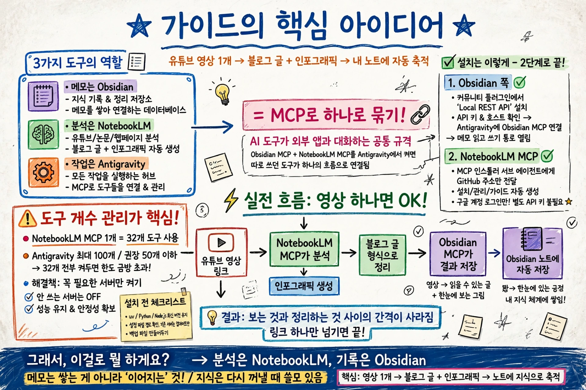
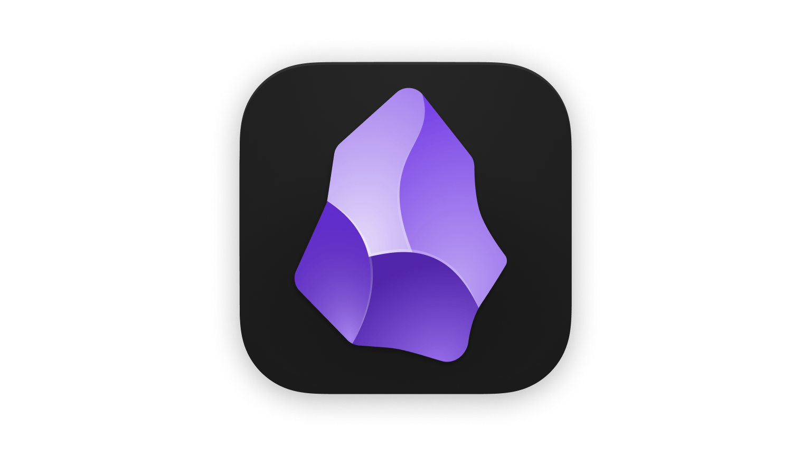
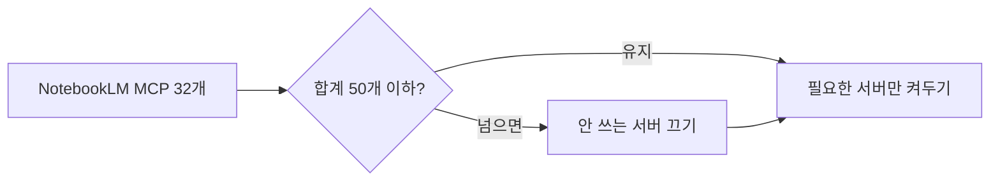
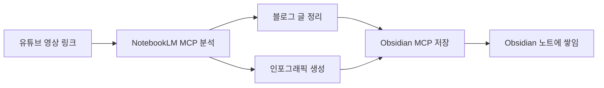

# Obsidian + NotebookLM + Antigravity: 영상 하나를 넣으면 블로그 글과 인포그래픽이 노트에 쌓입니다

> **Summary**
> Antigravity에서 NotebookLM MCP와 Obsidian MCP를 연결하면 유튜브 영상 등을 분석해 블로그 글과 인포그래픽으로 만들고 Obsidian 노트에 자동 저장할 수 있습니다. 설치에는 별도 API 키가 필요 없지만, NotebookLM MCP가 32개 도구를 사용하는 만큼 전체 도구 수를 관리하고 필요한 서버만 켜두는 것이 중요합니다.

---

- 메모는 `Obsidian`에, 분석은 `NotebookLM`에, 작업은 `Antigravity`에서 합니다. 셋을 `MCP`로 묶으면 유튜브 영상 하나가 블로그 글과 인포그래픽이 되어 노트에 쌓입니다.
- 설치는 서브 에이전트에게 GitHub 주소만 넘기면 됩니다. 구글 계정 로그인만으로 돌아가서 별도 API 키는 필요 없습니다.
- 단, 도구 개수 관리가 핵심입니다. `NotebookLM MCP` 하나만 32개 도구를 쓰고, `Antigravity`는 최대 100개, 권장 50개 이하입니다.

## 유튜브 보고, 정리 안 하고 넘긴 적 있으시죠?

유튜브에서 좋은 영상을 보고 "이건 정리해야지" 싶었는데, 며칠 뒤에 내용이 기억나지 않았습니다. 링크만 메모 앱에 쌓이고, 정리는 늘 다음으로 미뤄집니다. 보다 만 영상, 읽다 만 글, 흩어진 메모가 따로 노는 상태 말입니다.

🎥 [동영상 보기](https://www.youtube.com/watch?v=9JzSq_MALdE)

## 셋을 묶는 건 MCP입니다

`MCP`는 AI 도구가 외부 앱과 대화하는 공통 규격입니다. `Antigravity` 안에서 `NotebookLM MCP`와 `Obsidian MCP`를 켜면, 분석 도구와 메모 도구가 같은 작업 공간에서 말을 주고받습니다. 따로따로 쓰던 도구가 하나의 흐름으로 이어지는 겁니다!

## 설치, 뭐부터 해야 할까요?

먼저 `Obsidian` 쪽입니다. 커뮤니티 플러그인에서 `Local REST API`를 설치하고, API 키와 호스트를 확인합니다. `Antigravity`에 `Obsidian MCP`를 연결하면 메모를 읽고 쓰는 통로가 열립니다.

다음은 `NotebookLM MCP`입니다. 설치는 직접 하지 않습니다. `MCP` 인스톨러 서브 에이전트를 불러서 GitHub 주소만 넘기면 됩니다. 설치 스크립트부터 관리 도구, 빠른 시작 안내까지 한 번에 만들어줍니다. 구글 계정으로 로그인만 하면 돌아가서, 별도 API 키는 필요 없습니다.

## 도구 32개, 그냥 두면 안 됩니다!

`Antigravity`에 등록할 수 있는 도구는 최대 100개입니다. 권장 상한은 50개 이하입니다. 그런데 `NotebookLM MCP` 하나만 32개 도구를 씁니다! 32개나 되는 도구를 다 켜두면 어떻게 될까요? 금방 한도를 넘깁니다. 그래서 꼭 필요한 서버만 켜두는 게 답입니다. 안 쓰는 서버는 끄는 게 성능을 지키는 방법입니다.

설치 전에 챙길 것도 있습니다. 최신 버전인지 확인하고, `uv`나 `Python`, `Node.js` 같은 종속성을 최신으로 유지합니다. 설정 파일 경로를 정확히 잡고, 기존 서버는 지우지 말고 업데이트만 합니다. 만약을 대비한 백업 파일도 만들어둡니다.

## 영상 하나면, 블로그 글과 인포그래픽이 됩니다

실전 흐름은 단순합니다. 유튜브 영상 링크를 넘기면 `NotebookLM MCP`가 내용을 분석합니다. 블로그 글 형식으로 정리해주고, 인포그래픽까지 그려줍니다. 그리고 `Obsidian MCP`가 결과물을 노트에 자동으로 저장합니다. 영상 하나가 읽을 수 있는 글과 한눈에 보이는 그림이 되어 내 지식 체계 안에 들어가는 겁니다. 이 장면이 저는 가장 인상 깊었습니다. 보는 것과 정리하는 것 사이의 간격이, 링크 하나를 넘기는 것으로 사라지니까요.

## 그래서, 이걸로 뭘 하게요?

정리하면 흐름은 이렇습니다. 영상, 논문, 웹페이지. 뭘 보든 분석은 `NotebookLM`이, 기록은 `Obsidian`이 맡습니다. 메모는 쌓는 게 아니라 이어지는 겁니다. 지식은 보는 순간이 아니라 다시 꺼낼 때 쓸모가 있습니다. 영상 하나를 노트에 쌓는 흐름, 이게 이 조합이 던지는 답입니다!

