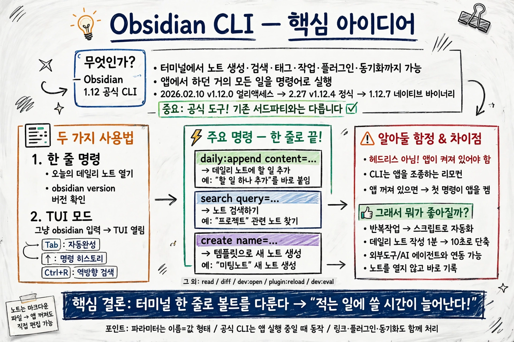
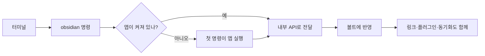
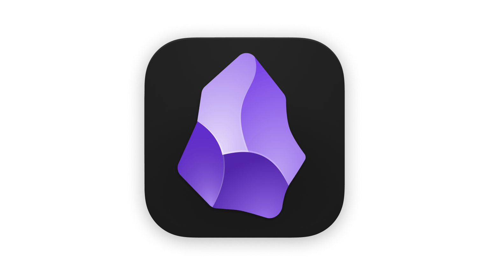
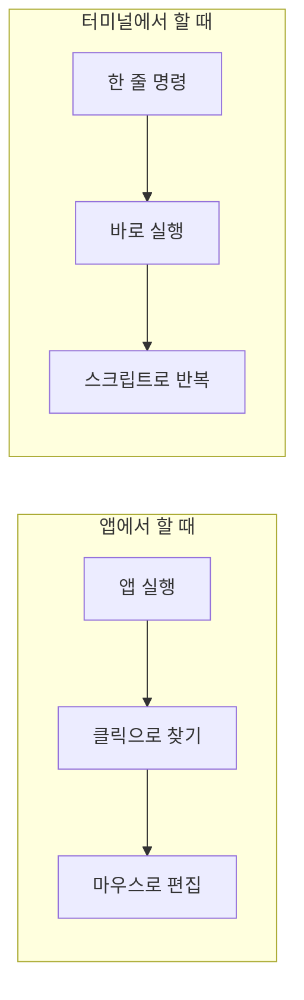
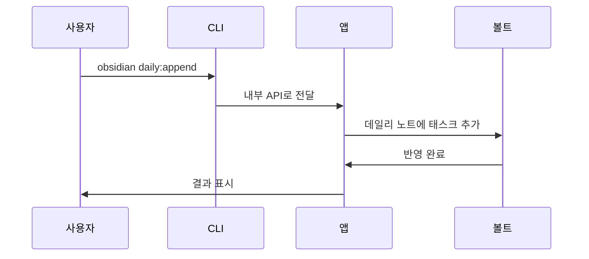

# Obsidian CLI: 터미널에서 노트를 다루면, 클릭할 일이 사라집니다

> **Summary**
> Obsidian CLI는 터미널에서 노트 생성·검색·태그·작업·플러그인 관리 등을 명령으로 수행하고 자동화할 수 있는 공식 도구입니다. TUI에서는 자동 완성과 명령 히스토리를 사용할 수 있으며, 앱의 내부 API를 통해 실행되므로 앱이 켜져 있어야 합니다.

---

- Obsidian 1.12에 공식 CLI가 들어왔습니다. 터미널에서 노트 생성·검색·태그·작업·플러그인까지, 앱에서 하던 거의 모든 일을 명령으로 할 수 있습니다.
- 한 줄 명령으로 실행하거나, 아무것도 안 치고 들어가면 자동 완성과 히스토리가 되는 TUI로 씁니다.
- 단, 앱이 켜져 있어야 돌아갑니다. 헤드리스 도구가 아니라, 실행 중인 앱을 조종하는 리모컨입니다!


## 데일리 노트 하나 적으려고 앱을 켠 적 있으시죠?

데일리 노트에 할 일 하나를 적으려고 앱을 켰습니다. 앱이 뜨길 기다리고, 사이드바에서 오늘 날짜를 찾고, 마우스로 커서를 옮기고. 10초짜리 일에 1분이 걸렸습니다. 이런 적 있으시죠?

터미널에서 한 줄만 치면 되는 일이었습니다!

🎥 [동영상 보기](https://www.youtube.com/watch?v=ntvZlLRjYTI)

## Obsidian CLI, 도대체 뭘까요?

Obsidian CLI는 터미널에서 Obsidian을 조종하는 공식 명령줄 도구입니다. 2026년 2월 10일 버전 1.12.0에 얼리 액세스로 나왔고, 2월 27일 1.12.4부터 정식 릴리스에 들어갔습니다. 1.12.7부터는 더 빠른 네이티브 바이너리로 돌아갑니다.

공식 도구라는 점이 중요합니다. 예전에 쓰던 서드파티 도구와는 다릅니다!

공식 설명은 한 줄입니다. 앱에서 할 수 있는 건 뭐든 명령줄에서도 할 수 있습니다. 노트 생성·검색·태그·작업·플러그인·동기화까지, 거의 모든 기능이 명령으로 됩니다. 스크립팅·자동화·외부 도구 통합이 목적입니다.



## 켜는 방법은 간단합니다

최신 인스톨러(1.12.7 이상)로 업데이트합니다. 설정에서 일반으로 가서 Command line interface를 켜고, 안내에 따라 등록합니다. 터미널을 다시 열면 `obsidian` 명령이 됩니다. 확인은 `obsidian version` 한 줄이면 됩니다.



## 한 줄 명령, 아니면 TUI?

두 가지로 씁니다. 한 줄 명령으로 바로 실행하거나, 아무것도 안 치고 `obsidian`만 입력하면 TUI(터미널 인터페이스)가 열립니다. TUI에서는 Tab으로 자동 완성, ↑로 명령 히스토리, `Ctrl+R`로 역방향 검색이 됩니다.

일상 명령은 이렇습니다.

```bash
obsidian daily
obsidian daily:append content="- [ ] 장보기"
obsidian search query="회의 노트"
obsidian read
obsidian tasks daily
obsidian create name="파리 여행" template=Travel
obsidian diff file=README from=1 to=3
```

`obsidian daily`는 오늘의 데일리 노트를 엽니다. `daily:append`는 데일리에 태스크를 붙입니다. `search`는 노트를 찾고, `read`는 현재 파일을 읽고, `create`는 템플릿으로 새 노트를 만듭니다. `diff`는 파일 버전을 비교합니다.

문법도 단순합니다. 파라미터는 `이름=값` 형태, 플래그는 이름만 씁니다. 볼트를 지정하려면 `vault=<이름>`을 붙입니다. 명령이 100개가 넘고, 파일·속성·검색·태그·링크·데일리 노트·플러그인·개발자 도구 8개 카테고리로 나뉩니다.



## 개발자 명령도 있습니다

개발자용 명령도 들어 있습니다. `obsidian dev:open`은 개발자 도구를 열고, `obsidian plugin:reload id=my-plugin`은 플러그인을 다시 불러오고, `obsidian dev:screenshot path=screenshot.png`은 스크린샷을 찍습니다. `obsidian dev:eval code="app.vault.getFiles().length"`은 앱 콘솔에서 자바스크립트를 실행합니다.

이 장면이 저는 가장 인상 깊었습니다. `dev:eval`은 내부 API(`app` 객체)에 직접 닿습니다. 플러그인을 만들 때 강력한데, 버전이 바뀌면 동작이 바뀔 수 있다는 점은 알아둬야 합니다.

## 알아둘 함정 하나, 앱이 켜져 있어야 합니다

CLI는 헤드리스가 아닙니다. 앱이 꺼져 있으면 첫 명령이 앱을 켭니다. 터미널만으로 돌리는 독립 도구가 아니라, 실행 중인 앱을 조종하는 리모컨입니다. 이 점은 꼭 알아둬야 합니다!

그래도 길이 막힌 건 아닙니다. 노트 자체는 마크다운 파일이라, 앱이 꺼져 있어도 파일을 직접 읽고 쓸 수 있습니다. CLI가 유일한 통로는 아닙니다. 그리고 동기화 없이 앱을 띄우지 않고 싶다면, 헤드리스 동기화라는 별도 방법도 있습니다.

명령이 내부 API를 탄다는 점도 중요합니다. 파일을 직접 건드리는 게 아니라 앱을 통해서 실행됩니다. 그래서 노트를 다른 폴더로 옮기면 링크도 알아서 고쳐집니다. 플러그인과 동기화도 함께 돌아갑니다.



## 그래서, 터미널로 옮기면 뭐가 달라질까요?

반복 작업이 스크립트가 됩니다. 데일리 노트 열기, 태스크 추가, 검색이 한 줄이 됩니다. 외부 도구와도 이어집니다. 스크립트·자동화·AI 에이전트가 볼트를 직접 다룰 수 있습니다.

노트 앱을 여는 일이 줄면, 적는 일에 쓸 시간이 늘어납니다. 터미널 한 줄로 볼트를 다루는 것, 그게 이 CLI가 던지는 제안입니다!

