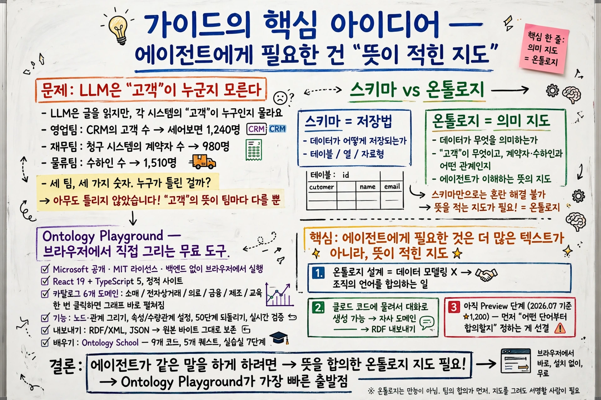
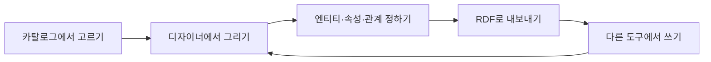
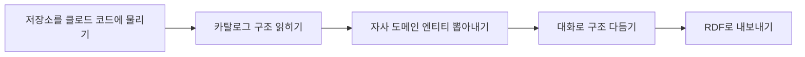

# Ontology Playground: 에이전트에게 필요한 건 스키마가 아니라 의미입니다

> **Summary**
> 온톨로지는 데이터의 저장 방식이 아니라 의미와 관계를 정의해 에이전트가 조직의 언어를 이해하도록 돕습니다. Microsoft의 무료 오픈소스 Ontology Playground에서는 브라우저에서 온톨로지를 만들고, 탐색하고, RDF·XML·JSON으로 내보내거나 가져올 수 있으며, 학습 과정과 실습 기능도 제공합니다. 다만 도구만으로 의미가 정해지는 것은 아니므로, 먼저 조직 내에서 핵심 용어의 뜻을 합의해야 합니다.

---

- LLM은 글을 읽지만, 우리 회사의 "고객"이 CRM의 고객인지 청구 시스템의 계약자인지 물류의 수하인인지 읽어내지 못합니다.
- 온톨로지는 데이터가 어떻게 저장되는지가 아니라, 데이터가 무엇을 의미하는지를 적는 지도입니다.
- 마이크로소프트가 공개한 Ontology Playground는 이 지도를 브라우저에서 직접 그리고, `RDF`로 내보내는 무료 도구입니다.


고객 수를 세어달라고 했는데, 세 팀이 세 가지 숫자를 가져온 적 있으시죠? 영업팀은 CRM의 고객 수를, 재무팀은 청구 시스템의 계약자 수를, 물류팀은 수하인 수를 가져옵니다. 세 숫자가 다르면, 누구 숫자가 틀린 걸까요? 사실 아무도 틀리지 않았습니다. "고객"이라는 말이 팀마다 다른 뜻으로 쓰이고 있었을 뿐입니다.

🎥 [동영상 보기](https://www.youtube.com/watch?v=VI_Wh-w_Wz0)

### 스키마는 저장법을 말하고, 온톨로지는 뜻을 말합니다

데이터베이스 스키마는 데이터가 어떻게 저장되는지를 말합니다. 테이블 이름, 열 이름, 자료형이 여기에 들어갑니다. 온톨로지는 한 걸음 더 나아갑니다. 데이터가 무엇을 의미하는지를 말합니다. "고객"이라는 단어가 어떤 존재를 가리키는지, 계약자와 수하인과 어떻게 다른지, 서로 어떤 관계인지를 적는 겁니다.

에이전트에게 필요한 건 후자입니다. 에이전트는 글을 읽고 답을 찾습니다. 그런데 "고객"이라는 말이 시스템마다 다른 뜻이라면, 에이전트는 어떤 "고객"을 세어야 할지 모릅니다. 스키마만으로는 이 혼란이 풀리지 않습니다. 뜻을 적어두는 지도가 따로 필요합니다. 이 지도가 바로 온톨로지입니다.

```mermaid
flowchart LR
    A[같은 단어 "고객"] --> B[CRM: 구매한 사람]
    A --> C[청구: 계약한 법인]
    A --> D[물류: 받는 사람]
    B --> E[스키마: 저장법만 안다]
    C --> E
    D --> E
    B --> F[온톨로지: 뜻까지 안다]
    C --> F
    D --> F
    F --> G[에이전트가 올바른 "고객"을 찾습니다]
```

### 브라우저에서 바로, 백엔드 없이

Ontology Playground는 온톨로지를 배우고, 살펴보고, 직접 설계하는 무료 웹 앱입니다. MIT 라이선스로 공개됐습니다. 백엔드 없이 브라우저에서 바로 돌아가는 정적 사이트라, 설치할 서버가 없습니다. `React 19`와 `TypeScript 5`로 만들어졌습니다.

먼저 카탈로그부터 둘러보면 됩니다. 소매, 전자상거래, 의료, 금융, 제조, 교육 여섯 개 도메인의 미리 만들어진 온톨로지가 들어 있습니다. 한 번 클릭하면 그래프가 바로 펼쳐집니다. 노드를 클릭하면 속성이 보이고, 검색창으로 엔티티와 관계를 바로 찾을 수 있습니다.

직접 그리는 건 디자이너가 맡습니다. 엔티티 종류를 만들고, 아이콘과 색을 붙이고, 속성을 정합니다. 관계는 수량 관계까지 함께 정합니다. 그래프 미리보기는 고치는 즉시 따라 바뀝니다. 되돌리기는 50단계까지 되고, 실시간 검증이 틀린 부분을 바로 짚어줍니다. 다 만든 온톨로지는 `RDF`/`XML`이나 `JSON`으로 내보낼 수 있습니다.

가져오기와 내보내기가 특히 신경 쓰인 부분입니다. 가져온 `RDF` 파일은 원본 바이트 그대로 보존됩니다. 고치지 않은 채 다시 내보내면, 처음 가져온 파일과 바이트까지 똑같습니다. `OWL` 제한이나 `SHACL` 규칙 같은 고급 내용도 그래프에 그대로 남습니다. 이게 왜 중요할까요? 온톨로지는 한 번 만들고 끝나는 문서가 아닙니다. 다른 도구와 주고받으며 계속 다듬는 문서라, 왕복할 때마다 내용이 조금씩 빠지면 믿고 쓸 수 없으니까요!



### 배우는 곳까지 들어 있습니다

온톨로지가 처음이라면, 학교부터 들르면 됩니다. Ontology School에는 9개 코스가 있습니다. 기초 과정 6편이 온톨로지 개념부터 `RDF`/`OWL`, 설계 패턴까지 짚어줍니다. 도메인 학습 경로 7개는 커피점, 전자상거래, 금융 같은 실제 사례를 네 편씩 나눠 단계별로 쌓아 올립니다. 실습실에서는 소매 공급망 온톨로지를 7단계에 걸쳐 3개에서 15개 엔티티까지 직접 키워봅니다.

재미 요소도 있습니다. 다섯 개 퀘스트가 단계별 안내와 힌트, 진행 표시줄, 달성 뱃지로 개념을 이끌어줍니다. 자연어 질의 체험에서는 "주문한 고객이 누구야?" 같은 질문이 온톨로지의 엔티티와 관계로 어떻게 바뀌는지 미리 볼 수 있습니다. 시작 템플릿 다섯 개는 소매, 의료, 금융, 사물인터넷, 교육 도메인에서 빈 페이지의 부담을 덜어줍니다. 이 장면이 저는 가장 인상 깊었습니다. 온톨로지를 설명하는 글이 아니라, 온톨로지를 직접 만져보게 만든 도구라는 게, 카탈로그를 한 번 클릭하는 순간 증명되니까요!

### 클로드 코드에 물리면 대화로 만듭니다

온톨로지를 몰라도 시작할 수 있는 길이 있습니다. 이 저장소를 클로드 코드에 물려놓으면, 대화만으로 구조를 만들 수 있습니다. 설치와 실행, 카탈로그 구조 읽히기, 자사 도메인 엔티티 뽑아내기, `RDF`로 내보내기까지 순서대로 따라가면 됩니다. 사전 지식 없이 화면만 따라오면 되는 흐름입니다.

온톨로지 설계는 데이터 모델링이 아니라 조직의 언어를 합의하는 일입니다. 어떤 단어를 쓸지, 그 단어가 무엇을 가리킬지, 팀끼리 먼저 정하는 겁니다. 에이전트가 답을 못 찾는 게 아니라, 조직이 아직 질문을 정의하지 못한 겁니다. 이 말이 글의 결론과 이어집니다. 도구가 답을 주는 게 아니라, 합의가 답을 주는 겁니다!



### 아직 미리보기라는 점은 알고 써야 합니다

정직하게 짚을 점도 있습니다. 이 프로젝트는 아직 미리보기 단계입니다. 공개 당시 별은 1,200개 남짓(2026년 7월 기준)이었고, 개발 과정에 AI 보조 코딩이 쓰였다고 README에 적혀 있습니다. 젊은 프로젝트라, 카탈로그가 더 커지고 검증이 더 쌓여야 할 부분이 남았습니다.

그리고 온톨로지 자체의 한계도 있습니다. 온톨로지는 합의를 적는 도구입니다. 팀끼리 "고객"의 뜻을 정하지 못한 조직에서는, 지도를 그려도 지도 위에 서명할 사람이 없습니다. 도구를 먼저 깔기보다, 어떤 단어부터 합의할지 먼저 정하는 게 순서입니다. 온톨로지가 만능은 아닙니다. 하지만 뜻이 정리된 조직에서는, 에이전트가 드디어 같은 말을 하게 됩니다!

에이전트에게 필요한 건 더 많은 텍스트가 아니라, 뜻이 적힌 지도입니다. 그 지도를 브라우저에서 직접 그려보고 싶다면, Ontology Playground가 가장 빠른 출발점입니다.

