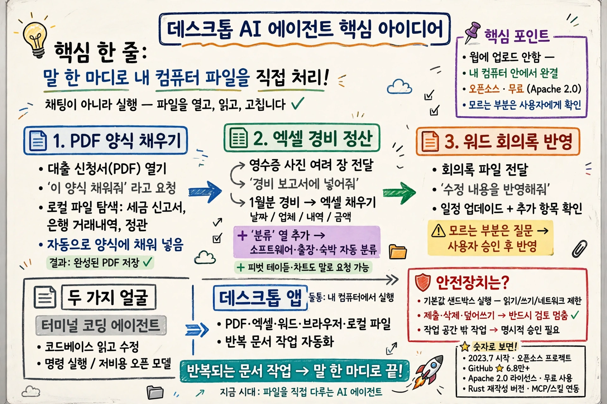
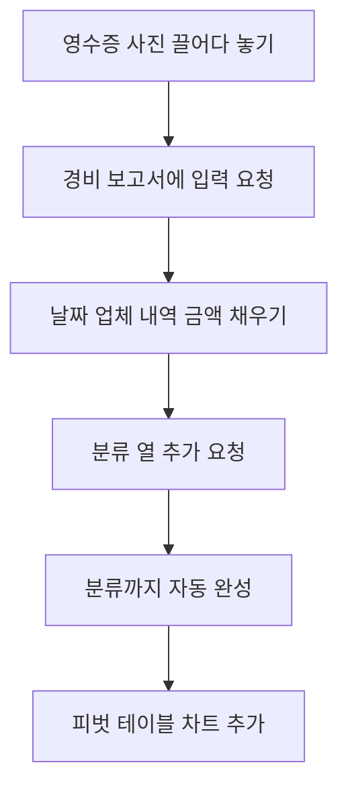
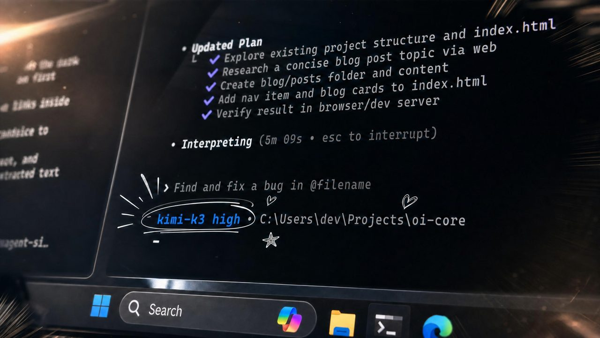
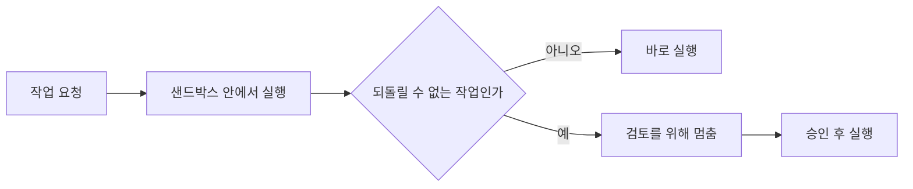

# Open Interpreter: PDF 양식 채우기부터 경비 정산까지, AI가 내 파일로 직접 처리합니다

> **Summary**
> Open Interpreter은 로컬 파일을 직접 읽고 수정해 PDF 양식 작성, 영수증 경비 정산, 회의록 반영 같은 반복 업무를 처리하는 오픈소스 AI 에이전트입니다. 터미널 코딩 에이전트와 데스크톱 앱을 제공하며, 샌드박스와 승인 절차로 중요한 작업을 안전하게 검토할 수 있습니다.

---

# Open Interpreter: PDF 양식 채우기부터 경비 정산까지, AI가 내 파일로 직접 처리합니다

- 데스크톱 AI 에이전트가 PDF 양식 채우기, 엑셀 경비 정산, 워드 회의록 반영까지 내 컴퓨터 파일로 직접 처리합니다.
- 비결은 말 한 마디입니다. "이 양식 채워줘"라고 하면 에이전트가 로컬 파일을 뒤져 정보를 찾고 문서에 그대로 채워 넣습니다.
- 터미널 코딩 에이전트와 데스크톱 앱, 두 가지 얼굴을 가졌습니다. 오픈소스라 누구나 무료로 쓸 수 있습니다.

대출 신청서 양식을 받아든 적 있으시죠? 이름, 주소, 사업자 번호. 매번 같은 정보를 다른 서식에 옮겨 적는 일. 영수증 사진을 엑셀에 하나씩 입력하는 일. 회의가 끝나고 회의록 내용을 기획서에 반영하는 일. 이런 반복 작업, AI에게 말 한 마디로 맡길 수 있다면 어떨까요?

🎥 [동영상 보기](https://www.youtube.com/watch?v=W-VwN0n4d9Y)

## PDF 양식, 누가 채우나요?

데모는 대출 신청서 양식(PDF)을 여는 장면으로 시작합니다. 사용자가 채팅창에 "이 양식을 채워줘"라고 적자, 에이전트는 컴퓨터 안을 뒤지기 시작했습니다. 세금 신고서, 은행 거래 내역, 정관 같은 로컬 파일에서 필요한 정보를 찾아 양식에 채워 넣었습니다. 파일을 웹에 올리지 않았습니다. 내 컴퓨터 안에서 끝났습니다!

이게 이 도구의 핵심입니다. 채팅이 아니라 실행입니다. 질문에 답하는 게 아니라, 파일을 직접 열고, 읽고, 고칩니다.

## 영수증 사진, 엑셀에 직접 넣는다고요?

다음 장면은 경비 정산입니다. 영수증 사진 여러 장을 채팅창에 끌어다 놓고 "경비 보고서에 넣어줘"라고 하자, 에이전트가 1월분 경비 보고서를 엑셀에 채웠습니다. 날짜, 업체, 내역, 금액까지요. 사용자가 "분류" 열을 추가하고 "새 열도 채워줘"라고 하자, 소프트웨어·구독, 출장, 숙박 같은 분류까지 알아서 채웠습니다.

이 장면이 저는 가장 인상 깊었습니다. 영수증을 일일이 입력하던 시간이 통째로 사라지는 게 보이니까요!

피벗 테이블 만들어줘, 차트 추가해줘. 말만 하면 됩니다. 사진 파일 이름 바꾸는 정리 작업도, 문서를 읽어 브랜드 PDF를 만드는 일도 같은 방식입니다.

## 회의록을 워드에 반영하는 건 어떻게 하나요?

워드 문서에서는 회의록 파일을 함께 건네며 "이 통화의 수정 내용을 반영해줘"라고 했습니다. 에이전트는 일정을 업데이트하고, 새로 추가할 항목이 있는지 되물었습니다. 알아서 판단하는 게 아니라, 모르는 부분은 묻습니다. 이 지점이 중요합니다!

## 터미널 에이전트와 데스크톱 앱, 뭐가 다르나요?

이 프로젝트는 두 가지 얼굴을 가졌습니다. 하나는 터미널에서 돌아가는 코딩 에이전트입니다. 저비용·오픈 모델에 맞춰 조정된 에이전트로, 코드베이스를 읽고 코드를 고치고 명령을 실행합니다. 다른 하나는 데스크톱 앱입니다. 워드, 엑셀, PDF, 브라우저, 로컬 파일을 오가며 일하는 에이전트입니다. 데모 속 장면들이 바로 이 데스크톱 앱의 일입니다.

공통점이 있습니다. 두 가지 모두 내 컴퓨터에서 직접 파일을 다루고, 샌드박스 안에서 실행되며, 보내기·삭제·덮어쓰기 같은 되돌릴 수 없는 작업 앞에서는 검토를 위해 멈춥니다.

## 안전장치는 있나요?

에이전트에게 컴퓨터를 맡긴다는 게 걱정되시죠? 당연한 걱정입니다. 기본값이 샌드박스 실행입니다. 읽기·쓰기·네트워크가 제한되고, 작업 공간 밖의 일은 명시적 승인이 필요합니다. 제출·전송·삭제·덮어쓰기 전에는 반드시 검토를 위해 멈춥니다. 좁은 작업 공간, 명확한 결과물, 명시적인 검토 지점. 공식 문서가 권하는 사용법도 바로 이겁니다!

## 숫자로 보면?

2023년 7월에 시작된 오픈소스 프로젝트로, 저장소 별이 6만 8천 개를 넘었습니다. 아파치 2.0 라이선스라 무료로 쓸 수 있습니다. 최근에는 러스트로 다시 쓰인 버전이 나왔고, 모델별 맞춤 하네스와 샌드박스, 스킬·MCP 연동까지 갖췄습니다.

PDF 양식 채우기, 영수증 정산, 회의록 반영. 반복되는 문서 작업이 말 한 마디로 끝나는 시대, 이미 와 있습니다!

