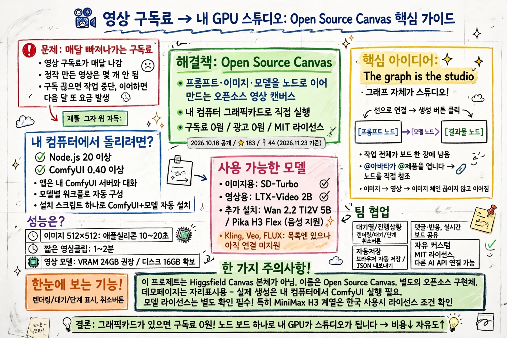
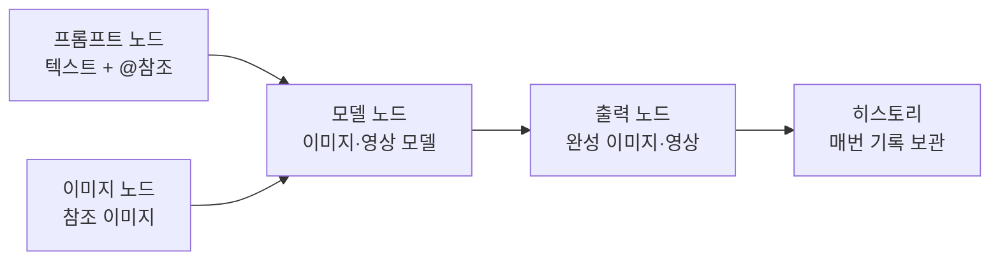

# Open Source Canvas: 구독료 없이 내 GPU로 영상을 만듭니다. 노드 보드 하나면 됩니다

> **Summary**
> Open Source Canvas는 프롬프트, 이미지, 모델을 노드로 연결해 내 컴퓨터의 GPU와 ComfyUI로 영상과 이미지를 생성하는 오픈소스 도구입니다. MIT 라이선스이며 구독료 없이 작업과 결과물을 보드에 저장할 수 있지만, 초기 단계라 일부 상용 모델 연동은 아직 지원되지 않고 영상 생성에는 충분한 메모리가 필요합니다.

---

- 영상 구독료가 매달 나가는데, 만드는 영상은 몇 개 안 됩니다. 그래프 하나면 그 돈을 아낄 수 있습니다.
- Open Source Canvas는 프롬프트·이미지·모델을 노드로 이어 만드는 오픈소스 영상 캔버스입니다. 내 컴퓨터의 그래픽카드로 직접 돌립니다.
- 구독료도 광고도 없습니다. MIT 라이선스라 고쳐 써도 되고, 다른 AI 영상 서비스 API도 끼워 쓸 수 있게 만들어뒀습니다.

매달 영상 생성 구독료가 빠져나가는데, 정작 만든 영상은 몇 개 안 되시죠? 구독을 끊으면 작업도 같이 멈추고, 이어 하자니 다음 달 요금이 또 나갑니다. 그런데 그래픽카드가 괜찮은 PC가 있다면, 그 구독료를 아낄 방법이 있습니다. 노드 보드 하나에 프롬프트와 이미지를 올리고, 내 그래픽카드로 직접 영상을 만드는 겁니다!

🎥 [동영상 보기](https://www.youtube.com/watch?v=0z8Pp4TaAl8)

## 그래프가 스튜디오라니, 무슨 뜻일까요?

이 도구의 표어는 "The graph is the studio", 그래프 자체가 스튜디오라는 뜻입니다. 프롬프트, 이미지, 모델, 결과물, 메모를 노드로 놓고 선으로 잇는 무한 보드 위에서 작업합니다. 프롬프트 노드를 모델 노드에 연결하고 생성 버튼을 누르면, 결과물이 출력 노드에 나옵니다. 폴더에 흩어진 생성물을 뒤지는 대신, 작업 전체가 보드 한 장에 남습니다!

참조 방식도 재밌습니다. 프롬프트에 "`@아바타`가 `@제품`을 엽니다"처럼 쓰면, 그 단어가 보드 위의 참조 노드를 직접 가리킵니다. 이름이 아니라 노드를 가리키니, 인물이 바뀌어도 참조가 틀어지지 않습니다. 그리고 한 노드에서 나온 이미지는 다음 노드의 참조나 첫 프레임으로 그대로 이어집니다. 이미지에서 영상으로, 영상에서 다시 이미지로, 체인이 끊기지 않고 이어집니다!

## 내 컴퓨터에서 돌리려면 무엇이 필요할까요?

준비물은 두 가지입니다. `Node.js` 20 이상, 그리고 `ComfyUI` 0.40 이상입니다. 브라우저에서 생성되는 것은 아무것도 없습니다. 앱은 내가 직접 띄운 `ComfyUI` 서버와 대화하고, 모델마다 워크플로를 대신 짜줍니다. 설치 스크립트 하나면 `ComfyUI`를 옆 폴더에 받아오고, 모델까지 내려받습니다.

속도는 어느 정도일까요? 512×512 이미지 한 장은 애플 실리콘 칩에서 10~20초면 나옵니다. 짧은 영상 클립은 1~2분 정도 걸립니다. 이미지용 기본 모델은 웬만한 컴퓨터에서 다 돌아가지만, 영상용 기본 모델은 그래픽카드나 통합 메모리 24GB 정도를 원합니다. 디스크는 16GB쯤 비워두면 됩니다.

대기열도 보입니다. 어떤 작업이 렌더링 중이고 무엇이 기다리는지, 지금 몇 단계인지 패널과 노드에 바로 표시되고, 작업마다 취소 버튼이 달려 있습니다. 팀 작업도 됩니다. 노드에 댓글과 반응을 달 수 있고, 방을 열면 보드를 함께 봅니다. 보드는 브라우저에 자동 저장되고, JSON으로 내보낼 수도 있습니다.

## 어떤 모델을 쓸 수 있을까요?

바로 쓸 수 있는 모델은 이미지용 `SD-Turbo`와 영상용 `LTX-Video 2B`입니다. 파일을 받아 설치하면 `Wan 2.2 TI2V 5B`와 `Pika H3 Flex`도 쓸 수 있습니다. `Pika H3 Flex`는 소리까지 내는 피카랩스의 공개 영상 모델인데, 캔버스용 워크플로는 아직 없어 `ComfyUI` 기본 템플릿으로 돌려야 합니다. `Kling`, `Veo`, `FLUX` 같은 상용 모델도 목록에는 보이지만, 캔버스에서 바로 돌리는 연결은 아직 안 됐습니다.

라이선스는 따로 챙겨야 합니다. 앱 자체는 MIT라 자유롭게 고쳐 쓸 수 있지만, 모델마다 조건이 다릅니다. 특히 `MiniMax H3` 계열 라이선스는 미국·유럽·영국·한국을 제외합니다. 한국에서 쓴다면, 이 조건을 꼭 확인하고 넘어가야 합니다!

## 한 가지, 정확히 짚고 넘어가야 합니다

Threads 게시물은 "AI 영상 툴 Higgsfield Canvas가 오픈소스로 풀렸다"고 소개했습니다. 그런데 저장소를 직접 읽어보니, 이 프로젝트는 Higgsfield 본체가 아닙니다. Higgsfield Canvas와 같은 노드 캔버스 방식을 오픈소스로 다시 만든 별개의 프로젝트입니다. 이름도 `Open Source Canvas`이고, 2026년 10월 18일에 공개된 따끈한 저장소입니다. 별 183개, 포크 44개(2026년 11월 23일 기준), 이제 막 시작한 단계입니다.

그래서 기대치를 잘 잡는 것이 좋습니다. 공개 데모 페이지는 구경용이라, 거기서 생성을 누르면 자리 표시용 그림만 나옵니다. 진짜 생성은 내 컴퓨터에서 `ComfyUI`를 띄워야 합니다. 상용 모델 연동도 아직 연결 중이고, 영상 모델은 메모리 요구량이 큽니다. 대신, 돌아가기만 하면 구독료는 0원입니다. 보드도, 결과물도, 전부 내 컴퓨터 안에 남습니다!

영상 구독료가 아깝다고 느끼셨다면, 그래픽카드부터 확인해 보시면 어떨까요? 노드 보드 하나면, 내 GPU가 스튜디오가 됩니다!

