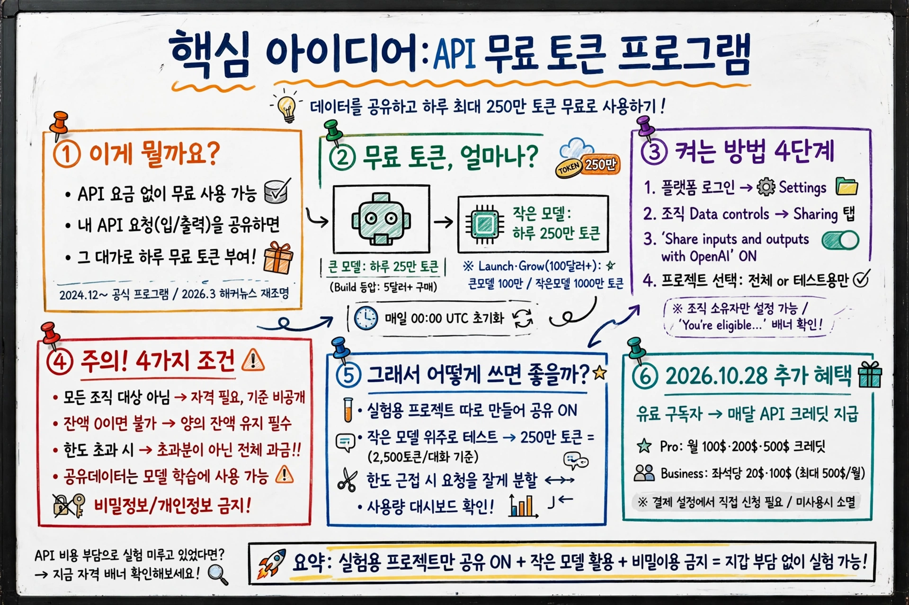
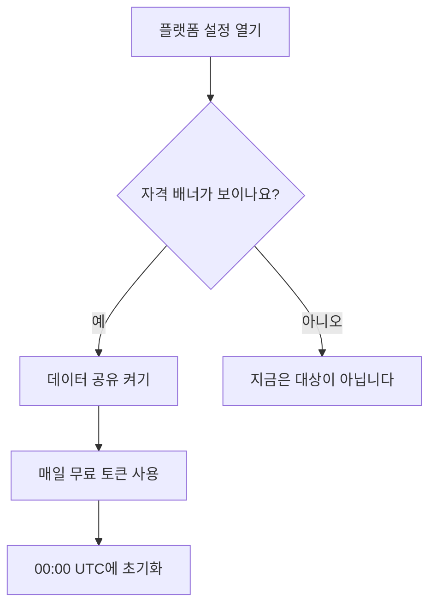
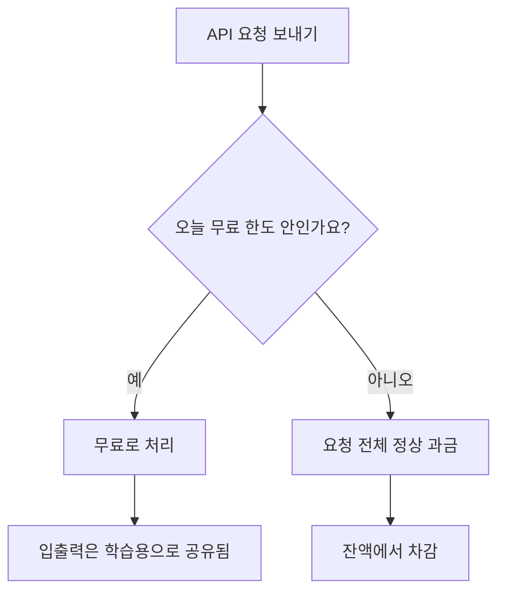

# OpenAI API, 하루 250만 토큰까지 무료입니다. 단, 대가는 데이터입니다

> **Summary**
> OpenAI는 데이터 공유에 동의한 일부 조직에 모델과 사용 등급에 따라 하루 최대 250만~1,000만 토큰을 무료로 제공하며, 사용량은 매일 UTC 자정에 초기화됩니다. 대상 여부와 양의 잔액 등 조건을 확인하고, 공유한 입력·출력은 모델 학습에 쓰일 수 있으므로 민감한 정보가 없는 테스트 프로젝트에서만 이용하는 것이 안전합니다.

---

- API 요금을 내지 않고도, 데이터를 공유하는 대가로 하루 최대 250만 토큰까지 무료로 쓸 수 있는 공식 프로그램이 있습니다.
- 큰 모델은 하루 25만 토큰, 작은 모델은 250만 토큰까지 무료이고, 자정(UTC)에 초기화됩니다.
- 다만 모든 조직이 대상은 아니고, 잔액이 남아 있어야 하며, 공유한 입출력은 모델 학습에 쓰일 수 있습니다.

API 요금 고지서가 무서워서, 아이디어를 떠올리고도 실험 버튼을 못 눌러본 적 있으시죠? 프롬프트를 조금만 고쳐도 토큰이 나가는데, 그 결과가 쓸모없으면 돈만 날아갑니다. 그래서 많은 개발자가 "나중에 돈 생기면 해보지" 하고 미뤄두곤 합니다. 2026년 3월, 바로 이 지점을 찌르는 소식이 해커뉴스에 올랐습니다. ChatGPT 계정만 있으면 API를 무료로 쓸 수 있게 됐다는 이야기였습니다!

🎥 [동영상 보기](https://www.youtube.com/watch?v=s3NI1GQG8tg)

## 무슨 소식일까요?

소식의 주인공은 API 입력과 출력을 공유하는 대가로 매일 무료 토큰을 주는 공식 프로그램입니다. 2024년 12월부터 있었던 제도인데, 2026년 3월에 해커뉴스에 오르면서 다시 주목받았습니다. 핵심은 간단합니다. 내 API 요청 내용을 모델 개선에 쓰도록 허락하면, 그 대가로 매일 정해진 양만큼 토큰을 무료로 주는 겁니다. API 키를 따로 사는 구조가 아니라, 데이터 공유 설정 하나로 켜고 끄는 방식입니다.

이 장면이 저는 가장 인상 깊었습니다. "무료"라는 말이 붙으면 보통 어딘가 함정이 있는데, 이번에는 함정이 아니라 거래 조건이 투명하게 적혀 있으니까요!

## 무료 토큰, 얼마나 받을까요?

무료량은 조직의 사용 등급과 모델 크기에 따라 달라집니다. 등급은 지금까지 구매한 크레딧 총액으로 정해집니다.

| 등급 | 큰 모델 (하루) | 작은 모델 (하루) |
| --- | --- | --- |
| Build (5달러 이상 구매) | 25만 토큰 | 250만 토큰 |
| Launch·Grow (100달러 이상 구매) | 100만 토큰 | 1,000만 토큰 |

큰 모델에는 `gpt-6-astra`, `gpt-6.1-sol` 같은 대형 모델이, 작은 모델에는 `gpt-5.6-luna`, `gpt-5.4-mini` 같은 경량 모델이 들어갑니다. 하루 2,500토큰짜리 대화 한 번을 기준으로 치면, 작은 모델 250만 토큰은 대략 1,000번 대화 분량입니다. 실험용으로는 넉넉한 양이죠. 카운터는 매일 00:00 UTC에 초기화됩니다.

## 켜는 방법은요?

절차는 네 단계입니다. 먼저 플랫폼에 로그인한 뒤 `Settings`에서 조직의 `Data controls`로 갑니다. `Sharing` 탭을 열면 "Share inputs and outputs with OpenAI" 항목이 보입니다. 여기에 "You're eligible for free daily usage"라는 문구가 있으면 대상입니다. 문구가 없으면 지금은 대상이 아니라는 뜻입니다. 조직 소유자만 이 설정을 켤 수 있습니다. 전체 프로젝트에 켤 수도 있고, 테스트용 프로젝트만 골라서 켤 수도 있습니다.

## 진짜 공짜일까요?

여기서부터가 중요합니다. "무료"라는 말만 듣고 달려가면 안 됩니다. 조건이 네 가지 있습니다.

첫째, 모든 조직이 대상이 아닙니다. 자격 여부는 계정마다 다르고, 기준은 공개돼 있지 않습니다. 배너가 안 보이면 공유를 켜도 혜택이 없습니다.

둘째, 잔액이 남아 있어야 합니다. 무료 토큰만 쓰는데도 API 계정에 양의 잔액이 필요합니다. 잔액이 0원이면 무료 토큰도 동작하지 않습니다.

셋째, 한도를 넘는 요청은 통째로 과금됩니다. 하루 한도가 100만 토큰인데 이미 98만 토큰을 썼다면, 5만 토큰짜리 요청은 초과분 3만 토큰만 과금되는 게 아니라 요청 전체가 정상 요금으로 청구됩니다. 한도 근처에서는 요청 크기를 잘게 쪼개는 편이 낫습니다.

넷째, 공유한 데이터는 모델 학습에 쓰일 수 있습니다. 이게 진짜 대가입니다. 고객 정보, 내부 문서, 비밀키가 든 코드 같은 건 공유 프로젝트에 절대 보내면 안 됩니다. 테스트용 프로젝트만 따로 만들어 공유를 켜는 게 안전합니다.

미세 조정된 모델, 평가 실행, 도구 사용은 무료 계산에서 빠집니다. 그리고 이 프로그램은 언제든 끝날 수 있습니다. 다만 끝낼 때는 30일 전에 미리 알린다고 합니다.

## 그 뒤 소식 하나 더, 구독자 크레딧은요?

2026년 10월 28일, 또 하나의 무료 소식이 나왔습니다. 유료 구독자에게 매달 API 크레딧을 주는 혜택입니다. Pro는 요금제 가격만큼, 월 100달러·200달러·500달러 크레딧을 받습니다. Business는 Standard 좌석당 20달러, Premium 좌석당 100달러를 받되, 워크스페이스 합계 월 500달러가 상한입니다. 단, 자동으로 들어오지 않습니다. 설정의 결제 항목에서 직접 신청해야 합니다. 쓰지 않은 크레딧은 결제 주기가 끝나면 사라집니다. 무료·Plus 요금제는 대상이 아니고, API 키로 쓰는 Codex 사용량에는 쓸 수 없습니다.

## 그래서, 어떻게 쓰면 좋을까요?

정리하면 이렇습니다. 실험용 프로젝트를 하나 따로 만들고, 그 프로젝트에만 데이터 공유를 켭니다. 작은 모델 위주로 돌리면 하루 250만 토큰이 생각보다 오래갑니다. 한도 근처에서는 요청을 잘게 나누고, 사용량 대시보드에서 무료 토큰이 실제로 빠지는지 확인합니다. 비밀 정보는 공유 프로젝트에 넣지 않습니다. 이 네 가지만 지키면, 지갑 걱정 없이 실험하는 습관이 생깁니다!

API 비용 때문에 미뤄뒀던 실험이 있다면, 먼저 자격 배너부터 확인하면 어떨까요?

