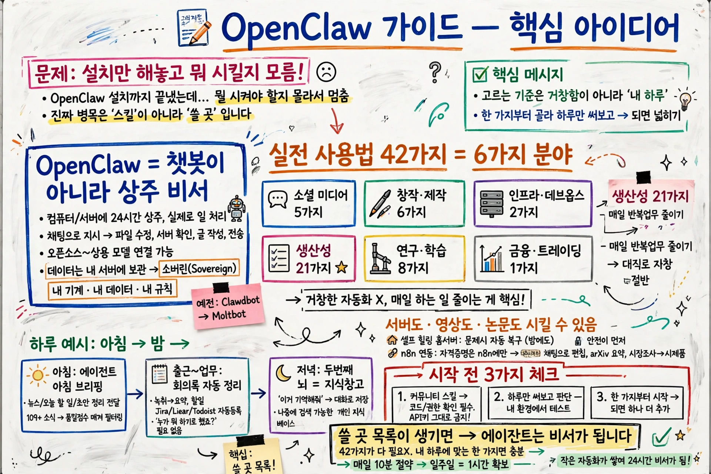
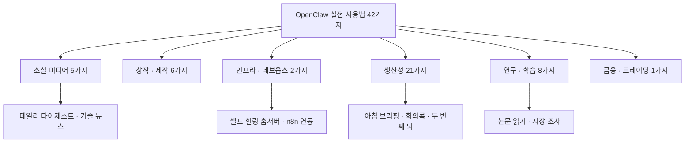
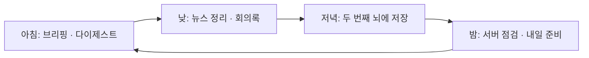
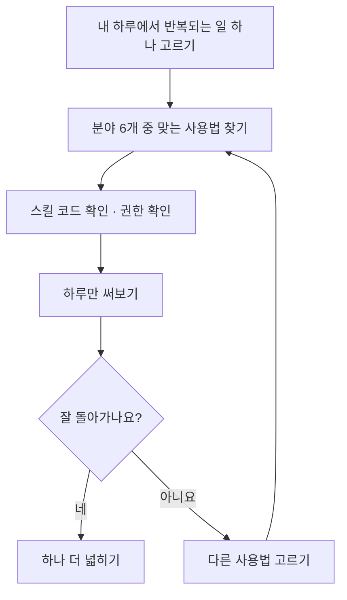

# OpenClaw: 스킬보다 쓸 곳이 먼저입니다

> **Summary**
> OpenClaw의 핵심 병목은 스킬이 아니라 일상에서 활용할 곳을 찾는 것입니다. 소셜 미디어, 생산성, 연구 등 6개 분야의 42가지 활용 사례 중 반복되는 일 하나를 골라 하루 동안 시험해 보고, 스킬 코드와 권한을 확인한 뒤 효과가 있으면 점차 확장하세요.

---

- OpenClaw는 설치까지 해놓고 뭘 시켜야 할지 몰라서 멈추는 경우가 많습니다. 진짜 병목은 스킬이 아니라 쓸 곳입니다.
- 전 세계 사용자가 검증한 실전 사용법 42가지가 한 곳에 모여 있습니다. 소셜 미디어부터 홈서버 자가 복구, 논문 읽기까지 분야도 6가지입니다.
- 고르는 기준은 거창함이 아니라 내 하루입니다. 한 가지부터 골라 하루만 써보고, 되면 넓히면 됩니다.

## AI 에이전트를 깔았는데, 뭘 시켜야 할지 모르겠으시죠?

서버에 AI 에이전트를 설치했습니다. 텔레그램이랑 연결도 끝냈습니다. 그런데 막상 채팅창을 열고 보니, 뭐라고 말해야 할지 모르겠습니다. "안녕하세요" 말고는 떠오르는 게 없습니다. 이런 적 있으시죠?

이게 흔한 풍경입니다. 설치는 10분이면 끝나는데, 쓸 곳을 찾는 데는 몇 주가 걸립니다. 도구 자체가 문제가 아닙니다. 쓸 곳 목록이 없는 게 문제입니다!

🎥 [동영상 보기](https://www.youtube.com/watch?v=YbqVHLqpBbc)

## OpenClaw, 챗봇이 아니라 상주 비서입니다

OpenClaw는 오픈소스 AI 에이전트입니다. 컴퓨터나 서버에 상주하면서 24시간 돌아갑니다. 예전 이름은 `Clawdbot`, 그 전에는 `Moltbot`이었습니다. 채팅으로 질문에 답만 하는 챗봇이 아닙니다. 텔레그램이나 왓츠앱으로 지시를 받으면 파일을 고치고, 서버를 확인하고, 글을 써서 보내는 식으로 실제 일을 처리합니다.

오픈소스 모델부터 상용 모델까지 붙여 쓸 수 있습니다. 내 서버에서 돌아가니 데이터가 남의 서버로 나가지 않는다는 점도 큽니다. 이게 "소버린"이라는 말이 나오는 이유입니다. 내 기계, 내 데이터, 내 규칙으로 돌아갑니다.

## 병목은 스킬이 아니라 쓸 곳입니다

실전 사용법 42가지를 모은 저장소의 첫 문장이 이 글의 핵심입니다. OpenClaw를 쓰는 데 막히는 이유는 스킬이 부족해서가 아닙니다. 내 삶을 어떻게 바꿀지, 쓸 곳을 못 찾아서입니다!

42가지는 분야 6개로 나뉩니다. 소셜 미디어 5가지, 창작·제작 6가지, 인프라·데브옵스 2가지, 생산성 21가지, 연구·학습 8가지, 금융·트레이딩 1가지입니다. 생산성이 절반을 차지하는 게 눈에 띕니다. 거창한 자동화가 아니라, 매일 반복되는 일을 줄이는 데서 시작한다는 뜻입니다.

## 아침부터 밤까지, 하루가 어떻게 달라질까요?

아침부터 그려보겠습니다. 눈을 뜨면 에이전트가 아침 브리핑을 보내줍니다. 뉴스, 오늘 할 일, 초안까지 한 번에 정리해서 말입니다. 출근길에는 좋아하는 채널의 새 영상을 요약한 데일리 다이제스트가 도착합니다. 놓친 영상을 일일이 확인할 필요가 없습니다.

기술 뉴스는 109개가 넘는 소스에서 모아서 품질 점수까지 매겨 전달합니다. RSS, 소셜 미디어, 저장소, 웹 검색을 한 번에 훑는 셈입니다. 관심 없는 글은 점수가 낮아서 걸러집니다.

일하는 중에는 회의록이 자동으로 정리됩니다. 녹취를 구조화된 요약으로 바꾸고, 할 일을 `Jira`나 `Linear`, `Todoist`에 담당자까지 지정해서 만들어줍니다. 회의 끝나고 "누가 뭐 하기로 했죠?"라고 묻지 않아도 됩니다!

저녁에는 두 번째 뇌가 기다립니다. 채팅으로 "이거 기억해줘"라고 보내두면, 나중에 검색할 수 있는 나만의 지식 창고가 됩니다. 따로 정리할 필요가 없습니다. 그냥 말하면 됩니다.

## 서버도, 영상도, 논문도 시킬 수 있습니다

집에 서버가 있다면 셀프 힐링 홈서버가 눈에 띕니다. `SSH` 접속 권한과 예약 작업을 가진 에이전트가 집 네트워크를 돌면서 문제를 스스로 고칩니다. 밤에 서버가 멈춰도 사람이 일어날 필요가 없습니다.

`n8n` 연동 방식도 배울 점이 있습니다. 에이전트가 자격 증명을 직접 만지지 않습니다. `n8n` 워크플로에 웹훅으로 일을 넘기면, 자격 증명은 `n8n` 쪽에만 있고 모든 연동은 눈으로 보고 잠글 수 있습니다. 이 부분이 저는 가장 인상 깊었습니다. 편한 자동화보다 안전한 자동화가 먼저라는 뜻이니까요.

창작 쪽도 만만치 않습니다. 목표만 던져두면 밤새 미니앱을 만들어주는 사례가 있습니다. 영상은 채팅으로 편집합니다. 자르기, 합치기, 음악, 자막, 색보정까지 타임라인 없이 말로 시킵니다. 팟캐스트는 게스트 조사부터 대본, 쇼노트, 홍보 문구까지 파이프라인으로 돌아갑니다.

연구 쪽에서는 논문 읽기가 있습니다. `arXiv` 논문을 번호로 가져와서 구간별로 읽고, 초록을 비교하고, 요약을 받습니다. 시장 조사는 소셜 미디어에서 사람들의 실제 불편을 캐낸 뒤, 그걸 푸는 시제품까지 만들게 합니다. 만들기 전에 저장소, 커뮤니티, 패키지 저장소를 훑어서 이미 비슷한 게 많은지 확인하는 사례도 있습니다.

## 고르기 전에 확인할 것, 딱 세 가지입니다

첫째, 커뮤니티 스킬은 검증이 안 됐을 수 있습니다. 이 저장소에도 경고가 적혀 있습니다. 남이 만든 스킬이나 플러그인을 쓸 때는 코드를 먼저 보고, 권한을 확인하고, API 키 같은 비밀값을 그대로 박아 넣지 말아야 합니다. 편하다고 아무거나 붙이면 안 됩니다!

둘째, 하루만 써보고 판단합니다. 이 저장소의 기여 규칙이기도 합니다. 최소 하루는 직접 써보고 되는 것만 올립니다. 남이 된다고 한 걸 그대로 믿지 말고, 내 환경에서 하루만 돌려보면 됩니다.

셋째, 한 가지부터 시작합니다. 42가지를 한 번에 보지 않아도 됩니다. 내 하루에서 가장 자주 반복되는 일 하나를 고릅니다. 아침 브리핑이든, 뉴스 다이제스트든, 회의록이든 하나면 됩니다. 되면 하나를 더합니다. 이 순서가 핵심입니다.

## 쓸 곳 목록이 있으면, 에이전트는 비서가 됩니다

설치는 시작이 아니라 준비였습니다. 쓸 곳 목록이 생기면 에이전트는 그때부터 비서가 됩니다. 42가지가 다 필요한 건 아닙니다. 내 하루에 맞는 한 가지면 충분합니다. 그 한 가지가 매일 10분을 아껴준다면, 일주일이면 한 시간이 생깁니다. 작은 자동화가 쌓이는 게, 결국 24시간 비서의 정체입니다!

