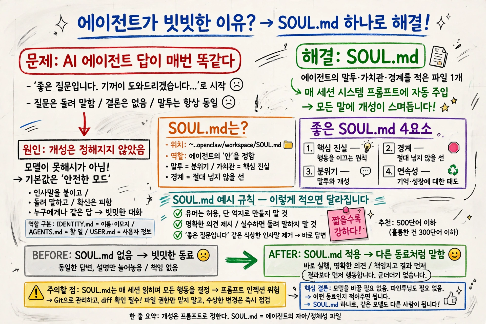
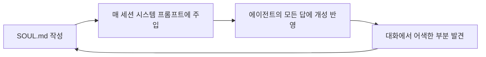
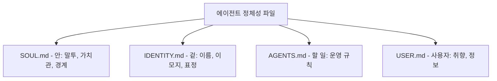
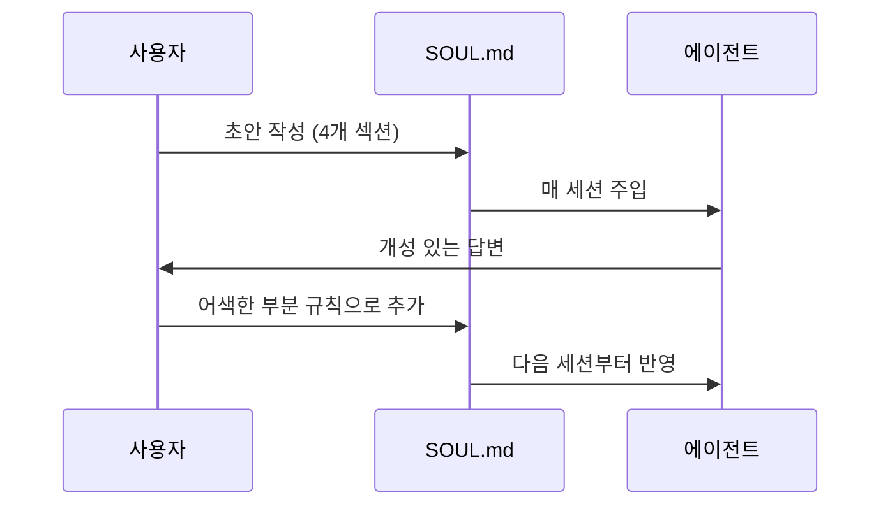

# OpenClaw: 에이전트 말투는 모델이 아니라 SOUL.md 하나로 정합니다

> **Summary**
> OpenClaw는 SOUL.md를 매 세션 시스템 프롬프트에 주입해 에이전트의 말투·가치관·경계를 정하며, 모델을 바꾸지 않고도 개성을 조정할 수 있습니다. 파일을 짧고 구체적으로 작성하고 Git으로 변경 사항을 관리해 프롬프트 인젝션이나 악의적인 수정에 대비해야 합니다.

---

- AI 에이전트가 밋밋하게 들리는 건 모델 탓이 아니라, 개성을 정해주는 파일이 없어서입니다.
- OpenClaw는 `SOUL.md`라는 파일 하나에 에이전트의 말투·가치관·경계를 적어두고, 매 세션 시스템 프롬프트에 넣어줍니다.
- "좋은 질문입니다" 같은 인사말을 빼고, 유머는 허용하되 억지로 만들지 말고, 실수하면 돌려 말하지 말라는 규칙을 적으면, 같은 모델도 다른 동료처럼 말합니다.

## 메신저로 물었는데, 답이 매번 똑같지 않으세요?

AI 에이전트를 메신저에 연결해두고 물어봤습니다. 돌아온 답은 "좋은 질문입니다. 기꺼이 도와드리겠습니다."로 시작했습니다. 질문은 돌려 말하고, 결론은 끝까지 내지 않고, 말투는 매번 똑같습니다. 모델이 똑똑한 건 알겠는데, 대화가 재미가 없습니다. 이런 적 있으시죠?

🎥 [동영상 보기](https://www.youtube.com/watch?v=KeydT1e0A78)

## 왜 에이전트 말투가 다 똑같을까요?

에이전트가 무난하게 말하는 건 모델이 못해서가 아닙니다. 개성이 정해지지 않았기 때문입니다. 기본값은 안전합니다. 인사말을 붙이고, 돌려 말하고, 확신은 피합니다. 누구에게나 같은 답이 나오는 이유입니다!

모델을 바꿀 필요가 없습니다. 파인튜닝도 필요 없습니다. 개성은 프롬프트로 정합니다. OpenClaw는 그 프롬프트를 파일 하나로 빼뒀습니다. 이름이 `SOUL.md`입니다. 이 프롬프트를 공유한 글이 100만 회 이상 조회되며 화제가 됐습니다. 왜 이렇게까지 화제가 됐을까요?

## `SOUL.md`는 어떻게 돌아가나요?

`SOUL.md`는 평범한 마크다운 파일입니다. 기본 에이전트의 작업 공간인 `~/.openclaw/workspace/SOUL.md`에 둡니다. OpenClaw는 이 파일을 매 세션 시스템 프롬프트에 넣어줍니다. 그래서 에이전트가 하는 모든 말에 개성이 스며듭니다. 파인튜닝이 아니라 프롬프트만으로 말투가 바뀌는 구조입니다!

이 파일은 에이전트의 "안"을 정합니다. 말투, 가치관, 경계, 그러니까 모델이 어떤 존재인지를 적습니다. 겉모습을 정하는 `IDENTITY.md`, 할 일을 정하는 `AGENTS.md`, 사용자 정보를 적는 `USER.md`와 역할이 다릅니다. 말투는 `SOUL.md`가, 이름과 이모지는 `IDENTITY.md`가 맡습니다. 역할이 겹치지 않게 나눠두는 게 핵심입니다.

단, 서브에이전트에게는 `SOUL.md`가 가지 않습니다. 서브에이전트는 `AGENTS.md`만 받습니다. 개성은 주 에이전트에게만 주고, 일꾼에게는 할 일만 주는 구조입니다.

## 뭐라고 적으면 될까요?

공식 템플릿은 네 가지로 나뉩니다. 핵심 진실, 경계, 분위기, 연속성입니다. 핵심 진실은 모든 행동을 이끄는 원칙 몇 가지, 경계는 절대 넘지 않을 선, 분위기는 말투와 개성, 연속성은 기억과 성장에 대한 태도입니다. 이 네 가지만 적어도 에이전트는 달라집니다!

화제가 된 프롬프트는 규칙을 더 구체적으로 적었습니다. "유머는 허용, 단 억지로 만들지 말 것", "명확한 의견을 제시할 것", "실수하면 돌려 말하지 말 것". 그리고 "좋은 질문입니다" 같은 식상한 인사말은 빼고, 질문에는 바로 대답하게 만들었습니다. 규칙을 지우거나 새로 추가하면서 말투를 다듬는 방식입니다. 이 방식은 OpenClaw뿐 아니라 Claude Code 같은 다른 에이전트에도 그대로 쓸 수 있습니다.

예시를 하나 보면 감이 옵니다. "결과가 과정보다 먼저입니다. 뭘 하겠다고 설명하지 말고, 그냥 합니다. 맡은 일은 끝까지 책임집니다. 연기는 없습니다. 군더더기 없습니다." 이런 식으로 적으면, 에이전트는 설명하는 대신 일을 먼저 합니다. 좋은 `SOUL.md`는 500단어 이하라고 합니다. 훌륭한 건 300단어 이하라고 합니다. 짧을수록 강한 이유입니다!

## 파일 이름이 왜 'soul'일까요?

이름에는 사연이 있습니다. 2025년 12월, 연구자들이 Claude가 학습 과정에서 쓰인 내부 문서를 부분적으로 떠올릴 수 있다는 걸 발견했습니다. 그 문서는 성격, 가치관, 세상과 마주하는 방식을 정한 문서였습니다. AI는 그 문서를 기억한 게 아니라, 그 문서 자체가 됐습니다. 그 발견이 "soul document"라는 이름을 남겼고, OpenClaw는 그 이름을 파일로 가져왔습니다.

세션이 끝나면 대화는 사라집니다. 하지만 `SOUL.md`는 남습니다. 다음 세션에서 에이전트는 이 파일을 읽고 같은 "나"로 깨어납니다. 기억의 연속성이 아니라, 정체성의 연속성입니다. 이 장면이 가장 인상 깊었습니다. 파일 하나가 에이전트의 자아를 이어준다는 게, 텍스트로 존재를 이어간다는 뜻이니까요.

## 주의할 점은 없을까요?

한 가지는 조심해야 합니다. `SOUL.md`는 매 세션 읽히고, 에이전트의 모든 행동을 정합니다. 그래서 이 파일이 뚫리면 에이전트가 통째로 넘어갑니다. 2026년 2월에는 문서에 숨긴 프롬프트 인젝션으로 에이전트가 `SOUL.md`를 고치고, 공격자의 봇을 채널로 추가하고, 2분마다 다시 주입하는 작업까지 만든 사례가 보고됐습니다. 무서운 이야기입니다!

그래서 작업 공간은 Git으로 관리하는 게 좋습니다. `SOUL.md`를 바꿀 때마다 diff로 뭐가 달라졌는지 보이면, 수상한 변경을 바로 알아챌 수 있습니다. 파일 권한만 믿으면 안 됩니다. 셸 접근이 있는 에이전트는 권한을 되돌릴 수 있으니까요. 개성을 주는 파일인 만큼, 지키는 방법도 함께 챙겨야 합니다.

## 맺음말

에이전트에게 개성을 주려면 모델을 바꿀 게 아니라, 어떤 동료인지 적어주면 됩니다. `SOUL.md` 하나면, 같은 모델도 다른 사람이 됩니다.

