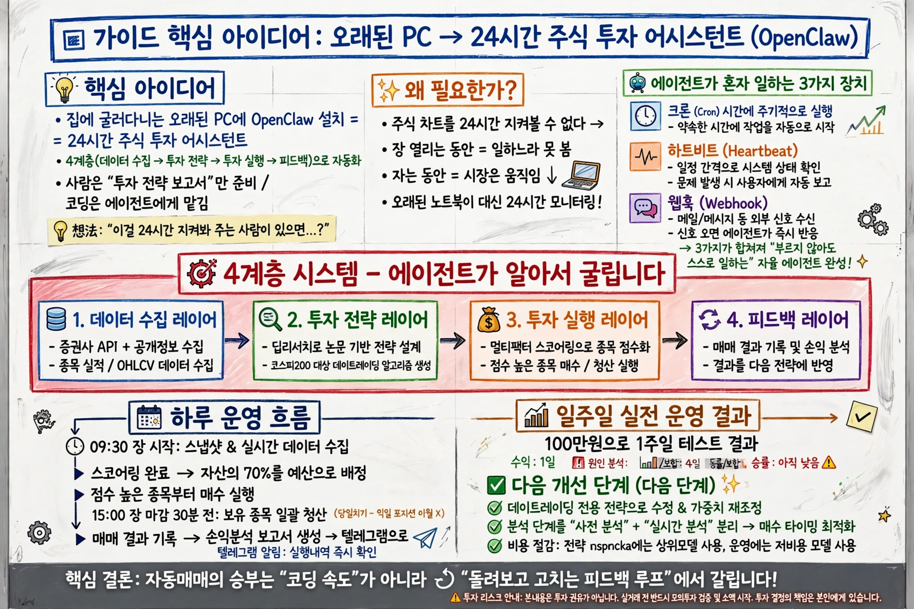
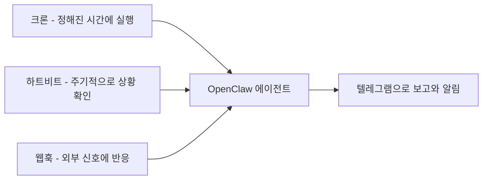
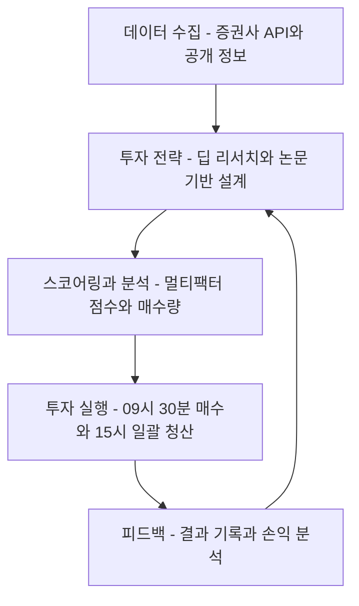
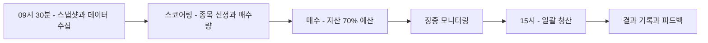

# OpenClaw: 오래된 PC가 24시간 주식 투자 어시스턴트가 됩니다

> **Summary**
> OpenClaw를 오래된 PC에 설치하면 크론, 하트비트, 웹훅을 활용해 데이터 수집부터 전략 설계·매매·피드백까지 자동화하는 24시간 주식 투자 어시스턴트를 만들 수 있습니다. 일주일간의 실전 운영에서는 시스템이 정상 작동했지만 승률은 낮았으며, 데이트레이딩에 맞는 전략으로 개선하고 모의 투자와 피드백 루프로 충분히 검증하는 것이 중요합니다.

---

- 오래된 PC에 OpenClaw를 설치하면 24시간 돌아가는 주식 투자 어시스턴트가 됩니다.
- 데이터 수집, 투자 전략, 투자 실행, 피드백까지 4계층으로 나누면 에이전트가 코딩부터 매매까지 알아서 돌립니다.
- 일주일 실전 운영 결과, 시스템은 끝까지 돌았지만 승률은 아직 낮았습니다. 전략을 데이트레이딩에 맞게 고치고 피드백 루프로 다듬는 게 다음 단계입니다.

주식 차트를 보다가 "이걸 24시간 지켜봐 주는 사람이 있으면 얼마나 좋을까" 생각해 본 적 있으시죠? 장이 열려 있는 동안은 일하느라 차트를 못 보고, 자는 동안에는 시장이 움직이는데 말이죠. 집에 굴러다니는 오래된 노트북 한 대가 그 역할을 대신할 수 있다면 어떨까요?

🎥 [동영상 보기](https://www.youtube.com/watch?v=CgniMVyJtmg)

## 에이전트는 어떻게 혼자 일할까요?

OpenClaw가 사람을 대신해 움직일 수 있는 이유는 세 가지 장치가 있기 때문입니다. 첫째, 크론입니다. 정해진 시간에 주기적으로 동작하는 스케줄러라서, 약속한 시간에 작업을 시작합니다. 둘째, 하트비트입니다. 일정한 간격으로 상황을 계속 확인하고, 문제가 생기면 사용자에게 알아서 보고합니다. 셋째, 웹훅입니다. 메일이나 메시지 같은 외부 신호가 오면 에이전트가 깨어나서 반응합니다. 이 세 가지가 합쳐지면 에이전트는 부르지 않아도 스스로 일하는 존재가 됩니다! 대화 맥락과 지침, 도구 정보는 워크스페이스 하위 마크다운 파일로 저장돼서, 세션을 넘나들며 기억이 이어집니다.

## 4계층으로 나누면 에이전트가 알아서 굴립니다

시스템은 네 계층으로 나뉩니다. 데이터 수집 레이어가 증권사 API와 공개 정보로 종목 실적과 OHLCV 데이터를 모으고, 투자 전략 레이어가 딥 리서치로 논문 기반 전략을 설계합니다. 투자 실행 레이어가 스코어링 결과로 매수와 청산을 실행하고, 피드백 레이어가 매매 결과를 기록해 다음 전략에 반영합니다. 코딩은 전부 에이전트에게 맡깁니다. 사람이 준비하는 건 투자 전략 보고서 하나뿐입니다!

## 전략은 어떻게 만드나요?

투자 전문가가 아니어도 됩니다. 딥 리서치 기능으로 논문과 신뢰할 수 있는 출처를 뒤져 코스피 200 종목 대상의 데이트레이딩 알고리즘을 설계합니다. 설계한 전략은 파이썬 분석 코드로 바뀌고, 수치·차트·감성 점수를 합산하는 멀티팩터 스코어링으로 종목별 점수와 매수량을 계산합니다. 과거 데이터로 백테스팅을 돌려 승률과 수익률을 확인하고, 과적합이 아닌지 검증합니다. 백테스팅을 통과한 전략만 크론잡에 등록해 실전에 올립니다.

## 하루는 어떻게 돌아갈까요?

장중 09:30에 스냅샷을 찍고 실시간 데이터를 수집합니다. 스코어링을 마친 뒤 자산 규모의 70%를 예산으로 잡고, 점수가 높은 종목부터 매수합니다. 장 마감 전 15:00에는 보유 종목을 일괄 청산합니다. 당일치기 데이트레이딩이라 다음 날로 포지션을 넘기지 않습니다. 매매 결과는 기록되고, 손익 분석 보고서가 피드백 루프로 들어갑니다. 텔레그램으로 알림이 오니, 에이전트가 뭘 했는지 메신저로 확인할 수 있습니다.

이 부분이 저는 가장 인상 깊었습니다. 코딩을 하나도 안 했는데 시스템이 끝까지 돌았다는 게, 에이전트에게 일을 맡긴다는 게 이런 거구나 싶어서요!

## 일주일 돌려보니, 숫자가 말해줍니다

100만 원으로 일주일을 돌린 결과는 이렇습니다. 수익을 본 날이 하루, 손해를 본 날이 이틀, 나머지는 거의 동률이었습니다. 승률은 아직 높지 않습니다. 원인을 뜯어보니 단타에 멀티팩터 전략이 맞지 않았습니다. 데이트레이딩에는 데이트레이딩에 맞는 전략이 따로 필요했습니다. 그래서 요소마다 가중치를 조절하고, 분석을 미리 하는 부분과 실시간으로 하는 부분을 나누면서 매수 타이밍을 놓치지 않게 다듬었습니다. API 비용도 신경 써야 합니다. 전략을 뽑아낼 때는 상위 모델을 쓰고, 운영 단계에서는 등급을 낮춰 비용을 절약합니다!

투자에는 항상 리스크가 따릅니다. 이 글의 내용은 투자 권유가 아니고, 투자 결정의 책임은 개인에게 있습니다. 실거래에 적용하기 전에는 반드시 모의 투자로 충분히 검증하고, 시작한다면 소액부터 시작하시기 바랍니다.

자동매매의 승부는 코드를 짜는 속도가 아니라, 돌려보고 고치는 피드백 루프에서 갈립니다.

