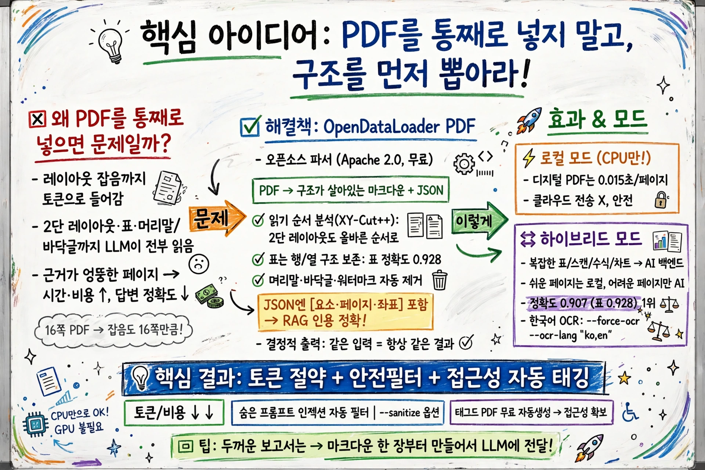
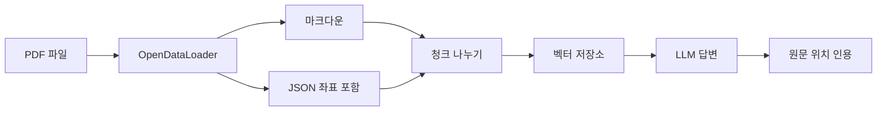
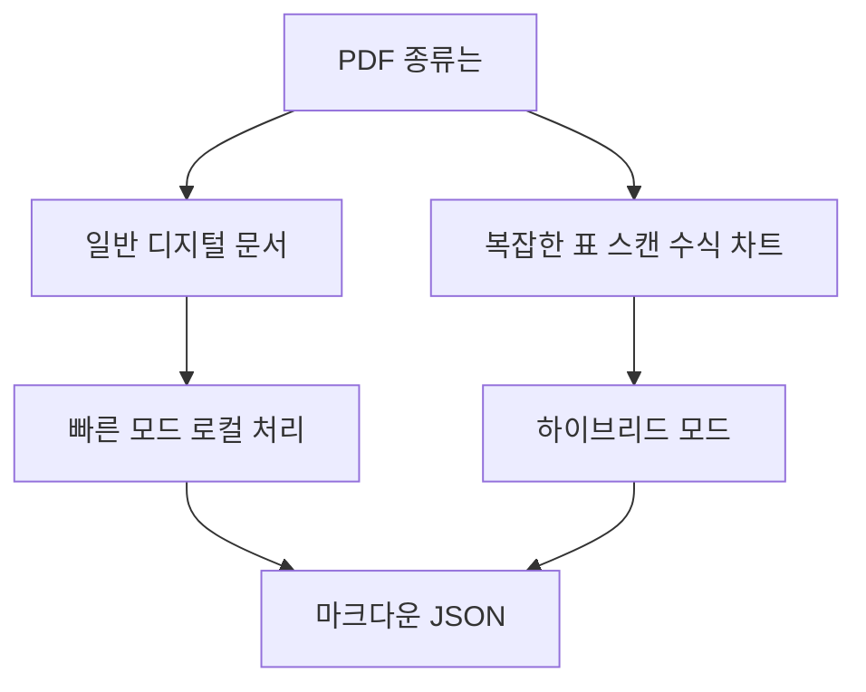

# OpenDataLoader PDF: PDF를 마크다운으로 미리 다듬으면, 토큰도 답도 아낍니다

> **Summary**
> OpenDataLoader PDF는 PDF를 구조가 살아 있는 마크다운과 JSON으로 바꿔주는 무료 오픈소스 파서로, RAG 파이프라인에 넣기 전 전처리 단계입니다. 2단 레이아웃의 읽기 순서와 표 구조를 유지하고 머리말·바닥글 잡음을 걸러내며, 요소마다 좌표가 붙어 답의 출처를 정확히 가리킬 수 있습니다. 로컬 CPU만으로 빠르고 결정적으로 동작하고, 복잡한 표·스캔·수식은 하이브리드 모드로 넘기면 됩니다.

---

- PDF를 통째로 LLM에 넣으면 레이아웃 잡음까지 토큰으로 들어가고, 답의 근거도 흐려집니다.
- OpenDataLoader PDF는 PDF를 구조가 살아 있는 마크다운과 JSON으로 바꿔주는 무료 오픈소스 파서입니다.
- 로컬에서 CPU만으로 돌고, 어려운 문서는 하이브리드 모드로 넘기면 됩니다.


보고서 PDF 한 권을 통째로 AI에게 물어본 적 있으시죠? 답은 돌아왔는데, 근거가 엉뚱한 페이지에서 온 것 같고, 토큰은 생각보다 훨씬 많이 나갔습니다. 문제는 모델이 아니라, PDF를 그대로 넣은 순서였습니다!

🎥 [동영상 보기](https://www.youtube.com/watch?v=Pnwfzloz8eU)

## 왜 PDF를 통째로 넣으면 토큰이 샐까요?

PDF는 사람이 보라고 만든 형식입니다. 2단 레이아웃은 왼쪽에서 오른쪽으로 잘못 읽히고, 표는 행과 열이 무너지고, 매 페이지 머리말과 바닥글이 맥락에 섞입니다. LLM은 이 잡음까지 토큰으로 읽습니다. 16쪽짜리 PDF를 그대로 해석하게 하면, 모델이 레이아웃까지 눈으로 뜯어야 해서 시간과 비용이 더 듭니다. 실제로 같은 분량의 문서를 마크다운으로 바꿔서 넣었더니 처리 시간과 비용이 크게 줄었다는 사례도 있습니다.

> PDF를 읽는 일과 답을 내는 일, 왜 한 모델이 둘 다 해야 할까요?

## 뭐가 다를까요? 구조를 살려서 뽑습니다

OpenDataLoader PDF는 PDF를 마크다운·JSON·HTML·태그드 PDF로 바꾸는 오픈소스 파서입니다. 아파치 2.0 라이선스라 상용으로도 무료입니다. 읽기 순서 분석(XY-Cut++)으로 2단 레이아웃도 올바른 순서로 읽고, 표는 테두리와 군집 분석으로 행과 열 구조를 유지합니다. 머리말·바닥글·워터마크는 걸러냅니다.

JSON 출력에는 요소마다 종류·페이지·좌표가 붙습니다. 그래서 RAG 답변이 "몇 페이지 어디에서 가져왔는지"를 정확히 가리킬 수 있습니다. 클릭 한 번으로 원문 위치를 보여주는 인용이 가능합니다!

결정적 출력도 강점입니다. 같은 입력은 항상 같은 결과를 냅니다. LLM에게 맡기면 매번 달라지는 것과 정반대입니다.



## 30초면 시작합니다

준비물은 자바 11 이상과 파이썬 3.11 이상입니다. 파이썬 SDK는 자바 엔진을 감싼 형태라 자바가 꼭 필요합니다.

```python
pip install -U opendataloader-pdf
```

```python
import opendataloader_pdf

opendataloader_pdf.convert(
    input_path=["document.pdf"],
    output_dir="output/",
    format="markdown,json"
)
```

한 가지 주의할 점이 있습니다. `convert()`를 부를 때마다 JVM 프로세스가 하나씩 뜹니다. 파일이 많으면 한 번에 묶어서 부르는 게 빠릅니다. LangChain 연동도 따로 준비돼 있습니다.

## 어려운 문서는 하이브리드 모드로 넘기면 될까요?

일반 디지털 PDF는 기본 빠른 모드로 충분합니다. 복잡한 표, 스캔본, 수식, 차트가 나오면 하이브리드 모드가 나섭니다. 하이브리드 모드는 빠른 로컬 처리와 AI 백엔드를 섞습니다. 쉬운 페이지는 로컬에서 0.02초에 처리하고, 어려운 페이지만 AI로 넘깁니다. 백엔드도 내 컴퓨터에서 돕니다. 클라우드로 문서가 나가지 않습니다!

스캔 PDF는 OCR로 읽습니다. 80개 넘는 언어를 지원하고, 한국어 스캔본은 `--force-ocr --ocr-lang "ko,en"` 옵션으로 읽습니다. 수식은 LaTeX로, 차트는 AI 설명문으로 바꿔줍니다. 단, 첫 실행 때는 모델을 내려받느라 몇 분이 걸릴 수 있습니다.



## 숫자로 보면 얼마나 정확할까요?

자체 벤치마크(실제 문서 200건) 기준 하이브리드 모드는 종합 정확도 0.907로 1위였습니다. 표 추출 정확도는 0.928입니다. 같은 기준에서 docling은 0.882, marker는 0.861이었습니다. 다만 이 수치는 프로젝트 자체 벤치마크 결과라는 점을 함께 봐야 합니다.

속도도 빠릅니다. 로컬 모드는 페이지당 0.015초, 8코어 이상에서는 배치 처리로 초당 100쪽 넘게 처리합니다. 하이브리드 모드는 페이지당 0.463초로 느리지만, 복잡한 표 정확도가 0.489에서 0.928로 뜁니다. GPU는 필요 없습니다. CPU만으로 돕니다!

## 토큰을 아끼는 건 덤, 안전 필터까지 챙깁니다

PDF 안에 숨은 프롬프트 인젝션 공격이 있습니다. 투명 글자, 페이지 밖 내용, 보이지 않는 레이어에 숨은 지시문이 LLM을 속일 수 있습니다. 이 도구는 이런 숨은 텍스트를 자동으로 걸러냅니다. 이메일·URL·전화번호를 자리 표시자로 바꾸는 `--sanitize` 옵션도 있습니다. 민감한 문서도 안심하고 넣을 수 있습니다!

## 접근성까지 챙기는 이유가 있을까요?

같은 구조 분석을 접근성에도 씁니다. 태그 없는 PDF를 스크린리더가 읽을 수 있는 태그드 PDF로 자동 변환해 줍니다. 이 기능은 무료입니다. 손으로 고치면 문서 한 건당 50~200달러가 드는 일입니다. 유럽 접근성법은 2025년 6월 28일부터 시행 중이고, 한국 디지털포용법도 시행 중입니다.

다만 PDF/UA-1·2 최종 내보내기와 시각 편집기는 유료 추가 기능입니다. 무료 범위는 태그드 PDF까지라는 점을 구분해야 합니다.


## 뭘 조심해야 할까요?

자바 11 이상이 꼭 필요합니다. 파이썬만 설치하면 안 됩니다. 워드·엑셀·파워포인트는 처리하지 못합니다. PDF 전용입니다. 하이브리드 모드는 첫 시작이 느립니다. 모델 다운로드 시간을 감안해야 합니다. 벤치마크 1위는 자체 측정 결과입니다. 내 문서에서는 직접 비교해 보는 게 맞습니다.

PDF를 통째로 넣는 대신, 구조부터 다듬어 넣는 습관이 토큰도 아끼고 답도 정확하게 만듭니다. 다음에 두꺼운 보고서를 AI에게 맡기기 전에, 마크다운 한 장부터 만들어 보시면 어떨까요?

