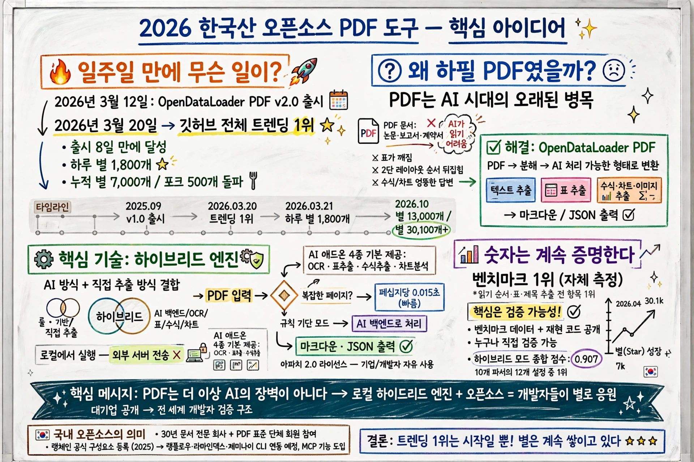
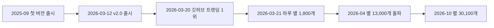
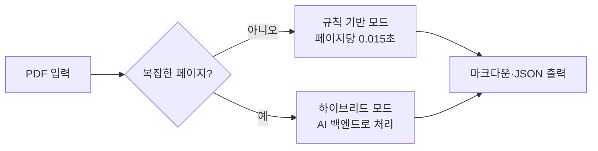
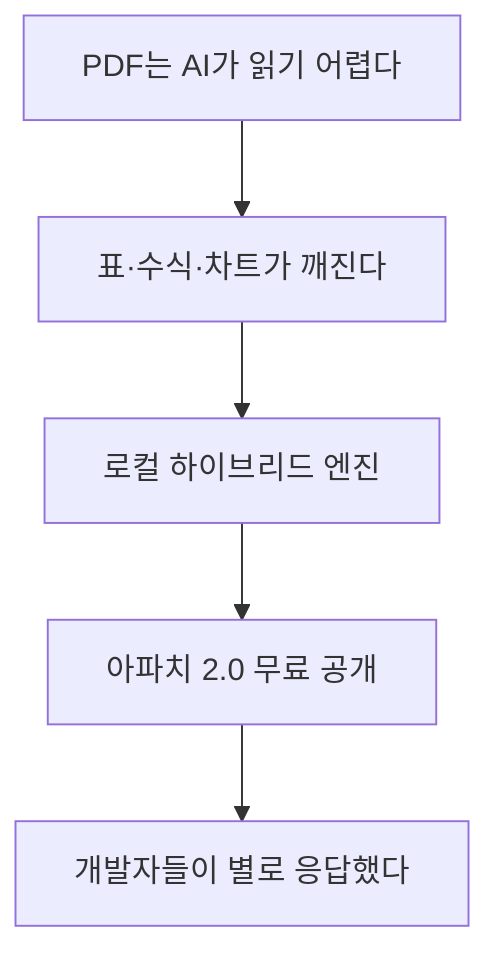

# OpenDataLoader PDF: 출시 일주일 만에 깃허브 트렌딩 1위, 하루에 별 1,800개가 찍혔습니다

> **Summary**
> OpenDataLoader PDF는 로컬에서 작동하는 하이브리드 방식으로 PDF의 텍스트·표·이미지·수식 등을 AI가 처리할 수 있는 형태로 변환하는 오픈소스 도구다. 2026년 3월 v2.0 출시 후 깃허브 트렌딩 1위에 올랐고 별이 꾸준히 늘어 10월에는 약 3만 개를 기록했다. 공개된 벤치마크와 재현 코드로 성능을 검증할 수 있으며, Apache 2.0 라이선스로 자유롭게 사용할 수 있다.

---

- 2026년 3월, 한국 회사가 만든 PDF 도구가 깃허브 전체 트렌딩 1위에 올랐습니다.
- 출시 일주일 만의 일이었고, 하루에만 별 1,800개가 찍혔습니다.
- 반짝 화제가 아니었습니다. 그 뒤로도 별은 계속 쌓여 10월에는 3만 개를 넘겼습니다.

PDF를 AI에게 읽히려고 넣어본 적 있으시죠? 표는 깨지고, 2단 레이아웃은 순서가 뒤집히고, 답은 엉뚱한 곳에서 나옵니다. 그런데 2026년 3월, 바로 이 지루한 문제를 푼 한국산 오픈소스 도구가 전 세계 개발자들의 별을 하루에 1,800개씩 받았습니다!

🎥 [동영상 보기](https://www.youtube.com/watch?v=2hrhmX_Ylng)

### 일주일 만에 무슨 일이 있었을까요?

2026년 3월 12일, `OpenDataLoader PDF` v2.0이 나왔습니다. 그리고 8일 뒤인 3월 20일, 깃허브 전체 개발 언어 대상 트렌딩 1위에 올랐고 트렌딩 배지를 받았습니다. 하루 기준 별 1,800개 이상, 누적 별 7,000개 돌파, 포크 500개 돌파까지 한 번에 이뤄졌습니다. 국내에서 만든 오픈소스 프로젝트가 전 세계 트렌딩 정상을 찍은 건 흔한 일이 아닙니다!

### 왜 하필 PDF였을까요?

PDF는 AI 시대의 오래된 병목입니다. 논문·보고서·계약서 같은 중요한 문서가 대부분 PDF로 돌아다니는데, AI는 그 구조를 그대로 읽지 못합니다. `OpenDataLoader PDF`는 PDF를 텍스트·표·이미지·수식으로 분해해 AI가 처리 가능한 형태로 바꾸는 도구입니다. 도구 자체는 한 문단이면 설명이 끝납니다. 진짜 이야기는 그 뒤에 있습니다.

이 도구는 AI 방식과 직접 추출 방식을 결합한 하이브리드 엔진을 썼고, 외부 서버로 문서를 보내지 않고 로컬에서 돌아갑니다. OCR·표 추출·수식 추출·차트 분석, AI 애드온 4종이 기본으로 들어 있고, 도클링 같은 타사 모델과도 호환됩니다. 아파치 2.0 라이선스라 기업도 개발자도 자유롭게 쓸 수 있습니다. 이 대목이 저는 가장 인상 깊었습니다. 빠르다고만 외치는 게 아니라, 빠른 길과 정확한 길을 나눠서 고르게 했다는 점이요!

### 숫자는 어디까지 믿을 수 있을까요?

벤치마크 1위는 자체 측정이라는 점을 먼저 짚어야 합니다. 읽기 순서·표·제목 추출 전 항목 1위라는 결과는 프로젝트 측이 직접 잰 수치입니다. 다만 다른 점이 하나 있습니다. 벤치마크 데이터와 재현 코드를 저장소에 함께 공개해 누구나 직접 검증할 수 있게 했다는 점입니다. 숫자를 믿으라는 말이 아니라, 직접 재보라는 태도입니다!

트렌딩 1위도 하루짜리 스냅샷이라는 한계가 있습니다. 그런데 그 뒤의 숫자가 말을 바꿉니다. 4월에는 별 13,000개와 포크 1,060개를 넘겼고, 10월에는 별이 약 30,100개까지 쌓였습니다. 하이브리드 모드 종합 점수 0.907로, 10개 파서의 12개 설정 가운데 1위도 지켰습니다. 반짝 인기였다면 숫자가 이렇게 이어지지 않았겠죠?

### 국내 오픈소스에는 어떤 의미일까요?

이 프로젝트는 30년 동안 문서를 다뤄온 회사가 PDF 표준 단체의 회원으로서, PDF 검증 도구 개발팀과 함께 만든 결과물입니다. 지난해 AI 개발 프레임워크 랭체인의 공식 구성요소로 등록됐고, 올해는 랭플로우·라마인덱스·제미나이 CLI와 연동을 넓히고 AI 에이전트 지원을 위한 MCP 기능도 도입할 계획입니다. 대기업이 기술을 공개하고, 전 세계 개발자가 검증하는 구조가 만들어진 겁니다.

트렌딩 1위는 끝이 아니라 시작이었습니다. 별은 그 뒤로도 계속 쌓이고 있습니다!

