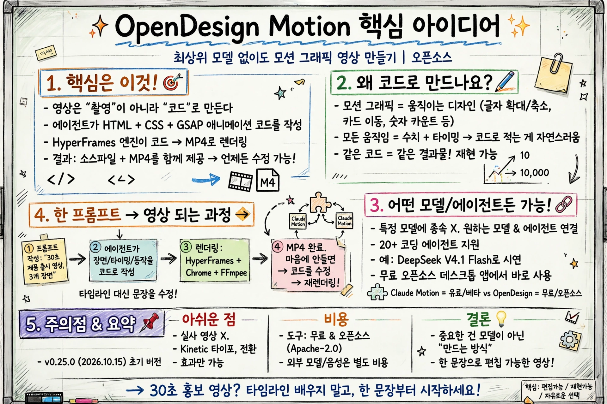
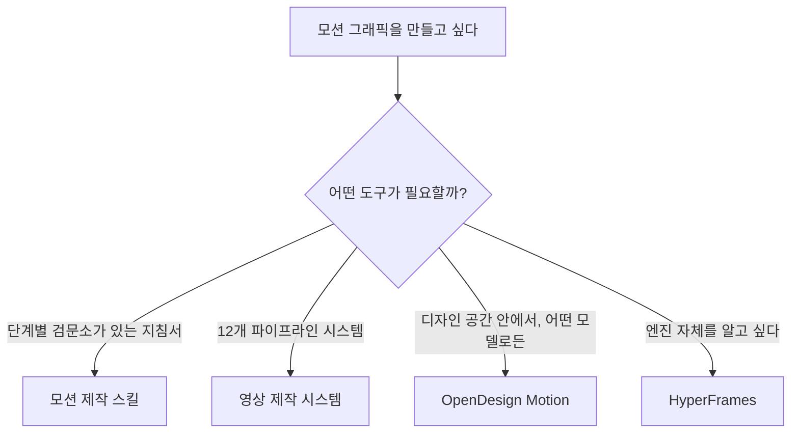

# OpenDesign Motion: 최상위 모델 없이도 모션 그래픽을 만듭니다. 모델은 골라 쓰는 것입니다

> **Summary**
> OpenDesign Motion은 사용자가 원하는 모델과 코딩 에이전트를 골라 프롬프트를 HTML·CSS·GSAP 코드로 바꾸고, HyperFrames로 편집 가능한 소스와 MP4를 만드는 무료 오픈소스 모션 그래픽 도구입니다. 고가의 최상위 모델이나 타임라인 편집 없이 제품 홍보 영상과 키네틱 타이포 등을 제작할 수 있지만, 실사 영상 제작에는 적합하지 않고 초기 버전이라는 점을 고려해야 합니다.

---

- OpenDesign Motion은 최상위 모델 없이도 모션 그래픽 영상을 만드는 오픈소스 기능입니다. 원하는 모델과 에이전트를 골라 연결하면 됩니다.
- 비결은 영상을 찍는 대신 코드로 만드는 것입니다. 에이전트가 HTML과 CSS, 애니메이션 코드를 쓰고, 오픈소스 엔진이 MP4로 바꿔줍니다.
- 소개 영상 자체도 이 기능으로 만들었습니다. 다만 만드는 것은 실사 영상이 아니라 움직이는 그래픽이라는 점은 알고 써야 합니다.

30초짜리 제품 홍보 영상이 급하게 필요했던 적 있으시죠? 영상 편집 툴을 켜면 타임라인부터 배워야 하고, AI 영상 생성기에 맡기면 결과물이 매번 달라집니다. 그런데 "한 문장으로 시키면 편집 가능한 영상이 나온다"면 어떨까요?

🎥 [동영상 보기](https://www.youtube.com/watch?v=nxoX2H2onZk)

## 모션 그래픽, 왜 코드로 만드나요?

모션 그래픽은 사실 영상이 아니라 움직이는 디자인입니다. 글자가 커졌다 작아지고, 카드가 기울어지며 지나가고, 숫자가 0에서 10,000까지 올라갑니다. 이 움직임은 전부 수치와 타이밍으로 정해집니다. 그래서 코드로 적는 것이 오히려 자연스럽습니다.

OpenDesign Motion은 이 생각을 그대로 구현했습니다. 에이전트가 영상 파일을 직접 만드는 대신, HTML과 CSS, `GSAP` 애니메이션 코드를 씁니다. 그리고 오픈소스 엔진인 HyperFrames가 그 코드를 헤드리스 크롬과 `FFmpeg`으로 렌더링해 결정적인 MP4로 바꿔줍니다. 같은 코드면 같은 영상이 나옵니다!

여기서 핵심은 "편집이 가능하다"는 점입니다. 결과물은 영상 파일 하나가 아니라, 수정할 수 있는 소스 파일과 MP4를 함께 받습니다. 글자가 마음에 안 들면 코드를 고치고 다시 렌더링하면 됩니다. 영상 생성기가 뱉은 결과물을 받아들이는 것과는 결이 다릅니다.

## 어떤 모델로든, 어떤 에이전트로든?

이 기능이 주목받은 이유는 따로 있습니다. 특정 모델에 묶이지 않기 때문입니다!

유사한 기능으로 잘 알려진 Claude Motion은 팀·기업 요금제 이용자에게만 열리는 베타 기능입니다. 반면 OpenDesign Motion은 무료 오픈소스 데스크톱 앱 안에서, 이미 쓰는 에이전트와 키로 바로 쓸 수 있습니다. 연결되는 코딩 에이전트만 20개가 넘습니다. 모델도 고를 수 있습니다. 소개 과정에서는 `DeepSeek V4.1 Flash`를 활용해 시연했고, 공개된 소개 영상도 OpenDesign Motion으로 직접 만들었습니다.

이게 왜 중요할까요? 모션 그래픽은 모델의 창의성보다 "지시를 얼마나 정확히 코드로 옮기느냐"가 승부를 가릅니다. 가장 비싼 모델이 아니어도, 지시를 잘 따르는 모델이면 충분합니다. 그래서 "최상위 모델 없이도 된다"는 말이 성립합니다.

## 한 프롬프트가 영상 되는 과정은?

앱을 열면 다섯 가지 시작점이 기다립니다. `Motion Future`, `Product Promo`, `Showreel`, `UI Morph`, `Visual Lesson`입니다. 예시를 고르거나, 에이전트에게 직접 영상을 부탁하면 됩니다.

흐름은 이렇습니다. 먼저 하고 싶은 말을 적습니다. "30초짜리 제품 출시 영상, 장면 세 개"처럼요. 에이전트가 장면 순서와 타이밍, 움직임을 코드로 적습니다. 렌더링이 끝나면 MP4가 나옵니다. 마음에 안 드는 장면이 있으면 소스를 고쳐서 다시 만듭니다. 타임라인을 드래그하는 대신, 문장을 고치는 방식입니다!

제품 출시, 기능 소개, 브랜드 이야기, 기념일 영상까지, 참고할 만한 모션 템플릿도 함께 제공됩니다. 참고 영상을 보고, 안내 문서를 에이전트에게 건네고, 내 문구와 브랜드, 자료로 바꿔 만드는 구조입니다.

## P320, P321과는 뭐가 다를까요?

비슷한 주제의 글과 헷갈릴 수 있어 정리해 두었습니다. P320에서 다룬 모션 스킬은 7단계마다 검문소를 두는 제작 지침서, 즉 하네스입니다. P321의 OpenMontage는 12개 파이프라인을 갖춘 제작 시스템 전체입니다. 이 글의 주인공은 그 둘과 다릅니다. 디자인 작업 공간 안에 들어간 모션 기능입니다. 웹사이트, 슬라이드, 이미지를 만들던 곳에서 영상까지 이어서 만드는 것이 포인트입니다. 엔진 자체(HyperFrames)를 다룬 글도 따로 있습니다. 이 글은 엔진을 쓰는 "기능"에 초점을 맞췄습니다.

## 아쉬운 점은 없을까요?

물론 있습니다. 만드는 것은 어디까지나 움직이는 그래픽입니다. 슬라이드, kinetic 타이포, 전환 효과는 잘 만들지만, 실제 촬영 영상이나 사실적인 장면은 이 도구의 몫이 아닙니다. 기대치를 여기에 맞추는 것이 먼저입니다.

그리고 아직 초기 버전입니다. 2026년 10월 15일에 나온 v0.25.0이 모션 기능의 시작이었습니다. 기능이 빠르게 바뀌고 있으니, 제작 파이프라인의 한가운데에 두기 전에 지금 버전을 직접 써보는 것이 좋습니다. 모션 쪽 기능은 이후 별도 저장소로도 커지고 있어, 프로젝트가 계속 움직이고 있다는 점도 함께 알아두면 좋습니다.

비용도 짚어야 합니다. 도구 자체는 무료이고 오픈소스(`Apache-2.0`)입니다. 다만 영화 같은 장면이나 음성을 붙이는 외부 모델은 각자 키로 비용을 냅니다. 무료인 것은 도구이지, 모든 재료가 공짜라는 뜻은 아닙니다.

Threads 포스트 자체는 짧은 소개 글이었고 로그인 화면에 가려 전문을 직접 읽기 어려웠기 때문에, 이 글은 저장소 README와 모션 안내 문서를 1차 원본으로 삼아 재구성했습니다.

## 결론: 모델이 아니라, 만드는 방식이 바뀌었습니다

모션 그래픽의 진입 장벽은 비싼 모델이 아니라, "영상을 코드로 적는다"는 발상의 전환이었습니다. 모델은 골라 쓰면 됩니다! 결과물은 고쳐 쓸 수 있습니다! 30초 홍보 영상이 필요하다면, 타임라인을 배우기 전에 한 문장부터 적어보는 것도 방법입니다.

