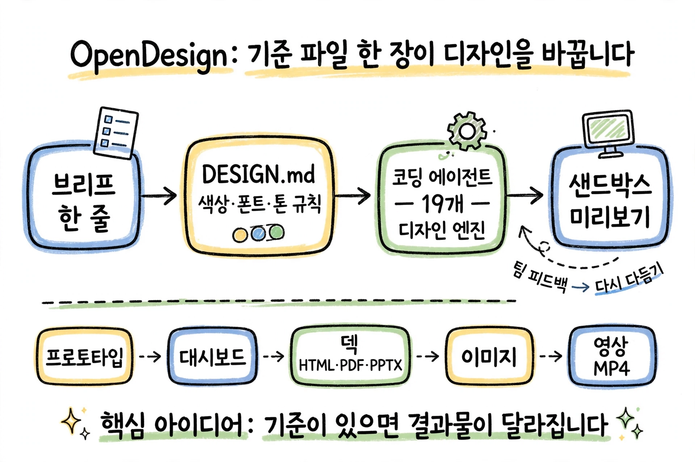
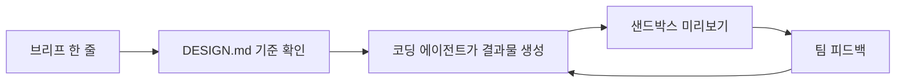
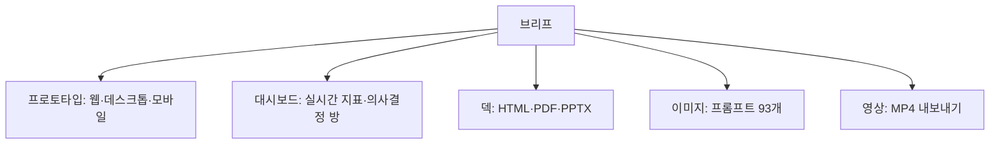
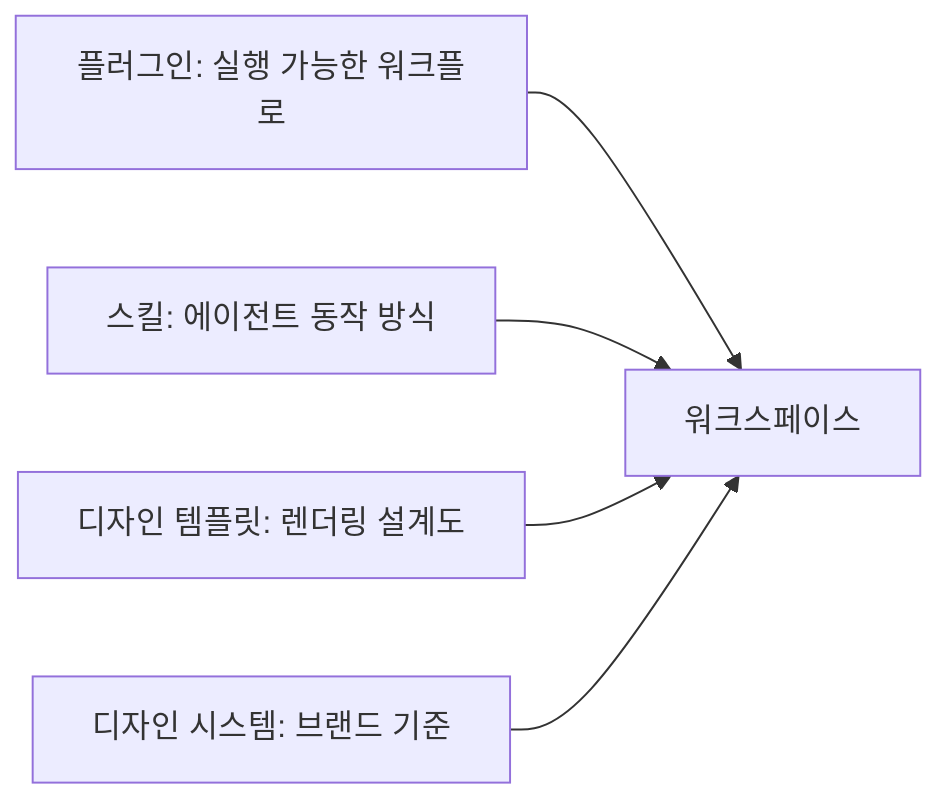

# OpenDesign: 클로드 디자인의 오픈소스 대안, 반년 만에 별 10만 개가 찍혔습니다

> **Summary**
> OpenDesign은 클로드 디자인의 오픈소스 대안으로 시작해, 쓰는 코딩 에이전트를 디자인 엔진으로 삼는 협업 워크스페이스로 커진 프로젝트입니다. 브랜드 기준을 DESIGN.md 한 장에 적어두면 에이전트가 그 기준에 맞춰 프로토타입·덱·이미지·영상까지 뽑아냅니다. 별 10만 개를 넘긴 인기 프로젝트지만, 호스팅 모델 크레딧은 유료 플랜이고 리눅스 설치 파일은 아직 없어 소스 빌드가 필요하다는 점은 알고 써야 합니다.

---

- 클로드 디자인의 오픈소스 대안으로 시작한 OpenDesign은, 쓰는 코딩 에이전트를 디자인 엔진으로 삼아 프로토타입·덱·이미지·영상까지 만드는 협업 워크스페이스입니다.
- 핵심은 `DESIGN.md` 한 장입니다. 브랜드 색상·폰트·톤을 파일에 적어두면, 에이전트가 그 기준에 맞춰 결과물을 뽑아냅니다.
- 2026년 5월 클립 당시 71개였던 디자인 시스템은 지금 151개, 별은 10만 개를 넘겼습니다. 무료로 시작할 수 있지만, 호스팅 모델 크레딧은 유료라는 점은 알고 써야 합니다.

랜딩 페이지 하나 만들어달라고 했는데, 색상도 폰트도 제각각인 화면이 나온 적 있으시죠? AI가 만든 화면은 기능은 되는데, 브랜드 느낌이 안 살아나는 경우가 많습니다. 왜 그럴까요? 기준이 없기 때문입니다. OpenDesign은 그 기준을 파일 한 장에 적어두는 데서 시작합니다!

🎥 [동영상 보기](https://www.youtube.com/watch?v=rMRsVyIsZCU)

## 왜 코딩 에이전트에게 디자인을 맡길까요?

클로드 디자인은 2026년 4월 17일에 공개됐습니다. LLM이 글을 쓰는 대신 디자인 결과물을 내놓는 모습이 화제가 됐지만, 닫힌 서비스에 유료, 클라우드 전용, 하나의 모델에만 묶여 있었습니다. OpenDesign은 같은 루프를 열어젖힌 대안입니다. 에이전트를 새로 만들지 않았습니다. 이미 쓰는 코딩 에이전트가 디자인 엔진이 됩니다!

지원하는 에이전트는 19개입니다. 클로드 코드, 코덱스, 커서, 코파일럿, 오픈코드, 키미, 헤르메스 에이전트까지, 터미널에 깔려 있는 도구가 그대로 이어집니다. 에이전트가 없으면 어떻게 할까요? 직접 키를 넣는 BYOK 프록시로 같은 루프를 돌릴 수 있습니다. 모델은 바꾸고, 방식은 그대로 가져가는 구조입니다.

## [DESIGN.md](http://design.md/) 한 장이 브랜드를 지킵니다?

OpenDesign의 핵심 계약은 `DESIGN.md`입니다. 색상, 폰트, 간격, 톤 규칙을 마크다운 한 장에 적어두면, 모든 결과물이 그 파일을 읽고 나옵니다. 디자인 시스템은 151개가 함께 들어 있습니다. 브랜드 폴더를 하나 떨어뜨리면 선택기에 바로 뜹니다. 기존 코드베이스에 `DESIGN.md`를 건네면, 에이전트가 실제 컴포넌트를 브랜드 기준에 맞게 다듬어주기도 합니다!

## 뭘 만들 수 있을까요?

한 워크스페이스에서 나오는 결과물이 다섯 갈래입니다. 웹·데스크톱·모바일 프로토타입, 실시간 대시보드와 의사결정 방, 매거진 스타일 덱, 이미지, 그리고 영상입니다. 덱은 HTML·PDF·PPTX·ZIP·마크다운으로 내보낼 수 있습니다. 이미지는 바로 써먹을 수 있는 프롬프트 93개가 함께 들어 있습니다. 영상은 에이전트가 HTML·CSS·애니메이션 코드를 짜면, 헤드리스 브라우저와 FFmpeg이 MP4로 바꿔줍니다. 시네마틱 영상 모델과 음악 모델까지 연결되는 구조입니다. 한 번의 브리프가 화면·문서·영상까지 이어지는 셈입니다.

## 설치는 어떻게 할까요?

가장 빠른 길은 데스크톱 앱입니다. macOS와 윈도우용 설치 파일을 받으면 끝입니다. 노드도, 클론도 필요 없습니다. 코딩 에이전트 안에서만 쓰고 싶으면 MCP로 연결합니다. `od mcp install claude`처럼 에이전트 이름 하나만 붙이면 됩니다. 설치 뒤에는 앱이 경로에 있는 에이전트를 알아서 찾고, 100개가 넘는 스킬과 151개 디자인 시스템을 불러옵니다. 리눅스는 아직 공식 설치 파일이 없어서 소스에서 직접 빌드해야 합니다. 이 부분은 미리 알고 가는 편이 좋습니다.

## 알고 써야 할 점은요?

숫자가 빠르게 움직이는 프로젝트입니다. 클립에는 스킬 19개, 디자인 시스템 71개로 적혀 있었는데, 지금은 스킬 100개 이상, 디자인 시스템 151개입니다. 별은 2026년 11월 23일 기준 108,935개, 포크는 12,326개까지 확인됐습니다. 설치 전에 최신 문서를 한 번 확인하는 습관이 필요합니다. 가격도 마찬가지입니다. 데스크톱 앱은 로컬 에이전트나 직접 넣은 키로 무료로 쓸 수 있지만, 호스팅 모델 크레딧이 붙는 유료 플랜이 따로 있습니다. 첫 달 8달러, 월 최대 120달러 크레딧이라는 안내가 공식 페이지에 적혀 있습니다. 무료와 유료의 경계가 어디인지, 쓰기 전에 구분해두면 됩니다!

디자인을 에이전트에게 맡기는 일, 기준을 파일 한 장으로 정하는 데서 시작하면 됩니다. 기준이 있으면 결과물이 달라집니다!

