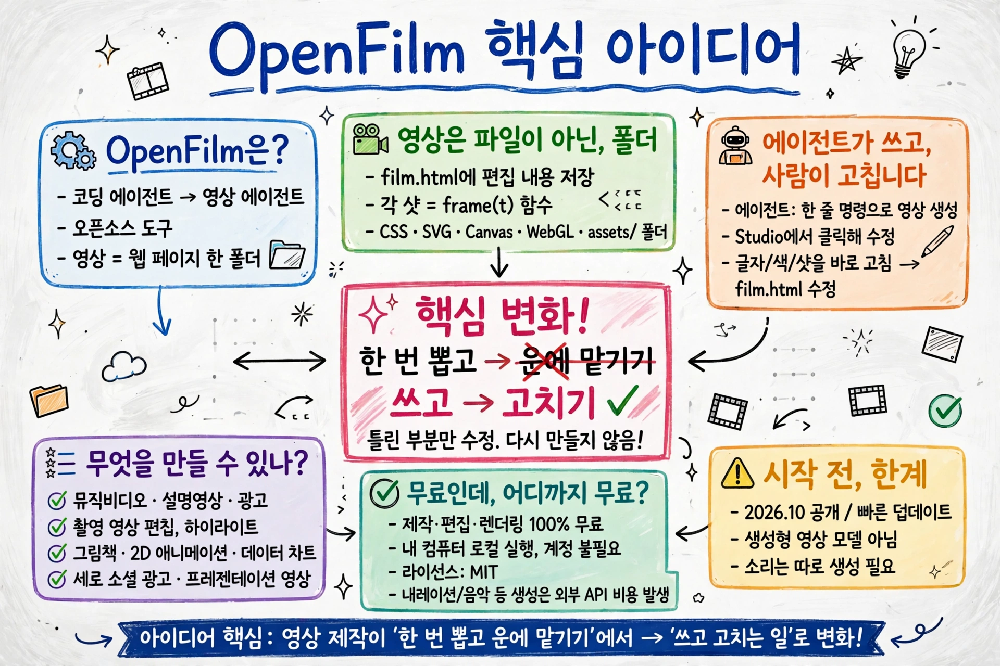
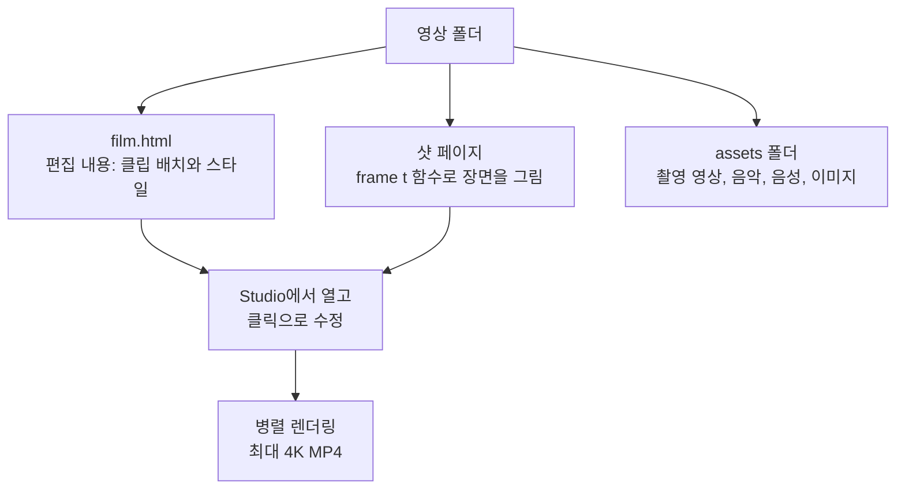
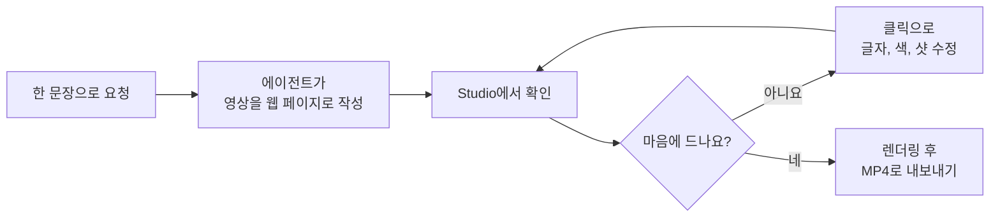

# OpenFilm: 영상은 파일이 아닙니다. 웹 페이지 한 폴더입니다. 에이전트가 쓰고, 클릭으로 고칩니다

> **Summary**
> OpenFilm은 코딩 에이전트를 영상 에이전트로 바꾸는 오픈소스 도구입니다. 영상은 웹 페이지 한 폴더이고, 에이전트가 쓰고 Studio에서 클릭으로 고칩니다. 촬영 영상 편집부터 뮤직비디오, 설명 영상, 광고까지 만듭니다. 모든 프레임은 병렬로 렌더링되고, 최대 4K까지 나옵니다. 제작과 편집, 렌더링은 무료이고 내 컴퓨터에서 돌아갑니다. 계정도 필요 없습니다.

---

- OpenFilm은 코딩 에이전트를 영상 에이전트로 바꾸는 오픈소스 도구입니다. 영상은 웹 페이지 한 폴더이고, 에이전트가 쓰고 Studio에서 클릭으로 고칩니다.
- 촬영 영상 편집부터 뮤직비디오, 설명 영상, 광고까지 만듭니다. 모든 프레임은 병렬로 렌더링되고, 최대 4K까지 나옵니다.
- 제작과 편집, 렌더링은 무료이고 내 컴퓨터에서 돌아갑니다. 계정도 필요 없습니다.

영상 하나 만들려면 타임라인을 열고, 자막을 맞추고, 색을 고르고… 생각만 해도 손이 먼저 무거워지시죠? 그런데 이 도구는 영상을 타임라인이 아니라 웹 페이지로 만듭니다!

🎥 [동영상 보기](https://www.youtube.com/watch?v=Qea7v6dtNM0)

## 영상은 파일이 아닙니다. 폴더입니다

OpenFilm에서 영상은 하나의 폴더입니다. 편집 내용은 `film.html`에 담깁니다. 어떤 클립을 어디서 언제 재생하는지, 각각 어떻게 보이는지까지요. 이 파일도 웹 페이지입니다.

각 샷은 `frame(t)`라는 함수 하나를 가진 웹 페이지입니다. 시점 `t`의 장면을 그리는 함수죠. 브라우저가 그릴 수 있는 것은 무엇이든 샷이 됩니다. CSS, SVG, canvas, WebGL까지요. 촬영 영상과 음악, 음성, 이미지는 `assets/` 폴더에 둡니다.

그래서 영상은 평범한 파일입니다. 코드처럼 읽고, 버전 관리하고, 복사하고, 고칠 수 있습니다. 영상 파일이 아니라, 읽을 수 있는 영상이라는 뜻입니다!

## 에이전트가 쓰고, 사람이 고칩니다

사용법은 단순합니다. 코딩 에이전트에 스킬을 추가하는 명령 한 줄, 그리고 영상을 요청하는 한 문장이 전부입니다. 스킬이 없으면 `npx openfilm`을 실행해서 영상을 만들어 달라고 하면 됩니다.

명령을 실행할 수 있는 에이전트라면 무엇이든 쓸 수 있습니다. 코딩 에이전트 여러 종류가 이미 지원됩니다. 에이전트는 OpenFilm의 매뉴얼과 도구를 읽고 영상을 웹 페이지로 씁니다.

그리고 사람이 Studio에서 보고 고칩니다. 글자, 색, 샷을 클릭해 바꿉니다. 클립을 자르고 타이틀을 옮기면 Studio가 `film.html`을 직접 수정합니다.

이게 왜 중요할까요? 생성형 영상은 틀리면 다시 뽑아야 합니다. OpenFilm은 틀린 부분만 고치면 됩니다. 다시 뽑지 않습니다!

## 무엇을 만들 수 있을까요?

한 문장으로 영상 한 편을 통째로 만들거나, 직접 찍은 영상을 편집할 수 있습니다. 종류가 꽤 넓습니다. 강연과 촬영 영상을 하이라이트로 편집하는 일부터, 부르는 모든 가사를 화면에 올리고 비트에 맞춰 자르는 뮤직비디오까지요. 스스로 페이지를 넘기는 그림책, 그림과 아이디어를 한 단계씩 설명하는 설명 영상, 정확한 글자와 브랜드를 넣는 광고, 실제 제품으로 만드는 출시 영상도 됩니다. 사진 모자이크 리빌 같은 VFX 템플릿, 코드로 그리고 움직이는 2D 애니메이션, 한 제품에 세 가지 훅을 단 세로 소셜 광고, 도표와 숫자가 함께 움직이는 교육 영상, 슬라이드를 영상으로 바꾸는 프레젠테이션까지요.

편집 기능도 함께 들어 있습니다. 강연에서 '음', '어' 같은 군말과 말실수를 찾아 잘라 내는 토크 편집, 수백 개 샷 중에서 딱 맞는 세 개를 찾는 샷 고르기, 받아 적고 단어마다 타이밍을 맞추는 자막, 밋밋한 log 영상을 완성된 느낌으로 바꾸는 색 보정, 음악에 맞춰 움직이는 모션 그래픽, 데이터로 그리고 애니메이션을 입힌 차트, 보이스오버와 배경 음악을 깔고 믹싱하는 음성과 음악, 모든 컷을 노래의 비트에 맞추는 편집까지요.

## 무료인데, 어디까지 무료일까요?

OpenFilm 자체는 무료입니다. 영상 제작, 편집, 렌더링은 모두 내 컴퓨터에서 이루어지고 계정이 필요 없습니다. 라이선스는 MIT입니다.

다만 내레이션, 음악, 이미지, 동영상을 생성할 때는 비용이 따로 듭니다. 자신이 이미 쓰는 서비스의 키를 연결하거나, OpenFilm 계정에 로그인해 모든 모델을 한곳에서 쓸 수 있습니다. 자신의 키를 쓰면 각 서비스가 직접 청구합니다.

필요한 것은 두 가지입니다. Node.js 22 이상, 그리고 셸 명령을 실행할 수 있는 코딩 에이전트입니다. 렌더링에는 FFmpeg이 쓰이고, Studio의 저장된 버전 관리에는 Git이 쓰입니다. 첫 실행 때는 헤드리스 브라우저 약 100MB가 내려받아집니다. 데스크톱 앱도 있습니다. Studio와 에이전트 채팅, FFmpeg, 렌더링용 브라우저가 함께 들어 있습니다.

## 시작하기 전에, 한계도 짚고 갑니다

이 프로젝트는 아직 새롭습니다. 2026년 10월 초에 공개됐고, 새 버전이 며칠 간격으로 나옵니다. 별은 9,013개, 포크는 912개입니다(2026-11-23 기준). 빠른 변화는 장점이자 주의점입니다. 오늘 배운 방법이 다음 버전에서 조금 달라질 수 있습니다.

그리고 이 도구는 생성형 영상 모델이 아닙니다. 실사 영상을 "만들어내는" 도구가 아니라, 웹 페이지로 그리고 촬영 영상을 편집하는 도구입니다. 소리도 따로 만들어야 합니다. 이 구분을 알고 쓰면 실망이 없습니다.

각도도 분명히 해둡니다. 제작 지침서를 다룬 글, 12개 파이프라인 시스템을 다룬 글, 디자인 공간 안의 모션 기능을 다룬 글, 그리고 Opus 현상 자체를 다룬 글과 달리, 이 글은 에이전트 자체가 주제입니다. 코딩 에이전트가 영상을 쓰고, 사람이 Studio에서 고치는 도구 말입니다.

영상 제작이 "한 번 뽑고 운에 맡기는 일"에서 "쓰고 고치는 일"로 바뀌었습니다. 틀린 부분을 고칠 수 있다는 것, 그게 이 도구의 가장 큰 차이입니다!

