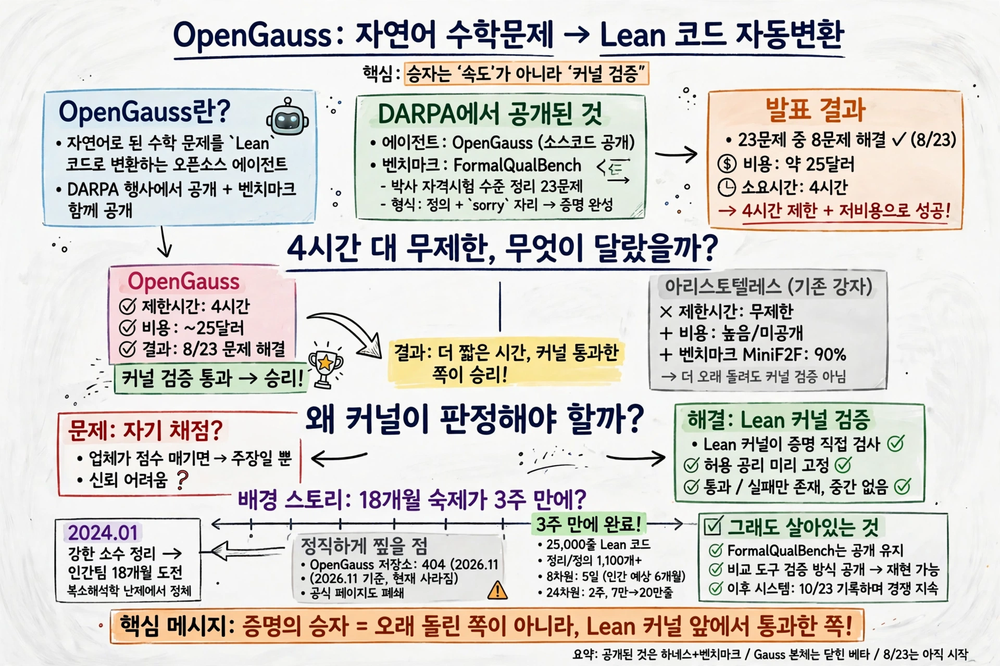
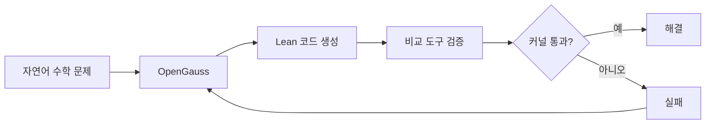
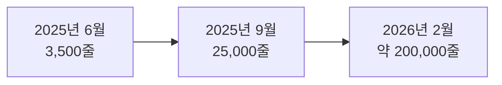
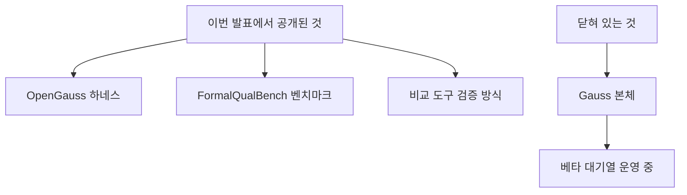

# OpenGauss: 4시간 제한으로 무제한 아리스토텔레스를 이겼습니다. 판정은 커널이 합니다

> **Summary**
> OpenGauss는 자연어 수학 문제를 Lean 증명으로 바꾸는 에이전트로, 박사 자격시험 수준 문제 23개 중 8개를 4시간과 약 25달러로 풀어 시간 제한이 없던 아리스토텔레스를 앞섰습니다. 핵심 기여는 Lean 커널이 증명을 판정하는 검증 가능한 벤치마크를 공개한 것이며, 다만 OpenGauss 하네스와 벤치마크만 공개됐고 Gauss 본체는 비공개입니다.

---

- OpenGauss는 자연어로 된 수학 문제를 `Lean` 코드로 바꾸는 오픈소스 에이전트입니다. DARPA 행사에서 공개됐고, 벤치마크 결과도 함께 나왔습니다.
- 박사 자격시험 수준 23문제 중 8문제를 풀었습니다. 비용은 약 25달러, 시간은 4시간이었습니다. 시간 제한이 없던 아리스토텔레스보다 앞섰습니다.
- 승패를 가른 건 속도가 아니라 검증 방식입니다. 증명은 업체가 아니라 `Lean` 커널과 비교 도구가 판정했습니다.

수학 증명 하나를 컴퓨터가 검증하는 코드로 옮기는 데 얼마나 걸릴까요? 종이에 적힌 증명을 기계가 읽는 형식으로 바꾸는 일은 전문가가 몇 년을 매달려도 끝내기 어려운 작업입니다. 그런데 DARPA 행사 무대에 오른 발표 하나가 이 상식을 흔들었습니다!

🎥 [동영상 보기](https://www.youtube.com/watch?v=hh4cjZOddQA)

### DARPA 행사에서 공개된 건 무엇이었을까요?

공개된 건 `OpenGauss`입니다. 자연어로 된 수학 문제를 정형화된 `Lean` 코드로 자동 변환하는 에이전트인데, 소스 코드까지 함께 풀렸습니다. 혼자 나온 게 아닙니다. 벤치마크 `FormalQualBench`도 같이 공개됐습니다. 박사 자격시험 수준의 정리 23개가 들어 있고, 각 문제는 정의와 `sorry` 자리만 있는 정리문으로 되어 있습니다. 에이전트의 과제는 그 빈자리를 채워 증명을 완성하는 것입니다.

발표된 결과는 이렇습니다. 23문제 중 8문제를 풀었고, 비용은 약 25달러, 제한 시간은 4시간이었습니다. 숫자로 보면 아직 갈 길이 멉니다. 그런데도 발표장이 술렁인 이유가 있습니다. 상대가 누구였는지 보면 알 수 있습니다.

### 4시간 대 무제한, 뭐가 달랐을까요?

상대는 아리스토텔레스였습니다. IMO 2025에서 금메달급 성적을 낸 시스템이고, 표준 벤치마크 `MiniF2F`에서 90%라는 기록을 내세운 강자입니다. 이번 대결에서 아리스토텔레스에게는 시간 제한이 없었습니다. 원하는 만큼 돌릴 수 있었습니다.

그런데 발표된 결과표에서 OpenGauss가 앞섰습니다. 4시간이라는 제한 안에서, 그것도 약 25달러의 비용으로 말입니다. 이 장면이 저는 가장 인상 깊었습니다. 더 오래 돌린 쪽이 아니라, 더 짧은 시간에 커널을 통과한 쪽이 이겼으니까요!

### 왜 커널이 판정해야 할까요?

AI 증명 경쟁에는 오래된 골칫거리가 있습니다. 업체가 자기 점수를 매기면, 그 숫자를 어디까지 믿어야 할까요? 자기 인프라에서 자기 방식으로 돌린 결과는 검증이 아니라 주장에 가깝습니다.

`FormalQualBench`는 이 문제를 정면으로 파고들었습니다. 증명은 비교 도구로 검증합니다. `Lean` 커널이 증명을 직접 검사하고, 허용되는 공리까지 미리 정해 둡니다. 통과 아니면 실패, 중간은 없습니다. 그래서 8/23이라는 숫자가 의미가 있습니다. 누가 매긴 점수가 아니라 커널이 확인한 결과니까요!

### 배경: 18개월이 멈춘 숙제, 3주 만에 끝나다

이 발표가 주목받은 데는 배경이 있습니다. 2024년 1월, 강한 소수 정리를 `Lean`으로 형식화하는 도전 과제가 나왔습니다. 인간 팀이 18개월을 매달렸지만 복소해석학의 핵심 난제에 막혀 진도가 나가지 않았습니다.

닫힌 본체 에이전트인 `Gauss`가 이 숙제를 3주 만에 끝냈습니다. 약 25,000줄의 `Lean` 코드, 정리와 정의 1,100개 이상이 나왔습니다. 사람은 설계도를 주고 핵심 보조정리를 검토하는 역할을 맡았습니다. 2026년 2월에는 구면 패킹 증명(8차원과 24차원)까지 이어졌습니다. 8차원 남은 보조정리는 5일 만에 끝났는데, 인간 추정치는 6개월이었습니다. 24차원은 논문만으로 2주 만에 자동 형식화됐고, 전체 분량은 7만 줄에서 약 20만 줄로 불어났습니다.

수천 개 에이전트가 각자 `Lean` 런타임을 들고 동시에 돌았고, 클러스터 메모리는 수 테라바이트를 썼습니다. DARPA의 `expMath` 프로그램이 이 작업을 지원했습니다. 규모가 커지는 속도 자체가 이야기의 핵심이었습니다.

### 정직하게 짚을 점은 없을까요?

있습니다. 발표 당시 공개된 결과표가 지금은 직접 확인이 안 됩니다. OpenGauss 저장소가 사라졌고, 공식 페이지도 사이트 개편으로 없어졌습니다. 2026년 11월에 확인했을 때 저장소는 404였습니다. 발표 내용을 지금 시점에서 그대로 믿으려면 이 단서를 함께 봐야 합니다.

다만 벤치마크 자체는 살아 있습니다. `FormalQualBench` 저장소는 그대로 남아 있고, 비교 도구 검증 방식까지 공개돼 있어 누구나 같은 조건으로 결과를 재현할 수 있습니다. 그리고 8/23은 아직 갈 길이 먼 숫자입니다. 뒤이어 나온 한 시스템이 10/23을 기록하며 기준을 넘겼습니다. 경쟁은 열려 있습니다.

한 가지 더 구분할 점이 있습니다. 공개된 건 하네스와 벤치마크입니다. `Gauss` 본체는 닫힌 채로 베타 대기열을 받고 있습니다. "오픈소스로 풀렸다"는 말은 에이전트 전체가 아니라 공개된 부분에 해당합니다.

증명의 승자는 누가 더 오래 돌렸느냐가 아니라, 누가 커널 앞에서 통과했느냐로 정해집니다. 그 판정 방식을 공개한 것, 그게 이번 발표의 진짜 내용입니다!

