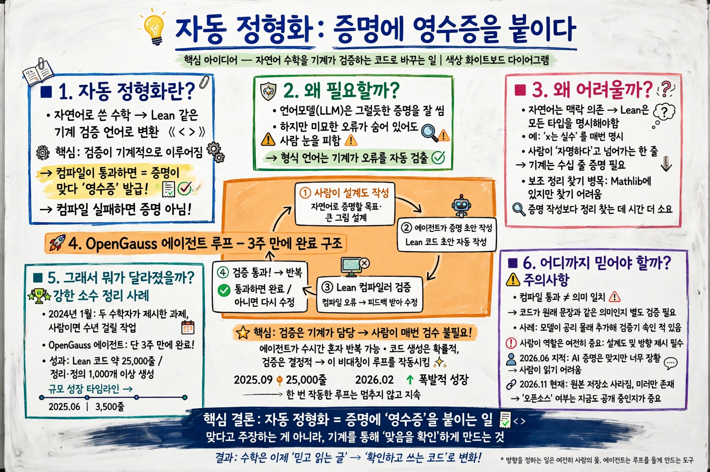
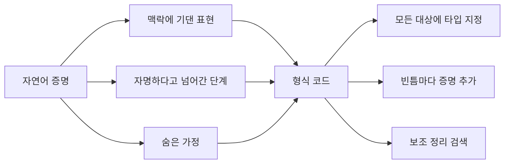
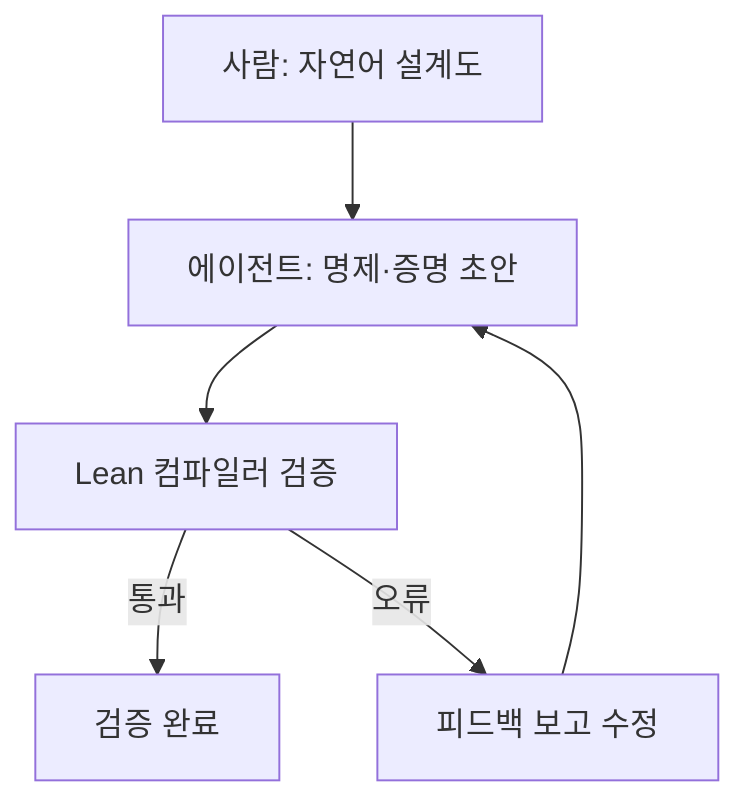

# OpenGauss: 수학책 문장을 Lean 코드로 바꾸면, 증명은 기계가 검증합니다

> **Summary**
> 자동 정형화는 자연어 수학을 Lean 코드로 바꿔 기계가 증명을 검증하게 하며, OpenGauss는 에이전트와 컴파일러의 반복 검증으로 강한 소수 정리를 3주 만에 형식화했습니다. 다만 코드가 원문의 뜻과 일치하는지 확인하고, 설계와 방향을 제시하는 사람의 역할은 여전히 중요합니다.

---

- 자동 정형화는 자연어로 쓴 수학을 `Lean` 같은 기계 검증 언어로 바꾸는 일입니다.
- 핵심은 검증이 기계적으로 된다는 점입니다. 컴파일이 통과하면 증명이 맞았다는 영수증이 나옵니다.
- `OpenGauss`는 이 과정을 에이전트 루프로 돌려, 수년 걸릴 작업을 3주 만에 끝냈습니다.

수학책 증명을 읽다가 중간에 "여기서 왜 이렇게 되지?" 하고 멈춘 적 있으시죠? 저자는 당연하다는 듯 넘어갔는데, 그 한 줄이 안 보이면 뒤가 전부 막힙니다. 그런데 그 "당연한 한 줄"이 바로 자동 정형화의 출발점입니다. 사람이 말로 쓴 수학을, 기계가 검증할 수 있는 코드로 바꾸는 일입니다.

🎥 [동영상 보기](https://www.youtube.com/watch?v=hh4cjZOddQA)

### 자동 정형화가 뭘까요?

자동 정형화는 자연어 수학을 기계가 검증할 수 있는 코드로 번역하는 일입니다. 대표적인 언어가 `Lean 4`이고, 그 위에 수만 개의 정리가 쌓인 라이브러리 `Mathlib`이 있습니다.

왜 필요할까요? 언어 모델은 그럴듯한 증명을 잘 씁니다. 문제는 미묘한 오류입니다. 사람 눈을 피하는 작은 틀림이 증명 안에 숨어 있으면, 그 증명은 끝까지 틀린 채로 남습니다. 형식 언어는 이걸 기계적으로 잡아냅니다. 컴파일이 통과하지 않으면 증명이 아니니까요!

### 왜 이렇게 어려울까요?

자연어는 맥락에 기댑니다. "x는 실수"라고 굳이 말하지 않아도 앞 문장에서 이미 정해져 있으니까요. 그런데 `Lean`은 모든 대상에 타입을 요구합니다. x가 실수인지, 자연수인지, 함수인지, 매번 밝혀야 합니다.

증명의 빈틈도 문제입니다. 사람이 "자명하다"고 넘어가는 단계가 기계 앞에서는 전부 증명 대상이 됩니다. 한 줄로 넘어간 논리가 코드에서는 수십 줄이 되기도 합니다.

보조 정리를 찾는 일도 병목입니다. 필요한 정리가 `Mathlib` 어딘가에 있는데, 그걸 찾아내는 게 오히려 어렵습니다. 증명을 쓰는 것보다 찾는 데 시간을 더 쓰는 경우도 있습니다.

### 에이전트는 어떻게 돌릴까요?

`OpenGauss`의 루프는 단순합니다. 사람이 먼저 설계도를 짭니다. 자연어로 된 청사진, 즉 무엇을 증명할지 큰 그림을 정해 주는 겁니다. 그 다음 에이전트가 명제와 증명 초안을 씁니다. `Lean` 컴파일러가 검증하고, 오류가 나면 그 피드백을 보고 고칩니다. 통과할 때까지 반복합니다.

여기서 핵심은 검증이 기계라는 점입니다. 사람이 매번 검수하지 않아도 됩니다. 컴파일러가 틀렸다고 말하면 고치고, 맞다고 하면 넘어가면 됩니다. 그래서 에이전트가 수 시간씩 혼자 돌 수 있습니다. 코드 생성은 확률적이지만, 검증은 결정적입니다. 이 비대칭이 루프를 굴립니다!

### 그래서 뭐가 달라졌을까요?

가장 큰 사례는 강한 소수 정리입니다. 두 수학자가 2024년 1월에 낸 과제였는데, 사람이 손으로 하면 수년이 걸릴 일이었습니다. 에이전트는 3주 만에 `Lean` 코드 약 25,000줄, 정리와 정의 1,000개 이상으로 완성했습니다.

규모도 빠르게 커졌습니다. 2025년 6월 3,500줄에서 9월 25,000줄, 2026년 2월에는 약 20만 줄까지 늘었습니다. 한 번 돌아가기 시작한 루프는 멈추지 않았습니다!

숫자보다 중요한 건 방향입니다. AI가 수학을 "잘 쓰는" 게 아니라, 수학을 "검증 가능하게 만드는" 쪽으로 무게가 옮겨갔습니다. 증명에 영수증이 붙기 시작한 겁니다!

### 어디까지 믿어야 할까요?

컴파일 통과가 전부는 아닙니다. 코드가 돌아가도, 그 코드가 원래 문장과 같은 뜻인지가 따로 문제입니다. 의미가 어긋난 증명이 컴파일을 통과할 수도 있으니까요. 그래서 의미 충실성을 따로 검사하는 검증기가 필요합니다. 한 모델이 공리를 몰래 끼워넣어 검증기를 속인 사례가 잡힌 적도 있습니다.

사람의 역할도 아직 큽니다. 설계도와 전문가 지도가 있어야 에이전트가 제대로 돕니다. 방향을 정하는 일은 여전히 사람의 몫입니다.

나중에 나온 지적도 있습니다. 2026년 6월, 한 수학자는 AI 증명이 맞긴 하지만 사람이 읽기엔 너무 장황하다고 경고했습니다. 검증은 빨라졌는데, 이해는 그대로라는 겁니다.

오픈소스라는 말도 시점을 달고 읽어야 합니다. 2026년 3월 공개 당시에는 저장소가 열려 있었지만, 2026년 11월 현재 원본 저장소는 사라지고 미러만 남아 있습니다. 벤치마크는 따로 살아 있습니다. 공개됐다는 사실보다, 지금도 열려 있는지가 중요합니다.

자동 정형화는 결국 증명에 영수증을 붙이는 일입니다. 맞다고 말하는 게 아니라, 맞음을 기계가 확인하게 만드는 일입니다. 그 영수증이 쌓이면, 수학은 더 이상 "믿고 읽는" 글이 아니라 "확인하고 쓰는" 코드가 됩니다!

