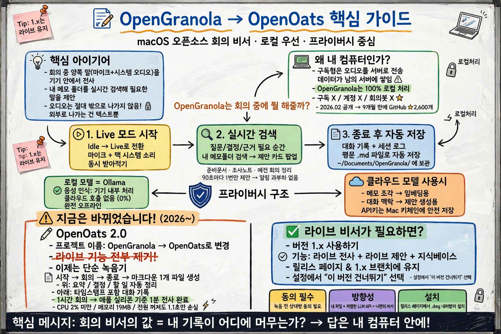
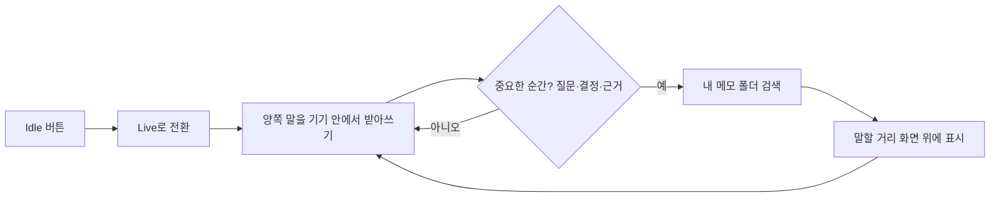
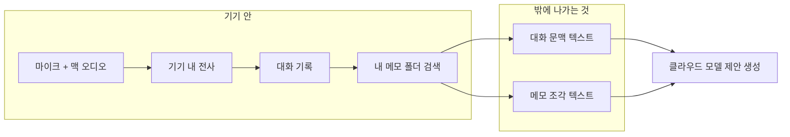

# OpenGranola: 회의 중 필요한 말을, 내 노트에서 찾아 띄워줍니다

> **Summary**
> OpenGranola(OpenOats)는 회의 양쪽의 음성을 기기 안에서 받아 적고 메모에서 필요한 정보를 찾아 띄워주는 macOS 오픈소스 도구입니다. 오디오는 외부로 전송되지 않으며, 로컬 모델을 사용하면 텍스트도 기기 밖으로 나가지 않습니다. 현재 OpenOats 2.0에서는 라이브 기능이 빠졌고, 라이브 비서가 필요하면 1.x를 사용할 수 있습니다. 녹음 전에는 참석자의 동의를 받아야 합니다.

---

- OpenGranola는 회의 중 양쪽 말을 기기 안에서 받아 적고, 내 메모 폴더에서 지금 필요한 말을 찾아 띄워주는 macOS 오픈소스 회의 비서입니다.
- 오디오는 절대 밖으로 나가지 않습니다. 밖에 나가는 건 대화 문맥과 메모 조각, 텍스트뿐입니다.
- 지금은 이름이 OpenOats로 바뀌었고, 새 버전에서는 라이브 기능이 빠졌습니다. 라이브 비서가 필요하면 1.x를 쓰면 됩니다.

회의가 끝나고 나서야 "아, 그 자료를 보여줄 걸" 하고 후회한 적 있으시죠? 상대방이 딱 그 얘기를 꺼냈을 때, 내 노트 어딘가에 답이 있었는데 말이죠.

🎥 [동영상 보기](https://www.youtube.com/watch?v=6FnhSC_eSz8)

## 회의 비서, 왜 구독이 아니라 내 컴퓨터여야 할까요?

유료 회의 비서는 회의 오디오를 서버로 보냅니다. 매달 돈을 내고, 내 회의 기록은 남의 서버에 쌓입니다. 편리함의 대가가 데이터입니다. 그런데 그 일을 내 컴퓨터에서도 할 수 있다면 어떨까요?

OpenGranola는 그 질문에 대한 답이었습니다. 2026년 2월 말에 공개된 macOS용 오픈소스 회의 비서로, 공개된 지 9개월 만에 별 2,600개 넘게 받았습니다. 구독도, 계정도, 회의에 들어오는 봇도 없습니다!

## OpenGranola는 회의 중에 뭘 해줄까요?

버튼 하나만 누르면 됩니다. `Idle`에서 `Live`로 바꾸면, 내 마이크와 맥이 내는 소리를 양쪽 다 받아 적기 시작합니다. 화면 공유 중에는 창이 보이지 않아서, 상대방은 비서를 쓰고 있다는 걸 모릅니다.

진짜 재미는 대화가 중요한 순간에 닿을 때 시작됩니다. 질문이 나오거나, 결정을 내려야 하거나, 근거가 필요한 주장이 나왔을 때, 내 메모 폴더를 검색해 말할 거리를 화면 위에 띄워줍니다. 회의 준비 문서, 조사 노트, 예전 회의 정리 — 뭐든 메모 폴더에 넣어두면 회의 중에 꺼내 쓸 수 있습니다.

회의가 끝나면 대화 기록과 세션 로그가 평문 파일로 자동 저장됩니다. 따로 내보낼 필요가 없습니다.

이 장면이 저는 가장 인상 깊었습니다. 비서가 말을 거는 게 아니라, 말이 필요해진 순간에만 끼어든다는 점이요. 90초에 한 번씩만 제안을 검토해서, 화면이 알림으로 뒤덮이지도 않습니다.

## 오디오는 절대 밖으로 나가지 않습니다. 그럼 뭐가 나가나요?

프라이버시 구조는 이렇게 나뉩니다. 음성 인식은 기기 안에서만 돕니다. 오디오는 절대 밖으로 나가지 않습니다!

밖에 나가는 건 텍스트뿐입니다. 클라우드를 쓰면 메모 조각이 임베딩용으로, 대화 문맥이 제안 생성용으로 나갑니다. 그런데 로컬 모델을 쓰면 이야기가 달라집니다. `Ollama`를 쓰면 네트워크 호출이 아예 없습니다. 전부 내 컴퓨터 안에서 끝납니다.

API 키는 맥의 키체인에 저장됩니다. 내 메모 폴더는 `~/Documents/OpenGranola/` 아래에 평문 파일로 남습니다. 설치는 릴리스 페이지에서 디스크 이미지를 받아 끌어다 놓으면 끝납니다.

## 그런데 지금은 이름도, 모습도 바뀌었습니다?

프로젝트 이름이 OpenOats로 바뀌었습니다. 그리고 새 버전 2.0은 아예 다른 앱이 됐습니다. 라이브 전사, 라이브 제안, 지식 베이스가 통째로 빠졌습니다!

지금의 OpenOats는 녹음기입니다. 시작을 누르고, 회의를 하고, 멈추면 마크다운 파일 하나가 나옵니다. 위에는 요약·결정·할 일이, 아래에는 시간 표시가 붙은 대화 기록이 있습니다. 1시간짜리 회의는 애플 실리콘에서 1분 남짓이면 전사가 끝납니다. 녹음 중에는 CPU 2%도 안 쓰고, 메모리는 19MB 수준입니다. 전원이 나가도 녹음은 몇 초만 잃습니다. 종료 테스트에서는 1.1초만 잃었습니다.

라이브 비서가 필요하면 1.x를 쓰면 됩니다. 릴리스 페이지와 1.x 브랜치에 그대로 남아 있습니다. 업데이트 알림에서 "이 버전 건너뛰기"를 누르면 됩니다.

## 구독 대신, 내 파일과 저렴한 API로?

이 도구가 보여주는 방향이 있습니다. 특정 업체 서비스에 묶이는 대신, 내 로컬 파일과 저렴한 LLM API를 직접 연결해 나만의 비서를 만드는 흐름입니다. 모델 성능이 오를수록 기술적 해자는 얇아지고, 그 자리를 오픈소스가 메우고 있습니다.

다만 한 가지는 잊지 말아야 합니다. 녹음에는 동의가 필요합니다. 상대방에게 알리지 않고 녹음하면 안 되는 곳이 많습니다. 앱도 첫 녹음 전에 이 점을 확인받습니다.

회의 비서의 값은 매달 내는 돈이 아니라, 내 기록이 어디에 머무는지로 정해집니다. 그 기준이라면, 답은 내 컴퓨터 안에 있습니다!

