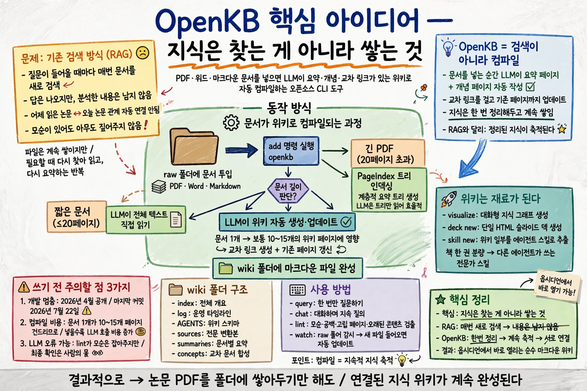
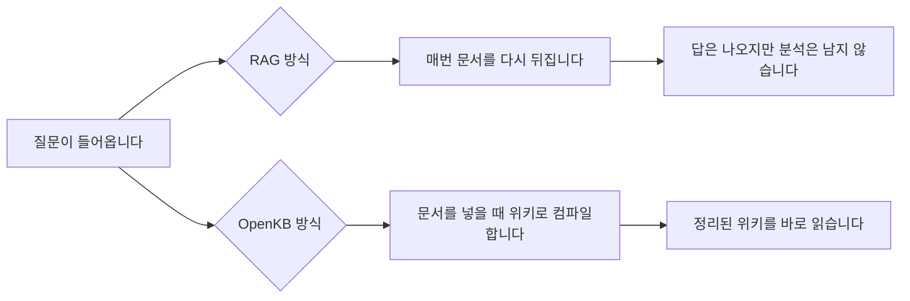
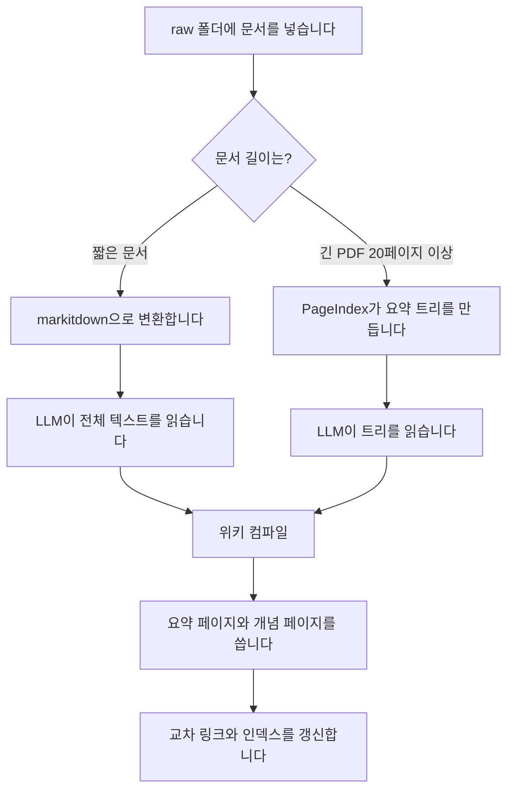
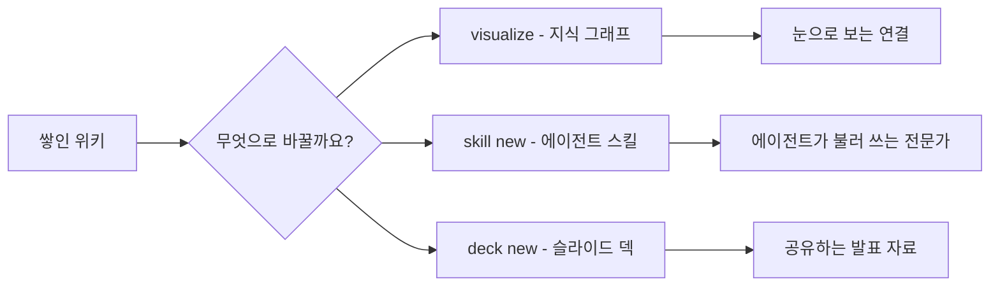

# OpenKB: 문서를 넣으면 위키가 됩니다. 지식은 다시 찾지 않고 쌓입니다

> **Summary**
> OpenKB는 문서를 요약·개념 페이지와 교차 링크가 연결된 마크다운 위키로 컴파일해 지식을 축적하며, 긴 PDF는 PageIndex로 처리하고 위키를 에이전트 스킬·지식 그래프·슬라이드로 만들 수 있습니다. 다만 개발이 멈춰 있고 LLM 오류와 문서 처리 비용이 발생할 수 있어 결과를 검토해야 합니다.

---

- OpenKB는 PDF·워드·마크다운 같은 문서를 넣으면 LLM이 요약·개념·교차 링크가 있는 위키로 자동 컴파일하는 오픈소스 CLI 도구입니다.
- 매번 다시 검색하는 RAG와 달리, 지식은 한 번 정리해두고 문서가 들어올 때마다 쌓입니다. 긴 PDF는 PageIndex 트리 인덱싱으로 처리합니다.
- 위키는 순수 마크다운이라 옵시디언에서 바로 열리고, 스킬 팩토리로 에이전트 스킬까지 뽑아낼 수 있습니다. 다만 2026년 7월 이후 개발이 멈춰 있다는 점은 알고 써야 합니다.

논문 PDF를 폴더에 쌓아두기만 하고, 정작 필요할 때 다시 찾지 못한 적 있으시죠? 파일 이름은 기억나는데, 그 안에 뭐라고 적혀 있었는지는 기억나지 않습니다. 그래서 매번 파일을 다시 열고, 다시 읽고, 다시 요약합니다. 같은 일을 몇 번이나 반복하는 걸까요?

🎥 [동영상 보기](https://www.youtube.com/watch?v=3pL8h_Yljkg)

## 매번 다시 찾는 검색, 왜 아쉬울까요?

흔한 검색 방식은 매번 새로 찾습니다. 질문이 들어오면 그때그때 문서를 뒤져서 답을 만듭니다. 답은 나오지만, 분석한 내용은 남지 않습니다. 어제 읽은 논문과 오늘 읽은 논문이 서로 무슨 관계인지도 자동으로 이어지지 않습니다. 모순이 있어도 아무도 짚어주지 않습니다!

OpenKB는 반대쪽에 섰습니다. 검색이 아니라 컴파일입니다. 문서를 넣는 순간 LLM이 요약 페이지와 개념 페이지를 쓰고, 교차 링크를 걸고, 기존 페이지까지 업데이트합니다. 지식은 한 번 정리해두고 계속 쌓입니다. 나중에 물어볼 땐 이미 정리된 위키를 읽으면 됩니다.

## 문서가 들어오면, 위키는 어떻게 만들어질까요?

과정은 단순합니다. 문서를 `raw/` 폴더에 넣고 `openkb add`를 실행하면 됩니다. 그런데 문서를 대하는 방식이 길이 따라 달라집니다. 짧은 문서는 LLM이 전체 텍스트를 직접 읽습니다. 20페이지가 넘는 긴 PDF는 다릅니다. PageIndex가 계층적 요약 트리를 만들고, LLM은 전체 텍스트 대신 트리를 읽습니다. 수백 페이지짜리 문서도 컨텍스트 창에 구겨 넣지 않고 처리하는 방법입니다.

문서 하나가 들어오면 LLM은 요약 페이지를 만들고, 기존 개념 페이지를 읽어 새 지식으로 업데이트하거나 새 개념 페이지를 만듭니다. 인덱스와 로그도 함께 갱신합니다. 문서 하나가 보통 10~15개의 위키 페이지에 영향을 미친다고 합니다. 문서가 고립된 섬이 아니라 전체 지식 그래프의 일부로 연결되는 이유입니다.

완성된 위키는 `wiki/` 폴더 안에 평범한 파일들로 놓입니다. `index.md`가 전체 개요를, `log.md`가 운영 타임라인을, `AGENTS.md`가 위키 스키마를 담습니다. `sources/`엔 전문 변환본이, `summaries/`엔 문서별 요약이, `concepts/`엔 교차 문서 합성이 들어갑니다. 핵심은 `concepts/`입니다. 여러 문서를 아우르는 개념이 여기에 쌓이니까요!

## 위키는 그냥 파일입니다. 그래서 어디서든 열립니다

위키는 순수 마크다운 파일입니다. `[[위키링크]]`로 연결된 평범한 파일이라 옵시디언에서 바로 열립니다. 그래프 뷰로 개념들이 어떻게 이어졌는지 눈으로 볼 수도 있습니다. 데이터베이스도, 전용 서버도 필요 없습니다. 파일이 곧 지식 베이스입니다.

물어보는 방법도 두 가지입니다. `openkb query`로 한 번만 물어보거나, `openkb chat`으로 대화를 이어가며 물어볼 수 있습니다. 대화 세션은 저장했다가 나중에 다시 이어갈 수 있습니다.

위키가 커지면 건강 검진도 필요합니다. `openkb lint`를 실행하면 모순, 공백, 고립된 페이지, 오래된 콘텐츠를 찾아줍니다. `openkb watch`를 켜두면 `raw/` 폴더를 감시하다가 새 파일이 들어오면 위키를 자동으로 업데이트합니다. 넣어두기만 하면 위키가 알아서 자라는 구조입니다!

## 위키가 쌓이면, 결과물로 뽑아낼 수 있을까요?

위키는 끝이 아니라 재료입니다. OpenKB에는 위키를 결과물로 바꾸는 생성기가 있습니다. `openkb visualize`는 대화형 지식 그래프를 만들어줍니다. 3D, 마인드맵, 방사형 보기로 개념의 연결을 한눈에 볼 수 있습니다. `openkb deck new`는 단일 HTML 파일로 된 슬라이드 덱을 만듭니다.

가장 눈에 띄는 건 스킬 팩토리입니다. `openkb skill new`를 실행하면 위키의 일부를 에이전트 스킬로 뽑아낼 수 있습니다. 책 한 권 분량의 문서를 넣으면, 다른 에이전트가 불러 쓸 수 있는 전문가 스킬이 나옵니다. 위키가 내 컴퓨터 안에만 머무르지 않고, 에이전트의 손으로 넘어가는 순간입니다!

## 쓰기 전에, 알고 써야 할 것들이 있습니다

좋은 도구라고 무조건 달려들면 안 됩니다. 알고 써야 할 점이 세 가지 있습니다.

첫째, 개발이 멈춰 있습니다. 2026년 4월에 공개됐고, 별 5,000개를 넘기며 주목받았지만, 마지막 커밋은 2026년 7월 22일입니다. 새 버전 후보가 올라온 뒤로 조용합니다. 긴 호흡으로 쓸 위키를 시작하기 전엔 이 점을 봐야 합니다. 멈춘 도구에 지식을 맡기는 건, 생각해볼 일입니다.

둘째, 컴파일에는 비용이 듭니다. 문서 하나가 10~15개 페이지를 건드리니, 넣을수록 LLM 호출이 쌓입니다. 대신 한 번 만든 뒤에 물어보는 비용은 가볍습니다. 쌓는 데 돈을 쓰고, 쓰는 데 아끼는 구조라고 보면 됩니다.

셋째, LLM이 잘못 읽을 수 있습니다. 요약이 틀리거나, 개념을 엉뚱하게 묶을 수도 있습니다. `lint`가 모순을 잡아주지만, 마지막 확인은 사람의 몫입니다. 위키를 믿기 전에, 가끔은 직접 열어보는 습관이 필요합니다.

지식은 찾는 게 아니라 쌓는 것이라는 아이디어, OpenKB는 그걸 손에 잡히는 도구로 만들었습니다. 문서가 쌓여 있다면, 한 번 넣어보는 것부터 시작하면 됩니다.

