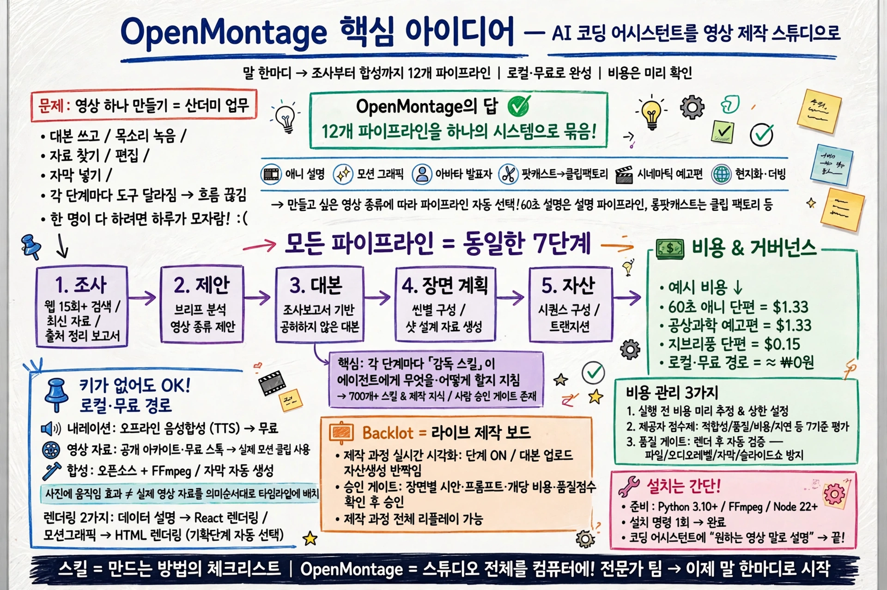
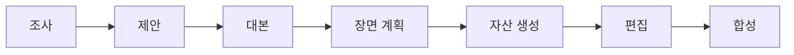
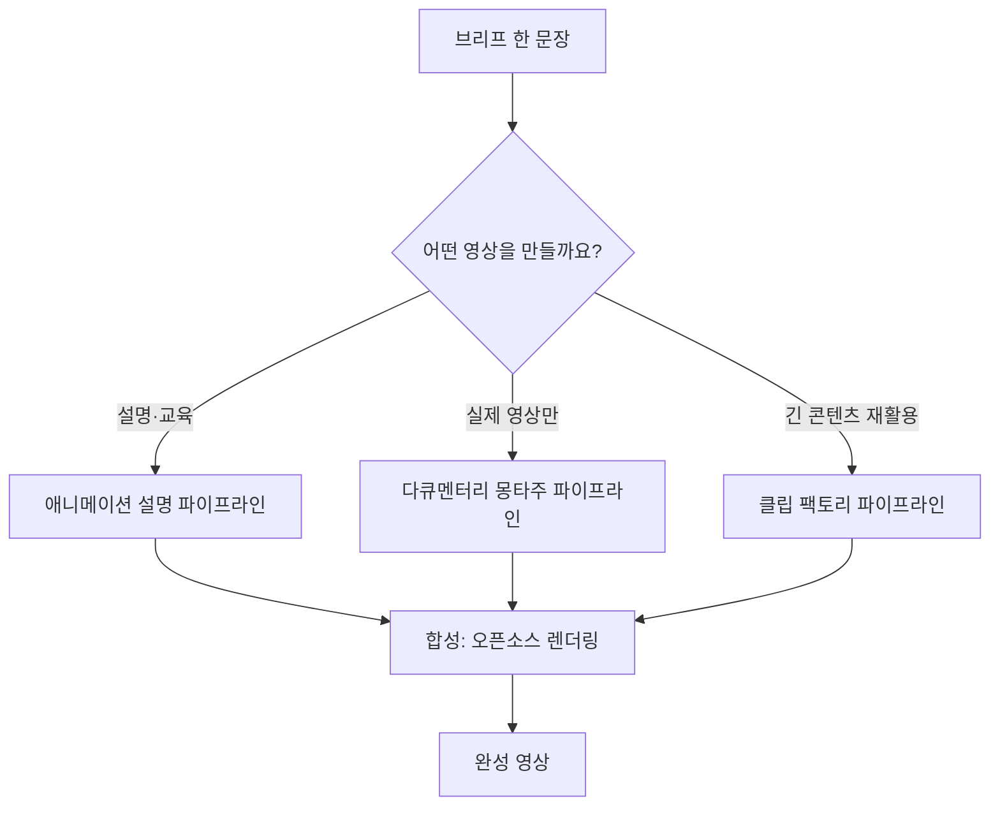

# OpenMontage: 영상 하나 만드는 데 12개 파이프라인이 돕니다. 코딩 어시스턴트가 스튜디오가 됩니다

> **Summary**
> OpenMontage는 AI 코딩 어시스턴트를 영상 제작 스튜디오로 바꾸는 오픈소스 시스템으로, 말 한 마디로 시작하면 조사부터 대본, 자산 생성, 편집, 합성까지 12개 파이프라인이 나눠 맡습니다. 파이프라인마다 흐름은 같습니다. 조사, 제안, 대본, 장면 계획, 자산, 편집, 합성 순서로 가고, 각 단계마다 감독 스킬이 에이전트에게 방법을 가르치며, 대본을 쓰기 전에 웹을 15번 넘게 검색해 최신 정보를 모읍니다. 키가 없어도 만들 수 있습니다. 로컬 음성 합성과 무료 영상 자료, 오픈소스 합성 도구로 실제 영상까지 완성하고, 60초 단편이 1.33달러 수준으로 만들어지며 비용은 실행 전에 미리 확인합니다.

---

- OpenMontage는 AI 코딩 어시스턴트를 영상 제작 스튜디오로 바꾸는 오픈소스 시스템입니다. 말 한 마디로 시작하면 조사부터 대본, 자산 생성, 편집, 합성까지 12개 파이프라인이 나눠 맡습니다.
- 파이프라인마다 흐름은 같습니다. 조사 → 제안 → 대본 → 장면 계획 → 자산 → 편집 → 합성 순서로 가고, 각 단계마다 감독 스킬이 에이전트에게 방법을 가르칩니다.
- 키가 없어도 만들 수 있습니다. 로컬 음성 합성과 무료 영상 자료, 오픈소스 합성 도구로 실제 영상까지 완성하고, 비용은 실행 전에 미리 확인합니다.

유튜브에 올릴 영상 하나 만들려고요. 그런데 대본 쓰고, 목소리 녹음하고, 자료 찾고, 편집하고, 자막 넣는 일이 산더미처럼 쌓여 있지 않으셨나요? 한 명이 다 하려면 하루가 모자랍니다!

🎥 [동영상 보기](https://www.youtube.com/watch?v=dyGjMasaZKs)

### 영상 제작, 왜 이렇게 손이 많이 갈까요?

영상은 단계가 많은 작업입니다. 주제를 정하고, 자료를 찾고, 대본을 쓰고, 화면을 만들고, 목소리를 입히고, 음악을 고르고, 편집하고, 자막을 넣어야 합니다. 각 단계마다 쓰는 도구가 달라서, 손이 바뀌는 순간마다 흐름이 끊깁니다.

그래서 대부분의 AI 영상 도구는 한 조각만 맡습니다. 클립 하나를 뽑아주는 도구가 대표적입니다. 그런데 OpenMontage는 생각이 다릅니다. 영상 제작 전체를 하나의 시스템으로 묶었습니다.

### 12개 파이프라인, 뭐가 다를까요?

OpenMontage에는 12개 파이프라인이 들어 있습니다. 애니메이션 설명 영상, 모션 그래픽, 아바타 발표자, 시네마틱 예고편, 클립 팩토리, 다큐멘터리 몽타주, 하이브리드, 현지화·더빙, 팟캐스트 재활용, 화면 데모, 토킹 헤드, 캐릭터 애니메이션까지입니다.

핵심은 선택입니다. 만들고 싶은 영상 종류에 따라 파이프라인이 달라집니다. 60초 설명 영상을 원하면 설명 파이프라인이, 2시간짜리 팟캐스트를 짧은 클립 여러 개로 나누고 싶으면 클립 팩토리가 맡습니다. 어떤 파이프라인을 쓸지는 에이전트가 브리프를 보고 정합니다.

### 파이프라인은 어떻게 돌아갈까요?

모든 파이프라인이 같은 일곱 단계를 밟습니다. 조사, 제안, 대본, 장면 계획, 자산, 편집, 합성 순서입니다.

조사 단계가 먼저인 점이 눈에 띕니다. 대본을 쓰기 전에 에이전트가 웹을 뒤집니다. 영상 플랫폼, 커뮤니티, 뉴스, 학술 자료까지 15번 넘게 검색해서 최신 정보를 모으고, 출처를 정리한 조사 보고서를 만듭니다. 대본은 그 보고서 위에서 쓰입니다. 그래서 내용이 공허해지지 않습니다.

각 단계마다 감독 스킬이 있습니다. 스킬은 에이전트에게 "이 단계에서 무엇을, 어떻게 하라"고 가르치는 지침 파일입니다. 에이전트는 스킬을 읽고 도구를 쓰고, 스스로 검토하고, 중요한 결정 앞에서는 사람에게 승인을 받습니다. 스킬과 제작 지식 파일이 700개가 넘습니다.

### 키 없이도 진짜 영상이 될까요?

됩니다! API 키가 하나도 없어도 만들 수 있는 경로가 따로 있습니다. 내레이션은 오프라인 음성 합성 도구가 맡고, 영상 자료는 공개 아카이브와 무료 스톡에서 가져오고, 합성은 오픈소스 렌더링 도구와 `FFmpeg`이 처리합니다. 자막도 자동으로 만들어집니다.

여기서 한 가지는 짚고 넘어가야 합니다. "무료 AI 영상"이라는 말의 속뜻이 보통은 사진 몇 장을 움직이는 효과에 그치기 때문입니다. 그런데 OpenMontage는 실제 움직이는 영상을 씁니다. 무료 영상 자료와 공개 아카이브에서 진짜 모션 클립을 모아 의미 순서대로 잘라 타임라인에 올립니다. 사진에 움직임 효과를 얹은 것과는 차원이 다릅니다.

합성에는 두 가지 런타임이 있습니다. 데이터 중심 설명 영상에는 리액트 기반 렌더링이, 모션 그래픽이 많은 기획에는 HTML 기반 렌더링이 기본값입니다. 에이전트가 기획 단계에서 어느 쪽을 쓸지 정해 둡니다.

### 제작 현장을 실시간으로 본다고요?

Backlot이라는 이름의 라이브 보드가 있습니다. 채팅은 에이전트가 "뭐라고 했는지"만 보여주지만, 이 보드는 제작이 "실제로 어떻게 돌아가는지"를 보여줍니다. 단계가 켜지고, 대본이 각본 페이지로 올라오고, 장면 카드가 자산 생성 중에 반짝이고, 제공자 선택과 쓴 돈이 벽에 붙습니다.

이 보드는 승인 게이트이기도 합니다. 자산 생성이 끝나면 장면별 연락 시트가 멈춰 섭니다. 장면마다 시안, 프롬프트, 개당 비용, 품질 점수가 붙어서, 렌더링 전에 눈으로 확인하고 승인합니다. 끝나고 나면 전체 제작 과정을 처음부터 다시 재생할 수도 있습니다.

### 비용은 얼마나 들까요?

놀라운 부분은 비용입니다. 60초짜리 애니메이션 단편이 1.33달러에 만들어졌습니다. 공상과학 예고편도 1.33달러, 지브리풍 단편은 0.15달러 수준이었습니다. 물론 유료 제공자를 쓸 때의 이야기이고, 로컬·무료 경로만 쓰면 0원에 가깝습니다.

비용이 새지 않는 이유는 거버넌스가 있기 때문입니다. 실행 전에 비용을 미리 추정하고, 지출 상한을 정하고, 일정 금액이 넘는 작업은 승인을 받습니다. 제공자 선택도 점수로 매깁니다. 작업 적합성, 출력 품질, 제어 가능성, 신뢰성, 비용 효율, 지연, 연속성까지 일곱 가지 기준으로 점수를 매기고, 그 기록이 남습니다. 어떤 선택을 왜 했는지 나중에 되짚어볼 수 있습니다.

품질 게이트도 있습니다. 렌더링이 끝나면 파일 검증, 프레임 샘플링, 오디오 레벨 분석, 자막 검사가 자동으로 돕니다. 슬라이드쇼처럼 보이는 결과물은 아예 막힙니다. 에이전트가 검증되지 않은 결과물을 내놓지 못하게 설계된 것입니다.

### 스킬 하나와 시스템 하나, 뭐가 다를까요?

비슷해 보이지만 다릅니다. 모션 그래픽 제작 순서와 단계별 점검을 담은 스킬은, 코딩 어시스턴트 안에서 영상 제작 단계를 따라가게 해주는 지침 한 벌입니다. 잘 만든 체크리스트에 가깝습니다.

OpenMontage는 그 위에 시스템 전체가 얹혀 있습니다. 12개 파이프라인, 100개가 넘는 도구, 60개가 넘는 제공자 연결, 실시간 제작 보드, 품질 게이트, 비용 거버넌스까지 한 묶음입니다. 스킬이 "어떻게 만들지"를 가르친다면, 시스템은 "만드는 데 필요한 모든 것을 연결해서 끝까지 굴리는" 쪽입니다. 모션 그래픽 스킬이 한 장르의 작업 지침이라면, OpenMontage는 스튜디오 전체를 통째로 옮겨온 셈입니다!

설치는 간단합니다. 파이썬 3.10 이상, `FFmpeg`, 노드 22 이상을 준비하고, 프로젝트를 받아 설치 명령 한 번이면 됩니다. 그다음 코딩 어시스턴트에 만들고 싶은 영상을 말로 설명하면 됩니다. "신경망이 배우는 방식을 설명하는 60초 애니메이션을 만들어줘"처럼요.

영상 제작이 원래 전문가 팀의 일이었다면, 이제는 말 한 마디로 시작하는 일이 됐습니다. 스튜디오를 통째로 빌리는 대신, 스튜디오를 내 컴퓨터에 들이는 쪽이 더 빠릅니다!

