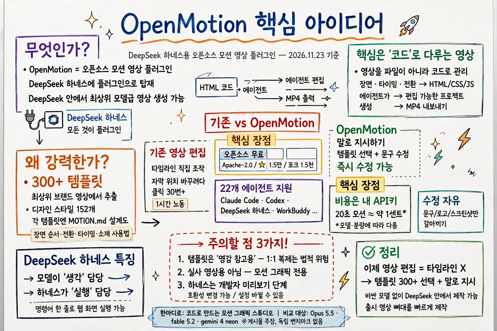
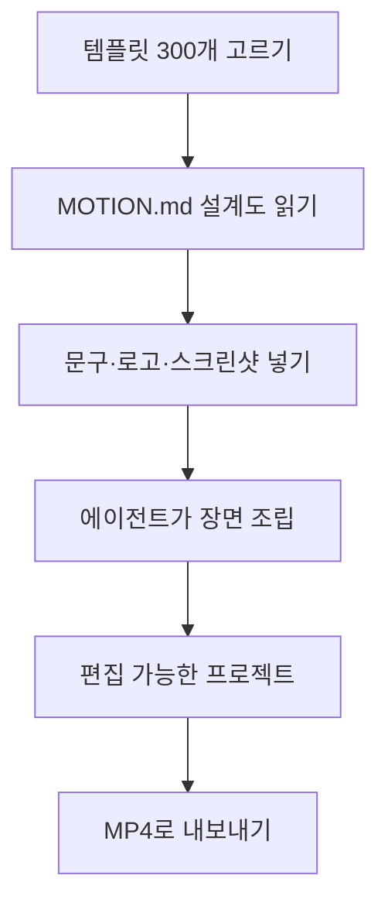

# OpenMotion: DeepSeek에서도 최상위 모델급 동영상을 만듭니다. 템플릿 300개가 비결입니다

> **Summary**
> OpenMotion은 300개 이상의 템플릿과 152개 이상의 디자인 스타일을 활용해 DeepSeek 하네스에서 모션 그래픽 영상을 만들 수 있는 무료 오픈소스 플러그인입니다. 영상은 HTML·CSS·JavaScript 기반의 편집 가능한 프로젝트로 생성해 MP4로 내보낼 수 있으며, 모델 사용 비용은 별도로 부담해야 합니다. 실사 영상 제작 도구가 아니고 템플릿은 참고용이며, DeepSeek 하네스는 아직 미리보기 단계입니다.

---

- OpenMotion은 오픈소스 모션 영상 플러그인입니다. DeepSeek 하네스에 올라가면서, DeepSeek 안에서도 최상위 모델급 동영상을 만들 수 있게 됐습니다.
- 비결은 템플릿입니다. 최상위 브랜드 영상에서 뽑은 템플릿 300개와 디자인 스타일 152개가 들어 있습니다.
- 영상은 HTML로 만듭니다. 장면·타이밍·전환을 코드로 적으면, 에이전트가 편집 가능한 프로젝트로 바꿔 MP4로 내보냅니다.

제품 출시 영상 하나 만들려고, 영상 편집 툴을 켜고 타임라인 앞에서 한 시간을 보낸 적 있으시죠? 자막 위치 하나 바꾸는 데도 클릭이 수십 번입니다. 그런데 이제는 말로 시키면 됩니다. 그것도 유료 최상위 모델이 아니라, DeepSeek 안에서 말이죠!

🎥 [동영상 보기](https://www.youtube.com/watch?v=rMRsVyIsZCU)

## OpenMotion, 도대체 뭘까요?

OpenMotion은 에이전트가 만드는 모션 영상 스튜디오입니다. 오픈소스이고, `Claude Motion`과 `CapCut`의 대안으로 소개됐습니다. 참고 영상을 올리면 에이전트가 그 영상을 분석해, 브랜드 키트를 입힌 편집 가능한 모션 그래픽으로 다시 만듭니다. 완성본은 유튜브·쇼츠·릴스·틱톡용 MP4로 내보낼 수 있습니다.

핵심은 영상을 파일이 아니라 코드로 다룬다는 점입니다. 장면·글자·레이아웃·전환·타이밍을 HTML·CSS·자바스크립트로 적습니다. 그래서 결과물이 잠긴 영상이 아니라, 고칠 수 있는 프로젝트로 남습니다. 문구 하나 바꾸고 싶으면 파일을 고치면 됩니다. 다시 처음부터 만들 필요가 없습니다!

## DeepSeek 하네스에 올라갔다는 게 무슨 뜻일까요?

DeepSeek 하네스는 DeepSeek이 공개한 오픈소스 에이전트 하네스입니다. "모든 것이 플러그인"이라는 구조로, 필요한 기능을 플러그인으로 붙였다 뗐다 합니다. 공식 표현을 빌리면, 모델이 생각을 맡고 하네스가 실행을 맡는 구조입니다. 웹 화면은 명령어 한 줄로 띄웁니다.

OpenMotion이 이 하네스의 플러그인으로 들어오면서, DeepSeek 안에서 바로 모션 영상을 만들 수 있게 됐습니다. 게시물의 표현은 이렇습니다. DeepSeek 안에서 최상위 모델급 동영상을 만들 수 있게 됐다고 말이죠. 비교 대상으로 든 이름은 `Opus 5.5`와 `fable 5.2`, `gemini 4 neon`입니다. 다만 이 비교는 게시물 쪽 주장이라는 점을 밝혀둡니다. 독립적인 벤치마크 결과가 나온 것은 아닙니다.

## 템플릿 300개, 어떻게 쓰는 걸까요?

템플릿이 이 플러그인의 본체입니다. 최상위 브랜드 영상에서 뽑은 템플릿이 300개 넘게 들어 있고, 디자인 스타일은 152개가 넘습니다. 템플릿마다 미리보기와 모션 설명, 재현용 안내가 붙어 있습니다.

각 템플릿에는 `MOTION.md`라는 파일이 따라옵니다. 장면 순서와 타이밍, 전환,소재 사용법을 마크다운으로 적어둔 설계도입니다. 에이전트는 이 설계도를 읽고 영상을 만듭니다. 그래서 템플릿을 고르는 일이 곧 영상의 뼈대를 고르는 일이 됩니다. 출시 데모에서는 다섯 가지 AI 제품의 출시 영상을 같은 방식으로 만들었습니다. 제품 문구와 로고, 스크린샷만 갈아 끼우면 됩니다.

## 공짜라고요? 그럼 돈은 어디서 나갈까요?

플러그인 자체는 무료이고 오픈소스입니다. 라이선스는 `Apache-2.0`입니다. 별 개수는 1만 5천 개가 넘었고, 포크도 1천5백 개가 넘었습니다. 2026년 11월 23일 기준 수치입니다. 지원하는 에이전트는 22개입니다. `Claude Code`와 `Codex`, DeepSeek 하네스, `WorkBuddy` 등이 있습니다.

다만 "무료"의 뜻을 정확히 짚어야 합니다. 플러그인은 무료지만, 영상 만드는 데 드는 모델 비용은 내 키로 냅니다. "내 키를 가져온다"는 방식입니다. 모델·이미지·음성 등 각 단계마다 내 API 키를 씁니다. DeepSeek의 저렴한 가격이 자주 언급되는 이유가 여기에 있습니다. 한 튜토리얼에서는 20초짜리 모션 영상을 만드는 데 1센트 정도가 들었다고 전했습니다. 물론 모델과 분량에 따라 달라집니다.

## 쓰기 전에 확인할 것, 세 가지가 있습니다!

첫째, 템플릿은 "영감을 받은" 것입니다. 최상위 브랜드 영상을 그대로 복사한 게 아닙니다. 1:1로 베끼면 법적 문제가 생길 수 있으니, 패턴만 참고하는 선에서 써야 합니다. 둘째, 이건 실사 영상을 만드는 도구가 아닙니다. 모션 그래픽, 즉 움직이는 디자인 영상 전용입니다. 사람이나 풍경이 나오는 실사 영상은 다른 도구의 몫입니다. 셋째, DeepSeek 하네스 자체가 아직 개발자 미리보기 단계입니다. 호환성이 깨지는 변경이 있을 수 있다고 공식 안내에 적혀 있습니다. 새 버전이 나오면 설정이 바뀔 수 있습니다.

## 이 글과 앞선 글, 어떻게 다를까요?

앞선 글에서 오픈 디자인의 모션 기능을 다룬 적이 있습니다. 그 글은 워크스페이스 안에 들어간 모션 기능 자체가 주제였습니다. 이 글은 다릅니다. 그 기능을 DeepSeek 하네스용 플러그인으로 꺼내 쓴 소식, 그리고 템플릿 300개라는 라이브러리가 주제입니다. 기능 하나가 아니라, 생태계가 넓어졌다는 이야기입니다.

정리하면 이렇습니다. 영상 편집은 이제 타임라인을 손으로 끄는 일이 아니라, 템플릿을 고르고 말로 지시하는 일이 됐습니다. 비싼 모델이 없어도 됩니다. DeepSeek 안에서, 오픈소스 플러그인 하나로, 출시 영상의 뼈대를 만들 수 있습니다. 나머지 한계만 정확히 알면 됩니다. 실사가 아니라는 점, 템플릿은 참고용이라는 점, 하네스가 아직 미리보기라는 점 말이죠. 그 세 가지만 기억하면, 다음 출시 영상은 훨씬 가볍게 만들 수 있습니다!

