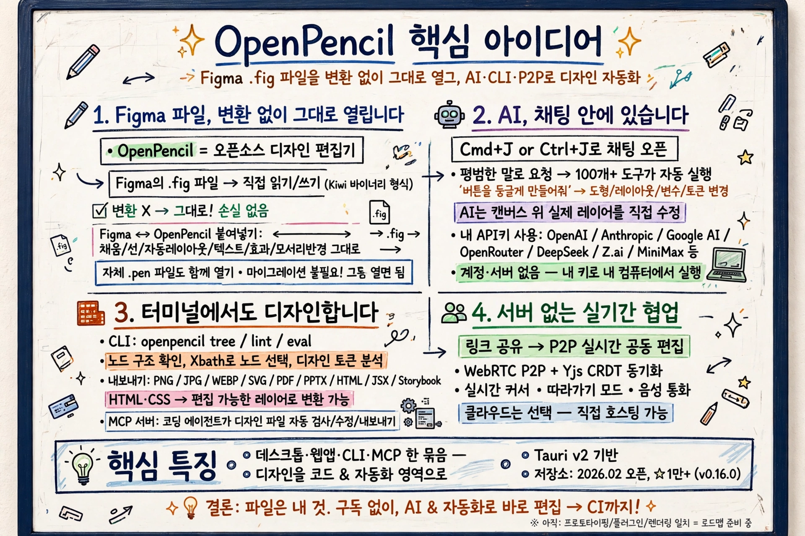
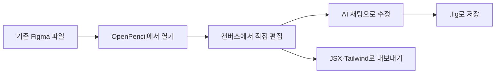
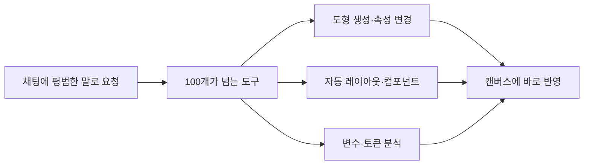
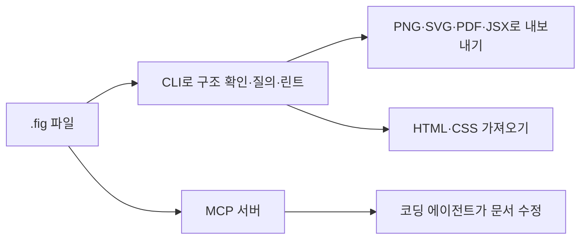

# OpenPencil: Figma 파일을 그대로 열고, AI가 캔버스 위에서 직접 디자인합니다

> **Summary**
> OpenPencil은 Figma의 .fig 파일을 그대로 열고 저장하는 오픈소스 디자인 편집기입니다. 변환이 아니라 같은 형식을 직접 읽고 씁니다. 채팅으로 말을 걸면 100개가 넘는 도구가 캔버스 위에서 도형을 만들고 속성을 바꾸고 레이아웃을 잡아줍니다. 계정도, 서버도 필요 없습니다. 데스크톱 앱·웹앱·CLI·MCP 서버까지 한 묶음으로, 디자인을 코드와 자동화의 영역으로 가져옵니다.

---

- OpenPencil은 Figma의 `.fig` 파일을 그대로 열고 저장하는 오픈소스 디자인 편집기입니다. 변환이 아니라 같은 형식을 직접 읽고 씁니다.
- 채팅으로 말을 걸면 100개가 넘는 도구가 캔버스 위에서 도형을 만들고 속성을 바꾸고 레이아웃을 잡아줍니다. 계정도, 서버도 필요 없습니다.
- 데스크톱 앱·웹앱·CLI·MCP 서버까지 한 묶음으로, 디자인을 코드와 자동화의 영역으로 가져옵니다.


디자인 파일 하나 열려고 구독 결제 알림부터 마주친 적 있으시죠? 파일은 내 것인데, 열어보는 일조차 구독 상태에 묶여 있습니다. 그래서 문득 이런 생각이 듭니다. 내 파일인데, 왜 내 컴퓨터에서 마음대로 못 열까요?

🎥 [동영상 보기](https://www.youtube.com/watch?v=8T2QJP5u_OY)

## Figma 파일, 변환 없이 그대로 열립니다?

OpenPencil의 첫 번째 약속은 단순합니다. Figma 파일을 변환하지 않고 그대로 여는 것입니다. Figma가 쓰는 Kiwi 바이너리 형식을 직접 구현해서, `.fig` 파일을 읽고 다시 `.fig`로 저장합니다. 변환 과정에서 무언가 빠지거나 틀어질 틈이 없습니다.

Figma에서 노드를 복사해 OpenPencil에 붙여넣으면 채움·선·자동 레이아웃·텍스트·효과·모서리 반경이 그대로 들어옵니다. 반대 방향도 됩니다. 기존 Figma 파일을 가져와서 AI에게 맡기고, 다시 Figma 형식으로 내보내는 흐름이 이미 됩니다. 자체 형식인 `.pen` 파일도 함께 엽니다.



이 부분이 저는 가장 인상 깊었습니다. 파일 형식을 흉내 내는 게 아니라, 같은 형식을 직접 읽고 쓴다는 점입니다! 그래서 마이그레이션이라는 말 자체가 필요 없습니다. 그냥 열면 됩니다.

## AI, 어디에 있나요? 채팅 안에 있습니다

AI는 별도 패널이 아니라 편집기 안에 삽니다. `Cmd+J` 또는 `Ctrl+J`를 누르면 채팅이 열리고, 평범한 말로 요청하면 됩니다. "버튼을 둥글게 만들어줘" 같은 말이 100개가 넘는 도구로 이어져서, 도형 생성·채움·선·자동 레이아웃·컴포넌트·변수·토큰 분석까지 캔버스 위에서 바로 일어납니다.

키는 내 것을 씁니다. Anthropic·OpenAI·Google AI·OpenRouter·DeepSeek·`Z.ai`·MiniMax는 물론, OpenAI 호환 엔드포인트면 어떤 곳이든 연결됩니다. 계정을 만들 필요도 없고, 뒤에 서버도 없습니다. 내 키로 내 컴퓨터에서 돌아갑니다.



그런데 AI가 그림을 그려주는 것과, 캔버스 위의 실제 레이어를 직접 만지는 것은 다릅니다. OpenPencil의 AI는 후자입니다. 그래서 작업 결과가 이미지 한 장이 아니라, 계속 편집할 수 있는 디자인 파일로 남습니다!

## 터미널에서도 디자인을 만집니다?

이 도구가 남다른 지점은 편집기를 벗어나는 순간 드러납니다. CLI가 디자인 파일을 터미널에서 다룹니다. `openpencil tree`로 노드 구조를 보고, XPath 질의로 원하는 노드만 골라내고, `lint`로 이름·레이아웃·접근성 문제를 잡고, 색상·타이포그래피·간격 같은 디자인 토큰을 분석합니다. 내보내기는 PNG·JPG·WEBP·SVG·PDF·PPTX·HTML·JSX·Storybook 스토리까지 됩니다. HTML·CSS나 웹페이지를 가져와서 편집 가능한 레이어로 바꾸는 일도 됩니다.

```bash
npm install -g @open-pencil/cli
```

```bash
openpencil tree design.fig
openpencil query design.fig "//FRAME[@width < 300]"
openpencil export design.fig -f tailwind-jsx
openpencil lint design.fig --preset strict
```

`eval` 명령은 Figma Plugin API 스크립트를 문서에 직접 실행합니다. 실행 중인 앱을 제어하는 일도 CLI에서 됩니다. MCP 서버까지 열려 있어서, 코딩 에이전트가 디자인 문서를 headless로 검사하고 수정하고 내보냅니다. 데스크톱 앱 채팅 패널에서는 코딩 에이전트 자체를 디자인 에이전트로 쓸 수도 있습니다. 디자인 파일이 이제 스크립트와 CI의 대상이 됩니다.



## 함께 작업하는데 서버가 없다고요?

링크 하나를 공유하면 실시간 공동 편집이 시작됩니다. WebRTC P2P 연결과 Yjs CRDT 동기화로, 서버도 계정도 없이 동료와 같은 문서를 봅니다. 실시간 커서·따라가기 모드·음성 통화까지 됩니다. 팀이 원하면 Cloud 서버를 직접 호스팅해서 쓸 수도 있습니다.

자동 레이아웃은 Taffy WASM으로 Flexbox와 CSS Grid를 처리합니다. 렌더링은 Skia, 화면은 Vue 3·Reka UI·Tailwind CSS 4로 만듭니다. 데스크톱 앱은 Tauri v2 기반이라 macOS·Windows·Linux에서 돌아가고, 크기는 약 15MB입니다. 3월에 처음 나왔을 때는 약 7MB였습니다. 설치 없이 쓰는 PWA 형태의 웹앱도 있습니다.

## 아직 없는 것은 무엇일까요?

아직 다 갖춘 도구는 아닙니다. 프로토타이핑과 플러그인 생태계, Figma와의 렌더링 완전 일치는 로드맵에 남아 있습니다. README도 "지금 쓸 수 있지만 다듬는 중"이라고 밝힙니다. 그래서 큰 팀의 프로덕션 워크플로우를 통째로 옮기기에는 아직 이릅니다!

그래도 흐름은 분명합니다. 저장소는 2026년 2월 27일에 만들어졌고, 11월 기준 별 1만 개를 넘었습니다. 최신 안정 버전은 0.16.0입니다. 시작 계기도 뚜렷합니다. 2026년 2월, Figma가 데스크톱 앱의 원격 디버깅 포트를 조용히 없애면서 서드파티 자동화의 길이 막혔고, 그 직후 이 프로젝트가 나왔습니다. 이름이 같은 다른 프로젝트가 하나 더 있으니, 공식 사이트가 맞는지 확인하고 받으면 됩니다.

파일을 여는 일부터 AI와 자동화까지, 디자인 도구의 경계가 넓어지고 있습니다. 한 번 열어보는 것만으로 충분합니다!

