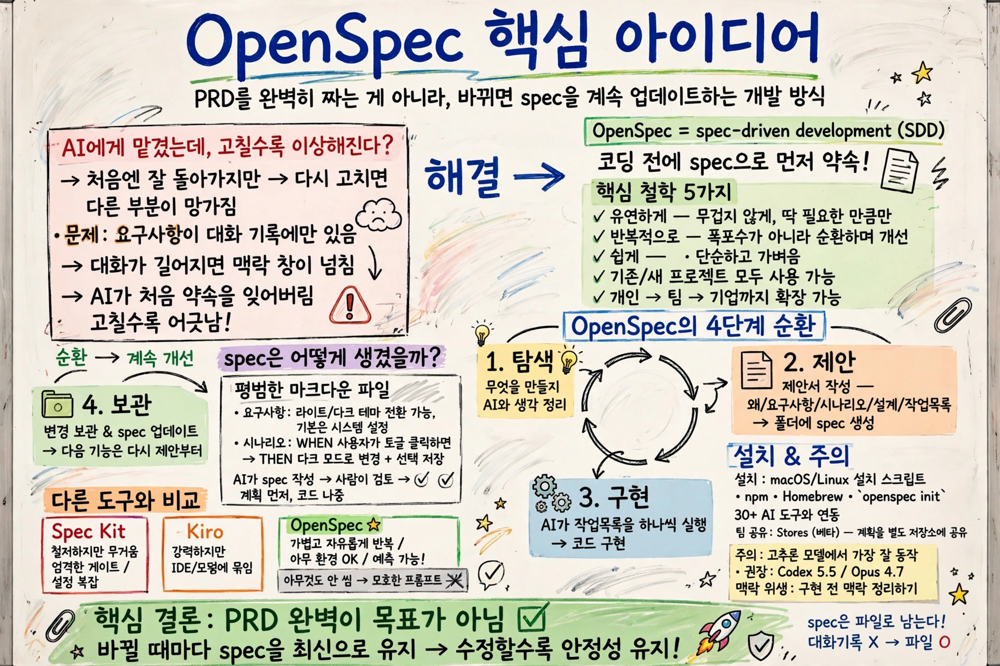
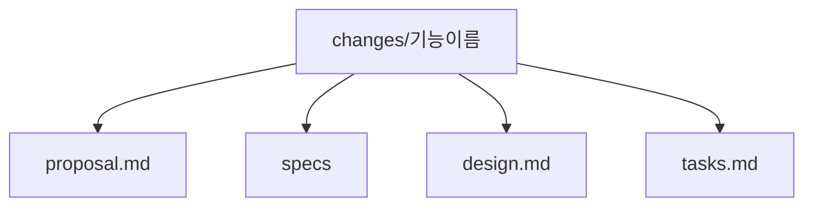
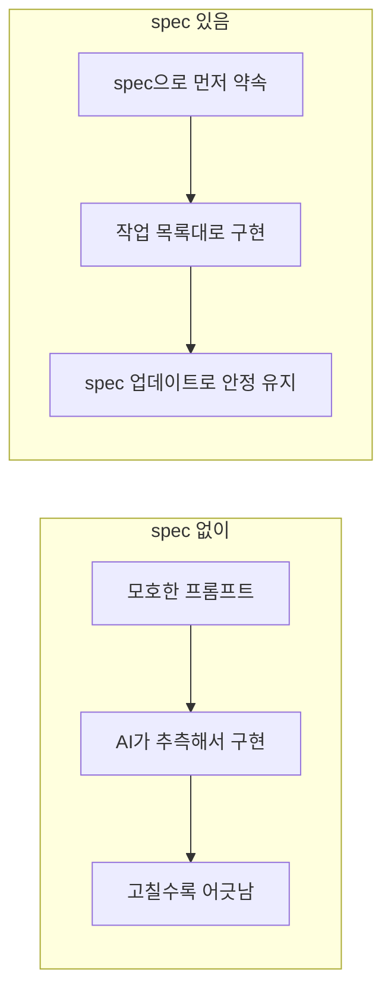

# OpenSpec: PRD를 완벽하게 짜지 말고, 바뀔 때마다 spec을 고치면 됩니다

> **Summary**
> OpenSpec은 완벽한 PRD를 미리 작성하는 대신, 제안·구현·보관의 반복 과정에서 spec을 최신 상태로 유지하는 가벼운 AI 개발 방식입니다. 요구사항을 저장소 파일로 관리해 AI가 맥락을 잃지 않도록 하고, 수정이 반복돼도 구현의 일관성과 안정성을 높입니다.

---

- PRD를 처음부터 완벽하게 짜는 게 아니라, 결과를 보면서 계속 고치는 개발 방식이 있습니다.
- 문제는 변화가 쌓이면 AI가 맥락을 놓친다는 점입니다. OpenSpec은 변화가 생길 때마다 최신 spec을 업데이트해두는 방식입니다.
- 제안하고, 구현하고, spec에 반영하는 순환이 돕니다. 수정을 거듭해도 안정성이 유지됩니다!

## AI에게 맡겼는데, 고칠수록 이상해진다면?

AI 코딩 어시스턴트에게 기능 하나를 맡겼습니다. 처음엔 잘 돌아갔습니다. 그런데 고칠 게 생겨서 다시 시켰더니, 멀쩡하던 부분이 이상해졌습니다. 또 고쳤더니 이번엔 다른 곳이 틀어졌습니다. 이런 적 있으시죠?

문제는 AI가 게으른 게 아닙니다. 요구사항이 대화 기록에만 있기 때문입니다. 대화가 길어지면 맥락 창이 넘치고, AI는 처음에 정한 약속을 잊어버립니다. 그래서 고칠수록 어긋나는 겁니다!

🎥 [동영상 보기](https://www.youtube.com/watch?v=e9c7Gyd8zCY)

## OpenSpec, 코드 쓰기 전에 spec으로 약속합니다

OpenSpec은 AI 코딩 어시스턴트를 위한 spec-driven development(SDD) 도구입니다. 핵심은 가볍다는 점입니다. 코드 쓰기 전에 사람과 AI가 spec으로 먼저 약속합니다. 요구사항이 대화 기록이 아니라 저장소 안의 파일로 남는 겁니다.

철학은 다섯 줄로 정리됩니다. 유연하게, 폭포수가 아니라 반복적으로, 쉽게, 새 프로젝트뿐 아니라 기존 프로젝트에서도, 개인부터 기업까지 확장 가능하게. 무겁게 문서를 쌓는 게 아니라, 딱 필요한 만큼만 적는 방식입니다.

이 장면이 저는 가장 인상 깊었습니다. spec이 대화가 아니라 파일로 남는다는 점입니다. 파일은 맥락 창이 넘쳐도 사라지지 않으니까요!

## 네 단계 순환, 탐색하고 제안하고 구현하고 보관합니다

워크플로우는 네 단계입니다. 아직 뭘 만들지 모르겠으면 `/openspec-explore`로 AI와 생각을 정리합니다. 뭘 만들지 알면 `/openspec-propose`로 바로 제안서를 만듭니다. 제안서가 `openspec/changes/<이름>/` 폴더 안에 생깁니다. `proposal.md`는 왜 만드는지, `specs/`는 요구사항과 시나리오, `design.md`는 기술적 접근, `tasks.md`는 구현 체크리스트입니다.

제안서를 검토한 뒤 `/openspec-apply-change`로 구현합니다. AI가 `tasks.md`를 하나씩 실행합니다. 끝나면 `/openspec-archive-change`로 변경을 보관하고 spec을 업데이트합니다. 다음 기능은 다시 제안서부터 시작합니다. 이 순환이 OpenSpec의 전부입니다.

## spec은 어떻게 생겼을까요?

spec은 평범한 마크다운입니다. 특별한 문법을 배울 필요가 없습니다. 요구사항과 구체적인 시나리오를 적습니다. 예를 들어 테마 전환 기능이면, 요구사항은 "앱은 라이트와 다크 테마를 전환할 수 있어야 하며, 기본값은 시스템 설정을 따릅니다"가 됩니다. 시나리오는 "사용자가 토글을 클릭하면"이라는 조건과 "앱이 다크 모드로 바뀌고 선택이 저장된다"는 결과로 적습니다. `WHEN`과 `THEN`으로 적는 겁니다.

AI가 이 spec을 쓰고, 사람이 코드를 쓰기 전에 검토합니다. 계획이 먼저 있고 코드가 뒤에 오는 구조입니다.

## 다른 도구와 뭐가 다를까요?

비교 대상은 세 가지입니다. Spec Kit은 철저하지만 무겁습니다. 엄격한 단계 게이트와 많은 마크다운, 파이썬 설정이 필요합니다. Kiro는 강력하지만 IDE와 모델에 묶입니다. OpenSpec은 가볍고 자유롭게 반복할 수 있습니다. 아무것도 안 쓰는 경우와 비교하면, 모호한 프롬프트는 예측할 수 없는 결과를 낳습니다. spec이 있으면 예측 가능성이 생깁니다!

## 설치는 어떻게 할까요?

설치는 간단합니다. macOS나 Linux에서는 설치 스크립트를 실행하고, `npm install -g @fission-ai/openspec@latest`나 `brew install openspec`으로도 설치할 수 있습니다. 프로젝트 폴더에서 `openspec init`을 실행하면 됩니다. 30개가 넘는 AI 도구와 연동됩니다. 팀 단위로는 Stores라는 베타 기능이 있습니다. 별도 저장소에 계획을 두고 여러 저장소에 걸쳐 공유하는 방식입니다.

주의할 점도 있습니다. 고추론 모델에서 가장 잘 동작합니다. 권장 모델은 Codex 5.5와 Opus 4.7입니다. 그리고 맥락 위생이 중요합니다. 구현을 시작하기 전에 맥락을 정리하고, 세션 내내 깨끗하게 유지하는 게 좋습니다.

## PRD를 완벽하게 짜는 게 목표가 아닙니다

PRD를 완벽하게 짜는 게 목표가 아닙니다. 바뀔 때마다 spec을 고쳐서 최신 상태로 유지하는 게 목표입니다. 그럼 수정을 거듭해도 AI는 약속을 잊지 않습니다. spec이 최신이면, 고치는 만큼 안정성이 따라옵니다!

