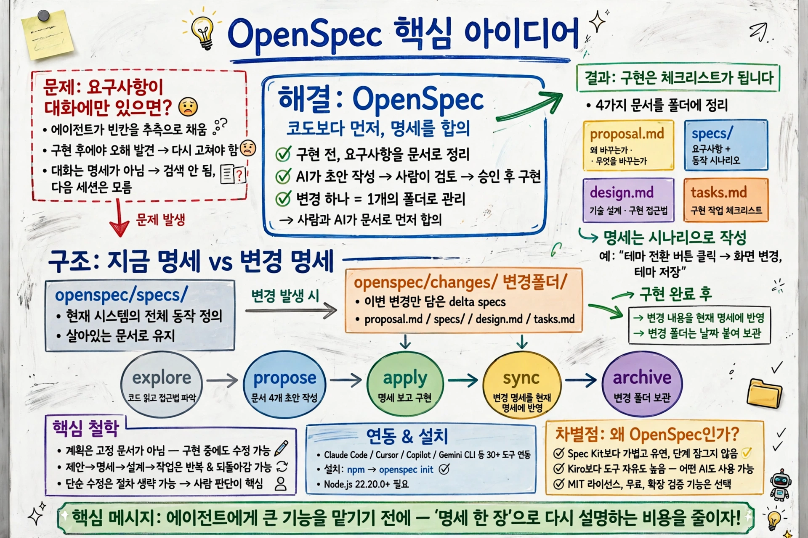
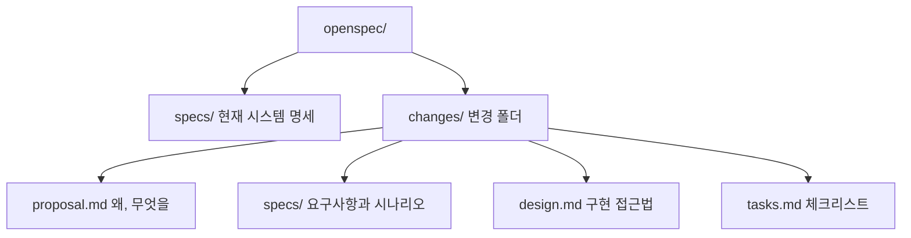

# OpenSpec: 코드부터 짜지 말고, 명세부터 합의하세요. 에이전트와 싸우는 시간이 줄어듭니다

> **Summary**
> OpenSpec은 코딩 에이전트에게 코드를 맡기기 전에, 무엇을 만들지 명세로 먼저 합의하는 가벼운 개발 도구입니다. 변경 하나마다 제안서·명세·설계·작업 목록을 별도 폴더에 모아 Markdown 파일로 저장하고, 사람이 검토한 뒤에야 구현이 시작됩니다. 계획은 구현 중에도 고칠 수 있고, 기존 코드베이스에도 바로 붙일 수 있으며, 30개 넘는 코딩 도구와 함께 쓸 수 있습니다.

---

- 코딩 에이전트에게 일을 맡겼는데, 엉뚱한 결과물이 나온 적 있으시죠? 요구사항이 대화 속에만 남아 있으면, 에이전트는 빈칸을 추측으로 채웁니다.
- OpenSpec은 구현 전에 요구사항을 명세로 정리하고, 사람이 검토한 뒤에야 코드를 짜게 하는 가벼운 도구입니다.
- 변경 하나마다 제안서·명세·설계·작업 목록을 폴더 하나에 모아 Markdown 파일로 저장합니다. 계획은 고정 문서가 아니라, 구현 중에도 고칠 수 있습니다.

에이전트한테 기능 하나 추가해달라고 했는데, 결과물을 보고 한숨 쉬어본 적 있으시죠? "다크 모드 넣어줘"라고 했더니, 시스템 설정을 따라가는지, 선택을 저장하는지, 어디에도 적혀 있지 않았습니다. 에이전트는 물어보지 않고 추측으로 채웠고, 결과물은 다시 고쳐야 했습니다.

🎥 [동영상 보기](https://www.youtube.com/watch?v=e9c7Gyd8zCY)

## 요구사항이 대화에만 있으면, 에이전트는 추측으로 채웁니다

대화에만 남은 요구사항은 두 가지 문제를 만듭니다. 첫째, 구현 전에 오해를 확인할 방법이 없습니다. 에이전트는 코드를 짜기 시작했고, 틀렸다는 건 결과물을 보고 나서야 알게 됩니다. 둘째, 나중에 "왜 이렇게 바꿨지?"라고 물으면 답할 사람이 없습니다. 과거 대화를 뒤져야 합니다. 대화 기록은 명세가 아닙니다. 검색도 안 되고, 다음 세션의 에이전트는 읽지도 않습니다.

그래서 OpenSpec의 답은 단순합니다. 코드보다 먼저, 무엇을 만들지 문서로 합의합니다. AI가 요구사항과 계획의 초안을 쓰고, 사람이 검토하고 조정한 뒤 구현이 시작됩니다!

## 명세부터 합의하면, 구현은 체크리스트가 됩니다

변경 하나마다 `openspec/changes/` 아래에 별도 폴더를 만듭니다. 폴더 안에 네 가지 문서가 들어갑니다. `proposal.md`에는 왜 바꾸는지, 무엇을 바꾸는지 적습니다. `specs/`에는 요구사항과 구체적인 동작 시나리오를 적습니다. `design.md`에는 기술적인 구현 접근법을 적습니다. `tasks.md`에는 구현할 작업의 체크리스트를 적습니다.

명세는 추상적인 목표가 아니라 시나리오로 씁니다. "사용자가 테마 전환 버튼을 누르면 화면이 바뀌고, 선택한 테마가 저장됩니다." 이런 문장이 명세입니다. 에이전트가 읽고 그대로 구현하면 됩니다. 다섯 가지 명령이 흐름을 이끕니다. `/opsx:explore`로 코드를 읽고 접근법을 살피고, `/opsx:propose`로 네 가지 문서의 초안을 만들고, `/opsx:apply`로 문서를 참고해 구현하고, `/opsx:sync`로 변경 명세를 현재 명세에 반영하고, `/opsx:archive`로 변경 폴더를 보관합니다.

## 지금 명세와 바꾸는 명세를 따로 둡니다

`openspec/specs/`에는 현재 시스템의 동작을 정리합니다. 개별 변경에는 달라지는 요구사항만 적는 변경 명세(delta specs)를 씁니다. 그래서 기존 코드베이스 전체를 먼저 문서화할 필요가 없습니다. 이번 작업에서 달라지는 부분부터 명세로 관리하면 됩니다. 새 프로젝트가 아니라 이미 돌아가는 코드에 붙이기 좋은 이유입니다.

구현이 끝나면 변경 명세를 현재 명세에 반영하고, 변경 폴더를 날짜가 붙은 보관 경로로 옮깁니다. 명세는 살아 있는 문서로 남습니다! 다음 에이전트 세션에서도 같은 요구사항과 계획을 참고할 수 있습니다.

## 계획은 고정 문서가 아닙니다. 구현 중에도 고칩니다

제안 → 명세 → 설계 → 작업 목록의 순서는 문서 간 의존 관계이지, 되돌릴 수 없는 절차가 아닙니다. 구현 중 설계의 문제를 발견하면 `design.md`를 고치고, 범위를 줄여야 하면 제안서와 관련 문서를 조정합니다. 문서 구성과 작성 순서도 스키마로 바꿀 수 있습니다.

유연한 만큼 책임도 남습니다. 작업 범위가 계속 커지지 않게 관리하는 일은 사람의 몫입니다. 한 줄짜리 단순 수정처럼 명세 작성 수고가 이점보다 큰 작업에는 전체 절차가 필요하지 않을 수도 있습니다. 이 지점이 저는 가장 마음에 들었습니다. 폭포수처럼 단계를 잠그는 도구가 아니라, "유연하게, 반복적으로, 쉽게"라는 철학이 그대로 드러나니까요!

## 어떤 도구와 붙나요? 설치는 어떻게 하나요?

Claude Code, Codex, Cursor, GitHub Copilot, Gemini CLI, OpenCode 등 30개 넘는 코딩 도구와 연동됩니다. 명령은 AI 코딩 도구의 대화창에서 실행합니다. 설치는 `npm install -g @fission-ai/openspec@latest`로 하고, 프로젝트에서 `openspec init`으로 초기화합니다. Node.js 22.20.0 이상이 필요합니다.

한 가지 주의할 점이 있습니다. 소개된 글의 명령은 `/opsx:propose` 같은 1.x 형태인데, 현재 버전(2.x)에서는 `/openspec-propose` 같은 형태로 바뀌었습니다. 새로 시작한다면 현재 문서를 기준으로 명령을 확인하는 게 안전합니다. 여러 저장소에 걸친 변경은 Stores(베타)로 공유할 수 있습니다. API 서버, 웹 앱, 공통 라이브러리에 걸친 하나의 변경 계획을 별도 저장소에서 함께 봅니다. MIT 라이선스로 공개되어 있습니다.

## 비슷한 도구와 뭐가 다를까요?

스펙 중심 개발 도구로는 깃허브의 Spec Kit, AWS의 Kiro도 있습니다. Spec Kit은 단계가 엄격하고 문서량이 많고, Kiro는 특정 IDE에 묶입니다. OpenSpec은 가볍고, 도구도 자유롭게 고를 수 있습니다! 구현과 명세가 어긋나는지 대조하는 검증 명령도 있지만, 기본 프로필이 아니라 추가로 활성화하는 확장 기능입니다.

에이전트와 일할 때 가장 비싼 비용은 다시 설명하는 시간입니다. 명세 한 장이 그 시간을 줄여줍니다! 에이전트에게 큰 기능을 맡기기 전에, 명세부터 한 장 써보시면 어떨까요?

