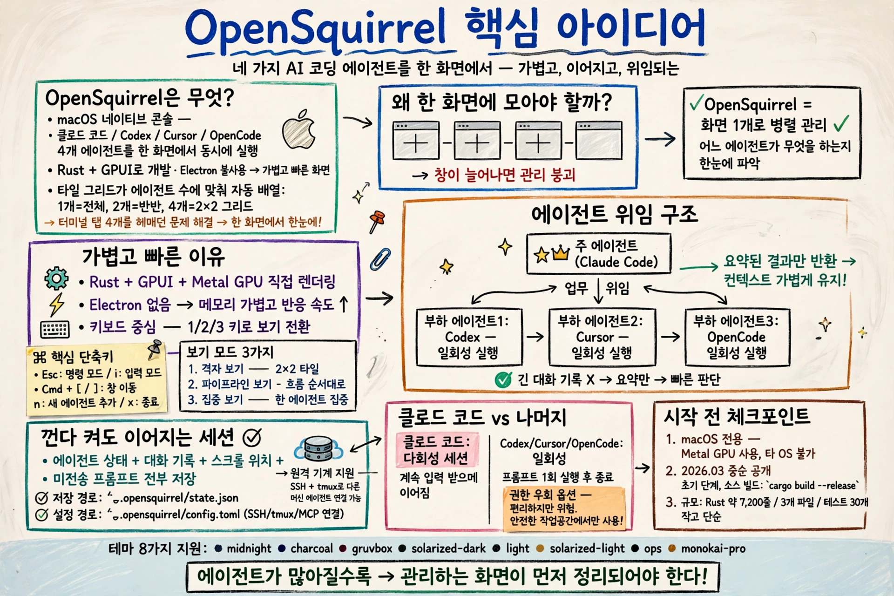
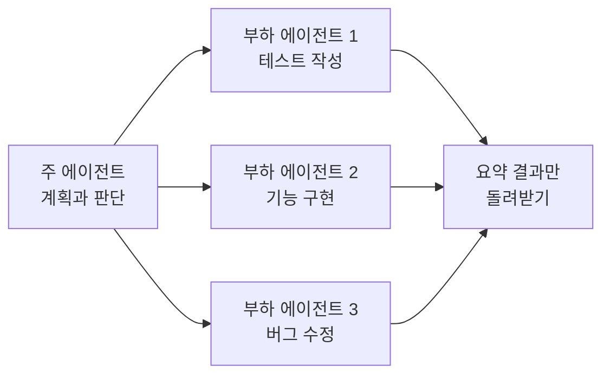
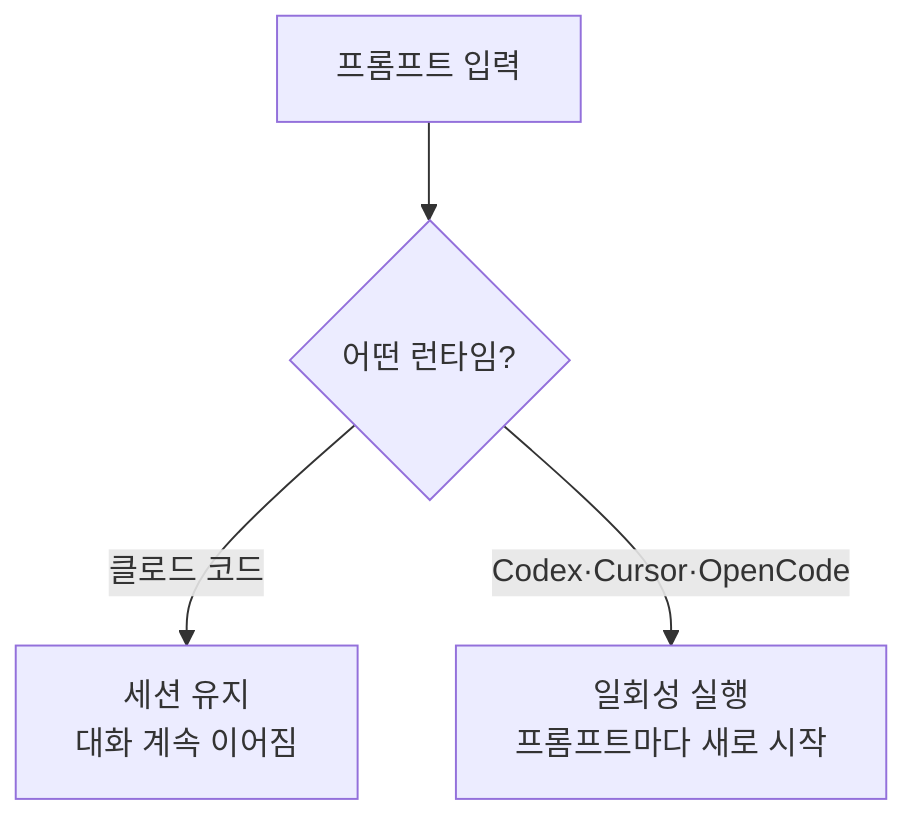
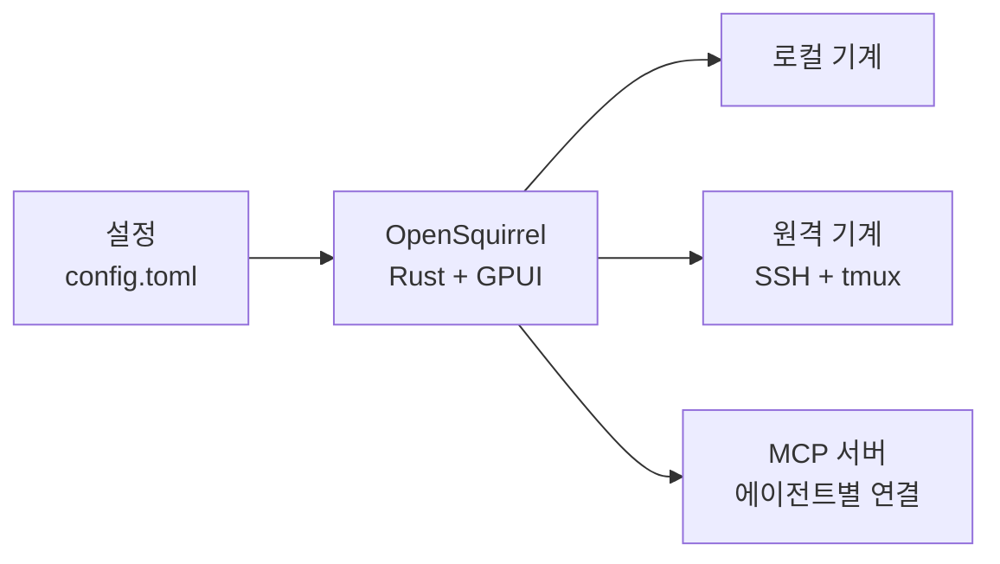

# OpenSquirrel: 에이전트 네 개를 한 화면에 띄우면, 터미널 탭을 헤맬 일이 없습니다

> **Summary**
> OpenSquirrel은 Rust와 GPUI로 만든 macOS용 콘솔로, Claude Code·Codex·Cursor·OpenCode를 타일 화면에서 동시에 관리하고 에이전트 간 작업 위임과 세션 복원을 지원합니다. 키보드 중심의 가벼운 인터페이스를 제공하며, 초기 단계의 macOS 전용 프로젝트로 직접 빌드해야 합니다. 권한 우회 옵션은 위험할 수 있으므로 격리된 작업 공간에서만 사용하는 것이 안전합니다.

---

- OpenSquirrel은 클로드 코드, Codex, Cursor, OpenCode 네 가지 AI 코딩 에이전트를 한 화면에서 동시에 굴리는 macOS 네이티브 콘솔입니다.
- Rust와 GPUI로 만들어 Electron을 쓰지 않아 화면이 가볍고, 타일 그리드가 에이전트 수에 맞춰 자동으로 배열됩니다.
- 주 에이전트가 부하 에이전트에게 일을 나누고, 세션은 앱을 껐다 켜도 그대로 이어집니다.

터미널 탭을 네 개 띄워 놓고, 어느 탭에서 무슨 일이 돌아가는지 찾느라 헤맨 적 있으시죠? 하나는 테스트를 돌리고, 하나는 기능을 만들고, 하나는 버그를 잡는데, 정작 지금 답을 기다리는 에이전트가 어느 탭인지 모르겠는 순간 말입니다.

🎥 [동영상 보기](https://www.youtube.com/watch?v=MPYUbQRxdjY)

### 왜 한 화면에 모아야 할까요?

에이전트는 병렬로 돌릴수록 빠릅니다. 그런데 창이 늘어나면 관리가 먼저 무너집니다. 어느 탭이 어떤 작업을 맡았는지, 누가 끝났고 누가 입력을 기다리는지, 한눈에 안 보이기 때문입니다.

OpenSquirrel은 이 문제를 화면 하나로 풉니다. 네 가지 에이전트를 타일 그리드에 나란히 띄우고, 개수가 바뀌면 배열도 알아서 바뀝니다. 하나면 전체 화면, 두 개면 반반, 네 개면 2×2 격자입니다. 에이전트 네 개, 화면 하나면 충분합니다!

### 가벼운 화면, 어떻게 만들었을까요?

비결은 기술 선택에 있습니다. Rust와 GPUI로 만들었고, Electron을 쓰지 않았습니다. GPUI는 Zed 에디터의 UI 프레임워크이고, 화면은 macOS의 Metal GPU로 직접 그립니다. 그래서 창을 여러 개 띄워도 화면 반응이 가볍고 깔끔하게 유지됩니다.

보기 방식도 세 가지입니다. 숫자 키 `1`·`2`·`3`으로 격자 보기, 파이프라인 보기, 집중 보기를 오갑니다. 키보드 중심으로 움직이는 구조라, 마우스를 찾으러 손을 뗄 일이 적습니다. `Esc`로 명령 모드, `i`로 입력 모드, `Cmd-]`와 `Cmd-[`로 창 이동, `n`으로 새 에이전트, `x`로 종료까지, 손가락이 키보드를 떠나지 않습니다.

### 에이전트끼리 일은 어떻게 나누나요?

이 도구의 가장 흥미로운 부분은 위임 구조입니다. 주 에이전트가 부하 에이전트를 불러서 일을 나눕니다. 부하 에이전트는 맡은 일만 처리하고, 긴 대화 기록이 아니라 요약된 결과만 돌려줍니다. 이 대목이 저는 가장 와닿았습니다. 긴 기록을 그대로 넘기면 컨텍스트가 금방 차는데, 요약만 받으면 주 에이전트가 가벼운 상태로 다음 판단을 내릴 수 있으니까요!

### 클로드 코드만 계속 이어지는 이유는?

네 가지 런타임은 같은 방식으로 돌지 않습니다. 클로드 코드는 입력을 계속 받는 다회성 세션으로 돌고, Codex·Cursor·OpenCode는 프롬프트마다 한 번씩 실행되는 일회성 방식입니다.

| 런타임 | 방식 | 권한 우회 옵션 |
| --- | --- | --- |
| 클로드 코드 | 계속 이어지는 다회성 세션 | `--dangerously-skip-permissions` |
| Codex | 프롬프트마다 한 번씩 | `--dangerously-bypass-approvals-and-sandbox` |
| Cursor | 프롬프트마다 한 번씩 | `--yolo` |
| OpenCode | 프롬프트마다 한 번씩 | 실행 모드에서 자동 승인 |

옵션 이름에서 알 수 있듯, 권한 검사를 건너뛰는 설정입니다. 편리하지만 위험 부담이 따라옵니다. 날릴 수 있는 작업 공간에서만 쓰는 편이 안전합니다.

### 껐다 켜도 이어지나요?

이어집니다. 에이전트 상태, 대화 기록, 스크롤 위치, 보내지 않은 프롬프트까지 앱을 다시 켜면 그대로 돌아옵니다. 도중에 끊긴 작업도 이어서 다시 시작할 수 있습니다. 껐다 켜도 이어진다는 점, 이게 진짜 편합니다!

원격 기계도 노릴 수 있습니다. SSH와 `tmux`로 다른 기계에 에이전트를 붙이고, 설정은 `~/.opensquirrel/config.toml`에 적습니다. 상태는 `~/.opensquirrel/state.json`에 저장됩니다. MCP 서버도 에이전트마다 골라서 연결합니다. 브라우저 자동화 같은 외부 도구가 필요할 때, 에이전트별로 필요한 것만 붙이는 구조입니다.

### 시작하기 전에 확인할 점은?

세 가지입니다. 첫째, macOS 전용입니다. Metal GPU를 써서 화면을 그리기 때문에, 다른 운영체제에서는 돌아가지 않습니다. 둘째, 아직 초기 단계 프로젝트입니다. 2026년 3월 중순에 공개됐고, 설치 파일 배포보다는 소스에서 직접 빌드하는 방식이 안내돼 있습니다. 빌드는 `cargo build --release` 한 줄이면 됩니다! 셋째, 전체 규모는 Rust 약 7,200줄, 세 개 파일에 테스트 30개입니다. 작고 단순한 구조라, 코드가 궁금하면 직접 읽어보기도 쉽습니다.

테마도 여덟 가지가 들어 있습니다. `midnight`, `charcoal`, `gruvbox`, `solarized-dark`, `light`, `solarized-light`, `ops`, `monokai-pro` 중에서 고르면 됩니다.

에이전트가 많아질수록, 관리하는 화면이 먼저 정리돼야 합니다!

