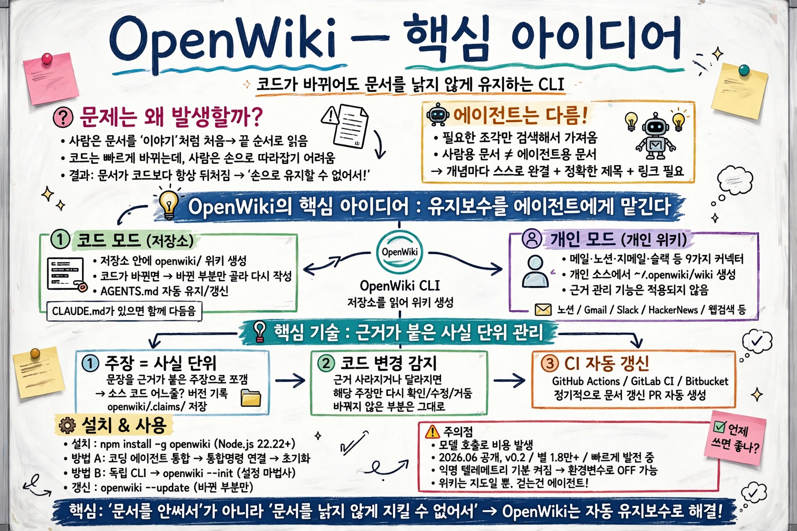
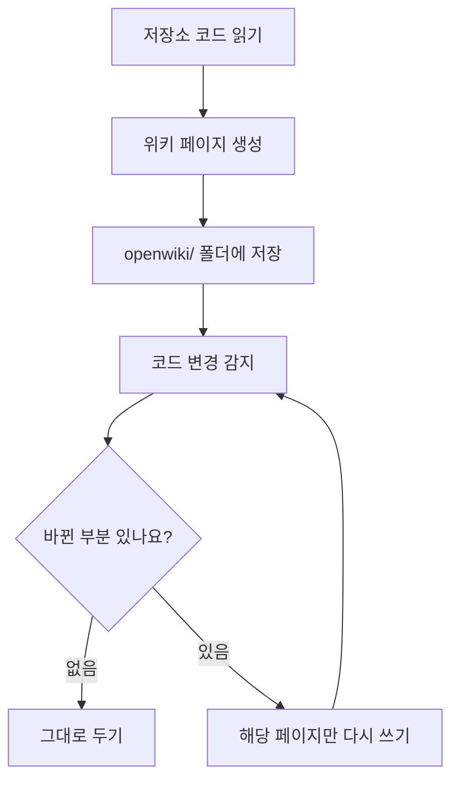
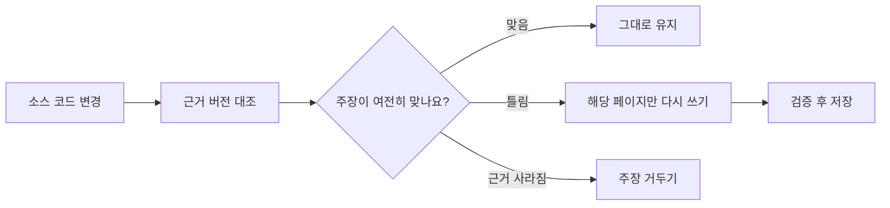
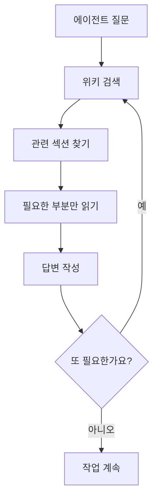

# OpenWiki: 에이전트가 읽을 문서는 사람이 쓰지 않습니다. 코드가 바뀌면 문서가 따라옵니다

> **Summary**
> OpenWiki는 코드베이스 문서를 에이전트가 읽는 형태로 만들고, 코드가 바뀌면 스스로 고치는 CLI입니다. 코드 모드는 저장소 안에 openwiki/ 위키를 만들고, 개인 모드는 메일·노션 등에서 개인 위키를 만듭니다. 문서는 한 번 쓰고 끝이 아닙니다. 근거가 붙은 사실 단위로 관리돼, 낡은 부분만 골라 다시 씁니다.

---

- OpenWiki는 코드베이스 문서를 에이전트가 읽는 형태로 만들고, 코드가 바뀌면 스스로 고치는 CLI입니다.
- 코드 모드는 저장소 안에 `openwiki/` 위키를 만들고, 개인 모드는 메일·노션 등에서 개인 위키를 만듭니다.
- 문서는 한 번 쓰고 끝이 아닙니다. 근거가 붙은 사실 단위로 관리돼, 낡은 부분만 골라 다시 씁니다.


에이전트에게 일을 시키려고 지침 파일에 규칙을 잔뜩 적어본 적 있으시죠? 처음엔 잘 돌아갑니다. 그런데 코드가 바뀌고, 구조가 바뀌고, 어느새 지침 파일은 옛날 얘기만 하고 있습니다. 문서가 코드보다 뒤처지는 건, 게을러서가 아닙니다. 사람이 손으로 따라잡기엔 코드가 너무 빨리 바뀌기 때문입니다!

🎥 [동영상 보기](https://www.youtube.com/watch?v=XNX-1h2K-9U)

## 문서는 왜 코드보다 자꾸 뒤처질까요?

사람이 읽는 문서는 이야기로 읽힙니다. 처음부터 끝까지 순서대로 읽고, 맥락을 머릿속에 쌓습니다. 그런데 에이전트는 다릅니다. 필요한 조각만 검색해서 가져옵니다. 그래서 에이전트용 문서는 사람용 문서와 모양부터 달라야 합니다. 개념 하나하나가 스스로 완결되고, 제목이 정확하고, 서로 링크로 연결돼야 합니다. 이걸 사람이 일일이 손으로 쓰면, 쓰는 순간부터 낡기 시작합니다. 결국 문제는 "문서를 안 써서"가 아니라 "문서를 손으로 유지할 수 없어서"입니다!

## OpenWiki는 뭘 다르게 하나요?

OpenWiki는 이 유지보수 자체를 에이전트에게 맡깁니다. 저장소를 읽어 위키를 만들고, 코드가 바뀌면 바뀐 부분만 골라 다시 씁니다. 두 가지 모드가 있습니다. 코드 모드는 지금 있는 저장소의 문서를 `openwiki/` 폴더에 만듭니다. 개인 모드는 메일·노션·검색 기록 같은 개인 소스에서 `~/.openwiki/wiki`에 개인 위키를 만듭니다. 같은 CLI지만, 다루는 대상이 완전히 다릅니다. 이 글은 코드 모드가 중심입니다. 코드베이스 문서가 이 도구의 본령이니까요.



## 설치는 어떻게 하나요?

설치는 한 줄입니다. Node.js 22.22 이상이 필요하고, 전역 설치 명령 하나로 끝납니다.

```bash
npm install -g openwiki
```

그다음은 두 가지 길입니다. 이미 쓰는 코딩 에이전트 안에서 시작하는 방법이 가장 쉽습니다. 통합 설치 명령으로 에이전트에 연결한 뒤, 에이전트를 다시 시작하고 "이 저장소의 OpenWiki를 지금 소스와 테스트에서 초기화해달라"고 시키면 됩니다. 에이전트가 저장소를 조사해 위키를 씁니다. 이 경우 모델 설정은 에이전트의 인증 세션을 그대로 씁니다. 코덱스·클로드 코드·오픈코드·커서·코파일럿·키로 등 아홉 가지 에이전트에 연결할 수 있습니다.

독립 CLI로 직접 돌리는 방법도 있습니다. 저장소 루트에서 `openwiki --init`을 치면 설정 마법사가 프로바이더와 모델을 묻고 위키를 만듭니다. `openwiki --update`는 바뀐 부분만 갱신합니다. `-p` 옵션을 붙이면 한 번 실행하고 끝나는 일회성 모드가 됩니다. 직접 돌릴 때는 열다섯 가지 추론 프로바이더 중에서 고를 수 있고, 온보딩 기본값은 OpenAI 계열 모델입니다.

## 문서가 낡으면 누가, 어떻게 고치나요?

여기가 이 도구의 진짜 속살입니다. OpenWiki는 문장을 사실 단위로 쪼개 "근거가 붙은 주장"으로 관리합니다. 각 주장마다 소스 코드의 어느 줄에서 왔는지 버전과 함께 기록합니다. 이 기록은 `openwiki/.claims/` 폴더에 위키와 함께 저장됩니다. 코드가 바뀌어 근거가 사라지거나 달라지면, 그 주장만 다시 확인하거나 고치거나 거둡니다. 바뀌지 않은 부분은 손대지 않습니다. 그래서 깨끗한 업데이트는 모델을 아예 안 쓰고 끝납니다. 문서가 통째로 다시 써지는 게 아니라, 낡은 사실만 골라 교체되는 겁니다!



그리고 이 갱신은 CI가 대신 해줍니다. 깃허브 액션·깃랩 CI·비트버킷용 예시 워크플로가 들어 있어, 정해진 일정마다 문서 갱신 PR을 자동으로 열어줍니다. 자동 병합 변형도 있지만, 전용 토큰과 브랜치 보호 설정이 먼저 필요합니다. 문서 PR이 검토 없이 합쳐지는 일은 없어야 하니까요. 사람이 고치는 게 아니라, 사람이 검토만 하는 구조입니다. 위키 아이디어는 이미 여러 번 나왔지만, "낡은 문서를 누가 고치나"까지 답한 도구는 흔치 않았습니다.

## 에이전트는 위키를 어떻게 찾나요?

위키를 만들어두기만 하면 에이전트가 알아서 읽을까요? 아닙니다. 에이전트에게 위키가 있다는 걸 알려줘야 합니다. OpenWiki는 코드 모드를 실행할 때마다 저장소 루트의 `AGENTS.md`를 유지합니다. 이미 있는 파일이면 자기 블록만 갱신하고 나머지는 건드리지 않습니다. `CLAUDE.md`가 이미 있으면 그 파일도 같은 방식으로 다듬고, 없으면 새로 만들지 않습니다. 지침 파일 안에 위키를 참조하라는 안내가 들어가고, 에이전트는 질문이 있을 때 위키를 검색해서 필요한 부분만 읽습니다. 검색과 읽기 도구는 로컬에서만 돌고, 읽기 전용이라 모델 호출을 따로 일으키지 않습니다.



또 하나, 위키는 표준 형식으로 나옵니다. 개념 문서마다 `type` 필드가 들어간 YAML 프론트매터가 붙고, 문서끼리 마크다운 링크로 연결됩니다. 이 형식은 구글의 개방형 지식 형식(OKF)을 따릅니다. 소개 글이 나왔을 때는 v0.1 기준이었지만, 지금은 v0.2 번들을 냅니다. 형식이 표준이라 다른 OKF 도구에서도 같은 위키를 읽을 수 있습니다. 여러 저장소를 묶는 워크스페이스 기능도 있습니다. 서비스가 여러 저장소로 나뉘어 있을 때, 각 위키를 묶어 한 번에 검색할 수 있습니다.

## 내 메일과 노션도 위키가 되나요?

개인 모드가 그 역할을 합니다. 아홉 가지 커넥터가 들어 있습니다. 로컬 깃 저장소, 노션, 지메일, X, 웹 검색, 해커뉴스, 슬랙, 커스텀 MCP 서버 등이 소스가 됩니다. `openwiki auth notion`처럼 인증 명령으로 연결하고, `openwiki ingest all`로 가져옵니다. 같은 커넥터를 여러 개로 나눠 쓸 수도 있습니다. 다만 이 모드는 코드 모드와 성격이 다릅니다. 코드 모드가 "저장소의 지금 상태"를 다루는 데 비해, 개인 모드는 "내가 쌓은 지식"을 정리하는 쪽에 가깝습니다. 그리고 개인 모드에서 모은 사실에는 근거 주장 관리가 적용되지 않습니다. 코드 증거가 있는 저장소 위키에만 해당 기능이 붙습니다.

## 그래서, 언제 쓰면 좋을까요?

코딩 에이전트를 매일 쓰고, 저장소가 커서 지침 파일이 자꾸 부풀어 오르는 팀이라면 한 번 써볼 만합니다. 공식 발표에서 소개한 초기 평가에서는 위키를 쓴 에이전트가 작업당 검색 명령을 24% 덜 썼다고 합니다. 숫자는 초기 평가라 그대로 믿을 일은 아니지만, 방향은 분명합니다. 문서를 미리 다 읽히는 게 아니라, 필요할 때 찾아 읽히는 구조가 토큰을 아낍니다.

다만 조심할 점도 있습니다. 첫째, 문서 생성은 모델 호출이라 비용이 듭니다. 저장소가 클수록 초기 생성 비용이 커집니다. 둘째, 아직 젊은 프로젝트입니다. 2026년 6월 말에 공개돼 세 주 만에 별 1만 개를 넘겼고, 지금은 1만 8천 개를 넘겼지만, 기능이 빠르게 바뀌는 시기입니다. 소개 글 기준과 지금 기준이 OKF 버전부터 다릅니다. 셋째, 익명 텔레메트리가 기본으로 켜져 있습니다. 명령·결과·프로바이더 수준만 모으고 파일 내용이나 자격증명은 모으지 않는다고 하지만, 꺼두는 게 마음 편하다면 환경 변수 한 줄로 끌 수 있습니다. 넷째, 위키가 있다고 에이전트가 저절로 똑똑해지지는 않습니다. 위키는 지도일 뿐, 걷는 건 에이전트입니다. 지도가 정확해야 걷는 방향이 맞습니다. 그래서 이 도구의 가치는 위키를 만드는 데 있는 게 아니라, 위키를 낡지 않게 지키는 데 있습니다!

