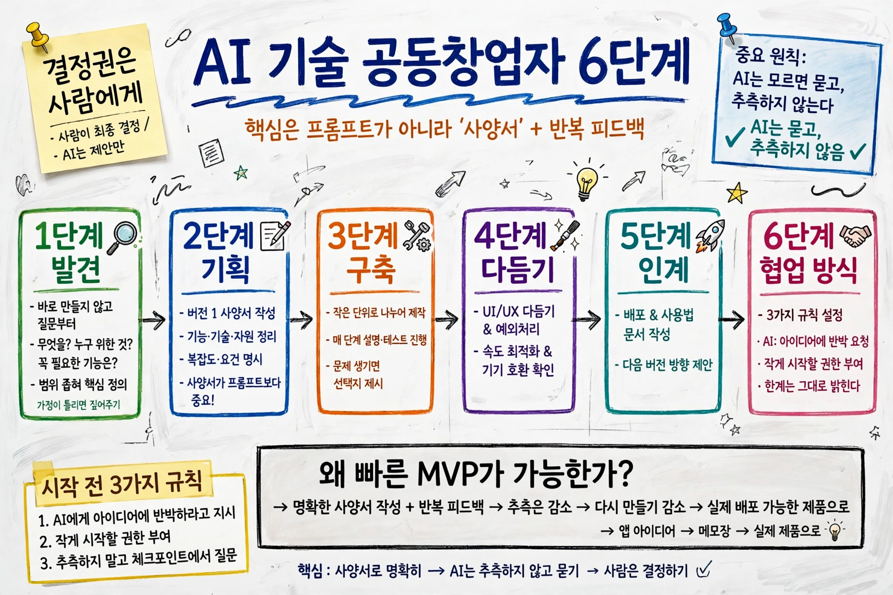
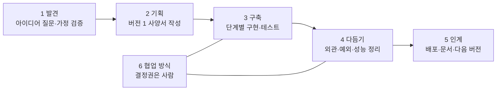
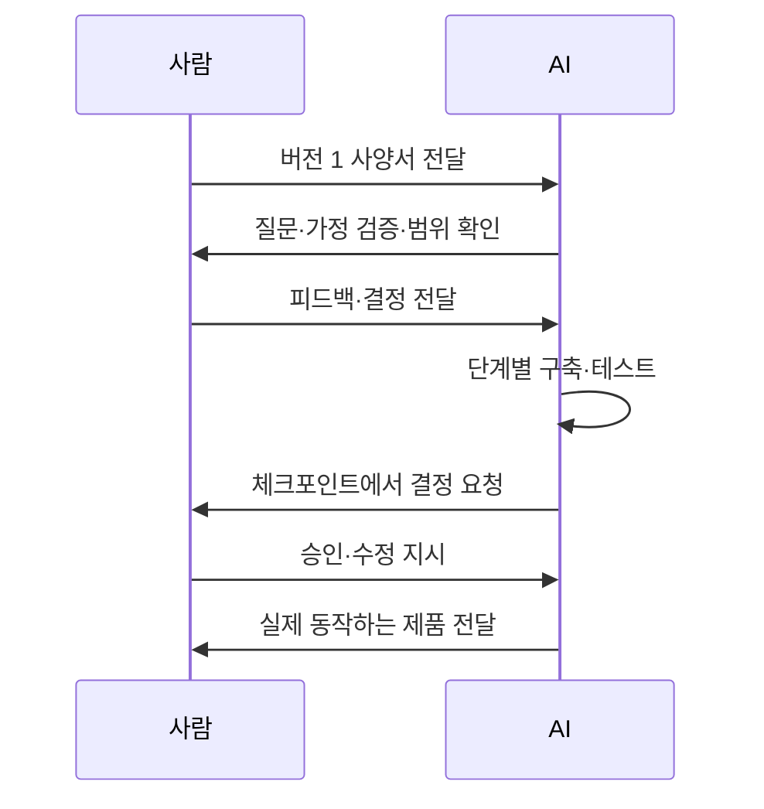

# Opus 만능 프롬프트: AI를 기술 공동창업자로 쓰면, 5분 만에 진짜 제품이 나옵니다

> **Summary**
> AI를 기술 공동창업자로 설정해 아이디어를 실제 제품으로 발전시키려면, 발견·기획·구축·다듬기·인계의 단계를 따르고 명확한 버전 1 사양서를 작성하는 것이 중요합니다. AI는 추측하지 않고 질문하며 단계별로 구현하고, 사람은 범위와 주요 결정을 맡습니다. 5분 MVP는 간단한 제품에서 가능하지만, 핵심은 속도보다 명확한 사양과 반복적인 협업입니다.

---

- AI를 기술 공동창업자로 설정하는 프롬프트가 있습니다. SEO 최적화 웹사이트, 앱, 개인 대시보드까지 5분 안에 실제 제품을 만든다고 합니다.
- 핵심은 프롬프트 문장이 아니라 사양서입니다. 구체적인 버전 1 사양서를 쓰고, 반복 피드백을 주는 방식이 빠른 MVP의 비결입니다.
- 6단계(발견·기획·구축·다듬기·인계·협업 방식)로 돌아가며, 결정권은 사람이 쥐고 AI는 추측하지 않고 묻습니다.

## 앱 아이디어, 메모장에만 적어두셨나요?

주말에 번뜩이는 앱 아이디어가 떠올랐습니다. 머릿속에서는 이미 돌아가고 있습니다. 그런데 개발할 줄 몰라서, 메모장에 적어두고 마는 경우가 많습니다. 이런 적 있으시죠?

아이디어는 있는데 손이 안 가는 겁니다. 외주를 맡기자니 비용이 부담되고, 직접 배우자니 시간이 없습니다. 그런데 AI에게 기술 공동창업자 역할을 맡기면 어떨까요? 기획부터 개발, 배포까지 전 과정을 맡기는 프롬프트가 있습니다!

🎥 [동영상 보기](https://www.youtube.com/watch?v=ORW9FumLGBo)

## 기술 공동창업자, 프롬프트 하나로 세팅합니다

이 프롬프트의 핵심은 AI의 역할을 바꾸는 것입니다. 질문에 답하는 조수가 아니라, 제품의 기술 공동창업자로 설정합니다. 그러면 AI는 "어떻게 만들까요?"가 아니라 "무엇을 만들지, 왜 만드는지"부터 묻기 시작합니다.

방식은 6단계로 돌아갑니다. 발견, 기획, 구축, 다듬기, 인계, 그리고 협업 방식입니다. 각 단계마다 AI가 할 일과 사람이 결정할 일이 정해져 있습니다. 이 구조가 있어서, 아이디어가 모형이 아니라 실제 제품으로 이어집니다!

## 1단계 발견, 질문부터 시작합니다

발견 단계에서는 AI가 바로 만들지 않습니다. 먼저 묻습니다. 무엇을 만들고 싶은지, 누구를 위한 것인지, 꼭 필요한 기능이 무엇인지. 가정이 틀렸으면 짚어줍니다. 범위가 넓으면 좁혀줍니다.

이 부분이 저는 가장 인상 깊었습니다. 보통은 "만들어줘" 하면 바로 코드가 나오는데, 이 프롬프트는 "왜 만드는지"부터 확인하니까요. 시작이 다르면 결과도 달라집니다!

## 2단계 기획, 사양서가 프롬프트보다 중요합니다

기획 단계에서는 버전 1 사양서를 씁니다. 무엇을 만들지, 어떤 기능이 들어가는지, 어떤 기술로 구현하는지를 쉬운 말로 정리합니다. 복잡도는 어느 정도인지, 필요한 자원은 무엇인지도 함께 적습니다.

여기가 이 프롬프트의 진짜 비결입니다. 잘 짜인 문장 한 줄보다 명확한 사양서 한 장이 더 강력합니다. 사양서가 분명하면 AI가 추측하지 않습니다. 추측이 줄면 다시 만드는 일이 줄고, 그래서 5분 만에 MVP가 나옵니다!

## 구축은 단계별로, 결정은 체크포인트에서

구축 단계에서는 한 번에 다 만들지 않습니다. 작은 단위로 나눠서 만들고, 만들 때마다 설명하고, 테스트합니다. 결정이 필요한 지점에서는 멈추고 사람에게 묻습니다. 문제가 생기면 숨기지 않고 선택지를 보여줍니다.

다듬기 단계에서는 겉모습을 다듬고, 예외 상황을 처리하고, 속도를 챙기고, 여러 기기에서 잘 보이는지 확인합니다. 인계 단계에서는 배포하고, 사용법을 적고, 문서를 남기고, 다음 버전의 방향을 제안합니다.

## 시작하기 전에 정하는 3가지 규칙, 아시나요?

이 프롬프트에는 시작 전에 정하는 규칙이 있습니다. 첫째, AI에게 아이디어에 반박하라고 시킵니다. 둘째, "작게 시작하자"고 말할 권한을 줍니다. 셋째, 추측하지 말고 체크포인트에서 질문하라고 못 박습니다.

이 세 가지가 없으면 AI는 확신에 찬 엉뚱한 결과를 내놓고 시간을 허비합니다. 반대로 이 규칙이 있으면, AI는 모르는 것을 묻고, 사람은 결정만 하면 됩니다. 협업 방식 단계가 바로 이 규칙을 정리합니다. 결정권은 사람에게 있고, 전문 용어는 쉽게 풀어 쓰고, 복잡해지면 단순하게 되돌리고, 한계는 솔직하게 밝히는 방식입니다.

## 5분 만에 MVP, 정말 가능할까요?

5분이라는 숫자는 자극적입니다. 실제로는 아이디어의 크기에 따라 달라집니다. 간단한 웹사이트나 대시보드라면 5분 안에 첫 화면이 나옵니다. 복잡한 앱이라면 5분이 시작일 뿐입니다.

중요한 건 속도가 아니라 방향입니다. 사양서를 쓰고, 단계별로 만들고, 체크포인트에서 결정하는 구조가 있으면, 만든 것이 모형이 아니라 실제 제품이 됩니다. 보여주기용 목업이 아니라, 배포해서 쓸 수 있는 제품입니다!

이 프롬프트가 던지는 질문은 단순합니다. 만드는 사람이 AI에게 무엇을 맡길 것인가, 그리고 무엇을 직접 결정할 것인가. 그 경계가 분명하면, 아이디어는 메모장에서 나오지 않고 제품이 됩니다.

