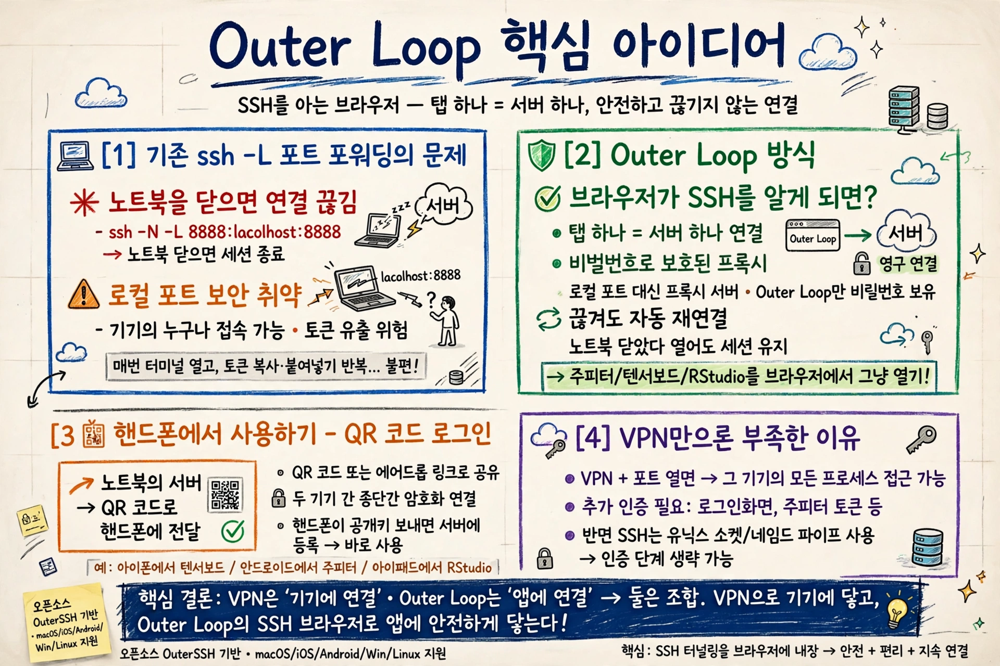
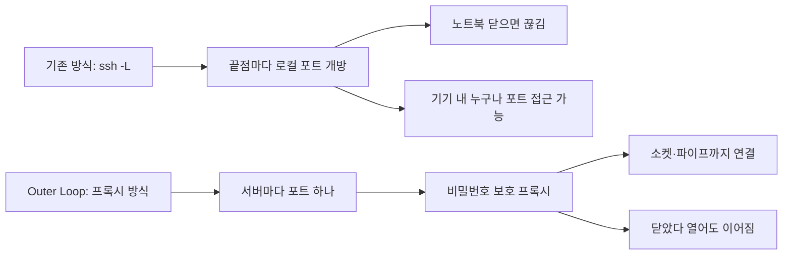
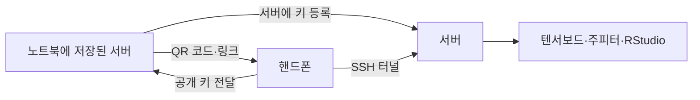
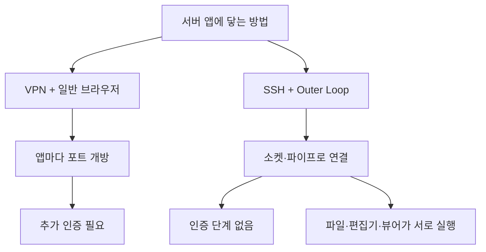

# Outer Loop: 브라우저가 SSH를 알면, 서버 앱이 그냥 열립니다

> **Summary**
> Outer Loop는 SSH를 아는 브라우저입니다. 탭 하나가 서버 하나에 연결돼, 원격 포트와 소켓에 바로 닿습니다. 기존 ssh -L 포트 포워딩은 노트북을 닫으면 끊기고, 로컬 포트를 기기의 누구나 쓸 수 있습니다. Outer Loop는 비밀번호로 보호된 프록시 하나로 바꿉니다. 핸드폰에서는 QR 코드 하나로 서버를 넘겨받고, VPN만 쓰는 방식보다 포트를 열지 않아 인증 단계가 사라집니다.

---

- Outer Loop는 SSH를 아는 브라우저입니다. 탭 하나가 서버 하나에 연결돼, 원격 포트와 소켓에 바로 닿습니다.
- 기존 `ssh -L` 포트 포워딩은 노트북을 닫으면 끊기고, 로컬 포트를 기기의 누구나 쓸 수 있습니다. Outer Loop는 비밀번호로 보호된 프록시 하나로 바꿉니다.
- 핸드폰에서는 QR 코드 하나로 서버를 넘겨받고, VPN만 쓰는 방식보다 포트를 열지 않아 인증 단계가 사라집니다.

서버에 SSH로 들어가 주피터 노트북을 띄운 적 있으시죠? 터미널을 하나 더 열고 `ssh -N -L 8888:localhost:8888` 같은 명령을 칩니다. 토큰을 복사해 브라우저에 붙여넣고, `localhost:8888`로 들어갑니다. 그런데 노트북을 덮었다 열면 연결이 끊기기 일쑤입니다. 이 과정을 매번 반복하는 게 익숙해졌다는 게, 사실은 이상한 일 아닐까요?

🎥 [동영상 보기](https://www.youtube.com/watch?v=TFx5G_Cwgjc)

## 브라우저가 SSH를 알면 뭐가 달라질까요?

Outer Loop는 SSH를 아는 브라우저입니다. "SSH와 로컬호스트를 위한 브라우저"라는 설명 그대로입니다. 탭 하나가 서버 하나에 연결됩니다. 탭이 열리면 그 서버의 포트와 소켓에 바로 닿습니다. 주피터 노트북, 텐서보드, RStudio 같은 웹 앱이 서버에서 돌아가는데, 브라우저에서 그냥 열립니다!

앞선 글에서 다룬 그래픽 셸은 이 브라우저의 기본 홈페이지입니다. 셸이 앱들의 홈 화면이라면, Outer Loop는 그 셸로 들어가는 문입니다. 셸 구조 자체는 앞선 글에서 다뤘으니, 여기서는 문이 어떻게 열리는지에 집중하겠습니다.

## 포트 포워딩, 왜 매번 터미널을 열어야 할까요?

기존 방식은 이렇습니다. 터미널을 새로 열고, 포트마다 `-L`을 달고, `localhost:8888`로 들어갑니다. 주피터 하나, 텐서보드 하나면 명령이 두 줄이 됩니다. 문제는 두 가지입니다.

첫째, 연결이 자주 끊깁니다. 노트북을 닫았다 열면 세션이 끊기기 일쑤입니다. 둘째, 보안입니다. 로컬 포트를 열면 내 기기의 어떤 앱이나 사용자도 그 포트에 닿을 수 있습니다. SSH 인증 없이 말입니다.

Outer Loop의 답은 프록시입니다. 로컬 포트를 중계기로 쓰는 게 아니라, 비밀번호로 보호된 프록시 서버로 씁니다. 비밀번호는 Outer Loop만 갖고 있습니다. 끝점마다 포트를 따로 여는 대신, 서버마다 포트 하나만 씁니다. 그 하나의 프록시가 서버의 여러 끝점에 다 연결해 줍니다. 유닉스 도메인 소켓과 윈도우 네임드 파이프에도 닿고, 동일 출처 정책도 지킵니다.

SSH 엔진도 다릅니다. SSH 세션이 불안정하다는 걸 전제로 설계돼서, 노트북을 닫았다 열어도 매끄럽게 이어집니다. 이게 "터널링이 귀찮다"는 문제를 푸는 방식입니다!

## 핸드폰으로 서버를 쓰면 왜 이렇게 불편할까요?

터미널 앱은 핸드폰에서 정말 불편합니다. X11 포워딩은 느립니다. 웹 앱 방식이 핸드폰에 가장 잘 맞는데, 터널링 설정이 발목을 잡습니다. 세 가지 길 중 가장 좋은 길이 가장 귀찮은 셈입니다.

Outer Loop의 로그인은 다릅니다. 노트북이나 다른 기기에 이미 저장된 서버가 있으면, QR 코드나 에어드롭 가능한 링크로 핸드폰에 넘깁니다. 두 기기 사이에 종단간 암호화 연결이 생기고, 핸드폰이 공개 키를 보내면 다른 기기가 서버에 등록해 줍니다. 처음부터 시작하는 경우에는 노트북 터미널에 붙여넣을 명령어를 알려주거나, 서버 관리자에게 메일로 보낼 수 있습니다.

공식 문서가 드는 예시는 이렇습니다. 아이폰에서 텐서보드, 안드로이드 폰에서 주피터, 아이패드에서 RStudio입니다. 서버 앱을 핸드폰 브라우저에서 그냥 쓰는 그림입니다.

## VPN만으로는 안 될까요?

테일스케일 같은 VPN과 일반 브라우저 조합도 있습니다. 집 서버에 VPN을 깔고, 앱마다 포트를 열어 주소로 들어가는 방식입니다. 이것도 됩니다. 공식 문서도 "이 방식이 맞는 경우도 있다"고 말합니다.

그런데 SSH를 쓰면 좋은 이유가 있습니다. 첫째, 포트입니다. VPN 방식은 앱을 포트에 올려야 해서, 그 기기의 어떤 프로세스든 앱에 닿을 수 있습니다. 그래서 로그인 화면이나 주피터 토큰 같은 추가 인증이 필요합니다. SSH는 포트 대신 유닉스 소켓이나 네임드 파이프를 쓸 수 있어, 인증 단계를 없앨 수 있습니다. 포트만 쓰는 앱은 컨테이너에 넣고 셸이 소켓을 중계해 주면 됩니다. 포트를 열지 않으니 집 네트워크에 포트를 여는 위험도 피합니다.

둘째, "웹사이트를 여는 게 아니라 컴퓨터를 쓰는 것"입니다. SSH로 로그인하면 파일 브라우저, 텍스트 편집기, 이미지 뷰어가 서로를 실행하는 그래픽 셸의 세계가 열립니다. `sudo` 경험까지 가능합니다. 서버에 끝점이 아무리 많아도 인증 단계는 없습니다.

결론은 둘 중 하나가 아니라 조합입니다. VPN으로 기기에 닿고, SSH로 앱에 닿는 방식입니다!

## 이 브라우저, 속은 어떻게 생겼을까요?

속은 오픈소스 코어입니다. `OuterSSH`라는 오픈소스 라이브러리 위에 지어졌고, 표준 웹 뷰와 오픈소스 네이티브 앱 방식을 씁니다. 기본 홈페이지는 오픈소스 그래픽 셸입니다. 자기만의 클라이언트나 홈페이지를 만들 수도 있습니다.

플랫폼은 두 가지입니다. HTML·자바스크립트·웹어셈블리, 그리고 웹 같은 네이티브 앱 플랫폼입니다. 후자는 새 층을 얹는 게 아니라, 운영체제의 기존 플랫폼을 브라우저에서 쓸 수 있게 층을 하나 덜어낸 방식입니다.

받을 수 있는 곳도 넓습니다. macOS 14 이상, iOS·아이패드OS, 안드로이드(얼리 액세스), 윈도우 10 이상, 리눅스(우분투·데비안·페도라·아치 등)입니다.

## 지금 쓸 수 있을까요?

알고 써야 할 단서는 있습니다. 아직 초기 단계입니다. macOS는 0.9.47인데 윈도우는 0.1.9입니다. 버전 숫자만 봐도 윈도우 쪽이 더 어립니다. 안드로이드는 구글 그룹을 통한 얼리 액세스입니다.

공개 토론에서 "결국 HTTP 서버를 SSH로 프록시하는 일 아니냐"는 지적도 있었습니다. 맞는 말입니다. 새 프로토콜이 아니라, 터널링을 브라우저 안에 넣어 안전하고 편하게 만든 것이 가치입니다!

그래도 방향은 분명합니다. 서버를 검은 화면으로만 보지 않고, SSH를 아는 브라우저로 쓰는 관점 자체가 새롭습니다. 터미널을 버리라는 얘기가 아닙니다. 서버에 닿는 방법이 하나 더 생겼다는 얘기입니다. SSH로 들어갈 수 있으면, 그래픽 셸도 그냥 열립니다.

