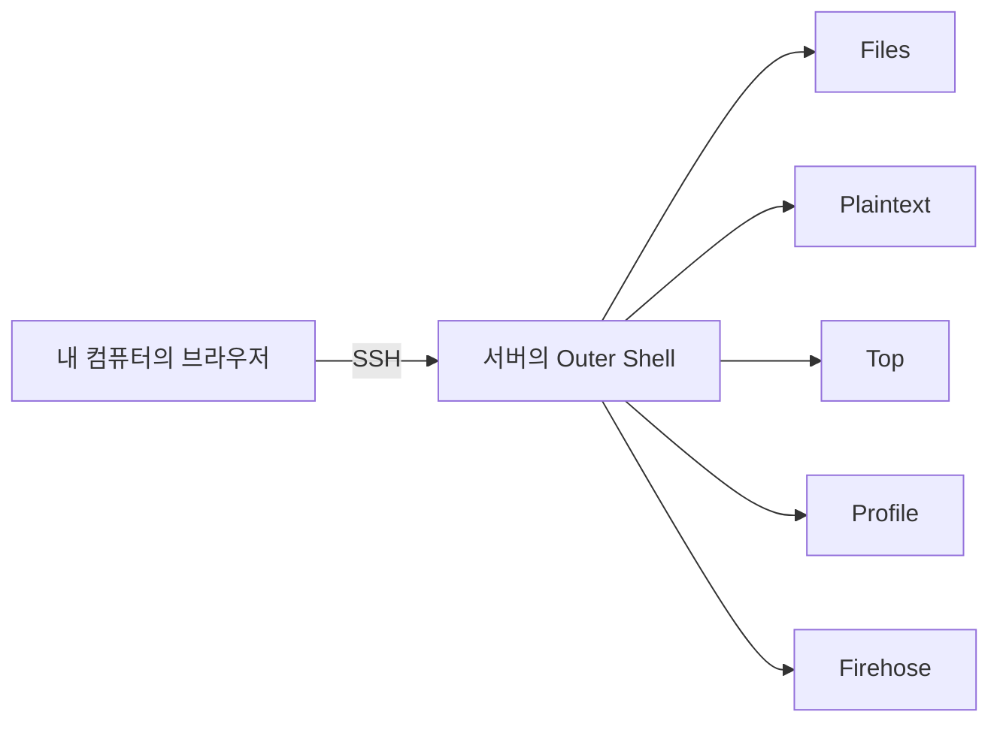
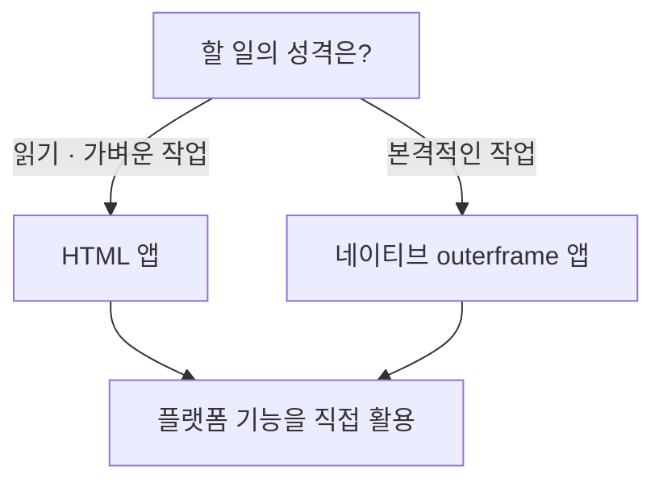

# Outer Shell: 서버에 터미널만 두지 않습니다. SSH 위에 그래픽 셸을 올립니다

> **Summary**
> 서버와 엣지 기기에 터미널 대신 브라우저 기반 그래픽 셸을 올리는 아이디어입니다. 앱 하나하나가 작은 HTTP 서버로 돌고, 암호화는 SSH 계층에 맡겨 앱은 단순하게 유지합니다. 셸이 앱 간 URL 조회 API를 제공해, 파일을 더블클릭하면 맞는 앱으로 열리는 흐름이 됩니다.

---

- 서버와 엣지 기기에 터미널 대신 브라우저 기반 그래픽 셸을 올리는 아이디어입니다.
- 앱 하나하나가 작은 HTTP 서버로 돌고, 암호화는 SSH 계층에 맡겨 앱은 단순하게 유지합니다.
- 셸이 앱 간 URL 조회 API를 제공해, 파일을 더블클릭하면 맞는 앱으로 열리는 흐름이 됩니다.

서버에 SSH로 들어간 적 있으시죠? 검은 화면에 프롬프트 한 줄, 거기서 `top`을 치고 로그를 `tail`로 봅니다. 파일 하나 열어보는 일도 명령어 한 줄이 필요합니다. 그런데 이 검은 화면이 꼭 필요할까요? 웹 브라우저는 이미 한 기기가 다른 기기에 경험을 제공하는 흐름을 잘 정립해 뒀습니다. 그 방식을 서버에 그대로 가져오면 어떨까요?

🎥 [동영상 보기](https://www.youtube.com/watch?v=e40PLLuZ5KI)

## 셸은 어떻게 동작할까요?

아이디어는 단순합니다. 서버가 브라우저 기반 그래픽 셸을 제공하고, 셸 안에 앱들의 홈 화면이 있습니다. 앱 하나하나가 작은 HTTP 서버로 웹 UI를 서빙합니다. 터미널 앱 대신 그래픽 앱을 쓰는 구조입니다!

그런데 이 HTTP 서버는 일반 공개 서버가 아닙니다. 네트워크의 다른 기기에서 접근할 수 없는 비공개 서버로 돕니다. `localhost` 포트 대신 Unix 도메인 소켓 파일을 주로 씁니다. 소켓 파일은 포트와 비슷하지만 파일시스템에 존재하고, 명시적인 사용자 권한을 가집니다. 사용자는 SSH를 통해 쓰거나 로컬에서 씁니다.

암호화도 앱이 직접 처리하지 않습니다. 암호화는 SSH 계층에서 처리됩니다. 덕분에 각 앱 서버는 의존성 없이 아주 단순한 구조를 유지할 수 있습니다. 이게 설계의 핵심입니다!

셸은 앱 간 URL 조회 API도 제공합니다. 앱이 자신을 텍스트 편집기로 등록해 두면, 다른 앱에서 텍스트 파일을 더블클릭했을 때 해당 편집기 앱으로 열 수 있습니다. 파일 미리보기는 몇 가지 타입으로 고정돼 있고, 열기·편집은 완전히 확장 가능합니다. 내장 파일 타입은 `public.text`나 `public.pdf` 같은 이름이고, 앱은 자기 타입을 함께 등록합니다.

기본으로 딸려 오는 앱은 다섯 가지입니다. 파일 관리자, 텍스트 편집기, 시스템 모니터, 프로필, 실시간 로그 뷰어입니다. 물론 자기 앱을 만들어 공유할 수도 있습니다.

## X 포워딩이랑 뭐가 다를까요?

비슷한 답이 30년 전에 이미 있었다는 지적이 있습니다. X 프로토콜과 `ssh -X` 말입니다. 맞는 말입니다. 화면을 원격으로 그리는 아이디어 자체는 오래됐습니다.

차이는 표시 계층을 무엇으로 삼느냐에 있습니다. X는 화면 전체를 그리는 방식이고, Outer Shell은 앱마다 작은 HTTP 서버가 UI를 서빙하고 브라우저가 그걸 표시하는 방식입니다. 웹이 표시 계층이 되는 셈입니다.

비슷한 도구와 비교하면 위치가 더 분명해집니다. Cockpit도 웹 UI로 서버를 관리합니다. 다만 기존 브라우저 안에서 돌아가니 포트를 열거나 포트 포워딩이 필요합니다. Outer Loop는 SSH를 아는 전용 브라우저라 포트를 새로 열 필요가 없습니다. SSH로 접속할 수 있으면 바로 쓸 수 있습니다!

Jupyter나 Tensorboard 같은 서버형 웹 앱도 이미 있었습니다. 문제는 각각 일회성 보안 프로토콜을 썼다는 점입니다. 앱을 "올바르게" 전달하는 공통 방식은 자리 잡지 못했습니다. 이 글이 파고드는 지점이 바로 여기입니다.

## 네이티브 앱은 왜 필요할까요?

앱은 기존 HTML 기반 웹 앱일 수도 있고, 네이티브 앱일 수도 있습니다. 여기서 말하는 네이티브 앱은 outerframe이라는 방식입니다. 웹뷰와 비슷하지만 네이티브로 돕니다. 샌드박스 프로세스 안에서 컴파일된 머신 코드가 운영체제의 기능을 직접 써서 앱을 구현합니다.

왜 굳이 네이티브까지 가져올까요? AI가 코드 작성을 도와주니 플랫폼마다 코드베이스를 갖는 게 실용적이 됐기 때문입니다. 읽기와 가벼운 앱은 HTML로, 작업용 앱은 플랫폼 맞춤 네이티브로 쓰는 구조가 글쓴이가 말하는 웹의 자연스러운 아키텍처입니다!

## 지금 쓸 수 있을까요?

Outer Loop는 macOS용 브라우저로 받을 수 있습니다. Outer Shell은 Linux, Windows, macOS에서 동작하는 서비스입니다. 받아서 연결하면 셸 UI와 기본 앱 다섯 가지가 바로 뜹니다.

다만 아직 초기 단계라는 점은 알고 써야 합니다. 브라우저에서 Unix 소켓 연결 같은 기능은 아주 틈새 기능으로 취급돼 왔습니다. SSH와 sudo 인식 같은 기능과 묶여야 비로소 새로운 가능성이 열립니다. 당장 모든 서버에 올릴 물건은 아닙니다.

그래도 방향은 분명합니다! 서버를 검은 화면의 집합으로만 보지 않고, 원격 그래픽 셸로 보는 관점 자체가 새롭습니다. 터미널이 사라진다는 얘기가 아닙니다. 서버를 대하는 방법이 하나 더 생긴다는 얘기입니다. 검은 화면만으로 충분했던 서버에, 그래픽 셸이라는 두 번째 문이 열리는 중입니다.

