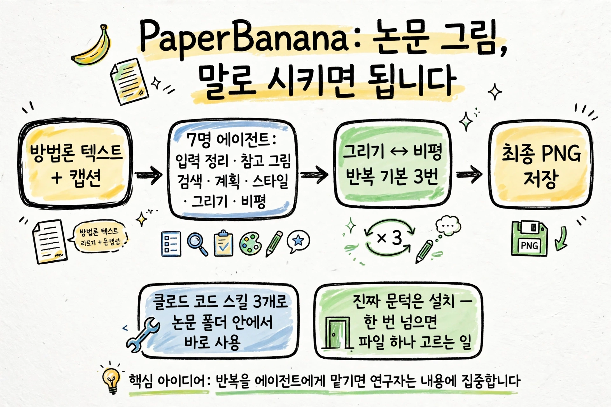
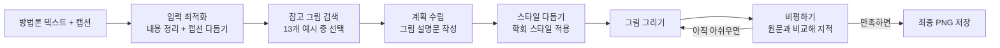
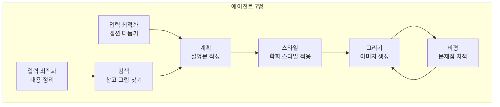
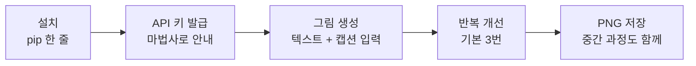

# PaperBanana: 논문 그림, 이제 그리는 게 아니라 말로 시키면 됩니다

> **Summary**
> PaperBanana는 방법론 텍스트와 캡션을 바탕으로 논문 그림을 생성하고, 여러 에이전트가 계획·스타일 적용·비평·수정을 반복하는 프레임워크입니다. 비공식 오픈소스 구현은 명령어로 그림과 통계 그래프를 만들고 Claude Code 스킬로도 사용할 수 있지만, 결과의 정확성을 직접 확인해야 하며 API 비용과 설치 부담을 고려해야 합니다.

---

- 논문 방법론 그림, 이제 직접 그릴 필요가 없습니다. 방법론 텍스트와 캡션만 주면 에이전트들이 그림을 그려줍니다.
- 그리는 에이전트와 비판하는 에이전트가 따로 있습니다. 그리고, 비평하고, 고치는 과정을 기본 3번 반복합니다.
- 클로드 코드 스킬로 등록하면 논문 폴더 안에서 바로 쓸 수 있습니다. 설치가 부담스럽다면, 그 장벽이 이 글의 진짜 주제입니다.


논문 그림 하나 그리는 데 하루가 간 적 있으시죠? 방법론은 이미 다 썼는데, 그림 때문에 제출이 미뤄지는 그 순간 말입니다. 그런데 그 그림을 자동으로 그려주는 논문이 나왔고, 오픈소스 구현까지 있습니다!

🎥 [동영상 보기](https://www.youtube.com/watch?v=zZfL0S5aAjo)

## PaperBanana, 도대체 뭘까요?

`PaperBanana`는 학술 논문의 그림을 자동으로 그려주는 에이전트 프레임워크입니다. 논문 제목은 "PaperBanana: Automating Academic Illustration for AI Scientists"이고, 2026년 1월에 공개됐습니다. 방법론 다이어그램이 핵심이고, 통계 그래프까지 그려줍니다.

연구진이 직접 만든 평가 기준도 있습니다. `NeurIPS` 2025 논문에서 뽑은 292개 그림 과제로 만든 `PaperBananaBench`인데, 충실성·간결성·가독성·미학 네 가지에서 기존 방법보다 낫다고 보고했습니다.

여기서 한 가지는 분명히 해야 합니다. 이 글에서 소개하는 저장소는 논문 저자들의 공식 코드가 아닙니다. 논문을 보고 커뮤니티가 따로 구현한 비공식 오픈소스 구현이고, 원본 시스템과 다를 수 있다고 저장소 첫머리에 적혀 있습니다. 그래도 `MIT` 라이선스로 열려 있고, 2026년 11월 기준으로 별 2,505개를 받았습니다.

## 그림은 누가 그리나요?

한 모델이 통째로 그리는 게 아닙니다. 최대 7명의 전문 에이전트가 역할을 나눠서 그립니다.



순서는 세 단계로 나뉩니다. 먼저 입력 최적화 단계에서 방법론 텍스트를 그림에 맞는 형태로 정리하고, 모호한 캡션을 정확한 시각 설명으로 바꿉니다. 이 단계는 `--optimize` 옵션을 켰을 때만 돕니다.

다음은 계획 단계입니다. 검색 에이전트가 13개 참고 그림 중에서 관련 있는 예시를 골라오고, 계획 에이전트가 그 예시를 보고 그림 설명문을 씁니다. 스타일 에이전트는 학회 스타일 가이드에 맞춰 색·배치·글꼴을 다듬습니다.

마지막은 그리기와 비평의 반복입니다. 그리기 에이전트가 그림을 그리고, 비평 에이전트가 원문과 비교해 문제점을 지적합니다. 이 과정을 기본 3번 반복하고, `--auto`를 켜면 비평가가 만족할 때까지 돕니다. 안전장치로 최대 30번까지만 돕니다.



## 쓰는 방법은 어렵지 않을까요?

설치는 명령어 한 줄입니다. `Python 3.10` 이상이 필요하고, `pip install paperbanana`로 설치합니다. API 키는 `OpenAI`나 `Google Gemini` 중 하나면 됩니다. `Gemini`는 무료 티어가 있어서, 키 발급 마법사인 `paperbanana setup`만 실행하면 준비가 끝납니다.



그림을 만드는 명령어도 짧습니다. 방법론을 적은 텍스트 파일과 캡션만 주면 됩니다.

```bash
paperbanana generate \
  --input my_method.txt \
  --caption "우리 프레임워크 개요"
```

결과는 `outputs` 폴더에 저장됩니다. 최종 그림뿐 아니라 중간 과정과 메타데이터도 함께 남습니다. 마음에 안 드는 부분은 피드백을 적어서 이어서 고칠 수도 있습니다. 그림 말고 통계 그래프도 그릴 수 있는데, 그래프는 이미지 생성 모델이 아니라 코드로 그려서 API 키가 따로 필요 없습니다.

이 장면이 저는 가장 인상 깊었습니다. 그림 그리는 도구가 클로드 코드 스킬로 등록된다는 점입니다. `/generate-diagram`, `/generate-plot`, `/evaluate-diagram` 세 가지 스킬이 들어 있어서, 논문 폴더 안에서 명령어 하나로 그림을 만들고, 평가까지 할 수 있습니다. 도구가 따로 노는 게 아니라 작업 흐름 안에 들어온다는 점이 다릅니다!

## 설치가 막막하다면, 그 장벽이 핵심입니다

설치가 제일 큰 문턱입니다. `pip`으로 깔고 환경 설정까지 맞추는 과정이, 코딩을 하지 않는 사람에게는 여간 심리적 장벽이 아닐 수 없습니다. 클립을 공유한 분도 같은 이야기를 했습니다. 설치가 부담스러웠다는 점 말입니다.

그런데 한 가지 재미있는 대목이 있습니다. 클라우드 작업 공간에서는 바로 실행이 안 됩니다. 외부 연결을 차단하는 보안 정책 때문에 `403` 오류가 났다고 합니다. 우회 방법은 없습니다. 대신 로컬 컴퓨터에 설치하는 건 완전히 가능합니다. 사실 그게 가장 깔끔한 방법이라고 합니다.

한 번만 설치해 두면 이후 과정은 단순합니다. 입력 파일이 선택한 폴더에 자동으로 생기고, 폴더를 열어 명령어 한 번만 실행하면, 같은 폴더에 `PNG`가 저장됩니다. 설치라는 한 번의 장벽을 넘으면, 그다음부터는 그림 그리는 일이 파일 하나 고르는 일이 됩니다.

## 그림을 믿어도 될까요?

아직은 맹신하면 안 됩니다. 세 가지를 짚고 넘어가야 합니다.

첫째, 비공식 구현이라는 점입니다. 원본 논문의 시스템과 다를 수 있습니다. 논문에 나온 성능 수치가 이 구현에 그대로 적용되는 건 아닙니다.

둘째, 이미지 모델은 글자를 틀리게 그릴 때가 있습니다. 학회 그림은 글자 하나가 틀려도 의미가 달라집니다. 제출하기 전에 눈으로 직접 확인하는 과정은 아직 사람의 몫입니다.

셋째, 비용입니다. `Gemini` 이미지 생성은 1장당 약 0.134달러 수준이고, `OpenAI` 쪽은 모델마다 다릅니다. 그림 한 장에 몇 번씩 반복하면 비용이 쌓입니다. 무료 티어로 시작해 감을 잡는 게 안전합니다.

그럼에도 방향은 분명합니다. 논문 그림의 병목은 손재주가 아니라 반복이었습니다. 반복을 에이전트에게 맡기면, 연구자는 그림이 아니라 내용에 시간을 쓸 수 있습니다. 그게 이 도구가 던지는 가장 큰 질문입니다!

