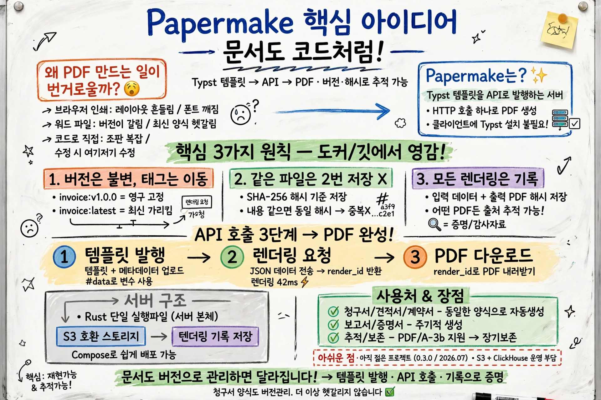
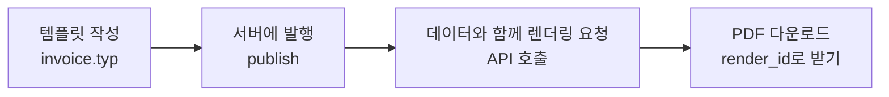
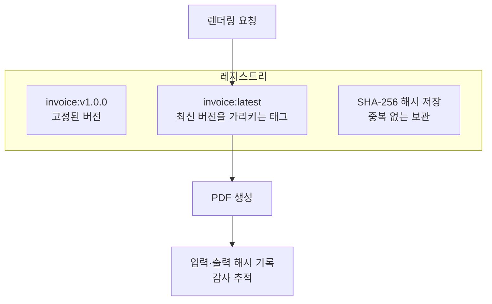
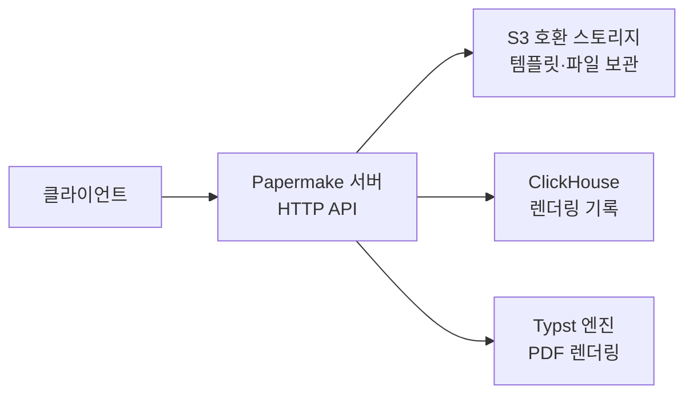

# Papermake: PDF를 만드는 일, 이제 템플릿을 발행하고 API로 뽑습니다

> **Summary**
> Papermake는 Typst 템플릿을 API로 발행해 HTTP 호출 하나로 PDF를 뽑아내는 서버입니다. 템플릿은 도커 이미지처럼 버전과 태그로 관리하고, 렌더링 기록은 해시로 남아 어떤 PDF든 출처를 추적할 수 있습니다. Rust 단일 실행 파일에 S3 호환 스토리지와 ClickHouse만 있으면 직접 띄울 수 있지만, 아직 젊은 프로젝트라 렌더링 워커와 웹 화면은 초기 단계입니다.

---

- Papermake는 Typst 템플릿을 API로 발행하고, HTTP 호출 하나로 PDF를 뽑아내는 서버입니다.
- 템플릿은 도커 이미지처럼 버전과 태그로 관리하고, 렌더링 기록은 해시로 남겨 어떤 PDF든 출처를 추적할 수 있습니다.
- Rust 단일 실행 파일에 S3 호환 스토리지와 ClickHouse만 있으면 직접 띄울 수 있습니다.

매달 청구서를 만들어야 하는 팀이 있습니다. 양식은 정해져 있는데, 만들 때마다 디자이너에게 부탁하거나 워드 파일을 복사해서 숫자를 고칩니다. 그러다 보면 어느 파일이 최신 양식인지 헷갈리고, 고객에게 나간 청구서가 어떤 데이터로 만들어졌는지 아무도 모르게 됩니다. 이런 적 있으시죠?

🎥 [동영상 보기](https://www.youtube.com/watch?v=rg46Mz74ssU)

## PDF 만드는 일이 왜 이렇게 번거로울까요?

PDF는 만들기는 쉬운데, 똑같은 양식으로 계속 만드는 건 어렵습니다. 브라우저 인쇄는 레이아웃이 흔들리고, 워드 파일은 버전이 갈리고, 코드로 직접 그리자니 조판이 엉망이 됩니다. 양식 하나 바꾸려면 여기저기 흩어진 파일을 다 뒤져야 합니다.

그래서 문서도 코드처럼 다루자는 아이디어가 나왔습니다. 템플릿은 저장소에 올리고, 버전으로 관리하고, API로 부르면 PDF가 나오는 방식입니다. Papermake가 바로 그 일을 하는 서버입니다.

## Papermake는 뭐가 다를까요?

한 줄로 정리하면, **Typst 템플릿을 PDF API로 바꾸는 서버**입니다. Typst는 LaTeX만큼 강력하면서 문법이 훨씬 가벼운 조판 시스템입니다. 마크업 몇 줄로 표, 수식, 다단 레이아웃까지 깔끔하게 뽑아냅니다.

Papermake는 이 Typst를 서버에 얹었습니다. 클라이언트에 Typst를 설치할 필요가 없습니다. HTTP 요청만 보내면 서버가 렌더링해서 PDF를 돌려줍니다. 템플릿을 한 번 발행해 두면, 어디서든 같은 양식으로 PDF를 뽑을 수 있습니다!

## 템플릿을 코드처럼 다룬다는 게 무슨 뜻일까요?

Papermake의 설계는 도커 레지스트리와 깃에서 그대로 가져왔습니다. 세 가지 원칙이 뼈대입니다.

**버전은 바뀌지 않고, 태그는 움직입니다.** `invoice:v1.0.0`은 한 번 발행하면 절대 바뀌지 않습니다. 대신 `invoice:latest`는 최신 버전을 가리키도록 갱신됩니다. 작년 청구서와 올해 청구서가 같은 양식인지 궁금하면, 버전만 보면 답이 나옵니다!

**같은 파일은 두 번 저장하지 않습니다.** 템플릿은 SHA-256 해시 기준으로 저장됩니다. 내용이 같은 파일은 해시가 같아서 중복 저장이 없습니다. 깃이 파일을 다루는 방식과 똑같습니다.

**모든 렌더링은 기록으로 남습니다.** 렌더링할 때마다 입력 데이터와 출력 PDF의 해시를 기록합니다. 그래서 고객에게 나간 PDF 한 장을 들고 "이건 어떤 템플릿과 어떤 데이터로 만든 겁니까?"라고 물어도, 기록을 따라가면 답이 나옵니다. 버전이 곧 증거가 됩니다!

## API 호출 세 번이면 PDF가 나옵니다

사용법은 단순합니다. 먼저 템플릿을 발행합니다. 템플릿 파일과 메타데이터를 함께 보내면 됩니다. 템플릿 안에서 입력 데이터는 `#data`로 꺼내 씁니다. 청구서 번호, 고객 이름, 금액 같은 값을 템플릿에 박아두는 방식입니다.

그다음 렌더링을 요청합니다. JSON으로 데이터를 보내면 서버가 PDF를 만들고 `render_id`를 돌려줍니다. 마지막으로 그 ID로 PDF를 내려받으면 끝입니다. 예시 응답에 찍힌 렌더링 시간은 42ms였습니다. 물론 템플릿이 복잡해지면 달라지겠지만, 구조 자체는 가볍습니다.

템플릿에 이미지나 폰트, 추가 파일이 필요하면 함께 올릴 수 있습니다. 렌더링은 가상 파일 시스템 안에서 돌아가서, 디스크에 직접 접근하지 않습니다. 파일은 이름으로만 찾습니다. 여기에 PDF/A-3b 같은 보존용 표준도 렌더링할 때 골라서 요청할 수 있습니다. 전자세금계산서 표준의 기반이 되는 형식이라, 청구서·계약서처럼 오래 보관해야 하는 문서에 잘 맞습니다.

## 서버는 어떻게 생겼을까요?

구조도 단순합니다. Rust로 만든 단일 실행 파일이 서버 본체이고, 뒤에 S3 호환 스토리지와 ClickHouse가 붙습니다. 스토리지는 템플릿과 파일을, ClickHouse는 렌더링 기록을 맡습니다. 직접 띄우려면 이 세 가지만 있으면 됩니다. compose 파일 하나로 서버, S3 호환 스토리지, ClickHouse를 함께 띄우는 방법도 준비되어 있습니다.

서버만 쓸 수도 있고, 라이브러리로만 쓸 수도 있습니다. 핵심 렌더링 엔진은 별도 크레이트로 나와 있어서, 서버 없이 내 프로그램 안에 직접 심을 수도 있습니다. 렌더링 워커는 아직 초기 단계의 스텁이고, 템플릿과 렌더링을 둘러보는 웹 화면도 실험 단계입니다. 핵심 기능이 먼저 굳어지고, 주변은 이제 채워지는 중입니다.

## 어디에 쓰면 좋을까요?

청구서, 견적서, 계약서처럼 양식이 정해진 문서가 첫 번째 쓰임새입니다. 데이터를 바꾸면 같은 양식으로 새 PDF가 나오니까요. 보고서나 증명서처럼 주기적으로 뽑아내는 문서도 잘 맞습니다.

두 번째는 **추적이 필요한 문서**입니다. 금융이나 공공처럼 "이 문서가 어떤 버전으로 만들어졌는지 증명하라"는 요구가 있는 곳에서는, 버전과 해시 기록이 그대로 감사 자료가 됩니다. PDF/A-3b 지원까지 있으니 보존 요건이 있는 문서에도 손이 갑니다.

## 아쉬운 점은 없을까요?

다만, 짚고 넘어가야 할 단서도 있습니다. 아직 젊은 프로젝트입니다. 릴리스 기록을 보면 2025년 5월에 첫 버전이 나왔고, 2026년 7월에 0.3.0까지 왔습니다. 렌더링 워커는 초기 스텁, 웹 화면은 실험 단계라 당장 운영에 필요한 모든 부품이 완비된 건 아닙니다.

그리고 직접 띄우려면 S3 호환 스토리지와 ClickHouse까지 함께 운영해야 합니다. 단일 실행 파일 하나만으로 끝나는 구조는 아닙니다. 작은 팀이 가볍게 쓰기에는 이 두 가지가 부담이 될 수 있습니다. 반대로, 이미 스토리지를 운영 중인 팀이라면 붙이기가 수월합니다.

## 문서도 버전으로 관리하면 달라집니다

문서는 한 번 만들고 끝나는 물건이 아닙니다. 양식은 바뀌고, 데이터는 쌓이고, 누가 어떤 버전으로 만들었는지 묻게 됩니다. Papermake는 그 질문에 답할 수 있게 만드는 도구입니다. 템플릿을 발행하고, API로 부르고, 기록으로 증명하는 흐름이 문서 만드는 일의 무게를 확 줄여줍니다!

청구서 양식 하나라도 버전으로 관리해 본 적 있으시다면, 이 도구가 왜 나왔는지 바로 감이 오실 겁니다.

