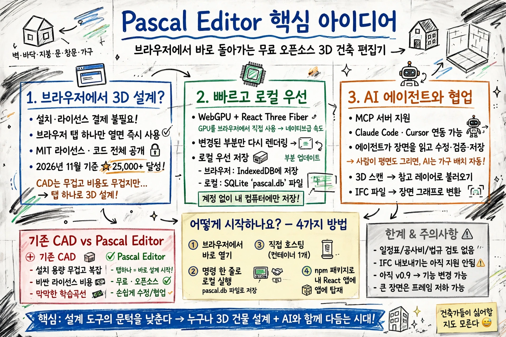
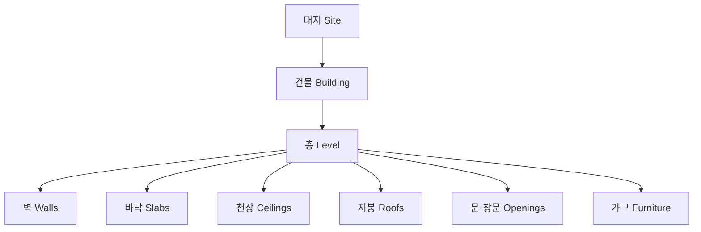
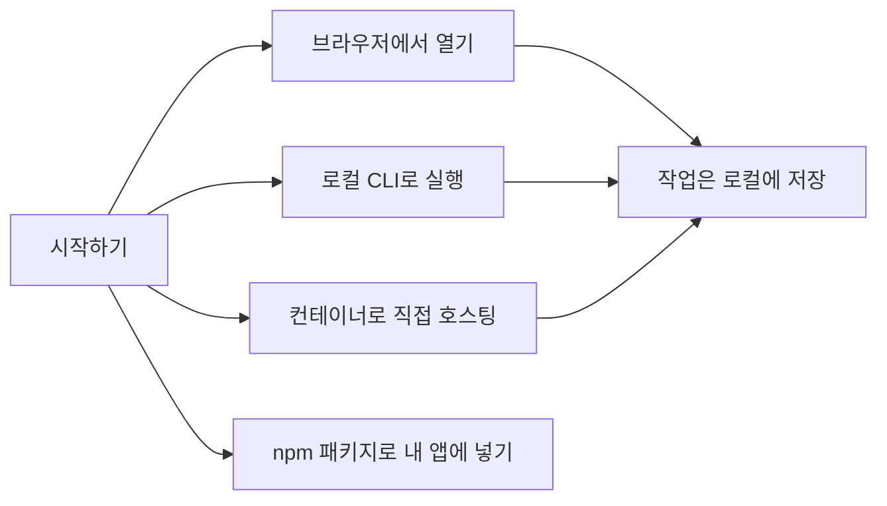

# Pascal Editor: 브라우저만 켜면 3D 건물 설계가 됩니다. 설치도, 라이선스도 필요 없습니다

> **Summary**
> Pascal Editor는 설치나 라이선스 비용 없이 브라우저에서 실시간 3D 건축 설계를 할 수 있는 오픈소스 도구입니다. 작업은 로컬에 저장되며, MCP를 통해 AI 에이전트와 함께 설계할 수 있습니다. 다만 공사비·법규 검토 기능과 IFC 내보내기는 없고, 대형 장면의 성능과 초기 버전의 안정성에는 한계가 있습니다.

---

- Pascal Editor는 브라우저에서 바로 돌아가는 무료 오픈소스 3D 건축 편집기입니다. 설치도, 라이선스 결제도 필요 없습니다.
- 벽·바닥·지붕·문·창문·가구를 그리면 3D 건물이 되었고, `WebGPU`가 GPU를 직접 써서 네이티브 앱에 가까운 속도를 냈습니다.
- 로컬 우선이라 작업이 내 컴퓨터에 남았고, AI 에이전트도 `MCP`로 같은 장면을 읽고 고칠 수 있었습니다.


방 구조를 조금만 바꿔보고 싶은데, CAD를 켜는 순간부터 막막해진 적 있으시죠? 설치 용량부터 무겁고, 라이선스 가격은 더 무겁습니다. 그런데 브라우저 탭 하나만 열면 3D 건물 설계가 되는 도구가 나타났습니다! 클립에는 "건축가들이 싫어할지도 모른다"는 농담까지 붙었습니다.

🎥 [동영상 보기](https://www.youtube.com/watch?v=MTcHTbXtx1s)

### 브라우저에서 3D 설계가 된다고?

Pascal Editor는 건축·엔지니어링·시공·운영 작업을 위한 3D 건축 편집기입니다. `MIT` 라이선스로 공개됐고, 코드가 전부 열려 있습니다. 2026년 봄에 화제가 되더니, 2026년 11월 기준 저장소 별이 2만 5천 개를 넘겼습니다.

핵심은 렌더링 방식입니다. `React Three Fiber`와 `WebGPU` 조합으로 GPU를 브라우저에서 직접 씁니다. 그래서 무거운 데스크톱 앱을 설치하지 않아도 실시간 렌더링이 됩니다.

### 뭐가 그려지나요?

그릴 수 있는 건 건물의 뼈대부터 속까지입니다. 대지·건물·층·벽·바닥·천장·지붕·구역·문·창문·가구까지, 계층 구조로 쌓아 올립니다. 벽을 그리면 모서리가 맞물리고, 문과 창문 자리에는 구멍이 뚫립니다. 평면도에서 방 하나를 그리면 바닥과 천장이 알아서 생깁니다!



### 왜 이렇게 빠를까요?

비결은 두 가지입니다. 첫째, `WebGPU`가 렌더링을 GPU에 직접 맡깁니다. 둘째, 바뀐 부분만 다시 그립니다. 장면 전체를 매번 다시 그리는 게 아니라, 건드린 노드만 추적해서 갱신합니다. 그래서 큰 장면에서도 반응이 살아 있습니다.

데이터도 내 컴퓨터에 남습니다. 브라우저에서는 `IndexedDB`에, 로컬로 실행하면 `SQLite` 데이터베이스에 저장됩니다. 서버로 올라가는 게 아니라서, 계정도 필요 없습니다!


### 어떻게 시작하나요?

시작은 네 가지 길입니다. 브라우저에서 바로 여는 방법, 로컬에서 명령 한 줄로 실행하는 방법, 직접 호스팅하는 방법, 패키지로 내 앱에 넣는 방법입니다.

```bash
npx @pascal-app/cli editor
```

이 명령 한 줄이면 로컬 에디터가 뜹니다. 프로젝트는 `~/.pascal/data/pascal.db`에 저장됩니다. 직접 호스팅은 컨테이너 하나면 됩니다. 개발자는 `npm` 패키지 네 개를 설치해 뷰어나 에디터 통째로 자신의 `React` 앱에 넣을 수도 있습니다.



### 에이전트도 같이 설계한다고?

Pascal Editor의 진짜 차별점은 에이전트 연결입니다. `MCP` 서버가 있어서 `Claude Code`나 `Cursor` 같은 에이전트가 같은 장면을 읽고, 고치고, 검증하고, 저장할 수 있습니다. 사람이 평면도를 그리고, 에이전트에게 가구 배치를 맡기는 식의 협업이 됩니다!

3D 스캔을 불러와 참고 레이어로 깔고, 그 위에 편집 가능한 요소를 모델링하는 스캔-투-빔 작업도 됩니다. `IFC` 파일은 전용 변환기가 장면 그래프로 바꿔서 가져올 수 있습니다.

### 아쉬운 점은 없나요?

물론 한계도 있습니다. 일정표나 공사비 계산, 법규 검토 기능은 없습니다. 설계 도면 패키지를 대신할 도구는 아닙니다. 내보내기는 `GLB`·`STL`·`OBJ`와 평면도 `PDF`가 되고, `IFC` 내보내기는 아직 없습니다. 큰 장면에서는 프레임이 흔들린다는 보고도 있습니다. 버전도 아직 `0.9`대라, 공개 기능이 바뀔 수 있습니다. 그리고 호스팅 서비스는 계정이 필요합니다. 오픈소스 에디터 자체는 무료지만, 호스팅 작업 공간은 별도 약관이 적용됩니다.

설계 도구가 브라우저 탭 안에 들어왔다는 사실 자체가, 건축 소프트웨어의 문턱을 낮췄습니다! 비싼 라이선스 없이도 건물을 그리고, 에이전트와 함께 다듬는 시대가 열렸습니다.

