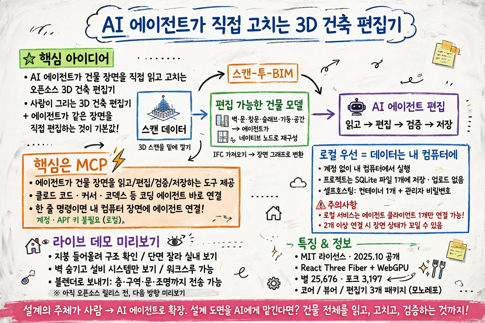
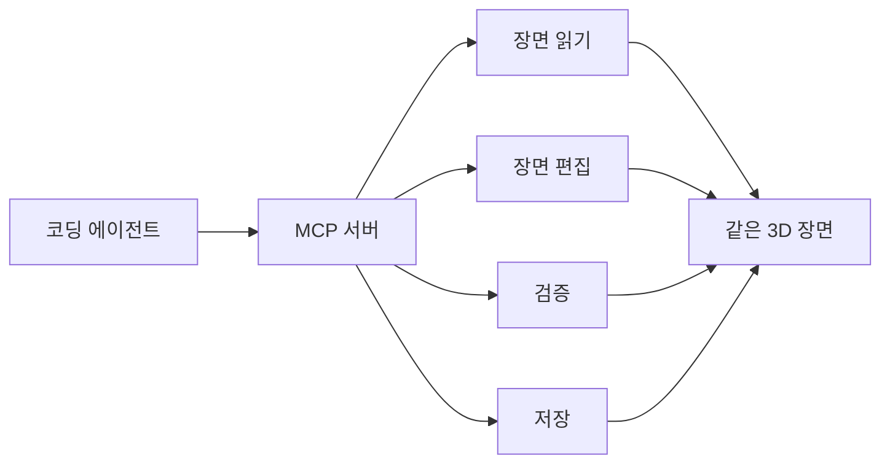
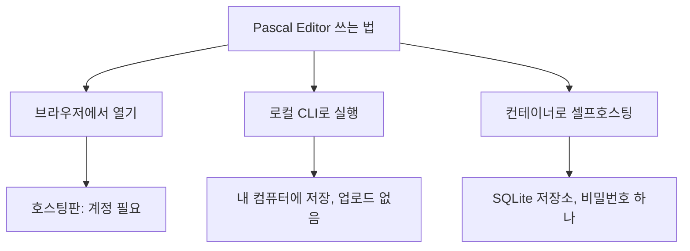
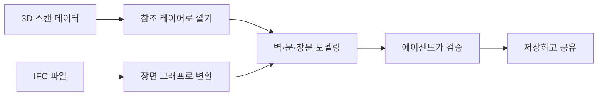

# Pascal Editor: 에이전트가 건물 장면을 직접 읽고 고칩니다. 설계가 에이전트의 일이 됩니다

> **Summary**
> Pascal Editor는 AI 에이전트가 MCP를 통해 건물의 3D 장면을 읽고 편집·검증·저장할 수 있는 오픈소스 건축 편집기입니다. 로컬 우선으로 작업을 저장하며, 3D 스캔을 참고해 편집 가능한 모델을 만들고 IFC 파일도 가져올 수 있습니다. MIT 라이선스로 공개됐고, 블렌더 연동과 건물 내부 워크스루 등은 향후 방향으로 소개됩니다.

---

- AI 에이전트가 건물 장면을 직접 읽고 고치는 오픈소스 3D 건축 편집기입니다.
- 계정 없이 내 컴퓨터에서 돌아가고, 에이전트는 MCP로 같은 장면을 읽고 검증하고 저장합니다.
- 스캔 데이터를 밑에 깔고 편집 가능한 건물로 다시 그리는 스캔-투-BIM까지, 설계가 에이전트의 일이 됩니다.

설계 도면을 AI한테 맡긴다면, 어디까지 맡길 수 있을까요? 벽 하나 옮기는 것까지일까요? 아니면 건물 전체를 읽고, 고치고, 검증하는 것까지일까요? 이 편집기는 후자를 노립니다. 사람이 그리는 3D 건축 편집기인데, 에이전트가 같은 장면을 직접 만지는 게 기본값입니다!

🎥 [동영상 보기](https://www.youtube.com/watch?v=7_PAXkAp2ec)

### 에이전트가 건물을 고친다고요?

핵심은 MCP입니다. 에이전트가 건물 장면을 읽고, 편집하고, 검증하고, 저장하는 도구를 받는 겁니다. 클로드 코드, 커서, 코덱스 같은 코딩 에이전트가 그대로 연결됩니다. 로컬에서는 계정도 API 키도 필요 없습니다. `pascal mcp connect` 한 줄이면 에이전트가 내 컴퓨터의 장면에 붙습니다!

주의할 점도 있습니다. 로컬 서비스에는 에이전트 클라이언트를 하나만 연결해야 합니다. 두 개를 동시에 붙이면 장면 상태가 꼬일 수 있습니다. 따로 돌리고 싶으면 저장 폴더를 나눠서 서비스를 따로 띄우면 됩니다. 이 장면이 저는 가장 인상 깊었습니다. 설계 도구가 에이전트한테 "읽기 전용"이 아니라 "편집 권한"을 주는 게, 건축 소프트웨어의 판이 바뀌고 있다는 증거니까요!

### 내 컴퓨터에서만 돌리면, 뭐가 좋을까요?

로컬 우선이라 작업이 내 컴퓨터에 남습니다. `npx @pascal-app/cli editor` 한 줄이면 편집기가 뜨고, 프로젝트는 `~/.pascal/data/pascal.db` 파일 하나에 저장됩니다. 업로드가 없습니다. 직접 운영하고 싶으면 컨테이너 하나로 셀프호스팅도 됩니다. SQLite 저장소에 관리자 비밀번호 하나면 끝입니다.

호스팅판은 얘기가 조금 다릅니다. 계정이 필요하고 약관도 별도입니다. 일부 기능은 크레딧을 씁니다. 무료 오픈소스라고 해서 모든 게 무료인 건 아니라는 점, 알고 쓰면 됩니다.

### 스캔한 건물을 그대로 쓸 수 있을까요?

스캔-투-BIM이 됩니다. 3D 스캔 데이터를 참조 레이어로 밑에 깔고, 그 위에 벽·문·창문 같은 편집 가능한 요소를 다시 그리는 겁니다. 스캔은 참고용, 건물은 편집 가능한 모델로 남습니다. IFC 파일 가져오기도 됩니다. 변환기가 IFC 파일을 장면 그래프로 바꿔주고, 벽·문·창문·슬래브·기둥·공간은 네이티브 노드가 됩니다.

### 다음 버전은 뭐가 다를까요?

라이브 데모가 방향을 보여줍니다. 실제 집 한 채를 세세하게 재구성한 데모에서 지붕을 들어 올려 집이 어떻게 맞물리는지 보고, 단면을 잘라 지붕 구조와 실내를 들여다보고, 벽을 숨기고 설비 시스템만 따로 볼 수 있습니다. 눈높이로 집 안을 걷는 워크스루도 있습니다. 단, 이건 아직 오픈소스 릴리스에 들어 있지 않은 다음 방향 미리보기입니다. 블렌더 애드온도 있습니다. "블렌더로 보내기"를 누르면 집이 블렌더 장면에 층·구역·문·조명까지 갖춰 도착합니다.

### 숫자로 보면 어떨까요?

별 25,676개, 포크 3,197개입니다. 2025년 10월에 공개돼 MIT 라이선스로 풀렸습니다. React Three Fiber와 WebGPU로 만들었고, 터보레포 모노레포에 코어·뷰어·편집기 세 패키지로 나뉩니다. 코어가 장면 구조와 상태를 맡고, 뷰어가 3D 렌더링을 맡고, 편집기가 도구와 상호작용을 얹습니다. 역할이 나뉘어 있으니, 뷰어만 떼어내 내 앱에 심을 수도 있습니다.

건물을 그리는 일이 사람의 손에서 에이전트의 손으로 넘어가고 있습니다. 다음에 지을 집, 에이전트에게 먼저 읽혀 보시는 건 어떨까요?

