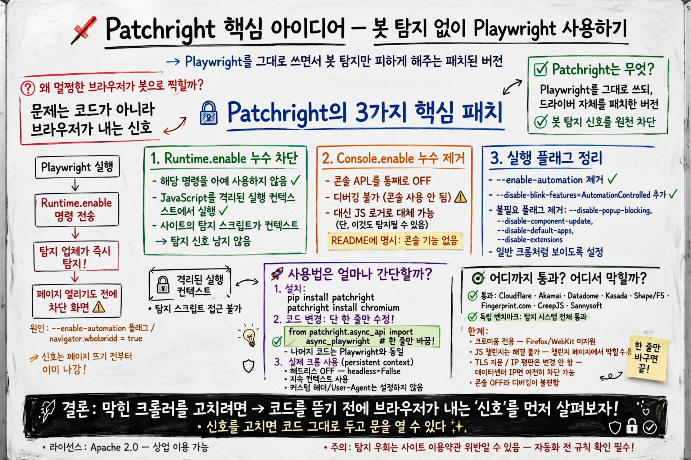
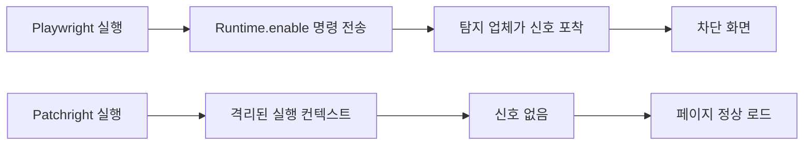
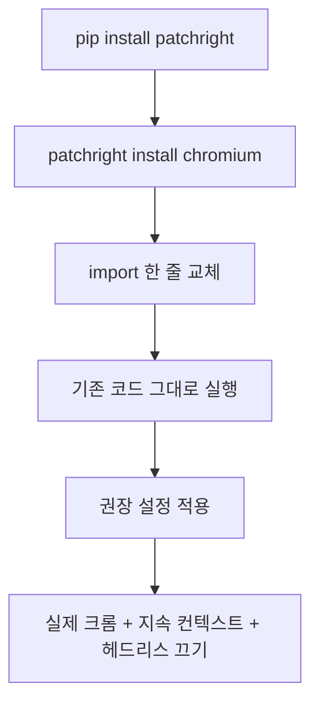
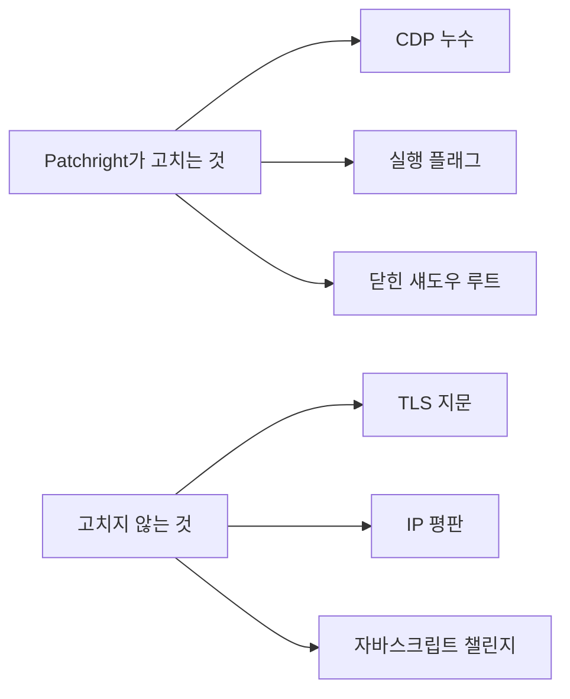

# Patchright: import 한 줄만 바꾸면, 봇 탐지가 브라우저를 못 알아봅니다

> **Summary**
> Patchright는 Playwright의 브라우저 자동화 신호를 줄여 봇 탐지를 피하도록 수정한 도구입니다. 일부 탐지 시스템에서 효과가 있을 수 있지만 크로미움 전용이며 콘솔 기능이 제한되고, 자바스크립트 챌린지·TLS 지문·IP 평판 문제는 해결하지 못하므로 사이트 이용 규칙을 확인해야 합니다.

---

- Patchright는 Playwright를 그대로 쓰면서 봇 탐지만 피하게 해주는 패치된 버전입니다.
- 가장 큰 패치는 `Runtime.enable` 누수 차단입니다. 자바스크립트를 격리된 실행 컨텍스트에서 돌려서 탐지 신호를 남기지 않습니다.
- import 한 줄만 바꾸면 됩니다. 다만 크로미움 전용이고, 콘솔 API가 안 되는 대가가 있습니다.


공개된 특허 문서를 몇 장 모으려고 브라우저 자동화를 돌렸는데, 페이지가 열리기도 전에 차단 화면이 떴던 적 있으시죠? 코드는 멀쩡했습니다. 그런데 사이트는 브라우저가 뜨는 순간부터 로봇이라고 판단했습니다. 이 글은 그 막힘을 뚫은 도구, Patchright를 소개합니다.

🎥 [동영상 보기](https://www.youtube.com/watch?v=lDQGkl8Jxsg)

### 왜 멀쩡한 브라우저가 봇으로 찍힐까요?

문제는 코드가 아니라 브라우저가 내는 신호였습니다. Playwright는 페이지를 다루기 시작할 때 `Runtime.enable`이라는 명령을 보냅니다. 탐지 업체는 이 명령 하나만 보고도 자동화라고 판단합니다. 이 신호는 페이지가 뜨기도 전에 이미 나갑니다!

여기에 실행 플래그까지 겹쳤습니다. `--enable-automation` 같은 플래그는 브라우저가 자동화 도구라는 사실을 그대로 알립니다. `navigator.webdriver` 값도 마찬가지입니다. 겉에 스텔스 플러그인을 덧씌워도 소용없었습니다. 자바스크립트 겉면만 가렸을 뿐, 신호 자체는 그대로 남아 있었기 때문입니다.

### Patchright는 뭘 고쳤을까요?

Patchright는 Playwright를 겉에서 감싸는 도구가 아닙니다. 드라이버 자체를 고친 버전입니다. 패치는 크게 세 가지입니다.

첫째, 가장 큰 패치인 `Runtime.enable` 누수입니다. Patchright는 이 명령을 아예 쓰지 않습니다. 대신 자바스크립트를 격리된 실행 컨텍스트에서 실행합니다. 사이트의 탐지 스크립트는 그 컨텍스트를 볼 수 없어서 신호를 찾을 수 없습니다.

둘째, `Console.enable` 누수입니다. Patchright는 콘솔 API를 통째로 꺼버렸습니다. 이 대목이 저는 가장 인상 깊었습니다. 코드를 고치는 게 아니라, 브라우저가 내는 신호를 고친다는 발상이요! 대신 콘솔 기능이 안 됩니다. 자바스크립트 로거로 대신할 수 있지만, 그것도 탐지될 수 있다고 README는 솔직하게 밝히고 있습니다.

셋째, 실행 플래그 정리입니다. `--disable-blink-features=AutomationControlled`를 추가하고, `--enable-automation`을 비롯해 `--disable-popup-blocking`, `--disable-component-update`, `--disable-default-apps`, `--disable-extensions`를 뺐습니다. 브라우저가 일반 설치 상태처럼 보이게 만든 것입니다. 닫힌 섀도우 루트 안의 요소도 일반 로케이터로 다룰 수 있게 됐습니다.



### 쓰는 방법은 얼마나 간단할까요?

설치는 두 줄입니다.

```bash
pip install patchright
patchright install chromium
```

그리고 import 한 줄만 바꿉니다. import 한 줄, 그게 전부입니다!

```python
from patchright.sync_api import sync_playwright

with sync_playwright() as p:
    browser = p.chromium.launch()
    page = browser.new_page()
    page.goto("https://example.com")
    browser.close()
```

나머지 코드는 그대로 둡니다. 비동기 API도 똑같이 `async_api`에서 가져오면 됩니다. Node.js도 `patchright` 패키지로 같은 방식을 씁니다.

다만 제대로 숨으려면 설정이 따라와야 합니다. 권장 설정은 실제 크롬을 쓰고, 지속 컨텍스트로 띄우고, 헤드리스를 끄는 것입니다. 커스텀 헤더나 `user_agent`를 따로 넣지 않는 것도 조건입니다. 설정을 어기면 패치가 있어도 탐지에 걸릴 수 있습니다.



### 어디까지 통과하고, 어디서 막힐까요?

README에 따르면, 제대로 설정하면 Cloudflare, Akamai, Datadome, Kasada, Shape/F5, [Fingerprint.com](http://fingerprint.com/), CreepJS, Sannysoft를 통과합니다. 독립 벤치마크에서도 헤드 모드 Patchright가 테스트한 탐지 시스템을 전부 통과했습니다.

하지만 만능은 아닙니다. 자바스크립트 챌린지 페이지 앞에서는 막혔다는 테스트 결과도 있습니다. Patchright는 지문을 고치는 도구이지, 챌린지를 풀어주는 도구가 아니기 때문입니다. TLS 지문과 IP 평판도 건드리지 않습니다. 데이터센터 IP로 너무 빠르게 요청하면, 지문이 깨끗해도 막힐 수 있습니다.

한계도 분명합니다. 크로미움 기반 브라우저 전용이라 Firefox와 WebKit은 지원하지 않습니다. 콘솔 API가 꺼져 있어 디버깅이 불편한 것도 감수해야 합니다. 그리고 탐지를 피하는 것과 규칙을 어기는 것은 다른 문제입니다! 봇 탐지를 우회하는 행위는 사이트 이용 약관에 어긋날 수 있으니, 자동화하기 전에 대상 사이트의 규칙부터 확인해야 합니다.



라이선스는 Apache 2.0이라 상업적 이용도 가능합니다. README는 교육 목적이라는 단서를 달고 있습니다. 탐지 업체의 기법은 계속 바뀌니, 오늘 통과했다는 말이 내일도 통한다는 보장은 없습니다.

결론은 단순합니다. 막힌 크롤러를 고치려고 코드를 뜯기 전에, 브라우저가 내는 신호부터 살펴볼 일입니다. 신호를 고치면 코드는 그대로 두고 문을 열 수 있습니다!

