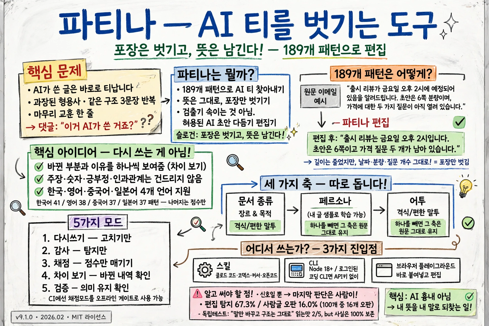
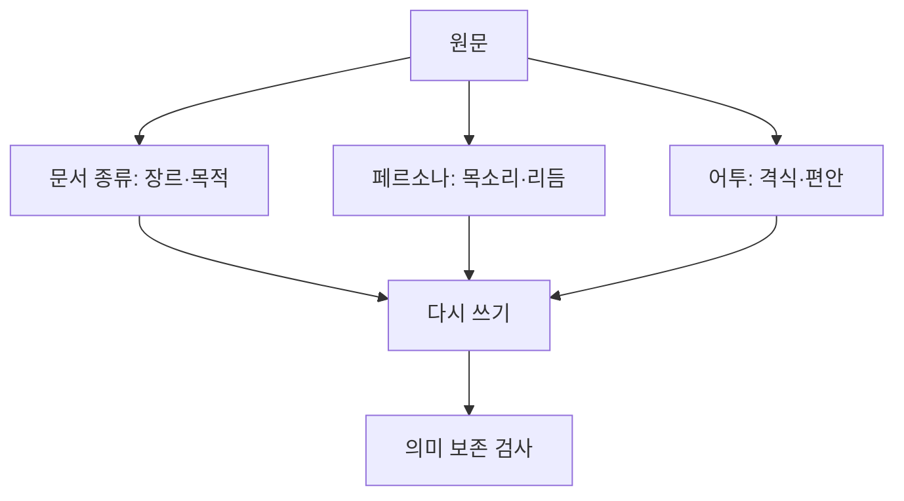
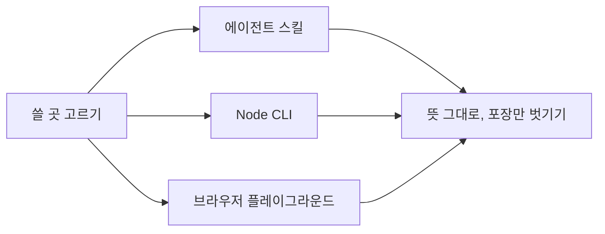

# Patina: AI 티를 벗기면, 뜻은 그대로 남습니다

> **Summary**
> Patina는 AI가 쓴 글의 티를 189개 패턴으로 찾아내 뜻은 그대로 두고 포장만 벗기는 오픈소스 도구입니다. 다시 쓰는 게 아니라 뭘 왜 바꿨는지 보여주는 게 핵심이라, 바뀐 부분과 이유를 하나씩 확인할 수 있습니다. 스킬·CLI·브라우저 세 가지로 쓸 수 있고, 점수는 참고 신호일 뿐이라 마지막 판단은 사람이 합니다.

---

- AI가 쓴 글은 읽으면 바로 티가 납니다. 파티나는 그 티를 189개 패턴으로 찾아내 뜻은 그대로 두고 포장만 벗기는 도구입니다.
- 다시 쓰는 게 다가 아닙니다. 뭘 왜 바꿨는지 보여주는 게 핵심이라, 바뀐 부분과 이유를 하나씩 확인할 수 있습니다.
- 스킬·CLI·브라우저 세 가지로 쓸 수 있고, 점수는 참고 신호일 뿐이라 마지막 판단은 사람이 합니다.

AI한테 초안을 맡기고 다듬어서 올렸는데, 댓글에서 "이거 AI가 쓴 거죠?"라는 말을 들어본 적 있으시죠? 문장은 매끈한데 어딘가 냄새가 납니다. 과장된 형용사, 똑같은 구조의 세 문장, 마무리마다 붙는 교훈 한 줄. 파티나는 그 냄새의 정체를 패턴으로 찾아내 하나씩 걷어내는 도구입니다.

🎥 [동영상 보기](https://www.youtube.com/watch?v=ZCQhyS2Ad9U)

### 파티나는 뭘까요?

파티나의 슬로건은 한 줄입니다. 포장은 벗기고, 뜻은 남긴다! 한국어·영어·중국어·일본어, 네 개 언어를 다룹니다. 결정적 패턴 기반 도구라서, 블랙박스처럼 통째로 다시 쓰는 방식이 아닙니다. 검출기를 속이는 도구도 아닙니다. 허용된 AI 초안 다듬기용으로 만든 편집기라고, 스스로 선을 긋습니다.

이 구분이 왜 중요할까요? 다시 쓰기만 하면 뜻이 슬쩍 바뀌기 때문입니다. 파티나는 주장·숫자·긍부정·인과관계는 건드리지 않는다고 못을 박았습니다. 바꾸는 건 포장뿐입니다.

### 189개 패턴이 글을 어떻게 고칠까요?

파티나 안에는 이름 붙은 패턴이 189개 들어 있습니다. 한국어는 41개, 영어는 38개, 중국어·일본어는 37개씩 다시 쓰기가 가능합니다. 나머지는 점수만 매기는 패턴입니다. 패턴이 잡아낸 부분은 `--diff`로 하나씩 확인할 수 있습니다. 뭘 바꿨는지, 왜 바꿨는지까지 보여줍니다.

이메일 예시 하나가 잘 보여줍니다. 원문은 이렇습니다. "출시 리뷰가 금요일 오후 2시에 예정되어 있음을 알려드립니다. 초안은 6쪽 분량이며, 가격에 대한 두 가지 질문이 아직 열려 있습니다." 파티나가 고친 문장은 이렇습니다. "출시 리뷰는 금요일 오후 2시입니다. 초안은 6쪽이고 가격 질문 두 개가 남아 있습니다." 길이가 줄었을 뿐, 날짜·분량·질문 개수는 그대로입니다. 핵심은 이겁니다. 짧아진 게 아니라, 포장이 벗겨진 겁니다!

쓸 수 있는 모드도 다섯 가지입니다. 고치기만 하는 다시 쓰기, 탐지만 하는 감사, 점수만 매기는 채점, 바뀐 내역을 보여주는 차이 보기, 다시 쓴 뒤 의미가 지켜졌는지 확인하는 검증까지 있습니다. CI에서는 점수 모드를 오프라인 게이트로 쓸 수도 있습니다. 점수가 기준을 넘으면 빌드를 멈추는 방식입니다.

### 세 가지 축은 따로 돕니다!

파티나의 재주는 세 가지 축을 섞지 않는 데 있습니다. 문서 종류·페르소나·어투, 세 축은 각자 따로 돕니다. 문서 종류는 장르와 목적, 페르소나는 말버릇과 리듬, 어투는 격식 있는 말투인지 편한 말투인지를 정합니다. 하나를 빼면 그 축은 원문 그대로 둡니다. 페르소나를 빼면 목소리가 그대로 남고, 어투를 빼면 말투가 그대로 남습니다.

페르소나는 내 글 샘플에서 배울 수도 있습니다. 예전 글을 넣어두면, 그 글의 말버릇을 닮은 목소리를 만들어줍니다. 설정은 `.patina.yaml` 파일 하나에 적어둡니다.

### 어디서 쓰면 될까요?

진입점은 세 가지입니다. 코딩 에이전트 스킬, Node CLI, 브라우저 플레이그라운드입니다. 스킬은 클로드 코드·코덱스·커서·오픈코드에서 돌아갑니다. 마켓플레이스에서 검색해 설치하면 됩니다. CLI는 Node 18 이상에서 `npx patina-cli`로 바로 씁니다. 로그인된 코딩 CLI가 이미 있으면 API 키 없이도 동작합니다. 설치가 귀찮으면 브라우저에서 바로 붙여넣고 고치는 플레이그라운드도 있습니다.

### 알고 써야 할 점은요?

점수는 조심해서 봐야 합니다. 파티나의 점수는 편집 신호이지, 누가 썼는지 증명하는 수단이 아닙니다. 직접 잰 수치도 함께 공개되어 있습니다. 편집이 필요한 부분을 잡아내는 비율은 67.3%, 사람 글을 잘못 잡는 비율은 16.0%입니다. 사람 글 100개 중 16개는 AI 티가 있다고 오판한다는 뜻입니다. 그래서 점수만 보고 글을 버리면 안 됩니다.

한 가지 더, 솔직한 평가도 있습니다. 한 독립 테스트에서는 파티나가 "말만 바꾸고 구조는 그대로"라는 평가를 받았습니다. 읽는 맛은 5점 만점에 2점이었습니다. 다만 사실은 하나도 빠뜨리지 않았다는 평가도 함께 받았습니다. 구조까지 뜯어고치는 도구가 아니라는 점을 알고 쓰면 됩니다.

버전도 빠르게 움직입니다. 최신 릴리스는 9.1.0이고, 저장소는 2026년 2월에 만들어져 별 390개를 받았습니다. MIT 라이선스라 자유롭게 쓸 수 있습니다. 영감의 뿌리는 위키피디아의 AI 글쓰기 징후 목록과 다른 휴머나이저 도구라고 밝히고 있습니다. 뿌리를 숨기지 않는 점이 이 도구의 태도를 잘 보여줍니다.

AI 티를 벗기는 일은 결국 사람을 흉내 내는 일이 아닙니다. 내 뜻을 내 말로 되찾는 일입니다. 파티나는 그 과정에 끼어들어 뜻은 지키고 포장만 벗깁니다. 마지막 검사는 사람이 합니다!

