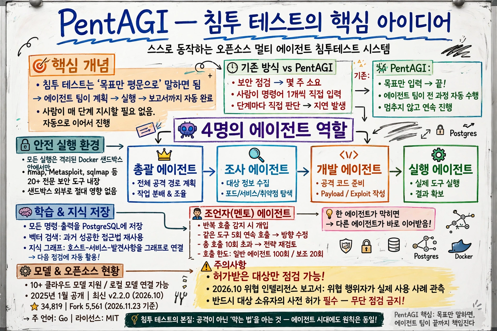
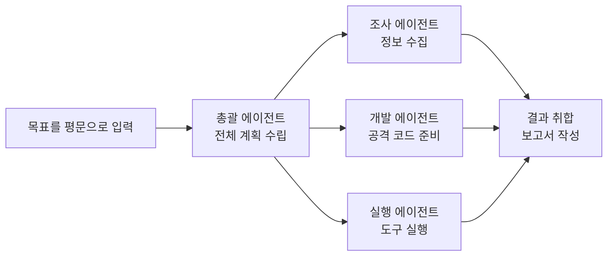
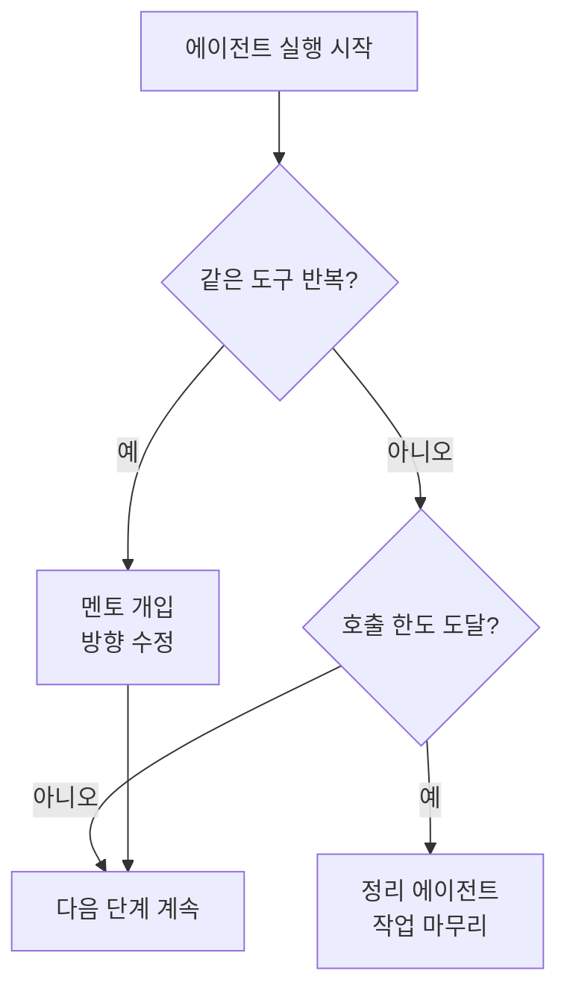

# PentAGI: 목표만 말하면 에이전트 팀이 알아서 침투 테스트를 이어갑니다

> **Summary**
> PentAGI는 평문으로 점검 목표를 입력하면 총괄·조사·개발·실행 에이전트가 협력해 침투 테스트와 보고서 작성을 수행하는 오픈소스 시스템입니다. Docker 샌드박스와 호출 한도로 실행을 통제하고, 점검 기록과 지식을 저장해 이후 작업에 활용합니다. 강력한 자동화 도구인 만큼 반드시 허가받은 대상에만 사용해야 합니다.

---

- 침투 테스트는 목표만 평문으로 말하면 됩니다. 에이전트 팀이 계획을 세우고, 도구를 돌리고, 보고서까지 만들어줍니다.
- 역할이 나뉜 네 명의 에이전트가 정찰부터 실행까지 이어받습니다. 사람이 매 단계마다 지시하지 않아도 작업이 멈추지 않습니다.
- 모든 실행은 격리된 샌드박스 안에서만 일어납니다. 배운 내용은 저장돼 다음 점검에 이어집니다.

보안 점검을 의뢰하면 보고서가 나오기까지 몇 주가 걸리는 걸 본 적 있으시죠? 점검하는 사람이 직접 명령어를 하나씩 치고, 결과를 보고, 다음 단계를 정해야 하니까요. 그런데 그 과정을 에이전트 팀이 통째로 이어받는 도구가 있습니다. 목표만 말하면 됩니다!

🎥 [동영상 보기](https://www.youtube.com/watch?v=R70x5Ddzs1o)

## PentAGI, 도대체 뭘까요?

PentAGI는 스스로 침투 테스트를 수행하는 오픈소스 멀티 에이전트 시스템입니다. 사람이 할 일은 목표를 평문으로 적는 것뿐입니다. "이 서버의 취약점을 찾아줘"처럼 말하면, 에이전트 팀이 계획을 세우고 실행하고 보고서를 만들어줍니다. 설치는 대화형 설치 프로그램으로 진행되고, `Docker Compose` 기반으로 자기 서버에 올려 씁니다.

핵심은 "한 명의 똑똑한 에이전트"가 아니라 "역할이 나뉜 팀"입니다. 한 명이 모든 걸 잘하는 게 아니라, 각자 맡은 일만 잘하면 됩니다. 그래서 작은 모델로도 돌아간다고 합니다. 이 분업이 이 도구의 가장 큰 특징입니다!

## 네 명의 에이전트, 각자 무슨 일을 할까요?

총괄 에이전트는 전체 공격 경로를 계획합니다. 조사 에이전트는 대상에 대한 정보를 모읍니다. 개발 에이전트는 필요한 공격 코드를 준비합니다. 실행 에이전트는 실제 도구를 돌립니다. 계획하고, 알아보고, 만들고, 실행하는 일이 나뉘어 있습니다. 한 에이전트가 막히면 다른 에이전트가 이어받습니다. 사람이 중간에 끼어들 필요가 없는 이유가 여기에 있습니다!

실행은 격리된 `Docker` 샌드박스 안에서만 일어납니다. `nmap`, `Metasploit`, `sqlmap`을 포함한 20개 넘는 전문 보안 도구가 샌드박스 안에 들어 있습니다. 에이전트가 내 컴퓨터를 직접 만지는 게 아니라, 격리된 공간 안에서만 명령을 실행합니다. 내 서버가 오염될 걱정은 줄어듭니다. 그런데 격리만으로 충분할까요? 아닙니다. 그래서 감독 장치도 함께 들어 있습니다.

## 에이전트가 멈추지 않게, 누가 지켜볼까요?

에이전트는 가끔 같은 도구를 반복해서 부르며 맴돌기도 합니다. 그래서 조언자 에이전트라는 멘토가 있습니다. 같은 도구를 다섯 번 연속으로 부르거나, 전체 호출이 열 번을 넘기면 멘토가 끼어들어 방향을 바로잡습니다. 도구 호출에도 한도가 있습니다. 일반 에이전트는 100회, 보조 에이전트는 20회까지만 부를 수 있습니다. 한도에 다다르면 정리 에이전트가 작업을 깔끔하게 마무리합니다. 무한 루프에 빠지지 않게, 여러 겹으로 막아둔 셈입니다.

## 배운 걸 기억한다? 그게 진짜 차이입니다.

점검 결과가 휘발되면 매번 처음부터 다시 시작해야 합니다. 이 도구는 모든 명령과 출력을 `PostgreSQL`에 저장합니다. 벡터 검색 기능이 붙어 있어, 예전에 성공한 접근법이 다음 점검에서 다시 쓰입니다. 여기에 지식 그래프가 더해집니다. 호스트와 서비스, 발견 사항 사이의 관계를 그래프로 엮어, 대상을 맥락 속에서 이해합니다. 한 번의 점검이 다음 점검의 밑거름이 되는 구조입니다.

모델도 고를 수 있습니다. 열 개가 넘는 클라우드 모델 제공자는 물론, 자기 서버에 올린 로컬 모델도 연결됩니다. 웹 화면과 API도 갖췄습니다. 그래서 내 인프라 안에서, 내 모델로, 내 데이터만으로 돌릴 수 있습니다. 외부로 점검이 새어 나갈 걱정이 줄어듭니다.

## 숫자로 보면 어떨까요?

저장소에는 2026년 11월 23일 기준 별 34,819개와 포크 5,561개가 찍혀 있습니다. 2025년 1월에 공개됐고, 최신 릴리스는 2026년 10월의 v2.2.0입니다. 주 언어는 `Go`, 라이선스는 `MIT`입니다. 별 개수만 보면 관심이 뜨겁다는 게 보입니다. 그런데 숫자가 전부는 아닙니다. 주의할 점도 분명합니다.

## 허가받은 대상에만 써야 합니다.

이 도구는 허가받은 대상의 점검을 위한 것입니다. 그런데 2026년 10월, 한 위협 인텔리전스 보고서에서 침해 대응 현장에서 위협 행위자가 이 도구를 운용하는 모습이 관측됐다고 밝혔습니다. 좋은 도구도 나쁜 손에 들어가면 악용될 수 있다는 뜻입니다. 그래서 사용 전에 허가를 받는 게 먼저입니다. 허가 없이 남의 시스템을 건드리면 안 됩니다!

침투 테스트의 본질은 "공격하는 법"이 아니라 "막는 법을 아는 것"입니다. 에이전트 팀이 점검을 이어받는 시대에도, 그 원칙은 바뀌지 않습니다!

