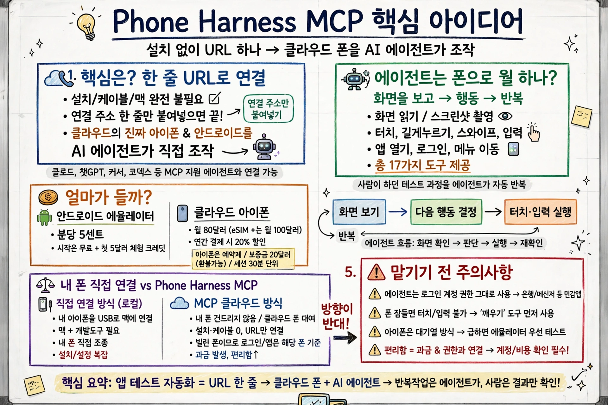
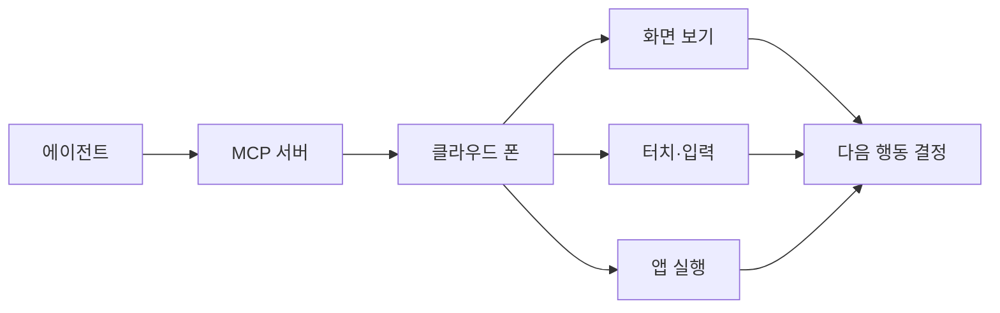
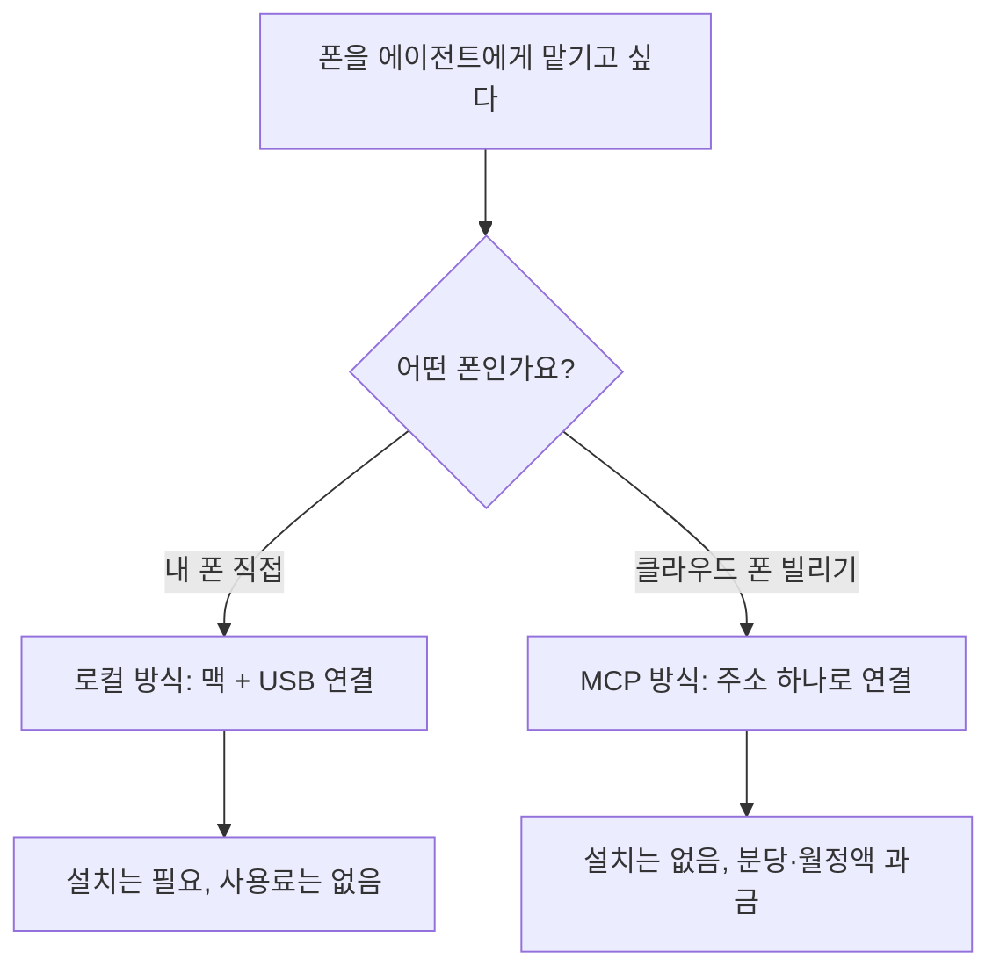

# Phone Harness MCP: 설치 없이 URL 하나로, 클라우드의 진짜 아이폰을 에이전트에게 맡깁니다

> **Summary**
> Phone Harness MCP는 URL 하나로 클라우드의 실제 아이폰이나 안드로이드를 AI 에이전트에 연결해 화면 확인, 터치, 입력, 앱 테스트와 반복 작업을 맡기는 서비스입니다. 설치와 케이블은 필요 없지만 안드로이드는 분당 과금, 아이폰은 월정액이며, 에이전트가 계정 권한을 그대로 사용하므로 민감한 앱과 개인정보에 주의해야 합니다.

---

- Phone Harness MCP는 설치 없이 연결 주소 하나만 붙여넣으면, 클라우드의 진짜 아이폰과 안드로이드를 AI 에이전트가 직접 움직이게 해주는 서버입니다.
- 에이전트는 화면을 보고, 터치하고, 글자를 입력하고, 앱을 열어 모바일 앱 테스트와 반복 작업을 대신합니다.
- 안드로이드 에뮬레이터는 분당 5센트, 클라우드 아이폰은 월 80달러부터이고, 내 폰을 직접 연결하는 로컬 방식과는 다른 길입니다.

앱 테스트를 위해 아이폰을 손에 들고 같은 동작을 열 번 반복해 본 적 있으시죠? 로그인하고, 메뉴를 누르고, 화면을 넘기고, 다시 처음으로 돌아가고요. 사람은 금방 지치는데, 테스트는 계속 늘어나기만 합니다!

🎥 [동영상 보기](https://www.youtube.com/watch?v=VUXFRMP0W-Y)

## URL 하나면 끝이라고요?

네, 끝입니다. 쓰는 에이전트에 연결 주소 한 줄을 붙여넣고 로그인하면 됩니다. 맥도 필요 없고, 케이블도 필요 없고, 폰을 직접 연결하는 과정도 없습니다. 클로드, 챗GPT, 커서, 코덱스 같은 MCP를 지원하는 에이전트라면 대부분 연결됩니다!

연결이 끝나면 에이전트는 클라우드에 있는 폰을 자기 손처럼 씁니다. 화면을 보고, 버튼을 누르고, 글자를 입력하고, 스크롤하는 일까지 말로 시키면 됩니다. 설치 과정이 사라지니, 진입 장벽이 주소 한 줄로 줄어든 셈입니다.

## 에이전트는 폰으로 뭘 할 수 있을까요?

공식 문서에 실린 도구는 17가지입니다. 폰 목록을 보고, 폰을 켜고 끄고, 화면 크기를 확인하고, 스크린샷을 찍고, 화면에 보이는 글자를 읽고, 터치하고, 길게 누르고, 스와이프하고, 글자를 입력하고, 버튼을 누르고, 앱을 열어 확인하는 일까지 맡길 수 있습니다.

흐름은 단순합니다. 에이전트가 화면을 보고, 다음 행동을 정하고, 터치나 입력으로 실행하고, 바뀐 화면을 다시 보는 일을 반복합니다. 사람이 하던 순서와 똑같습니다. 다른 점이 있다면, 지치는 사람이 아니라 에이전트가 반복한다는 점입니다!

## 얼마가 들까요?

안드로이드 에뮬레이터는 시작이 무료이고, 이후 분당 5센트씩 과금됩니다. 처음 가입하면 5달러 체험 크레딧이 주어집니다. 클라우드 아이폰은 분당 과금이 아니라 월정액입니다. 월 80달러, eSIM을 더하면 월 100달러이고, 연간 결제 시 20% 할인됩니다.

아이폰을 빌리려면 예약이 필요합니다. 대금 20달러를 환불 가능한 보증금으로 먼저 내고 대기열에 들어갑니다. 첫 번째 폰은 한 번만 적용되는 입문 가격으로 빌릴 수 있습니다. 세션은 기본 30분 단위로 돌아갑니다.

## 내 폰을 직접 연결하는 방법과는 뭐가 다를까요?

P329에서 다룬 아이폰 직접 조작 도구와는 방향이 다릅니다. 그쪽은 내 아이폰을 USB로 연결해 맥의 에이전트가 직접 조종하는 로컬 방식입니다. 맥과 전체 개발 도구가 필요하고, 내 폰을 직접 다룹니다.

이 글의 MCP 방식은 반대입니다. 내 폰은 건드리지 않고, 클라우드에 있는 폰을 빌려 씁니다. 설치도, 케이블도 필요 없습니다. 대신 사용료가 들고, 내 폰이 아니라 빌린 폰이라 로그인 상태나 앱도 그 폰에 맞춰야 합니다!

## 맡기기 전에 확인할 것은요?

주의할 점도 분명합니다. 에이전트는 로그인한 계정의 권한 그대로 폰을 움직입니다. 은행 앱이나 메신저처럼 민감한 앱은 에이전트에게 맡기기 전에 한 번 더 생각해야 합니다. 화면에 보이는 글자가 에이전트에게 지시를 바꿀 수도 있습니다.

폰을 오래 내버려두면 잠들어서 터치와 입력이 거부됩니다. 그럴 땐 깨우기 도구를 먼저 써야 합니다. 아이폰 예약은 대기열 순서대로 진행되니, 급하게 필요하다면 에뮬레이터부터 시험해 보는 편이 낫습니다.

설치가 사라진 자리에 과금과 권한이 남았습니다. URL 하나로 폰을 빌리는 편리함은 분명합니다. 그 편리함이 내 계정과 내 돈과 연결된다는 점만 잊지 않으면 됩니다!

