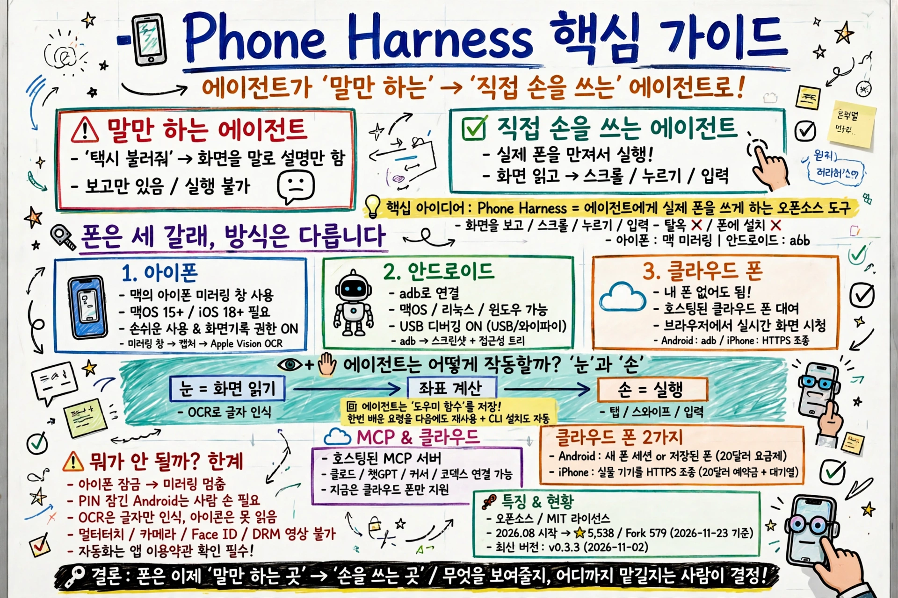
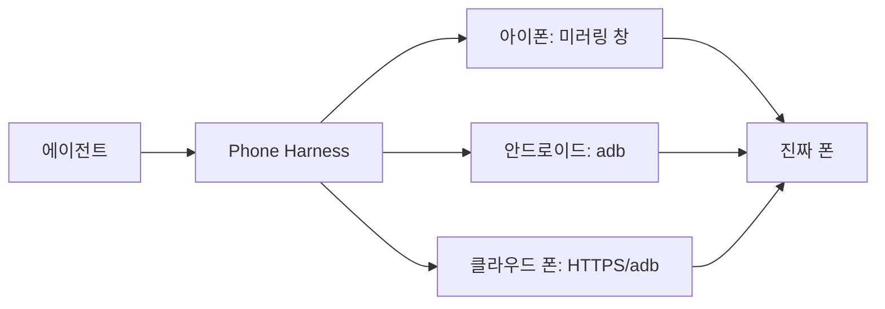
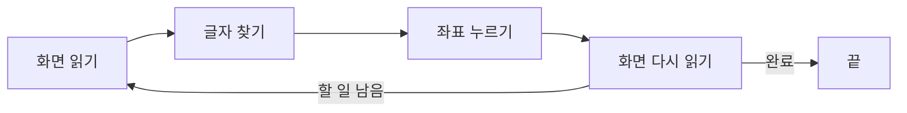

# Phone Harness: 에이전트에게 진짜 폰을 맡기면, 화면을 보고 직접 누릅니다

> **Summary**
> Phone Harness는 에이전트가 진짜 폰을 직접 만지게 하는 오픈소스 도구입니다. 화면을 읽고, 스크롤하고, 누르고, 입력하며, 탈옥도 없고 폰에 설치하는 것도 없습니다. 아이폰은 맥의 미러링 창을, 안드로이드는 adb를 쓰고, 내 폰이 없어도 호스팅된 MCP 서버와 클라우드 폰으로 빌려 쓸 수 있습니다. 다만 잠금 해제나 카메라, Face ID 같은 흐름은 안 되고, 에이전트에게 화면을 보여주는 만큼 민감한 화면은 미리 치워두는 편이 좋습니다.

---

- Phone Harness는 에이전트가 진짜 폰을 직접 만지게 합니다. 화면을 읽고, 스크롤하고, 누르고, 입력합니다.
- 탈옥도 없고, 폰에 설치하는 것도 없습니다. 아이폰은 맥의 미러링 창을, 안드로이드는 `adb`를 씁니다.
- 내 폰이 없어도 됩니다. 호스팅된 MCP 서버와 클라우드 폰으로 빌려 쓸 수 있습니다.


에이전트에게 "내 폰으로 택시 불러줘"라고 말했는데, 에이전트가 할 수 있는 일이 화면을 설명해 주는 것뿐이라면 어떨까요? 말만 하는 에이전트와, 직접 손을 쓰는 에이전트는 다릅니다!

🎥 [동영상 보기](https://www.youtube.com/watch?v=kwDBlEVfqXU)

## 에이전트가 폰을 만진다는 건 뭘까요?

Phone Harness는 클로드 코드나 코덱스 같은 에이전트가 진짜 폰을 쓰게 하는 오픈소스 도구입니다. 에이전트가 화면을 보고, 스크롤하고, 누르고, 입력합니다. 탈옥은 필요 없고, 폰에 아무것도 설치하지 않습니다.

데모가 보여주는 장면이 인상 깊었습니다. "지금 위치에서 커피숍까지 차량을 불러줘"라는 말 한마디에, 에이전트가 진짜 아이폰에서 차량 호출 앱을 열고 목적지를 입력해 주문을 마쳤습니다. 녹화된 매크로가 아닙니다. 매번 화면을 보고 다음 행동을 정합니다!

공개된 지는 얼마 안 됐습니다. 저장소는 2026년 8월에 시작했고, MIT 라이선스이며, 2026년 11월 23일 기준으로 별 5,538개와 포크 579개를 모았습니다. 버전은 0.3.3(2026-11-02)까지 나와 있습니다.

## 폰은 세 갈래, 방식은 다릅니다

같은 도구가 세 종류의 폰을 다룹니다. 폰마다 연결 방식이 다를 뿐, 에이전트가 쓰는 방법은 같습니다.

- **아이폰**: 맥의 아이폰 미러링 창을 통합니다. 맥OS 15 이상, iOS 18 이상 아이폰이 필요하고, 손쉬운 사용과 화면 기록 권한을 켜야 합니다.
- **안드로이드**: `adb`로 연결합니다. 맥OS, 리눅스, 윈도우 모두 되고, USB 디버깅을 켜면 됩니다. USB나 와이파이로 연결합니다.
- **클라우드 폰**: 내 폰이 없어도 됩니다. 안드로이드는 `adb`로, 아이폰은 HTTPS로 조종하는 클라우드 폰을 빌려 씁니다. 브라우저에서 폰 화면을 생중계로 보면서 에이전트가 일하는 모습을 지켜볼 수도 있습니다.


## 에이전트는 화면을 어떻게 읽을까요?

핵심은 "눈"과 "손"을 나누는 방식입니다. 아이폰은 미러링 창을 캡처하고 애플 비전 OCR로 글자를 읽습니다. 글자를 찾으면 그 좌표로 누르기, 쓸어넘기기, 입력하기를 보냅니다. 안드로이드는 `adb`로 스크린샷을 찍고 접근성 트리로 글자를 읽습니다.



폰이 달라도 에이전트가 쓰는 도구는 같습니다. 예를 들어 메모 앱을 열고 새 메모를 쓰는 일은 이렇게 표현됩니다.

```python
open_app("Notes")
tap_text("New Note")
type_text("hello from the harness")
```

에이전트는 자기만의 도우미 함수도 `~/.phone-harness/agent-workspace`에 저장해 둡니다. 한 번 배운 요령을 다음 실행에도 다시 씁니다. 설치도 에이전트에게 맡기면 됩니다. 에이전트가 CLI를 설치하고 어떤 폰을 쓸지 물은 뒤, 손이 필요한 단계만 안내합니다. `phone-harness doctor` 명령으로 설정이 제대로 됐는지 확인할 수 있습니다.

## MCP와 클라우드, 어디까지 갈까요?

호스팅된 MCP 서버도 있습니다. MCP 클라이언트에 서버를 추가하면 클로드, 챗GPT, 커서, 코덱스 같은 어떤 MCP 에이전트든 진짜 아이폰과 안드로이드를 쓸 수 있습니다. 다만 지금은 클라우드 폰만 연결됩니다.

클라우드 폰은 두 가지로 나뉩니다. 안드로이드는 세션마다 새 폰을 받거나, 앱과 로그인이 그대로 남는 저장된 폰을 씁니다. 아이폰은 전용 실물 기기를 HTTPS로 조종합니다. 아이폰은 대금 20달러의 환불 가능한 예약금을 내고 대기열에 들어가는 방식이고, 안드로이드 에뮬레이터는 20달러 요금제로 씁니다. 요금은 바뀔 수 있으니, 시작하기 전에 공식 안내를 확인하는 편이 좋습니다.

> 에이전트에게 폰을 맡긴다는 건, 화면을 보여준다는 뜻입니다. 민감한 화면은 미리 치워두는 편이 좋습니다!

## 뭐가 안 될까요?

한계도 분명합니다. 아이폰 잠금을 풀면 미러링이 멈추고, PIN으로 잠긴 안드로이드는 사용자의 손이 필요합니다. OCR은 글자를 읽지 아이콘을 읽지 못합니다. 레이블 없는 버튼은 스크린샷과 비전 모델이 필요합니다. 멀티터치, 카메라, Face ID 흐름은 안 되고, DRM 영상은 검게 나옵니다. 그리고 폰을 연결하는 일은 언제나 사용자의 몫입니다.

자동화가 앱의 이용 약관에 어긋날 수도 있습니다. 앱마다 다르니, 쓰기 전에 확인하는 편이 좋습니다. 이 점은 어떤 폰 자동화 도구에도 똑같이 적용됩니다.

## 다른 글들과 뭐가 다를까요?

폰을 다루는 글은 벌써 몇 편 있었습니다. 방향이 다릅니다. `iPhone Use`는 USB와 웹드라이버 에이전트로 로컬 아이폰을 직접 조종하는 방식이고, `Phone Harness MCP`는 호스팅된 MCP 서버로 클라우드 폰을 빌려 쓰는 부분만 다뤘습니다. `chums`는 반대로 워치와 폰에서 맥의 에이전트를 부르는 도구입니다. 이 글은 그 세 갈래를 한데 묶은 Phone Harness 자체가 주제입니다. CLI와 스킬, MCP 서버, 클라우드 폰까지, 에이전트가 진짜 폰을 만지는 방법 전체를 봅니다.

폰은 이제 에이전트가 말만 하는 곳이 아닙니다. 직접 손을 쓰는 곳이 됐습니다. 손을 빌려줄지는 사용자가 정합니다. 무엇을 보여주고, 어디까지 맡길지 정하는 일은 여전히 사람의 몫입니다!

