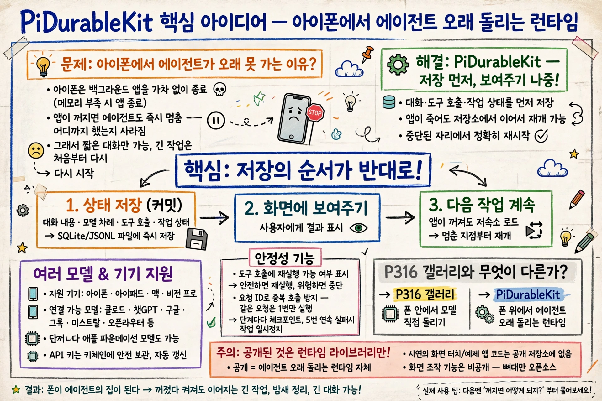
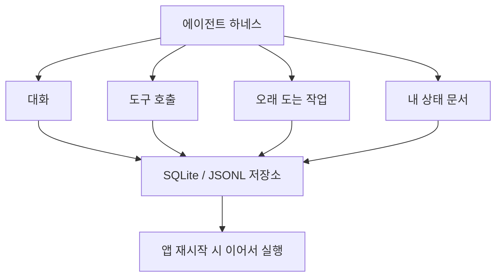

# PiDurableKit: 아이폰에서 에이전트가 죽지 않습니다. 꺼져도 이어서 일합니다

> **Summary**
> PiDurableKit은 대화, 도구 호출, 작업 상태를 SQLite나 JSONL에 먼저 저장해 앱이 종료돼도 재시작 후 이어서 실행할 수 있게 하는 에이전트 런타임입니다. 여러 클라우드·기기 내 모델과 다양한 애플 기기를 지원하지만, 시연에 나온 화면 터치 기능과 예제 앱은 공개 저장소에 포함되어 있지 않습니다.

---

- 아이폰에서 돌아가는 AI 에이전트는 앱이 꺼지면 그 자리에서 멈춥니다. PiDurableKit은 대화·도구 호출·작업 상태를 먼저 저장해 두는 런타임이라, 앱이 죽어도 다시 열면 멈춘 자리에서 이어갑니다.
- 아이폰·아이패드·맥·비전 프로에서 돌아가고, 여러 모델에 연결되며, 기기 안 모델도 쓸 수 있습니다.
- 단, 시연에서 보인 화면 터치와 예제 앱의 코드는 공개 저장소에 없습니다. 공개된 것은 에이전트를 오래 돌리는 런타임 자체입니다.

아이폰으로 긴 일을 시켜본 적 있으시죠? 자료를 모으고, 정리하고, 보고서까지 써달라고 맡겼는데, 잠깐 다른 앱을 봤다가 돌아오니 에이전트가 멈춰 있습니다. 어디까지 했는지도 모릅니다. 처음부터 다시 시켜야 할까요?

🎥 [동영상 보기](https://www.youtube.com/watch?v=ti3vVYwzW4A)

## 아이폰에서 에이전트가 오래 못 가는 이유가 뭘까요?

아이폰은 앱을 가차 없이 죽입니다. 메모리 정리를 위해 백그라운드 앱을 종료하고, 사용자가 닫은 앱은 말할 것도 없습니다. 서버에서 돌아가는 에이전트는 컴퓨터가 켜져 있는 한 계속 일하지만, 폰 안에서 돌아가는 에이전트는 앱과 운명을 같이합니다. 그래서 폰 위의 에이전트는 짧은 대화만 맡는 도구가 되기 쉬웠습니다. 오래 걸리는 일은 맡기기 어려웠습니다.

핵심은 저장의 순서입니다. 보통 에이전트는 답을 보여주고 나서 저장합니다. 그런데 이 런타임은 반대로 합니다. **보여주기 전에 먼저 저장합니다!** 대화 내용, 모델의 차례, 도구 호출, 내가 만든 상태까지 모두 저장소에 커밋한 뒤에야 화면에 보여줍니다. 앱이 중간에 죽어도, 저장소를 다시 열면 멈춘 자리에서 그대로 이어갑니다.

## 저장은 어떻게 이뤄질까요?

저장소는 `SQLite`나 `JSONL` 파일입니다. 메모리 저장도 되지만, 그건 테스트용입니다. 실제 앱에서는 파일에 남겨야 다시 열 수 있습니다. 한 번의 실행에 열 번 넘게 커밋이 쌓입니다. 모델 호출 한 번, 도구 호출 한 번, 그때마다 저장합니다. 그래서 손실 구간이 아주 짧습니다.

도구 호출에는 재실행 가능 여부도 붙어 있습니다. 다시 돌려도 안전한 도구는 충돌 뒤에 다시 실행하고, 안전하지 않은 도구는 모델에게 "중단됐다"는 결과를 돌려줍니다. 같은 요청을 두 번 보내도 한 번만 실행되도록 요청 ID로 중복을 막습니다. 오래 도는 작업은 단계마다 체크포인트를 찍습니다. 다섯 번 연속으로 커밋 없이 죽으면, 그 작업은 멈춰 세워두고 다시 실행할 때까지 기다립니다.

## 모델은 뭘 쓸 수 있을까요?

여러 모델 제공자를 쓸 수 있습니다. 클로드, 챗GPT, 구글, 오픈라우터, 그록, 미스트랄 등입니다. 오픈AI나 앤트로픽 방식과 호환되는 서버도 연결됩니다. API 키는 키체인에 넣어 둡니다. 구독 로그인을 쓰면 토큰도 키체인에 저장되고 자동으로 갱신됩니다. 기기 안에서 돌아가는 애플 파운데이션 모델도 제공자로 쓸 수 있습니다. 단, 앱 안에 API 키를 그대로 심으면 누구나 꺼내 볼 수 있으니, 실제 출시용 앱은 자기 서버를 거치는 게 안전합니다. 이건 저장소 안내에도 적혀 있습니다.

도구는 스위프트 클로저로 평범하게 씁니다. 시스템 프롬프트 조각, 도구 실행 전후에 끼어드는 훅, 서브에이전트, 원자적 트랜잭션까지 갖췄습니다. 대화는 갈래를 나누고, 압축하고, 중간에 말을 걸어 방향을 틀 수도 있습니다. iOS 17, macOS 14, tvOS 17, 비전OS 1부터 돌아갑니다.

## P316 갤러리와 뭐가 다를까요?

앞서 소개한 갤러리 앱은 언어 모델 자체를 폰 안에서 돌리는 데 초점이 있습니다. 모델이 폰 안에서 돌아가느냐가 핵심입니다. 이 글의 주인공은 다릅니다. 모델이 어디서 돌아가든, 에이전트라는 일꾼이 폰 위에서 오래, 끊기지 않고 일하게 만드는 게 핵심입니다. **모델이 아니라 런타임이 주인공입니다!** 갤러리가 "폰 안에서 모델 돌리기"라면, 이건 "폰 위에서 에이전트 오래 돌리기"입니다. 그래서 이 글은 에이전트 런타임 관점에서 읽어야 합니다.

## 시연의 화면 터치는 어디에 있을까요?

여기서 한 가지는 짚고 넘어가야 합니다. 시연에서는 AI가 컴퓨터 연결 없이 아이폰 화면을 터치하고 글자를 입력하며 작업했습니다. 그런데 공개 저장소를 직접 확인한 결과, 화면을 터치하는 도구나 예제 앱은 들어 있지 않았습니다. 저장소에는 런타임 라이브러리 코드만 있습니다. **시연의 화면 조작 부분은 공개된 코드가 아닙니다!** 예제로 소개된 채팅 앱과 단축어 연동도 저장소에서는 찾을 수 없었습니다. 시연은 시연이고, 공개된 것은 에이전트를 오래 돌리는 뼈대라는 점을 알고 쓰는 게 맞습니다.

그래도 뼈대만으로 쓸모는 충분합니다. 폰 위에서 오래 일하는 비서, 밤새 돌아가는 정리 작업, 꺼졌다 켜져도 이어지는 긴 대화 같은 것들이 가능해집니다. 폰이 에이전트의 집이 되는 겁니다. 화면을 직접 만지는 부분은 아직 공개되지 않았지만, 에이전트가 폰 위에서 오래 사는 길은 이미 열려 있습니다. 다음에 폰에서 에이전트를 쓸 때는, "꺼지면 어떻게 되지?"부터 물어보세요!

