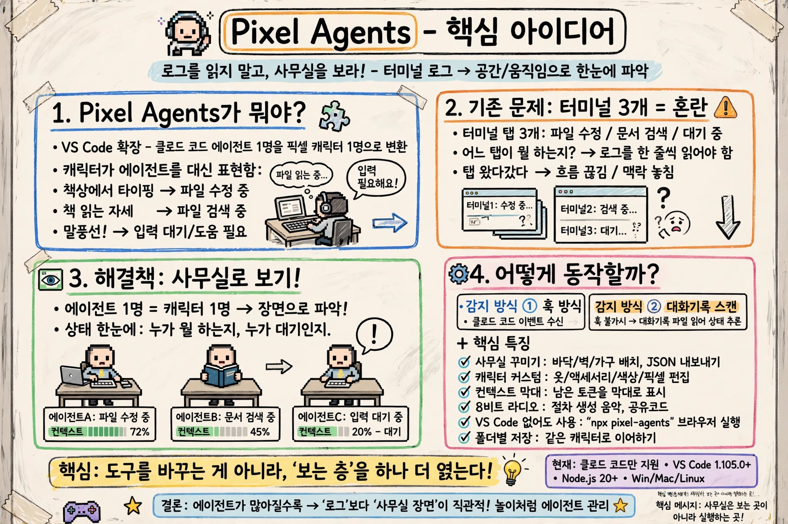
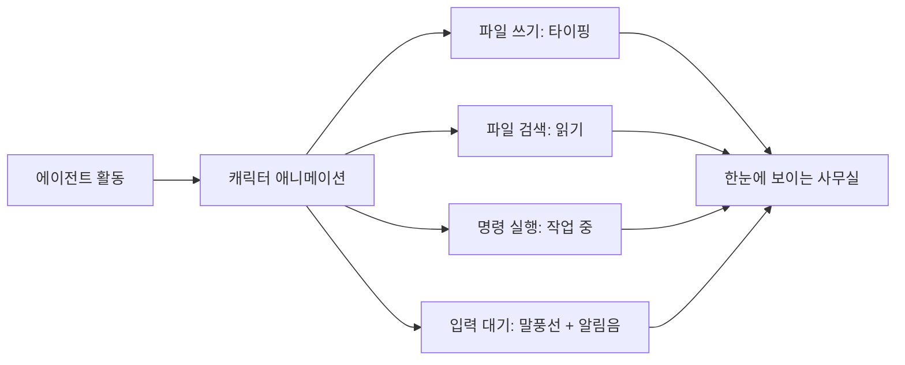
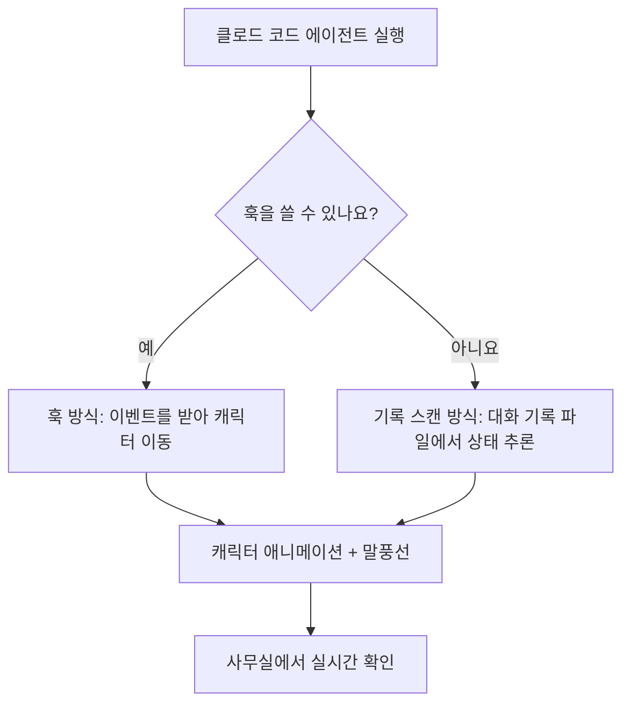

# Pixel Agents: 에이전트가 지금 뭘 하는지, 로그가 아니라 캐릭터 움직임으로 봅니다

> **Summary**
> Pixel Agents는 클로드 코드 에이전트의 상태와 활동을 픽셀 캐릭터의 움직임, 말풍선, 컨텍스트 막대로 실시간 시각화하는 도구입니다. 여러 에이전트를 한눈에 관리하고 사무실에서 실행·재개할 수 있으며, 공간과 캐릭터를 꾸미고 브라우저에서도 사용할 수 있습니다. 현재는 클로드 코드만 지원합니다.

---

- `Pixel Agents`는 클로드 코드 에이전트 한 명을 픽셀 캐릭터 한 명으로 바꿔 주는 VS Code 확장입니다.
- 캐릭터가 책상에 앉아 타이핑하고, 파일을 찾을 땐 읽는 동작을 하고, 입력이 필요하면 말풍선으로 알려줍니다!
- 사무실은 보는 곳이 아니라 실행하는 곳입니다. 폴더를 골라 에이전트를 띄우고, 남은 컨텍스트까지 한눈에 봅니다.

## 에이전트 세 명을 돌리는데, 누가 뭘 하는지 아시겠어요?

터미널 탭이 세 개가 됐습니다. 한 탭에서는 파일을 고치고, 한 탭에서는 문서를 찾고, 한 탭에서는 뭔가 기다리고 있습니다. 그런데 어느 탭이 뭘 하는지, 로그를 한 줄씩 읽어야만 압니다. 탭을 오가다 보면 흐름이 끊깁니다. 이런 적 있으시죠?

그래서 나온 발상이 있습니다. 로그를 읽는 대신, 사무실을 보는 겁니다!

🎥 [동영상 보기](https://www.youtube.com/watch?v=62Rfe1w9NBc)

## Pixel Agents: 에이전트 한 명이 캐릭터 한 명입니다

`Pixel Agents`는 터미널에서 돌아가는 AI 코딩 에이전트를 작은 사무실의 픽셀 캐릭터로 바꿔 주는 오픈소스 확장입니다. 에이전트 터미널 하나마다 캐릭터 하나가 생깁니다. 캐릭터는 책상으로 걸어가 앉고, 에이전트가 하는 일에 맞춰 움직입니다. 파일을 고칠 땐 타이핑하고, 파일을 찾을 땐 읽는 동작을 하고, 입력이 필요해 멈추면 말풍선으로 알려줍니다. 알림음도 켤 수 있습니다.

핵심은 이겁니다. 에이전트가 몇 명인지, 지금 뭘 하는지, 누가 기다리고 있는지를 로그가 아니라 장면으로 파악합니다. 여러 에이전트를 동시에 돌릴 때 터미널 로그만으로는 흐름을 따라가기 어렵습니다. 그런데 공간과 움직임으로 표현하면, 한눈에 들어옵니다!

## 어떻게 알아낼까요? 두 가지 감지 방식이 있습니다

캐릭터가 에이전트 상태를 아는 방법은 두 가지입니다. 기본값은 훅 방식입니다. 클로드 코드가 보내는 이벤트를 받아서 캐릭터를 움직입니다. 세션 시작, 도구 사용 전, 권한 요청, 작업 종료 같은 신호가 오면 캐릭터가 바로 반응합니다. 훅을 쓸 수 없을 땐 대화 기록을 읽는 방식으로 바꿉니다. 클로드 코드가 남기는 대화 기록 파일을 스캔해서 에이전트 상태를 추론합니다.

이 확장은 클로드 코드를 고치지 않습니다. 훅 설정과 저장 데이터는 클로드 코드 설정 폴더와 확장 전용 폴더에 따로 둡니다. 그래서 원래 쓰던 방식은 그대로 두고, 보는 방식만 얹는 셈입니다. 이 장면이 저는 가장 인상 깊었습니다. 도구를 바꾸는 게 아니라, 보는 층 하나를 더하는 발상입니다.

## 사무실은 보는 곳이 아니라, 실행하는 곳입니다

이 사무실은 구경만 하는 화면이 아닙니다. 여기서 에이전트를 띄웁니다. 패널에서 폴더를 고르면 그 폴더에서 클로드 코드가 시작되고, 캐릭터가 나타납니다. 서브 에이전트가 생기면 캐릭터도 따로 생깁니다. 지난 대화는 폴더별로 목록에 남아서, 한 번의 클릭으로 같은 캐릭터로 다시 이어갑니다.

각 캐릭터 옆에는 컨텍스트 막대가 있습니다. 에이전트의 남은 컨텍스트가 얼마나 되는지 막대로 보입니다. 요금제 사용량 막대도 켤 수 있습니다. 그래서 "이 에이전트, 아직 여유가 있나?"를 숫자가 아니라 막대 길이로 판단합니다. 작업이 끝나면 캐릭터가 쉬는 모습으로 바뀌고, 입력이 필요하면 말풍선으로 부릅니다. 기다리는 시간이 눈에 보이기 시작합니다.

## 사무실은 마음대로 꾸밉니다. 라디오도 있습니다

사무실은 직접 디자인합니다. 바닥, 벽, 가구를 놓고, 구역에 이름을 붙일 수 있습니다. 배치는 JSON으로 내보내고, 창을 닫았다 열어도 그대로 유지됩니다. 캐릭터도 고릅니다. 몸, 머리, 옷, 액세서리를 고르고 색을 바꾸고, 픽셀을 직접 다듬을 수도 있습니다. 만든 캐릭터는 이미지나 설정 파일로 내보낼 수 있습니다.

재미있는 부가 기능도 있습니다. 사무실 라디오는 8비트 배경 음악을 절차적으로 만들어 주고, 공유할 수 있는 노래 코드도 있습니다. 만든 사람의 비전은 분명합니다. 게임을 하면서 제품을 만드는 것입니다. 에이전트를 많이 굴리는 일을 관리 업무처럼 느끼지 않고, 놀이처럼 느끼게 만드는 것이 목표입니다!

VS Code가 없어도 쓸 수 있습니다. `npx pixel-agents` 한 줄이면 같은 사무실을 브라우저에서 띄웁니다. 폰에서는 원격 접속 도구로 연결하면 사무실과 터미널을 넘나들며 볼 수 있습니다.

## 아직은 클로드 코드만 됩니다. 그럼에도 쓸 만할까요?

지금 지원하는 에이전트는 클로드 코드입니다. 다른 에이전트는 로드맵에 있습니다. 그리고 클로드 코드 명령줄 도구가 설치되고 설정되어 있어야 합니다. VS Code 확장은 VS Code 1.105.0 이상에서 돌아가고, 단독 실행은 Node.js 20 이상이 필요합니다. 윈도우, 리눅스, 맥에서 쓸 수 있습니다.

그래서 이 확장은 "모든 에이전트를 보여준다"가 아니라 "클로드 코드를 사무실로 보여준다"가 정확한 설명입니다. 그런데 클로드 코드로 여러 에이전트를 돌리는 분이라면, 지금 당장 체감이 큽니다. 터미널 탭을 오가며 로그를 읽던 방식에서, 사무실 한 장면을 보는 방식으로 바뀌니까요.

에이전트가 많아질수록, 보는 방식이 중요해집니다. 로그 한 줄이 아니라, 사무실 한 장면으로 확인하는 습관이 생기면, 디버깅이 훨씬 직관적으로 느껴집니다!

