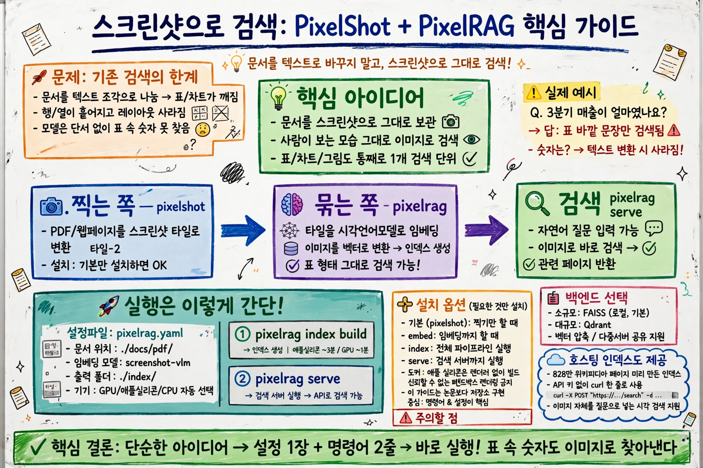
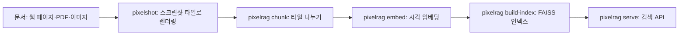
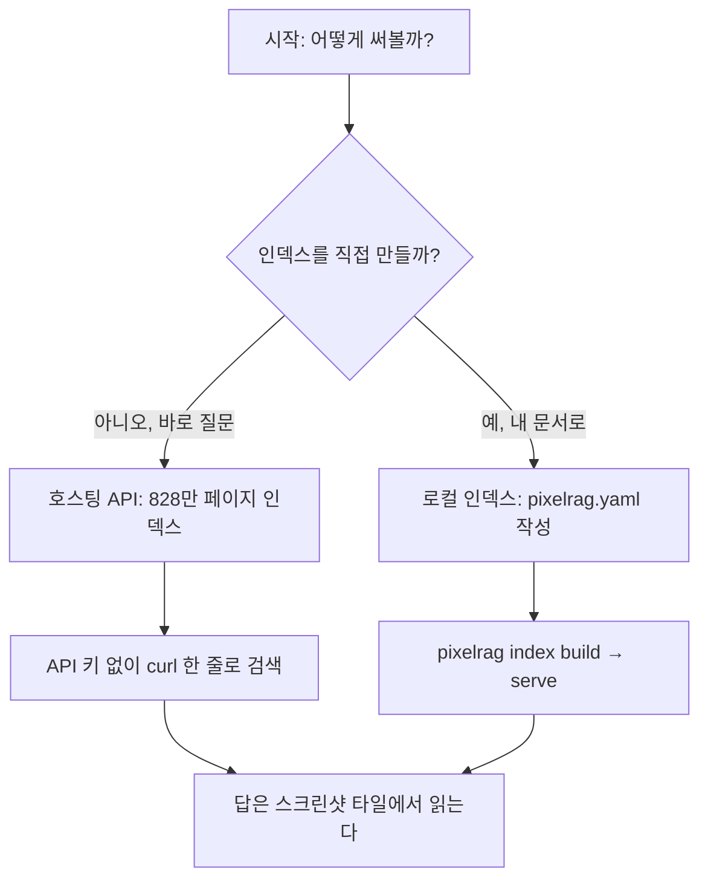

# PixelRAG: 논문은 읽었습니다. 이제 저장소를 직접 돌려봅니다

> **Summary**
> PixelRAG 검색은 문서를 텍스트로 변환하지 않고 스크린샷 타일로 보존해 표와 차트, 레이아웃을 시각적으로 검색합니다. pixelshot으로 페이지를 캡처하고 pixelrag로 임베딩과 인덱스를 만들 수 있으며, 로컬 문서 검색과 API 서버 운영은 물론 828만 개 위키백과 페이지를 미리 색인한 호스팅 API도 이용할 수 있습니다.

---

- 문서를 텍스트로 바꾸지 않고 스크린샷으로 검색한다는 아이디어, 논문으로 읽으면 그럴듯합니다. 그런데 저장소를 열어보면 이야기가 달라집니다. 설치하고, 명령어를 치고, 내 문서를 인덱싱하는 과정이 따로 있으니까요.
- 이 글은 그 과정을 따라가 봅니다. `pixelshot`으로 페이지를 찍고, `pixelrag`로 인덱스를 만들고, 직접 검색해 보는 순서입니다.
- 별도 API 키 없이 바로 쓸 수 있는 호스팅 인덱스부터, 내 PDF를 로컬에서 돌리는 방법까지 정리했습니다.

표가 들어간 보고서를 검색 시스템에 넣어본 적 있으시죠? 질문은 "3분기 매출이 얼마였나요?"인데, 돌아오는 답은 표 바깥의 문장만 훑은 결과입니다. 표 속 숫자는 어디로 갔을까요? 텍스트로 바꾸는 과정에서 표의 모양이 사라졌기 때문입니다. 이 글은 그 문제를 스크린샷으로 풀겠다는 저장소를 직접 돌려보는 관점에서 정리했습니다!

🎥 [동영상 보기](https://www.youtube.com/watch?v=3G9ui-njiqw)

## 왜 텍스트로 바꾸면 표가 사라질까요?

기존 검색은 문서를 텍스트 조각으로 나눕니다. 표는 행과 열이 흩어지고, 차트는 숫자의 나열이 되고, 레이아웃은 아예 사라집니다. 읽는 모델이 답을 찾을 단서가 없어지는 셈입니다. 그런데 사람은 어떻게 읽을까요? 표를 눈으로 보고 숫자를 바로 찾습니다. 이 저장소의 출발점은 그 차이입니다. 문서를 사람이 보는 모습 그대로, 스크린샷으로 남기는 것입니다.

## 두 가지 명령어만 기억하면 됩니다

저장소의 중심은 명령어 두 개입니다. 하나는 찍는 쪽, 하나는 묶는 쪽입니다. 찍는 쪽은 `pixelshot`입니다. 웹 페이지나 PDF를 스크린샷 타일로 바꿔줍니다. 묶는 쪽은 `pixelrag`입니다. 타일을 벡터로 바꾸고, 인덱스를 만들고, 검색 API로 서빙합니다. 단계마다 필요한 것만 설치하는 구조라, 일단 찍어보는 데는 기본 설치만으로 충분합니다!

임베딩 모델은 스크린샷 데이터로 미세 조정된 시각 언어 모델입니다. 페이지 이미지를 검색 가능한 공간에 올려놓는 역할을 합니다. 그래서 표가 통째로 하나의 검색 단위로 남습니다. 숫자를 텍스트로 풀어내지 않고, 이미지에서 바로 읽는 구조입니다!

## 내 문서로 인덱스를 만들어 봅니다

설정은 파일 한 장입니다. `pixelrag.yaml`에 문서 위치와 임베딩 모델, 출력 폴더를 적습니다. 기기는 자동으로 골라줍니다. 리눅스에서는 GPU를, 맥에서는 애플 실리콘 가속을, 없으면 CPU를 씁니다. 그다음 명령어 두 줄이면 끝입니다. `pixelrag index build`로 인덱스를 만들고, `pixelrag serve`로 검색 서버를 띄웁니다. 설정 파일만 바꾸면 내 문서가 검색 대상이 됩니다.

PDF 한 장으로 시험해 보는 방법도 저장소에 들어 있습니다. PDF 렌더링용 추가 기능과 `poppler`만 준비하면 됩니다. 논문 PDF를 인덱싱해 "개요 다이어그램이 있는 페이지"를 물으면, 개요 그림이 있는 페이지를 돌려준다고 합니다. 애플 실리콘에서는 3분, GPU에서는 1분 정도 걸린다고 안내돼 있습니다. 내 손으로 돌려보고 싶다면 이 경로가 가장 빠릅니다!

## 설치할 때 갈리는 길, 어디서부터 시작할까요?

기능마다 설치 옵션이 나뉩니다. 찍기만 할 거면 기본 설치, 임베딩까지 하려면 `embed` 옵션, 전체 파이프라인을 한 번에 돌리려면 `index` 옵션, 검색 서버까지 띄우려면 `serve` 옵션입니다. 필요한 단계만 골라 설치하는 방식이라 처음부터 전부 깔 필요가 없습니다. 도커로 API를 띄우는 방법도 있지만, 이미지는 CI에서 빌드하지 않는다고 명시돼 있어 직접 빌드해 확인하는 편이 안전합니다.

백엔드도 두 가지입니다. 기본은 로컬 인덱스용 `FAISS`이고, 규모가 커지면 `Qdrant`를 씁니다. 양자화로 벡터를 압축하거나, 여러 서버가 하나의 컬렉션을 공유하는 식의 설정이 가능합니다. 학습은 별도 프로젝트로 빠져 있습니다. 고정된 환경에서 따로 돌리는 구조라, 쓰는 쪽과 만드는 쪽이 깔끔하게 나뉩니다.

## 호스팅 인덱스로 바로 써보기

직접 인덱스를 만들지 않아도 되는 길도 있습니다. 828만 개 위키피디아 페이지로 미리 만든 인덱스를 호스팅 API로 제공합니다. API 키 없이 `curl` 한 줄로 질문을 던지면 됩니다. 이미지 자체를 질문으로 넣는 시각 검색도 지원합니다. 다만 미리 만든 인덱스 파일 하나가 217GB에 이른다고 안내돼 있어, 로컬에 내려받아 쓰는 길은 디스크를 넉넉히 준비해야 합니다.

## 어디까지 믿고 쓰면 될까요?

주의할 점도 정리했습니다. 도커 이미지는 애플 실리콘에서 렌더러 없이 빌드됩니다. 렌더링이 필요하면 amd64로 빌드해야 합니다. 컨테이너 안에서 크롬 샌드박스가 꺼져 있다는 점도 명시돼 있습니다. 믿을 수 없는 페이지를 향해 렌더러를 돌리는 건 피하는 편이 좋습니다. 그리고 한 가지 더, 이 글은 논문 중심이었던 이전 글과 달리 저장소 구현 중심으로 썼습니다. 수치보다 명령어와 설정, 실행 순서에 무게를 뒀습니다.

스크린샷으로 검색한다는 발상은 단순합니다. 문서를 사람이 보는 모습 그대로 남기는 것입니다. 그 단순한 선택이 저장소에서는 설치 옵션과 설정 파일, 명령어 몇 줄로 이어집니다. 표 속 숫자 하나가 궁금했던 분이라면, 직접 한 번 돌려보시면 됩니다!

