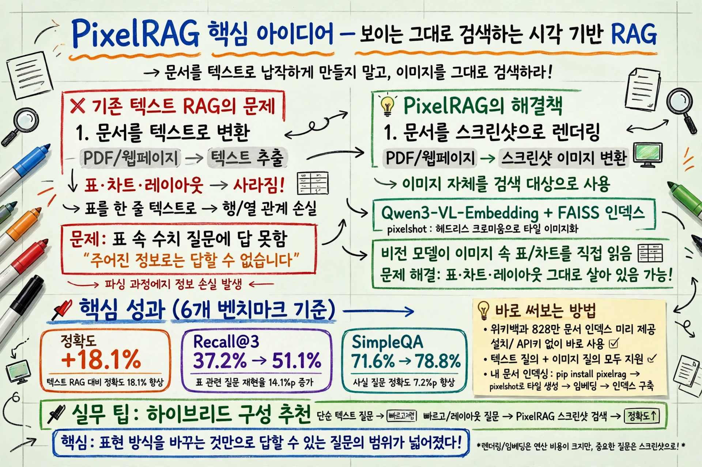
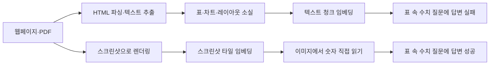
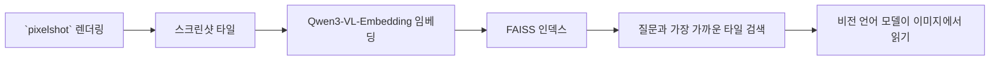

# PixelRAG: 문서를 텍스트로 바꾸지 않고 스크린샷으로 검색하면 표 속 숫자까지 읽어냅니다

> **Summary**
> PixelRAG는 문서를 텍스트로 파싱하지 않고 스크린샷으로 렌더링해 이미지 자체를 검색하는 시각 기반 RAG로, 표와 차트, 레이아웃이 그대로 남아 표 속 수치 질문에도 답할 수 있습니다. pixelshot 렌더링과 Qwen3-VL-Embedding 기반 FAISS 인덱스로 동작하며, 위키백과 828만 문서 인덱스를 설치나 API 키 없이 바로 써볼 수 있습니다. 논문 기준 여섯 개 벤치마크에서 텍스트 기반 RAG보다 정확도가 18.1% 높았다고 보고됐고, 플러그인을 쓰면 코딩 도우미도 페이지를 이미지로 직접 읽을 수 있습니다.

---

- PixelRAG는 문서를 텍스트로 바꾸지 않고 스크린샷으로 렌더링해, 이미지 자체를 검색 대상으로 삼는 시각 기반 RAG입니다.
- 표·차트·레이아웃이 그대로 남으니, 텍스트 RAG가 놓치던 표 속 수치 질문에도 답을 찾을 수 있습니다.
- 논문 기준 여섯 개 벤치마크에서 텍스트 기반 RAG보다 정확도가 18.1% 높았고, 위키백과 828만 문서로 만든 인덱스를 설치 없이 바로 써볼 수 있습니다.


PDF 보고서를 검색했더니, 표 안에 있는 숫자만 쏙 빠져서 답을 못 찾은 적 있으시죠? 문서는 분명히 있는데, 검색기는 "주어진 정보로는 답할 수 없다"고 말합니다. 답이 없는 게 아닙니다. 답이 들어 있던 표가, 텍스트로 바꾸는 과정에서 사라진 겁니다!

🎥 [동영상 보기](https://www.youtube.com/watch?v=90kPA7DOdRk)

## 텍스트 RAG는 왜 표 앞에서 멈출까요?

일반적인 RAG의 첫 단계는 문서를 텍스트로 바꾸는 일입니다. 웹페이지의 HTML을 파싱하거나 PDF에서 글자를 뽑아 텍스트 청크로 쪼갠 뒤 임베딩합니다. 그런데 이 과정에서 표·차트·레이아웃·인포그래픽처럼 글자만으로는 복원되지 않는 시각적 구조가 사라집니다. 표가 한 줄의 뒤죽박죽 텍스트가 되면, 그 안에 있던 숫자의 행과 열 관계는 복원되지 않습니다. 그래서 정작 답이 표 안에 들어 있는 질문에는 검색기가 올바른 근거를 찾지 못합니다. 파싱이 정보를 잃어버리는 지점, 바로 여기가 문제입니다!



## 스크린샷을 검색한다는 건 무슨 뜻일까요?

PixelRAG는 문서를 텍스트로 바꾸는 대신 웹페이지, PDF, 이미지를 스크린샷으로 렌더링한 뒤 그 이미지 자체를 검색 대상으로 삼습니다. 페이지가 사람 눈에 보이는 모습 그대로 인덱싱되니, 파싱이 버리던 시각 정보가 그대로 남습니다. 리더 모델은 텍스트 청크가 아니라 이미지 속 표에서 숫자를 직접 읽어냅니다. 검색의 단위가 바뀌는 겁니다. 글자 조각이 아니라, 보이는 화면 조각이 검색 단위가 됩니다!

렌더링은 `pixelshot`이라는 독립 명령이 맡습니다. 헤드리스 크로미움으로 웹페이지를 캡처하고, PDF도 타일 이미지로 바꿉니다. 임베딩 모델은 `Qwen3-VL-Embedding`으로, 스크린샷 데이터로 LoRA 파인튜닝을 거쳐 시각적 콘텐츠가 검색되도록 적응시켰습니다. 타일은 벡터로 바뀌어 FAISS 인덱스에 저장되고, 질문이 오면 가장 가까운 타일을 찾아 비전 언어 모델에게 건넵니다.



## 숫자는 뭐라고 말할까요?

논문에 따르면 PixelRAG는 여섯 개 벤치마크에서 텍스트 기반 RAG보다 정확도가 18.1% 높았습니다. 표 관련 질문에서는 상위 3개 결과의 재현율(Recall@3)이 37.2%에서 51.1%로 올랐습니다. 단순 사실 질문(SimpleQA)에서도 71.6%에서 78.8%로 정확도가 올랐습니다. 놀라운 건 순수 텍스트 질문에서도 이겼다는 점입니다. 파싱 과정에서 잃는 정보가 생각보다 크다는 뜻입니다! 저해상도 이미지를 쓰면 정확도를 크게 잃지 않으면서 토큰 비용을 최대 3배까지 줄일 수 있다고도 합니다. 다만 이 수치는 모두 연구팀이 논문에 밝힌 결과라는 점은 기억해 두시면 좋겠습니다.

## 바로 써보려면 어떻게 할까요?

가장 빠른 방법은 호스팅된 엔드포인트를 쓰는 것입니다. 위키백과 828만 페이지로 미리 만든 인덱스가 준비돼 있고, 설치도 API 키도 필요 없습니다. 텍스트 질의는 물론 이미지를 질의로 넣는 시각 검색도 지원합니다.

```plain text
curl -X POST https://api.pixelrag.ai/search \
  -H "Content-Type: application/json" \
  -d '{"queries": [{"text": "What is the capital of France?"}], "n_docs": 5}'
```

내 문서로 인덱스를 만들고 싶으면 `pip install pixelrag`로 `pixelshot`을 확보한 뒤, 단계별 명령으로 타일을 만들고 임베딩하고 인덱스를 구축합니다. 설정 파일에 문서 경로와 모델만 적으면 `pixelrag index build`가 전체 과정을 묶어서 실행해 줍니다. 직접 인덱스를 내려받아 로컬에서 띄우는 방법도 있습니다. 기본 인덱스 용량이 약 217GB라서, 디스크 여유는 먼저 확인하시는 게 좋습니다.

코딩 도우미에게 눈을 달아주는 방법도 있습니다. 플러그인 형태로 제공되는 `pixelbrowse` 스킬은 페이지의 원시 HTML을 가져오는 대신 스크린샷을 찍어 그 이미지를 직접 읽도록 합니다. 별도 서버 없이 사용자의 머신에서 렌더링을 호출하는 구조라, 설치만 마치면 페이지를 보라고 요청하기만 하면 됩니다. 차트와 다이어그램이 많은 페이지를 요약할 때 차이가 드러납니다!

## 어디까지 믿고 쓰면 될까요?

스크린샷 검색이 만능은 아닙니다. 렌더링과 임베딩에 연산이 들고, 인덱스 용량도 큽니다. 답의 품질은 결국 이미지를 읽는 비전 언어 모델의 성능에 달려 있습니다. 그래서 실무에서는 텍스트 파이프라인 위에 시각 검색을 얹는 하이브리드 구성이 현실적인 출발점입니다. 단순한 텍스트 질문은 기존 방식대로, 표·차트·레이아웃이 중요한 질문은 스크린샷으로 처리하는 겁니다. 표현 방식을 바꾸는 것만으로 답할 수 있는 질문의 범위가 넓어졌다는 점, 이게 PixelRAG가 던진 가장 큰 질문입니다.

문서를 텍스트로 납작하게 만드는 대신 보이는 그대로 검색하면, RAG가 답하지 못하던 질문들이 답을 찾기 시작합니다.

