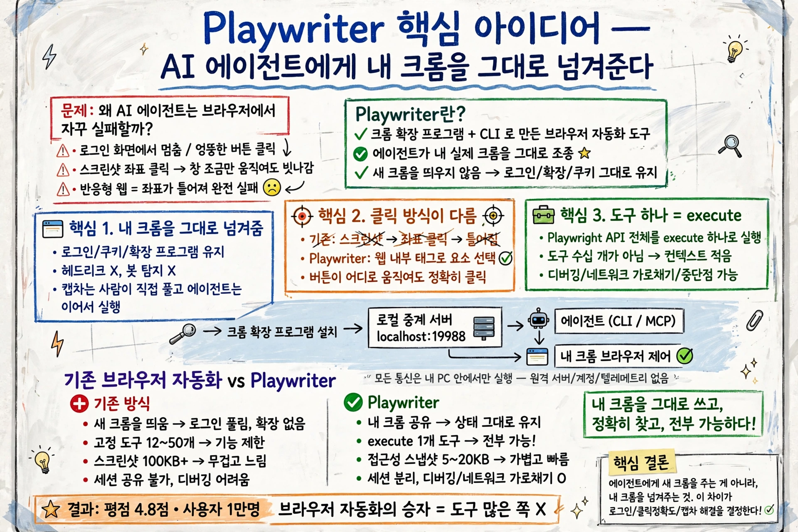
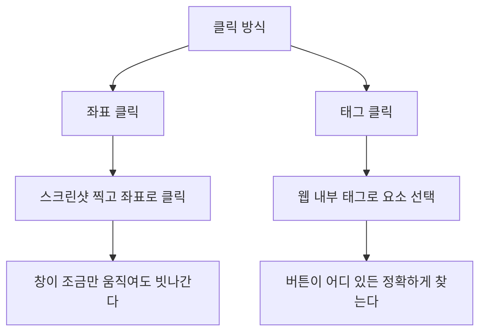
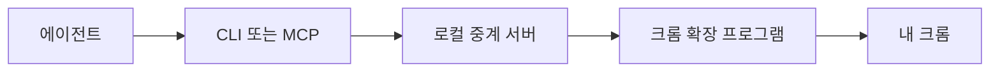
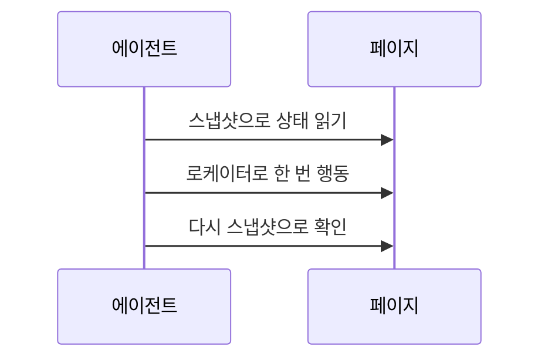

# Playwriter: 에이전트 브라우저 자동화, 새 크롬 말고 내 크롬을 쓰는 게 답이다

> **Summary**
> Playwriter는 에이전트가 새 브라우저 대신 로그인과 확장 프로그램이 유지된 사용자의 크롬을 자동화하도록 돕습니다. 화면 좌표가 아니라 웹 요소를 정확히 선택하고, Playwright API를 execute 하나로 실행해 적은 컨텍스트로 다양한 작업과 디버깅을 지원합니다. 로컬에서 동작하며 접근성 스냅샷으로 페이지를 가볍게 읽고, 여러 에이전트의 세션 관리와 네트워크 분석도 가능합니다.

---

- Playwriter는 에이전트에게 새 크롬을 띄우는 대신, 이미 로그인된 내 크롬을 그대로 넘겨주는 브라우저 자동화 도구입니다.
- 핵심은 클릭 방식입니다. 스크린샷 좌표가 아니라 웹 내부 태그로 요소를 찾아서, 창이 조금 움직여도 정확하게 클릭합니다.
- 도구도 하나입니다. 고정된 도구 수십 개가 아니라 Playwright API 전체를 `execute` 하나로 실행해서, 컨텍스트도 적게 쓰고 디버깅·네트워크 가로채기까지 됩니다.

AI 에이전트에게 브라우저 일을 맡겼는데, 로그인 화면에서 멈추거나 엉뚱한 버튼을 누르는 걸 본 적 있으시죠? 창이 조금만 움직여도 클릭이 빗나가고, 반응형 웹에서는 아예 답이 없습니다. 왜 그럴까요?

🎥 [동영상 보기](https://www.youtube.com/watch?v=3aAK2Ifl9ys)

## 에이전트에게 진짜 크롬을 넘겨준다?

Playwriter는 크롬 확장 프로그램과 CLI로 이루어진 브라우저 자동화 도구입니다. 에이전트가 내 실제 크롬을 조종하게 합니다. 로그인, 확장 프로그램, 쿠키가 이미 들어 있는 바로 그 브라우저입니다. 새 크롬을 띄우지 않으니 헤드리스도, 봇 탐지도, 메모리 두 배도 없습니다.

클릭 방식부터 다릅니다. 기존 방식은 스크린샷을 찍어서 좌표로 클릭합니다. 창이 조금만 움직여도 엉뚱한 데를 클릭합니다. 반응형 웹은 진짜 답이 없습니다. Playwriter는 웹 내부 태그로 요소를 선택합니다. 버튼이 어디 있든 정확하게 찾아서 클릭합니다.

기존 브라우저 MCP 대부분은 새 크롬을 띄웁니다. 그러면 로그인이 풀리고, 확장 프로그램이 없고, 봇 탐지에 걸리기 쉽습니다. 고정된 도구만 주면 에이전트는 성능 측정도, 중단점 설정도, 네트워크 요청 가로채기도 못 합니다. Playwriter는 다릅니다. Playwright API 전체를 `execute`라는 도구 하나로 넘깁니다. 도구 하나로 어떤 Playwright 코드든 실행합니다. 도구 정의가 수십 개가 아니니 컨텍스트도 적게 씁니다!

## 왜 내 크롬이어야 할까요?

이 부분이 저는 가장 와닿았습니다. 로그인된 사이트는 그대로 쓸 수 있습니다. 새 브라우저는 로그아웃 상태로 시작하지만, Playwriter는 내 쿠키를 그대로 씁니다. 확장 프로그램도 그대로, 캡차도 함께 해결합니다. 캡차가 뜨면 사람이 직접 풀면 됩니다. 에이전트가 막히면 탭에서 확장을 잠깐 끄고 직접 고친 뒤 다시 켜면, 에이전트가 그 자리에서 이어갑니다. 브라우저를 공유하는 느낌입니다!

## 어떻게 동작할까요?

확장 프로그램이 탭에 붙으면 로컬 중계 서버와 연결됩니다. 중계 서버는 `localhost:19988`에 묶입니다. 에이전트는 CLI나 MCP로 같은 중계 서버에 붙습니다. 명령은 중계 서버를 거쳐 크롬으로 흐릅니다. 크롬을 재시작할 필요도, 플래그를 달 필요도 없습니다. 기본적으로 모든 통신은 내 컴퓨터 안에서만 돕니다. 원격 서버도, 계정도, 텔레메트리도 없습니다.

## 에이전트는 페이지를 어떻게 읽을까요?

에이전트가 페이지를 읽는 주된 방법은 접근성 스냅샷입니다. 모든 상호작용 요소를 텍스트로 반환하고, Playwright 로케이터를 붙여줍니다. 용량은 5~20KB. 스크린샷 100KB 이상과 비교하면 훨씬 가볍고 빠릅니다. 눈으로 봐야 할 때만 스크린샷을 씁니다. 화면상의 위치가 중요하면 라벨을 입힌 스크린샷으로 요소를 가리켜 클릭합니다.

세션도 따로 둡니다. 여러 에이전트가 동시에 일해도 상태가 섞이지 않습니다. 변수, 페이지, 리스너가 호출 사이에도 유지됩니다. 디버깅과 네트워크 가로채기도 됩니다. 중단점을 걸고 코드를 한 줄씩 실행하고, 변수를 살펴보고, 페이지 스크립트와 CSS를 새로고침 없이 고칠 수 있습니다. 네트워크 트래픽을 지켜보며 API를 역추적하거나, 자바스크립트 뒤에 숨은 데이터를 긁어오거나, 실패한 요청을 디버깅할 수도 있습니다. 화면 녹화도 됩니다!

## 설치는 네 단계입니다

크롬 웹스토어에서 확장 프로그램을 검색해 추가합니다. 조종할 탭에서 확장 아이콘을 클릭합니다. 연결되면 초록색으로 바뀝니다. 터미널에서 `npm i -g playwriter`로 CLI를 설치합니다. `claude mcp add playwriter -s user -- playwriter mcp`로 클로드 코드에 연결합니다. 끝입니다.

## 숫자로 보면?

크롬 웹스토어 평점은 4.8점, 사용자는 1만 명입니다. 도구 수는 하나 대 수십 개. 고정 도구 12개 이상을 주는 도구도 있고, 50개가 넘는 명령을 주는 도구도 있습니다. Playwriter는 `execute` 하나로 끝냅니다. 스냅샷은 5~20KB, 스크린샷은 100KB 이상입니다. 숫자가 말해줍니다!

브라우저 자동화의 승자는 도구가 많은 쪽이 아닙니다. 내 브라우저를 그대로 쓰고, 요소를 정확하게 찾고, 필요한 건 전부 할 수 있게 하는 쪽입니다. 에이전트에게 새 크롬을 주는 게 아니라, 내 크롬을 넘겨주는 것. 그 차이가 클릭 정확도와 로그인, 캡차까지 갈라놓습니다.

