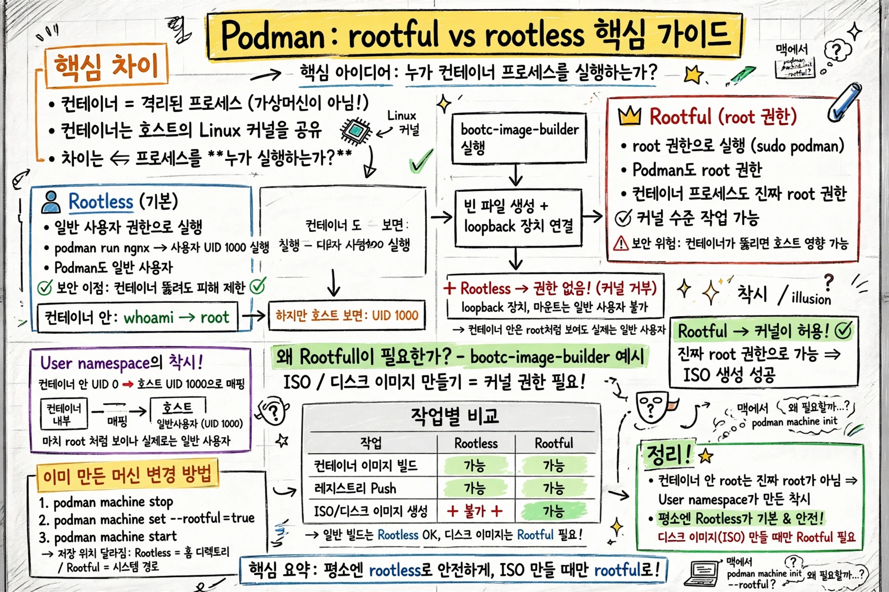
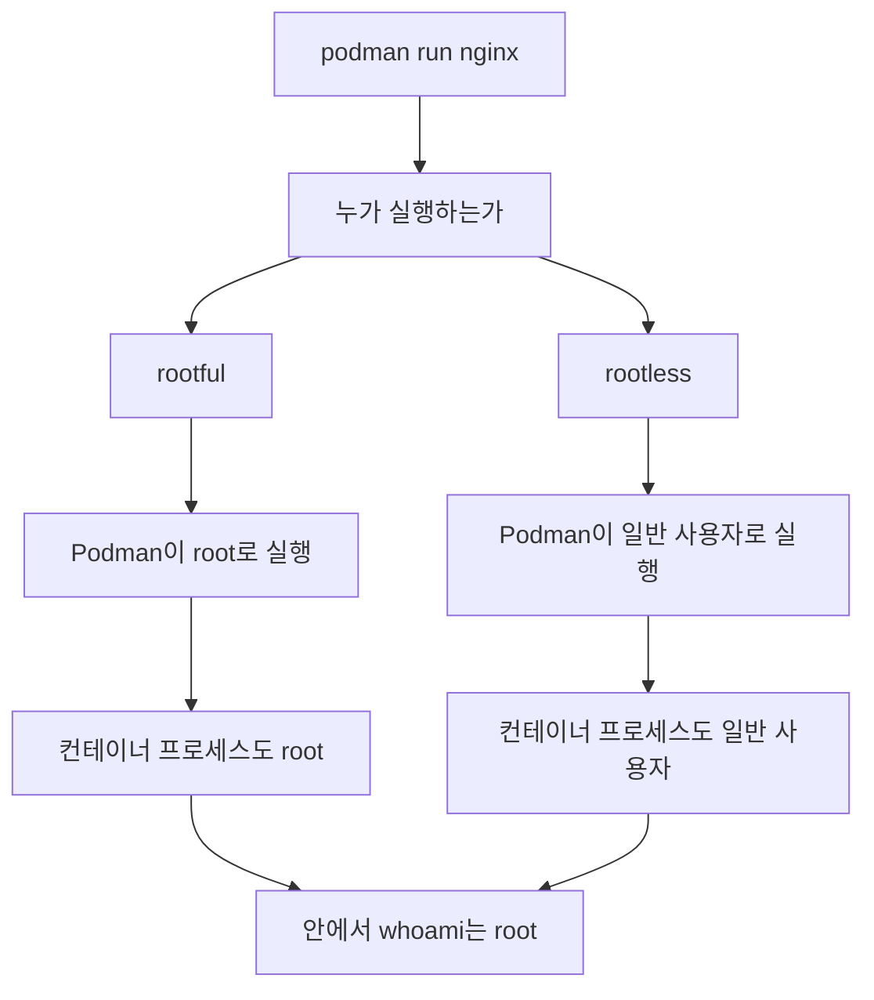
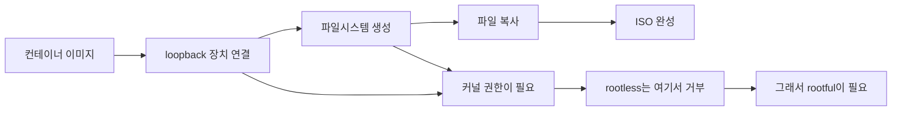
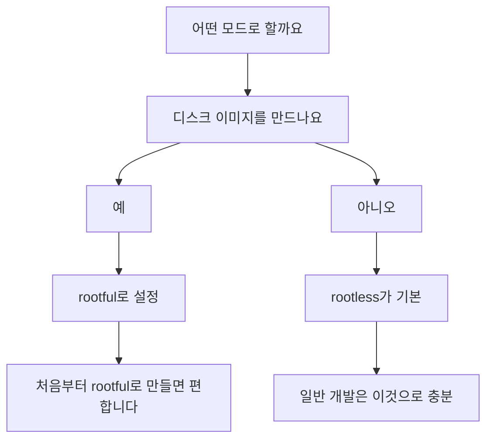

# Podman: rootful vs rootless, 디스크 이미지를 만들 때만 rootful이 필요합니다

> **Summary**
> Podman의 rootful과 rootless는 컨테이너 프로세스를 누가 실행하느냐의 차이입니다. 컨테이너 안 root는 User namespace가 만든 착시로, 호스트에서는 일반 사용자 권한입니다. 디스크 이미지를 만들려면 커널 권한이 필요하므로 bootc-image-builder는 rootful이 필수입니다. 평소엔 rootless가 기본입니다.

---

- Podman의 rootful과 rootless, 차이는 컨테이너 프로세스를 누가 실행하느냐입니다.
- 컨테이너 안 root는 착시입니다. User namespace가 안의 UID 0을 호스트의 일반 사용자로 바꿔치기합니다.
- 디스크 이미지를 만들려면 커널 권한이 필요합니다. 그래서 평소엔 rootless, ISO를 만들 때만 rootful입니다!


맥에서 `podman machine init --rootful`을 치는 순간, 뭔가 찜찜하지 않으셨나요? root를 붙인다는 게 왠지 위험해 보이는데, 왜 굳이 필요할까요? bootc로 ISO를 만들려다 이 옵션 앞에서 멈췄다면, 이 글이 그 답입니다.

🎥 [동영상 보기](https://www.youtube.com/watch?v=ZgXpWKgQclc)

## 컨테이너는 프로세스입니다

컨테이너는 가상머신이 아닙니다. 격리된 프로세스입니다.

`podman run nginx`를 실행하면, nginx라는 프로세스가 호스트 Linux 위에서 돌아갑니다. 다만 이 프로세스는 namespace와 cgroup이라는 커널 기능으로 격리되어 있어서, 마치 독립된 시스템처럼 보일 뿐입니다. 실제로는 호스트의 커널을 공유하는 하나의 프로세스입니다.

그렇다면 질문이 바뀝니다. 이 프로세스를 누가 실행하는가?

Linux에서 모든 프로세스는 특정 사용자의 권한으로 실행됩니다. `ps aux`를 쳐보면 각 프로세스 옆에 사용자 이름이 붙어 있습니다. root가 실행한 프로세스는 root 권한을 갖고, 일반 사용자가 실행한 프로세스는 그 사용자의 권한을 갖습니다.

컨테이너도 마찬가지입니다. 컨테이너 안에서 돌아가는 프로세스는 결국 호스트에서 누군가의 권한으로 실행됩니다.

## 그래서 rootful과 rootless의 차이는?

Rootful은 이렇습니다. `sudo podman run nginx`를 실행하면 Podman 자체가 root 권한으로 실행되고, 컨테이너 프로세스도 root 권한을 갖습니다. 호스트에서 `ps aux | grep nginx`를 해보면 소유자가 root입니다.

Rootless는 다릅니다. 일반 사용자로 `podman run nginx`를 실행하면 Podman 자체가 일반 사용자 권한으로 실행되고, 컨테이너 프로세스도 그 사용자의 권한을 갖습니다.

여기서 한 가지 복잡한 부분이 있습니다.

컨테이너 안에서 `whoami`를 쳐보면 `root`라고 나옵니다. Rootless 모드에서도요. 그런데 호스트에서 보면 일반 사용자로 돌아가고 있습니다. 어떻게 된 걸까요?

이건 User namespace라는 Linux 커널 기능 때문입니다. 컨테이너 안의 UID 0이 호스트의 UID 1000으로 매핑됩니다. 컨테이너 입장에서는 자기가 root라고 생각하지만, 커널 입장에서는 그냥 UID 1000입니다. 일종의 착시입니다.

안에서는 root인데 밖에서는 일반 사용자라니, 처음엔 이게 말이 되나 싶었습니다. 그런데 이 착시가 바로 rootless의 핵심이었습니다.



## 이게 왜 중요할까요?

권한이 다르면 할 수 있는 일이 다릅니다.

root는 파일시스템을 마운트하고, 네트워크 인터페이스를 만들고, 커널 모듈을 로드할 수 있습니다. 일반 사용자는 커널이 거부합니다.

Rootless 컨테이너 안에서 root처럼 보여도, 실제로는 일반 사용자 권한입니다. 그래서 호스트의 보호된 자원에 접근할 수 없습니다. 컨테이너가 뚫려도 피해가 제한됩니다. 보안상 이점이 여기서 나옵니다!

반대로, 정말로 커널 수준의 작업이 필요하다면 Rootless로는 불가능합니다.

## bootc-image-builder가 rootful을 요구하는 이유

bootc-image-builder는 컨테이너 이미지를 받아서 ISO 파일을 만듭니다. 빈 파일을 만들고, loopback 장치로 연결하고, 그 위에 XFS나 ext4 파일시스템을 생성하고, 파일을 복사합니다.

이 작업들은 전부 커널을 통해서만 가능합니다. 일반 사용자 권한으로는 loopback 장치를 만들 수 없고, 파일시스템을 마운트할 수 없습니다.

Rootless로 bootc-image-builder를 실행하면, 컨테이너 안에서는 root처럼 보여도 실제로는 일반 사용자입니다. loopback 장치 생성을 시도하는 순간 커널이 "권한 없음"을 반환합니다. 실패합니다!

그래서 rootful이 필요합니다. 진짜 root 권한이 있어야 커널이 요청을 수락합니다!

공식 문서도 같은 말을 합니다. bootc-image-builder는 rootful Podman이 필요하고, rootless로 돌리면 빌드가 실패합니다.



| 작업 | Rootless | Rootful |
| --- | --- | --- |
| 컨테이너 이미지 빌드 | 가능 | 가능 |
| 레지스트리 푸시 | 가능 | 가능 |
| ISO/디스크 이미지 생성 | 불가 | 가능 |

## 이미 만든 머신은 어떻게 바꾸나요?

이미 Podman 머신을 만들어둔 상태라면, 설정을 변경할 수 있습니다.

```bash
podman machine stop
podman machine set --rootful=true
podman machine start
```

처음부터 rootful로 만들 수도 있습니다.

```bash
podman machine init --rootful --disk-size 50 --memory 8192
podman machine start
```

Linux에서는 `sudo`를 붙여 실행하면 됩니다. 다만 이미지 스토리지 위치가 달라집니다. Rootless는 `~/.local/share/containers/storage`에, Rootful은 `/var/lib/containers/storage`에 저장합니다. 그래서 빌드와 ISO 생성은 같은 모드에서 진행하거나 스토리지를 명시적으로 마운트해야 합니다.



정리하면 이렇습니다. 컨테이너 안 root는 진짜 root가 아닙니다. User namespace가 만든 착시입니다. 평소엔 rootless가 기본이고, 디스크 이미지를 만들 때만 rootful이 필요합니다. 이 착시를 알면, 언제 rootful이 필요한지 헷갈릴 일이 없습니다.

