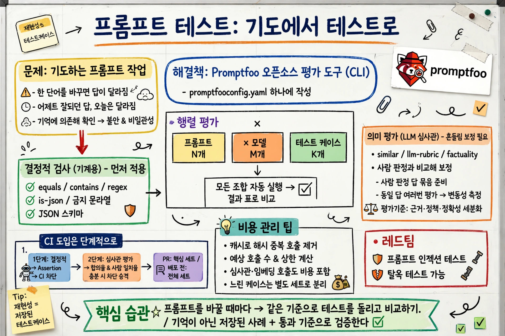
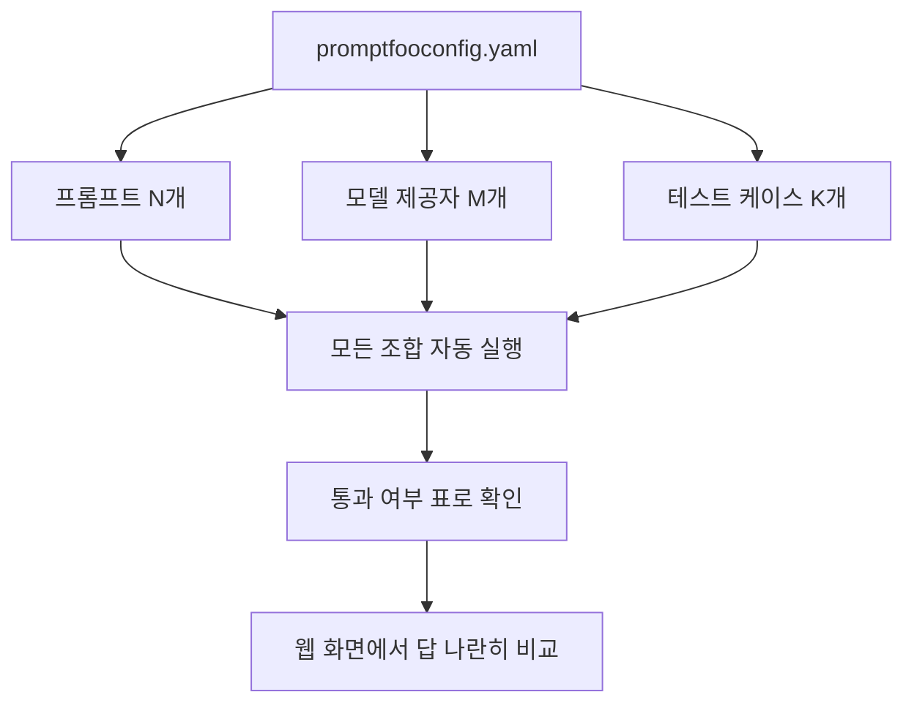
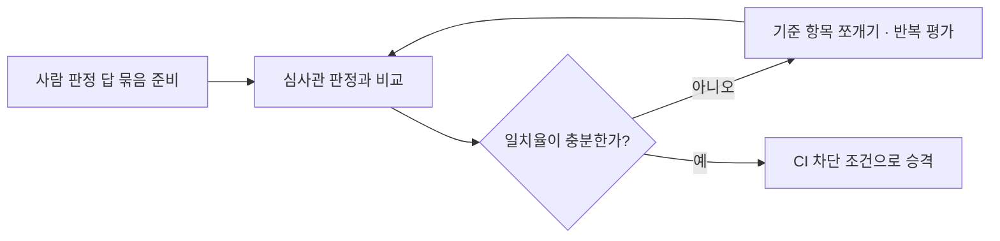
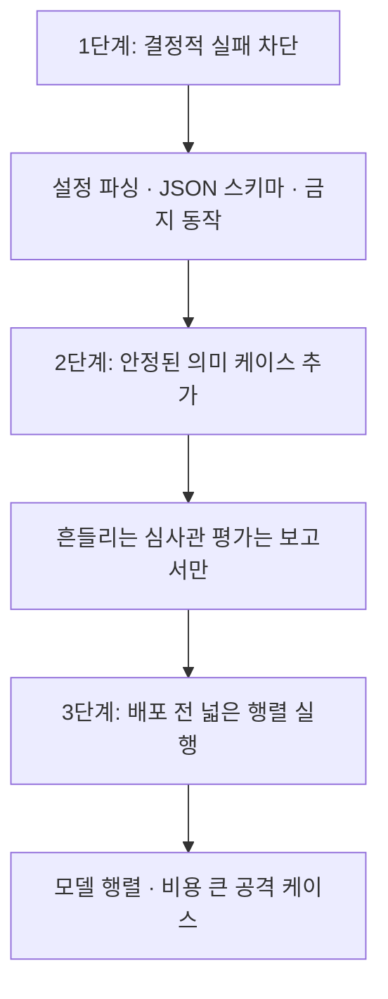

# Promptfoo: 프롬프트 단어 하나 바꾸고 기도하는 시대는 끝났습니다

> **Summary**
> Promptfoo는 프롬프트, 모델, 테스트 사례의 조합을 자동 평가해 변경으로 인한 회귀를 찾는 오픈소스 도구입니다. 결정적인 검사를 우선하고, LLM 심사관은 사람 판정과 비교해 보정하며, 안정성이 확인된 평가부터 단계적으로 CI 차단에 적용해야 합니다. 캐시와 실행 범위 설정으로 비용을 관리하고, 정기적인 전체 평가로 결과의 최신성을 확인할 수 있습니다.

---

- 프롬프트 한 단어를 바꾸면 답이 달라지는 LLM 앱, 이제는 눈으로 확인하고 기도하지 말고 테스트로 확인하면 됩니다.
- Promptfoo는 프롬프트·모델·테스트 케이스를 YAML 한 파일에 적어두면, 모든 조합을 자동으로 실행하고 통과 여부를 표로 보여주는 오픈소스 평가 도구입니다.
- 다만 LLM 심사관도 흔들립니다. 결정적인 검사부터 쓰고, 심사관 평가는 사람 판정과 비교해 보정하고, CI 차단은 단계적으로 강화하는 게 핵심입니다.

고객센터 챗봇 프롬프트에서 단어 하나를 바꿨는데, 환불 안내가 갑자기 엉뚱하게 나온 적 있으시죠? 어제는 잘되던 답이 오늘은 왜 달라졌는지, 바꾼 단어 때문인지 모델이 바뀐 건지 알 수가 없습니다. 그래서 "제발 잘 나오길" 바라며 배포 버튼을 누르게 됩니다. 이게 바로 기도하는 프롬프트 작업입니다!

🎥 [동영상 보기](https://www.youtube.com/watch?v=KhINc5XwhKs)

## 프롬프트 테스트, 왜 기도가 되었을까요?

LLM 앱의 문제는 답이 매번 조금씩 다르다는 점입니다. 같은 질문에도 표현이 바뀌고, 가끔은 정책과 어긋나는 답이 나옵니다. 그런데도 테스트가 없으면 변경의 영향을 확인할 방법이 없습니다. 프롬프트를 고치고 "어제 잘되던 답"을 기억에 의존해 확인하는 게 전부입니다. 기억은 테스트가 될 수 없습니다!

이 지점에서 평가 도구가 필요합니다. 프롬프트 후보, 모델 제공자, 테스트 변수를 조합해 같은 질문 세트를 자동으로 평가하는 도구 말입니다. 사람의 기억에 의존하던 확인을 저장된 사례와 통과 기준으로 바꾸는 것, 그게 핵심입니다.

## Promptfoo는 뭘 해줄까요?

Promptfoo는 프롬프트와 모델, 테스트를 평가하는 오픈소스 CLI 도구입니다. `promptfooconfig.yaml` 파일 하나에 세 가지를 적습니다. 테스트할 프롬프트, 비교할 모델 제공자, 그리고 입력과 기대 동작을 담은 테스트 케이스입니다. 한 줄 명령으로 평가를 실행하면 모든 조합을 돌리고 결과를 표로 보여줍니다. 웹 화면으로 열어 모델별 답을 나란히 비교할 수도 있습니다.

이 조합 실행이 바로 행렬 평가입니다. 프롬프트 N개, 제공자 M개, 테스트 케이스 K개를 선언하면 가능한 조합을 전부 실행해 결과를 비교합니다. 한 문장을 수정했을 때 특정 모델이나 엣지 케이스에서만 생기는 회귀를 찾기 좋습니다. 비동기 호출로 여러 요청을 동시에 보내 대기 시간을 줄입니다.

설치는 간단합니다. `npm install -g promptfoo`로 전역 설치하거나, `npx promptfoo@latest init`으로 시작합니다. `promptfoo eval`로 평가하고, `promptfoo view`로 결과를 봅니다. 90개가 넘는 모델 제공자를 지원하고, 로컬에서 실행되니 설정과 결과가 내 컴퓨터에 머무릅니다.

## Assertion, 결정적인 것부터 쓴다고요?

평가의 핵심은 통과 기준, 즉 Assertion입니다. Promptfoo는 30개가 넘는 내장 Assertion을 제공합니다. `equals`, `contains`, `regex`, `is-json` 같은 구조·문자열 검사가 있고, `similar`, `llm-rubric`, `factuality` 같은 의미 평가가 있습니다. JSON 스키마, 금지 문자열, 함수 호출처럼 기계적으로 판단할 수 있는 조건은 심사관보다 먼저 적용하는 게 좋습니다. 기계가 판단할 수 있는 건 기계에게 맡기는 겁니다!

`llm-rubric`은 답과 평가 기준을 심사관 프롬프트로 묶어, 별도 모델이 통과 여부와 이유를 내게 하는 방식입니다. 온도를 0으로 두면 변동성을 낮출 수 있지만, 같은 결과를 보장하지는 않습니다. 모델 업데이트나 백엔드 차이, 모호한 기준 때문에 같은 답이 통과와 실패 사이에서 흔들릴 수 있습니다. 중요한 케이스는 사람 판정과 심사관 판정을 주기적으로 비교해야 합니다.

고객센터 환불 정책 테스트 예시를 볼까요? 프롬프트 2개, 제공자 2개, 상황 2개를 조합하면 2×2×2, 총 8개 조합이 됩니다. "14일 환불 규정을 언급하며 친절하게 절차를 안내해야 함" 같은 기준은 심사관이 보고, "죄송"이라는 단어를 금지하는 기준은 문자열 검사로 봅니다. 단어 하나를 막는다고 법적 책임이나 적절한 응대가 검증되는 건 아니라는 점, 잊지 말아야 합니다!

## LLM 심사관이 흔들리면 어떻게 하나요?

이 질문이 저는 가장 중요하다고 생각합니다. 심사관을 쓴다고 테스트가 일반 단위 테스트처럼 결정적이 되지는 않으니까요. 구조와 금지 동작은 결정적으로 검사할 수 있지만, 의미 평가와 모델 출력은 변동할 수 있습니다. 그래서 심사관 기준을 보정하는 과정이 따로 필요합니다.

방법은 이렇습니다. 사람이 통과와 실패를 판정한 답 묶음을 준비하고, 심사관이 같은 기준으로 얼마나 일치하는지 봅니다. 명확한 답, 애매한 답, 부분 충족, 유창하지만 사실이 틀린 답을 골고루 넣습니다. 평가 기준은 한 번에 여러 추상 기준을 묻기보다 근거 제시, 정책 준수, 정확성처럼 항목을 나누는 편이 판정 원인을 이해하기 쉽습니다.

같은 답을 여러 번 평가해 판정이 흔들리는 사례를 찾습니다. 변동이 큰 항목은 CI 차단보다 경고나 사람 검토로 두고, 결정적 검사로 바꿀 수 있는 부분을 분리합니다. 심사관 모델이나 프롬프트가 바뀌면 기존 보정 세트를 다시 실행해야 과거 점수와 비교할 수 있습니다.

## CI에 바로 막아도 될까요?

처음부터 수백 개 케이스로 병합을 막으면, 흔들리는 심사관 때문에 팀이 테스트를 무시하게 될 수 있습니다. 최근 장애 다섯 개를 고정 케이스로 만들고, JSON이나 금지 동작, 필수 근거 같은 결정적 Assertion부터 CI에 넣는 게 순서입니다. 심사관 기반 평가는 반복 실행의 합의율과 사람 판정 일치율이 충분할 때 차단 조건으로 승격합니다.

범위도 단계별로 정합니다. 풀 리퀘스트에서는 빠른 핵심 세트, 배포 전에는 넓은 세트를 실행합니다. 실패가 많은 조합을 무작정 추가하기보다, 운영 사고와 사용자 피드백에서 재현 가능한 케이스를 먼저 쌓는 편이 낫습니다.

케이스가 늘면 YAML 한 파일에 모두 넣기보다 JSONL이나 CSV 같은 외부 데이터셋과 스키마 버전을 관리합니다. 차단 임계값은 전체 평균만 보지 않는 편이 좋습니다. 안전 케이스 하나의 실패가 일반 품질 몇 점 향상으로 상쇄되어서는 안 되니까요!

## 비용은 어떻게 관리할까요?

행렬 평가는 조합이 곱으로 늘어나니 비용 관리가 따라와야 합니다. 프롬프트와 변수, 모델 파라미터를 해시해 캐시에 저장하면 같은 입력은 다시 호출하지 않습니다. 프롬프트나 기준의 한 글자가 바뀌면 캐시 키가 달라져 해당 테스트가 다시 실행됩니다. 다만 제공자가 같은 이름 뒤의 서빙 모델을 바꾸는 경우, 캐시 결과가 현재 동작을 반영하지 않을 수 있습니다. 캐시는 속도 최적화로 쓰되, 정기 전체 실행과 배포 전 재평가 정책을 두는 게 좋습니다.

비용 집계에는 대상 모델뿐 아니라 임베딩과 심사관 모델 호출도 포함합니다. 풀 리퀘스트마다 예상 호출 수와 상한을 계산하고, 입력이 길거나 여러 번 반복하는 케이스는 느린 세트로 분류합니다. 오류로 무한 재시도하지 않도록 제공자별 동시성과 재시도 예산도 정합니다.

참고로 이 도구는 2026년 3월에 대형 AI 기업에 합류했지만, 오픈소스로 계속 개발되고 있습니다. 레드팀 기능도 함께 들어 있습니다. 프롬프트 인젝션이나 탈옥, 개인정보 유출 같은 위험을 플러그인으로 골라 자동으로 공격 질문을 만들어 모델을 시험합니다. 평가와 보안 테스트를 같은 도구에서 돌릴 수 있다는 뜻입니다!

프롬프트 작업에서 기도를 빼는 방법은 하나입니다. 바꿀 때마다 같은 기준으로 비교하는 평가 장치를 갖추는 것, 그게 전부입니다. 프롬프트 한 줄을 고치고 테스트를 돌려보는 습관, 오늘부터 시작하면 어떨까요?

