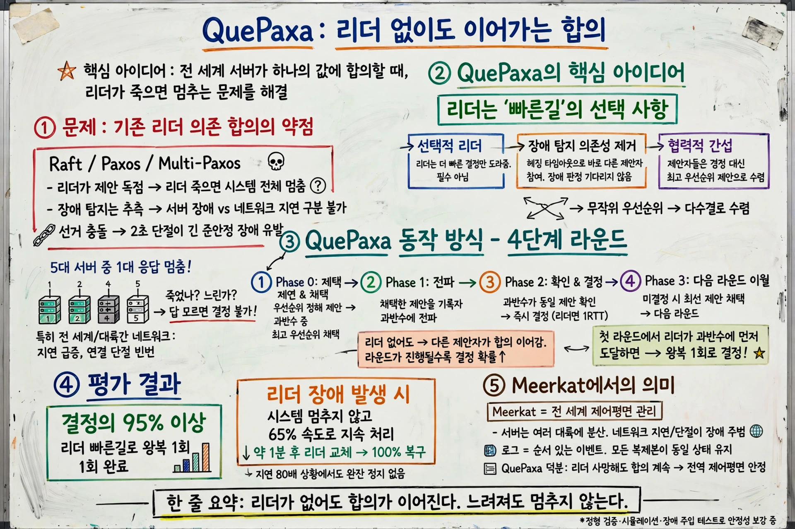
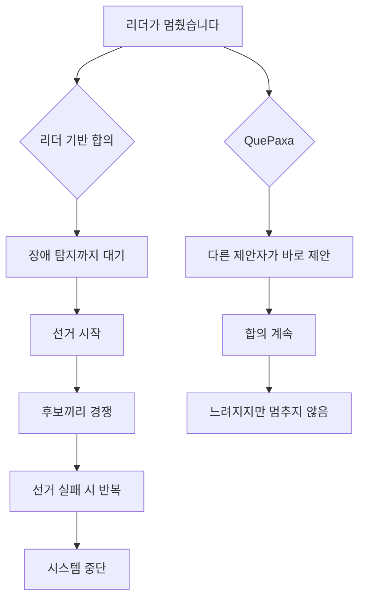
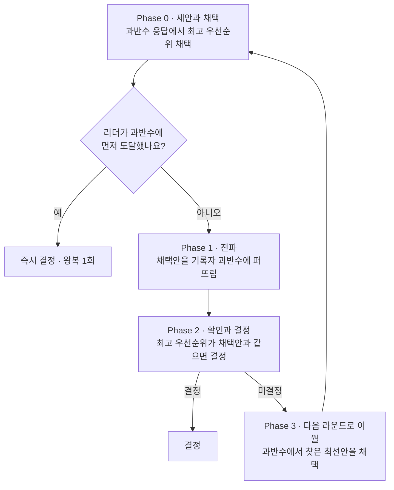

# QuePaxa: 리더가 죽어도 멈추지 않습니다. 왕복 1회로 합의하는 법입니다

> **Summary**
> QuePaxa는 리더 장애나 네트워크 지연에도 합의가 멈추지 않도록 리더를 필수 조건이 아닌 빠른 경로로 활용하는 비동기 합의 프로토콜입니다. 헤징과 제안자 간 협력으로 장애 탐지와 리더 선거에 따른 정지를 피하며, 평가에서는 결정의 95% 이상이 왕복 1회로 완료되고 리더 장애 중에도 평소 속도의 약 65%로 처리가 이어졌습니다. 실전 검증과 장애 후 복구 지원은 아직 진행 중입니다.

---

- 전 세계 서버가 하나의 값을 정해야 할 때, 리더가 죽으면 시스템 전체가 멈춥니다.
- QuePaxa는 리더를 빠른 길의 선택 사항으로 바꿨습니다. 리더가 없어도 다른 제안자가 합의를 이어갑니다.
- 평가에서 결정의 95% 이상이 왕복 1회로 끝났고, 리더 장애 때도 멈추지 않고 65% 속도로 계속됐습니다.

서버 다섯 대가 같은 값을 정해야 한다고 해보세요. 그중 한 대가 갑자기 응답을 멈췄습니다. 죽은 걸까요, 네트워크가 느린 걸까요? 답을 못 하면 시스템은 결정을 내리지 못합니다!

🎥 [동영상 보기](https://www.youtube.com/watch?v=kZMma6jbhqM)

## Meerkat은 무엇을 하려는 걸까요?

`Meerkat`은 전 세계 제어 평면을 관리하는 실험적 분산 합의 서비스입니다. 복제본들이 순서가 있는 이벤트 로그에 합의하고, 로그 위에는 키-값 저장소 같은 애플리케이션이 올라갑니다. 로그 항목 하나가 `get` 또는 `put`이고, 로그가 갈라지지 않으므로 모든 복제본이 같은 상태를 만듭니다.

그런데 `Meerkat`의 무대는 다릅니다. 클러스터가 여러 대륙에 걸쳐 있고 연결은 높고 가변적인 지연을 가집니다. 전 세계 규모에서는 자체 서버보다 네트워크에서 장애가 발생할 가능성이 더 높아, 지연 급증과 연결 단절에도 진행할 수 있어야 합니다.

2020년 핵심 네트워크 스위치의 부분 장애로 대시보드가 6시간 동안 평소보다 80배 느려진 적이 있습니다. 데이터 손실은 없었지만, 문제가 해결될 때까지 쓰기가 불가능했습니다.

## 리더 기반 합의는 왜 멈출까요?

대부분의 합의 알고리듬은 리더에 의존합니다. `Raft`, `Multi-Paxos`, `Viewstamped Replication`이 대표적입니다. 리더만 제안을 독점하면 동시 요청에 순서를 부여할 수 있고, 정상 상태에서는 한 번의 네트워크 왕복으로 결정할 수 있습니다. 리더가 건강할 때는 빠릅니다.

문제는 리더가 멈추는 순간 시작됩니다. 리더가 중단되거나 느려지거나 연결이 끊기면 시스템이 멈추고, 장애를 탐지해 새 리더를 선출해야 합니다. 그런데 이 복구 과정 자체가 또 다른 문제입니다.

첫째, `Paxos`의 파괴적 간섭입니다. 여러 제안자가 동시에 동작하면 다른 제안자가 두 단계 사이에 더 높은 투표 번호를 보내 앞선 제안을 차단합니다.

둘째, 리더 복구가 장애를 이어갑니다. `Raft`에서 리더 장애를 의심한 복제본은 후보가 되어 과반수 득표를 노리는데, 여러 후보가 동시에 나서면 서로를 차단합니다. 2초짜리 네트워크 단절이 촉발한 선거가, 원인이 사라진 뒤에도 훨씬 오래 이어지는 준안정 장애가 생길 수 있습니다!

셋째, 장애 탐지 자체가 추측입니다. 네트워크 너머의 프로세스 장애는 직접 관찰할 수 없고, 하트비트나 응답 도착 여부로 추정해야 합니다. 비동기 네트워크에서는 서버 장애와 느린 네트워크를 구별할 수 없습니다. 잘못된 장애 판정도 선거를 촉발합니다. `Raft`의 선거 타임아웃은 통상 왕복 시간의 5~10배라, 지구 반대편까지의 왕복이 수백 밀리초 단위인 환경에서는 장애 탐지에 약 1초가 걸릴 수 있습니다.

## QuePaxa는 무엇이 다를까요?

2023년 발표된 `QuePaxa`는 엄격한 리더나 정확한 타임아웃에 의존하지 않는 비동기 환경 프로토콜입니다. 핵심 설계는 세 가지입니다. 선택적 리더, 장애 탐지 의존성 제거, 제안자 사이의 협력적 간섭입니다.

`QuePaxa`에는 제안자와 기록자가 있습니다. 제안자는 결정할 값을 제출하고, 기록자는 관찰한 모든 제안을 기록하며 다른 활성 제안자에게 전달합니다. 일반 제안에는 무작위 숫자 우선순위를, 리더에는 독점적인 최댓값을 부여합니다. 더 높은 우선순위의 제안을 받은 제안자는 이를 자신의 제안으로 채택해 전파합니다.

제안자들은 서로 경쟁하기보다 공유된 최고 우선순위 제안으로 수렴합니다. 한 라운드에서 결정하지 못하면 다음 라운드를 시도하지만, 충분한 라운드를 거치면 합의가 보장됩니다.

리더는 자신의 제안이 필요한 기록자들에게 먼저 도달했음을 확인하면 왕복 1회로 결정합니다. 클라이언트는 리더에게만 요청할 필요가 없으며, 리더가 중단돼도 다른 제안자에게 계속 요청할 수 있습니다. 리더는 진행의 필수 조건이 아니라 더 빠른 결정을 위한 최적화입니다!

무작위 우선순위는 `FLP` 불가능성 정리를 우회하기 위해 필요합니다. 리더의 빠른 경로가 안전한 이유는 과반수 교차 덕분입니다. 어떤 두 과반수 집합도 최소 하나의 기록자를 공유하므로, 리더가 과반수에 먼저 도달했다면 다른 제안자는 반드시 리더의 제안을 만나 이를 채택합니다. 다른 값을 결정할 수 없습니다.

## 헤징은 장애 탐지를 어떻게 대신할까요?

`QuePaxa`는 헤징으로 리더의 빠른 경로를 우선 사용하면서 다른 제안자도 참여할 수 있게 합니다. 논문에서는 클라이언트가 모든 복제본에 요청하고, 비리더 복제본이 짧은 타임아웃 동안 기다려 리더가 먼저 결정할 기회를 줍니다. 공식 구현은 메시지 수를 줄이기 위해 복제본 대신 클라이언트가 헤징 타임아웃을 기다리도록 변경했습니다.

헤징 타임아웃은 장애 판정이 아니므로 네트워크 지연보다 짧게 설정할 수 있습니다. 지연이 100밀리초인 네트워크에서 `Raft`의 타임아웃을 5밀리초로 두면 시스템이 멈추지만, `QuePaxa`에서는 활성 제안자 수만 늘어납니다. 장애를 탐지한 뒤 반응하는 대신 선제적으로 다른 제안자를 참여시키는 방식입니다.

## 한 라운드는 네 단계로 돕니다

각 라운드는 네 단계로 구성되고, 결정하지 못하면 다음 라운드를 시작합니다. 각 단계 시작 시 제안자는 채택한 제안을 모든 기록자에게 전파하고, 과반수 응답을 받으면 다음 단계로 이동합니다.

`Phase 0, 제안과 채택`에서는 우선순위를 정하고 제안을 전송한 뒤, 과반수 응답에서 가장 높은 우선순위 제안을 채택합니다. 첫 라운드에서 리더가 자신의 제안이 과반수에 먼저 도달했음을 확인하면 즉시 결정합니다. `Phase 1, 전파`에서는 채택한 제안을 기록자 과반수에 퍼뜨립니다. `Phase 2, 확인과 결정`에서는 과반수 기록자가 이전 단계에서 본 최고 우선순위 제안을 조회하며, 채택안과 같으면 결정합니다. `Phase 3, 다음 라운드로 이월`에서는 결정하지 못한 제안자가 과반수에서 찾은 최선의 제안을 채택하고 다음 라운드를 준비합니다.

두 번째 라운드부터는 리더의 빠른 경로가 없고, `Phase 2`에서 수렴해야 결정합니다. 라운드가 진행될수록 결정이 지수적으로 쉬워집니다. 논문은 라운드마다 결정 확률을 50%로 예측하지만, 실제는 수렴 덕분에 더 높습니다!

## 평가에서 확인한 숫자들

거의 모든 대륙에 서버를 둔 평가에서 리더 중단, 연결 단절, 지연에도 요청 처리가 계속됐고, 완전한 정지는 관찰하지 못했습니다. 결정의 95% 이상을 리더가 첫 단계에서 처리해 처리량이 안정적이었습니다.

리더 장애 테스트가 인상적입니다. 리더가 멈추자 결정 속도는 평소의 약 65%까지 떨어졌고, 약 1분 뒤 리더를 교체하자 100%로 돌아왔습니다. 그 사이 시스템은 단 한 번도 멈추지 않았습니다. 첫 단계에서 결정하지 못하면 처리량이 일시적으로 평소의 3분의 1 수준까지 떨어지기도 합니다. 느려져도 완전히 정지하지는 않습니다.

## 아직 검증이 덜 된 선택입니다

한계도 분명합니다. `QuePaxa`는 `Raft`나 `Paxos`만큼 실전 검증되지 않았습니다. 원래의 중단 후 복귀하지 않는 장애 모델을 장애 후 복구를 지원하도록 확장하는 작업도 진행 중이라, 신중한 엔지니어링과 강한 정확성 근거가 필요합니다.

그래서 `QuePaxa` 구현과 `Meerkat` 전체에 정형 검증, 광범위한 시뮬레이션, 장애 주입 테스트를 병행하고 있습니다.

`cf` 명령줄 도구나 `WebMCP`, `Quick Tunnels`처럼 설치해 쓰는 제품 이야기가 아닙니다. 전 세계 제어 평면을 지탱하는 합의 알고리듬 이야기입니다. 리더가 없어도 합의가 이어진다는 사실이 분산 시스템의 상식을 조금 바꿔놓았습니다!

