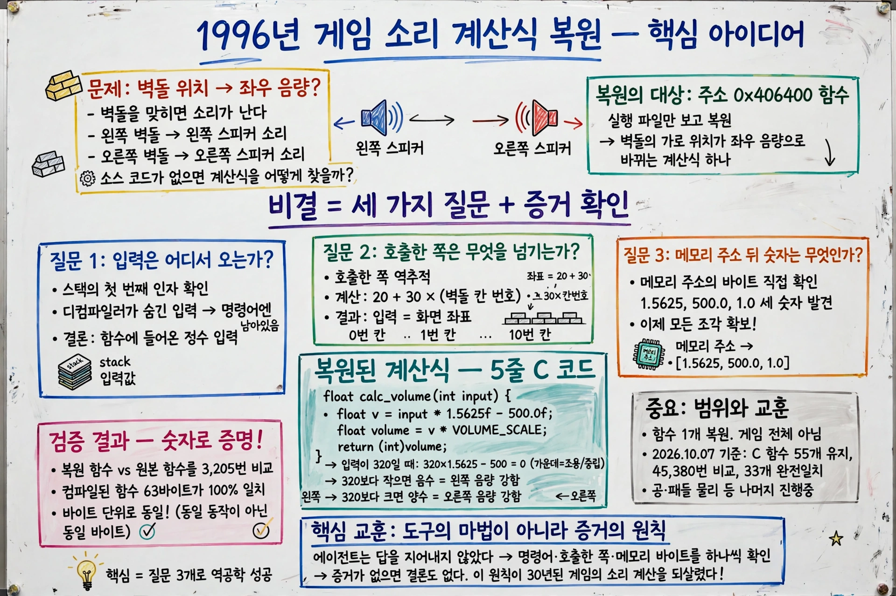
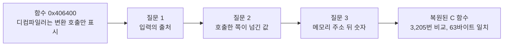
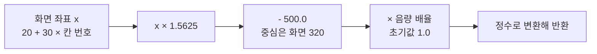

# REA: 1996년 게임의 소리 계산, 63바이트까지 똑같이 되살렸습니다

> **Summary**
> 에이전트는 1996년 게임 DX-Ball의 좌우 음량 계산 함수를 실행 파일의 명령어, 호출 인자, 메모리 값을 분석해 복원했습니다. 원본과 3,205번 비교해 컴파일된 63바이트가 모두 일치했으며, 이는 함수 하나의 복원이지 게임 전체의 완성을 뜻하지는 않습니다.

---

- 1996년 게임의 소리 계산식을, 실행 파일만 보고 되살렸습니다. 벽돌 위치가 좌우 음량으로 바뀌는 함수 하나를 통째로 복원했습니다.
- 비결은 디컴파일러가 놓친 세 가지를 따로 물은 것입니다. 입력은 어디서 오는지, 호출한 쪽은 무엇을 넘기는지, 메모리 주소 뒤의 숫자는 무엇인지 말이죠.
- 결과는 숫자로 검증했습니다. 원본과 3,205번 비교했고, 컴파일된 함수 63바이트가 모두 일치했습니다.

옛날 벽돌깨기 게임을 켜본 적 있으시죠? 벽돌을 맞히면 소리가 납니다. 왼쪽 벽돌을 맞히면 왼쪽 스피커에서, 오른쪽 벽돌을 맞히면 오른쪽에서 소리가 나옵니다. 당연해 보이지만, 그 당연함을 만드는 계산식은 게임 안에 숨어 있습니다. 소스 코드가 없으면 그 식은 어떻게 찾을까요?

🎥 [동영상 보기](https://www.youtube.com/watch?v=vi-WLyPrfRk)

이 글은 원본 포스트를 직접 읽지 못하고 쓴 글입니다. 포스트가 로그인 벽 뒤에 있어 본문을 확인할 수 없었고, 대신 공식 사례 페이지와 저장소 README를 1차 원본으로 삼아 재구성했습니다. 그래서 이 글은 포스트의 한 가지 메시지에만 집중합니다. 1996년 게임 `DX-Ball`의 소리 계산을 바이트 단위까지 되살린 사례 말입니다!

## 소리 계산, 어디서부터 찾을까요?

질문은 하나였습니다. 벽돌의 가로 위치가 어떻게 좌우 음량 값으로 바뀌는가? 에이전트는 실행 파일 속 함수 하나를 집어 들었습니다. 주소 `0x406400`번 함수입니다.

그런데 첫 화면이 이상했습니다. 디컴파일러가 보여준 것은 변환 호출 하나뿐이었습니다. 입력이 어디서 오는지, 무슨 계산을 하는지 보이지 않았습니다. 여기서 멈추면 "알 수 없다"로 끝났을 겁니다. 그런데 에이전트는 세 가지 질문을 따로 던졌습니다. 이 세 가지 질문이 이 사례의 전부입니다.

## 질문 1: 입력은 어디서 오는가?

명령어 목록을 보니 답이 있었습니다. `[EBP+8]`에서 값을 읽어 오는 명령어가 있었습니다. 스택에 쌓인 첫 번째 인자, 즉 함수에 들어온 정수 입력이었습니다. 디컴파일러가 감춘 입력이 명령어에는 그대로 남아 있었습니다.

## 질문 2: 호출한 쪽은 무엇을 넘기는가?

함수를 부른 쪽을 따라가 보니, 벽돌의 칸 번호에 30을 곱하고 20을 더하는 계산이 있었습니다. 즉 입력 `x`는 화면 좌표였고, 식은 `20 + 30 × tile_x`였습니다. 왼쪽 칸일수록 작은 숫자, 오른쪽 칸일수록 큰 숫자가 들어갑니다. 소리의 좌우가 화면의 좌우와 연결되는 순간입니다!

## 질문 3: 메모리 주소 뒤 숫자는 무엇인가?

명령어는 숫자 대신 메모리 주소를 가리키고 있었습니다. 에이전트는 그 주소의 바이트를 직접 읽었습니다. `1.5625`, `500.0`, `1.0`이라는 세 숫자가 나왔습니다. 이제 계산식의 모든 조각이 모였습니다.

복원된 C 코드는 다섯 줄이었습니다. 입력에 `1.5625`를 곱하고, `500.0`을 빼고, 음량 배율을 곱한 뒤 정수로 돌려줍니다. 화면 가운데인 320에서는 계산 결과가 0이 됩니다. 왼쪽은 음수, 오른쪽은 양수. 왼쪽·오른쪽 음량의 방향이 여기서 정해집니다!

## 숫자로 증명한 복원, 어디까지 믿을까요?

이 사례가 눈에 띄는 이유는 검증 방식입니다. 복원한 함수를 원본과 **3,205번** 비교했고, 컴파일된 함수 **63바이트가 모두 일치**했습니다. "비슷하게 동작한다"가 아니라 바이트 단위로 같다는 이야기입니다!

다만 한 가지는 분명히 해야 합니다. 이 검증은 함수 하나의 이야기입니다. 게임 전체를 복원했다는 뜻이 아닙니다. 2026년 10월 7일 기준 프로젝트는 C 함수 55개를 유지하고 있고, 원본과 45,380번 비교했으며, 컴파일 바이트가 일치하는 함수는 33개입니다. 공·패들 물리나 전원 아이템 같은 부분은 아직 진행 중입니다. 한 함수를 완벽히 되살린 것과 게임 전체를 되살린 것은 다른 일입니다!

그래서 이 사례의 교훈은 도구의 마법이 아닙니다. 에이전트가 답을 지어내는 대신, 명령어·호출한 쪽·메모리 바이트라는 증거 세 가지를 따로 확인했다는 점입니다. 증거가 없으면 결론도 없다는 원칙이, 30년 된 게임의 소리 계산을 되살렸습니다. 궁금한 기능이 있다면, 소스 코드가 없어도 질문부터 던져보는 건 어떨까요?

