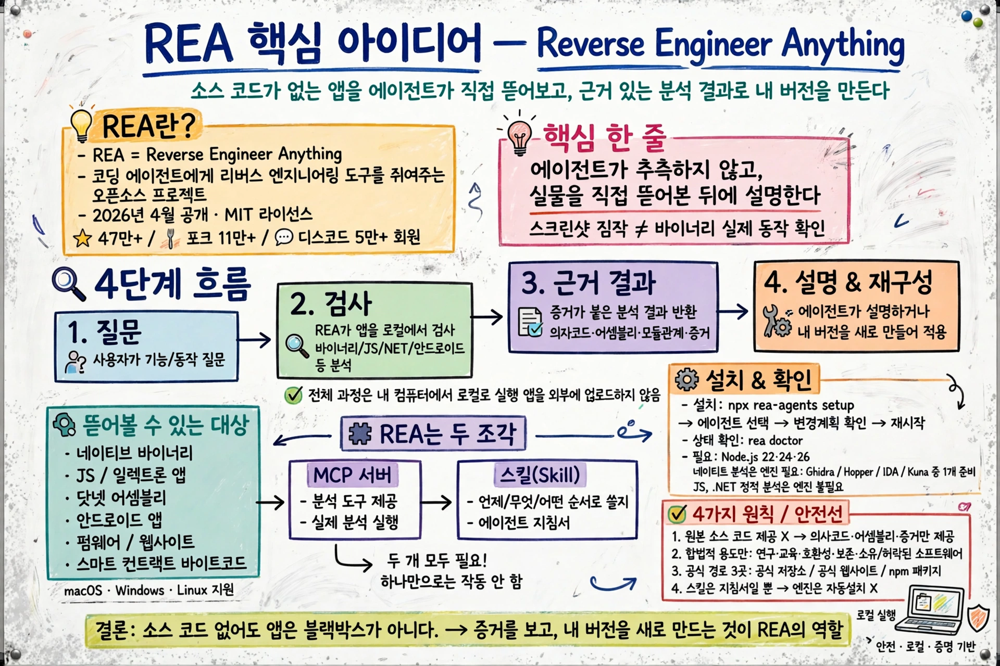
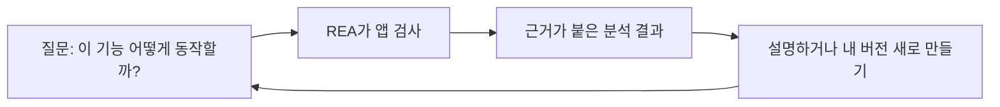
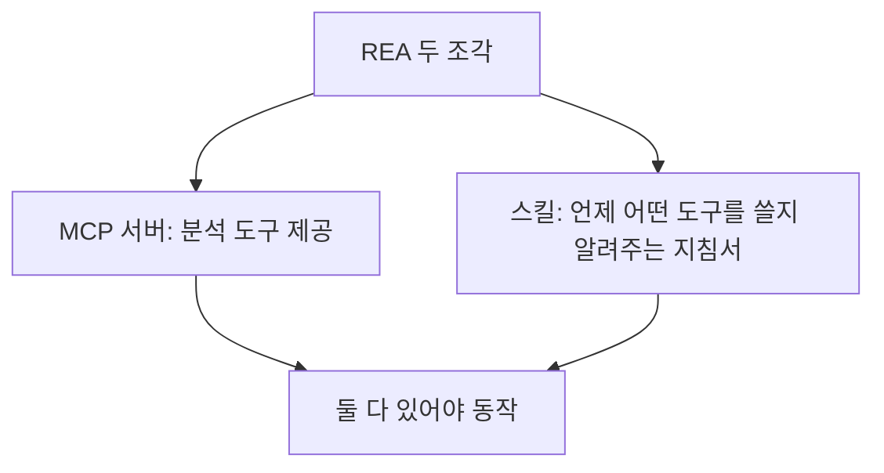
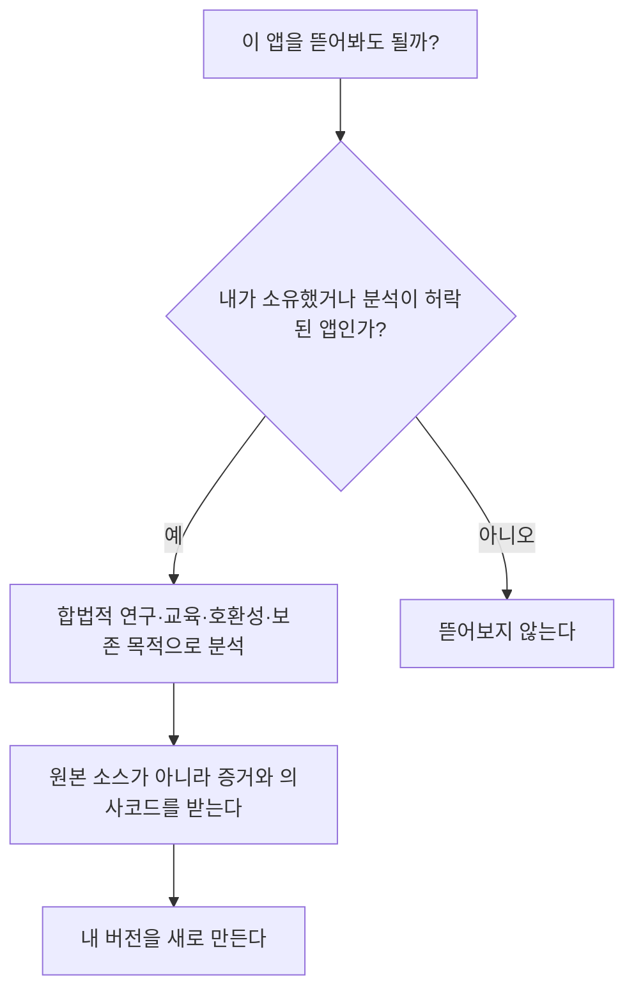

# REA: 소스 코드 없는 앱, 에이전트가 바이너리까지 뜯어봅니다

> **Summary**
> REA는 소스 코드가 없는 앱을 에이전트가 직접 뜯어보게 만드는 오픈소스 도구입니다. 네이티브 바이너리부터 자바스크립트 앱까지 분석은 내 컴퓨터에서 로컬로 돌아가고, MCP 서버와 스킬 두 조각이 함께 있어야 동작합니다. 원본 소스를 돌려주는 게 아니라 증거가 붙은 분석 결과를 주니, 그걸로 내 버전을 새로 만드는 데까지가 이 도구의 자리입니다.

---

- REA는 소스 코드가 없는 앱을 에이전트가 직접 뜯어보게 만드는 도구입니다.
- 네이티브 바이너리부터 자바스크립트 앱까지, 분석은 내 컴퓨터에서 로컬로 돌아갑니다.
- 원본 소스를 돌려주는 게 아니라, 증거가 붙은 분석 결과를 줍니다. 그걸로 내 버전을 새로 만듭니다.

앱 하나를 쓰다 보면 이런 순간이 있습니다. 마음에 드는 기능이 하나 있는데, 어떻게 만든 건지 도저히 감이 안 잡힐 때 말이죠. 화면은 보이는데 소스 코드는 없습니다. 이럴 때 어떻게 할까요?

🎥 [동영상 보기](https://www.youtube.com/watch?v=CjIfL4s7G5c)

참고로, 원문 게시글은 로그인 벽 뒤에 있어 전문을 직접 읽지 못했습니다. 이 글은 주제와 날짜에 맞는 공식 저장소 문서와 스킬 문서를 직접 읽어 재구성했습니다.

## REA가 뭘까요?

REA는 `Reverse Engineer Anything`의 줄임말입니다. 코딩 에이전트에게 리버스 엔지니어링 도구를 쥐여주는 오픈소스 프로젝트입니다. 2026년 4월에 공개됐고, MIT 라이선스입니다. 확인 시점에 별이 47만 개를 넘었고, 포크는 11만 개가 넘었습니다. 커뮤니티 디스코드 회원은 5만 명이 넘습니다!

핵심은 한 줄입니다. 에이전트가 추측하지 않고, 실물을 직접 뜯어본 뒤에 설명합니다. 스크린샷만 보고 "이렇게 만들었겠지"라고 짐작하는 것과, 바이너리 안에서 실제 동작을 확인하는 것은 전혀 다른 일입니다.

## 어떻게 돌아갈까요?

흐름은 네 단계입니다. 에이전트가 질문을 받으면, REA가 앱을 검사하고, 근거가 붙은 결과를 돌려주고, 에이전트가 그걸로 설명하거나 내 버전을 만듭니다.

분석은 내 컴퓨터에서 로컬로 돌아갑니다. 앱을 어딘가에 업로드하지 않습니다. 다만 분석 결과를 받은 에이전트의 모델 제공자는 각자 데이터 정책을 따릅니다. 이 점은 알고 써야 합니다.

## 무엇을 뜯어볼 수 있을까요?

뜯어볼 수 있는 대상이 넓습니다. 네이티브 바이너리, 자바스크립트·일렉트론 앱, 닷넷 어셈블리, 안드로이드 앱, 펌웨어, 웹사이트, 스마트 컨트랙트 바이트코드까지 봅니다. macOS·Windows·Linux에서 돌아갑니다.

## 설치, 두 조각을 헷갈리면 안 됩니다

REA는 두 조각입니다. MCP 서버와 스킬입니다. 이 둘을 헷갈리면 설치가 안 된 줄 알고 헤맵니다.

MCP 서버가 분석 도구를 제공합니다. 스킬은 에이전트에게 언제, 어떤 도구를, 어떤 순서로 쓸지 알려주는 지침서입니다. 스킬만 깔았다고 서버가 연결되는 게 아닙니다. 반대로 서버만 등록했다고 스킬이 생기는 것도 아닙니다.

설치는 한 줄입니다. `npx rea-agents setup`을 치고, 에이전트를 고르고, 변경 계획을 확인한 뒤 에이전트를 다시 시작합니다. 상태 확인은 `rea doctor`로 합니다. `Node.js` 22·24·26 버전이 필요합니다.

네이티브 분석에는 엔진이 따로 필요합니다. `Ghidra`·`Hopper`·`IDA`·`Kuna` 중 하나를 직접 준비합니다. 자바스크립트와 닷넷 정적 분석은 엔진 없이 됩니다. 설치 과정이 `Node.js`나 `Ghidra`를 대신 깔아주지 않으니, 없는 건 직접 준비해야 합니다.

## 실제 사례, 숫자로 확인하면?

공식 사례 세 가지가 눈에 띕니다. 오래된 게임 `DX-Ball`의 사운드-팬 계산을 x86 명령어에서 복원했고, 원본 x86 케이스 3,205개와 컴파일된 함수 바이트 63개 전부에 대해 검증했습니다. 메모 앱의 일렉트론 클립보드 다리는 렌더러에서 프리로드, 프로세스 간 통신을 거쳐 메인 프로세스까지 추적했습니다. PC-98 게임의 탄환 링 각도 계산도 16비트 명령어에서 복원했습니다.

이 사례들이 보여주는 건 하나입니다. REA는 "그럴듯한 설명"을 만드는 도구가 아니라, 검증 가능한 증거를 만드는 도구입니다!

## 한계와 선, 꼭 짚고 넘어가야 합니다

강력한 도구일수록 선이 분명해야 합니다. 네 가지를 짚겠습니다.

첫째, REA는 원본 소스 코드를 돌려주지 않습니다. 돌려주는 건 의사코드와 어셈블리, 모듈 관계, 증거입니다. "원본을 그대로 복원한다"는 말은 과장입니다!

둘째, 합법적인 용도로만 씁니다. 합법적 연구·교육·호환성·소프트웨어 보존, 그리고 내가 소유했거나 분석이 허락된 소프트웨어가 대상입니다.

셋째, 가짜 복사본이 돕니다. 공식 경로는 세 곳뿐입니다. 공식 저장소, 공식 웹사이트, npm 패키지입니다. 공식 실행 파일은 따로 없습니다. 다른 곳에서 받은 실행 파일은 악성코드일 수 있습니다!

넷째, 스킬은 지침서일 뿐입니다. 분석 엔진까지 자동으로 깔아주지 않습니다. 소스 코드가 있는 저장소를 읽는 데는 REA를 쓰지 않는 게 맞습니다. REA는 이미 배포된 결과물과 실행 중 동작을 볼 때 쓰는 도구입니다.

소스 코드가 없다고 해서 앱이 블랙박스인 건 아닙니다. 에이전트에게 제대로 된 도구를 쥐여주면, 앱은 설명 가능한 대상이 됩니다. 다만 도구가 강력할수록 선이 분명해야 합니다. 증거를 보고, 내 버전을 새로 만드는 데까지가 이 도구의 자리입니다.

