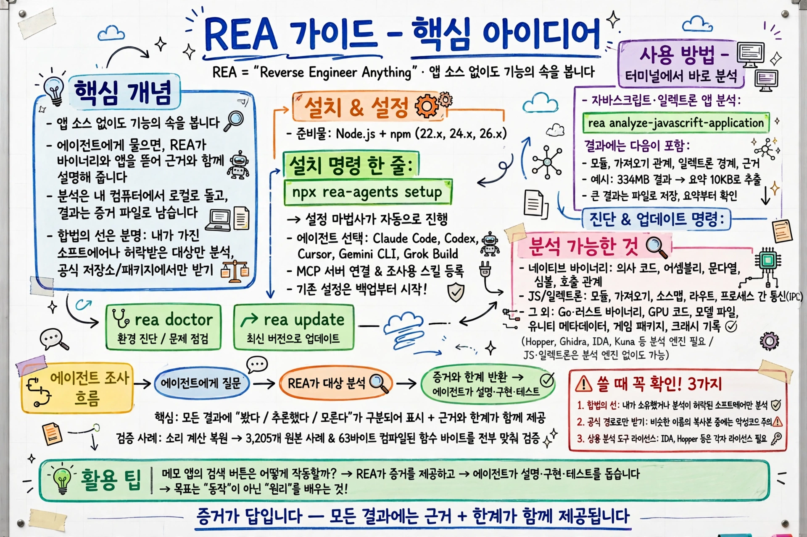
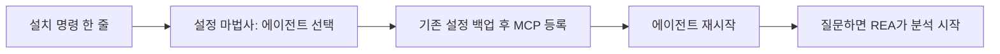
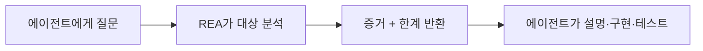

# REA: 앱 소스 없이 기능의 속을 봅니다. 설치 한 줄이면 에이전트가 증거까지 가져옵니다

> **Summary**
> REA는 소스 코드 없이도 바이너리와 앱을 로컬에서 분석해 기능의 동작과 근거를 확인하고, 에이전트가 설명·구현·테스트에 활용하도록 돕습니다. 설치와 설정이 간편하지만, 소유했거나 분석 허가를 받은 소프트웨어만 공식 경로에서 받아 사용하고 관련 라이선스와 약관을 확인해야 합니다.

---

- 앱 소스 없이도 기능의 속을 봅니다. 에이전트에게 물으면, REA가 바이너리와 앱을 뜯어 근거와 함께 설명해 줍니다.
- 설치는 명령어 한 줄, 설정은 마법사가 대신합니다. 분석은 내 컴퓨터에서 로컬로 돌고, 결과는 증거 파일로 남습니다.
- 단, 합법의 선은 분명합니다. 내가 가진 소프트웨어나 허락받은 대상만 분석하고, 공식 저장소와 패키지에서만 받아야 합니다.


좋아하는 앱에 기능 하나가 있습니다. 이거, 내 제품에도 넣고 싶은데 어떻게 만들었는지 도통 감이 안 오죠? 소스 코드는 없고, 겉보기엔 버튼 하나뿐입니다. 이럴 때 에이전트에게 "이 기능이 어떻게 돌아가는지 알아봐 줘"라고 시키면, REA가 앱 속을 직접 읽어 옵니다!

🎥 [동영상 보기](https://www.youtube.com/watch?v=CjIfL4s7G5c)

## 설치는 한 줄, 설정은 마법사가 맡습니다

먼저 준비물은 `Node.js`와 `npm`입니다. 버전은 22.x, 24.x, 26.x 계열을 씁니다. 준비가 됐으면 설치 명령 한 줄을 실행합니다.

```bash
npx rea-agents setup
```

설정 마법사가 어떤 에이전트를 쓰는지 묻고, REA의 MCP 서버 연결과 조사용 스킬을 등록해 줍니다. 기존 설정은 백업부터 하고 바꾸니, 잘못 건드릴 걱정은 덜해도 됩니다. 끝나면 에이전트를 다시 시작합니다. 지원하는 에이전트는 `Claude Code`, `Codex`, `Cursor`, `Gemini CLI`, `Grok Build` 등이고, MCP를 지원하는 다른 클라이언트는 수동 등록도 됩니다.

설치가 잘 됐는지 확인하고 싶으세요? 진단 명령이 있습니다.

```bash
npx -y rea-agents@latest doctor --client claude_code --json
```

자주 쓰는 분은 전역 설치가 편합니다. 전역으로 설치하면 `rea` 명령을 바로 쓸 수 있고, 업데이트도 `rea update` 한 줄로 끝납니다.

```bash
npm install --global rea-agents
rea --help
```

## 터미널에서 바로 분석하는 법은?

에이전트를 거치지 않고 터미널에서 직접 분석할 수도 있습니다. 자바스크립트·일렉트론 앱은 이렇게 봅니다.

```bash
npx -y rea-agents@latest analyze-javascript-application /absolute/path/to/app --json
```

결과에는 모듈, 가져오기 관계, 일렉트론 경계와 그 근거가 들어 있습니다. 경로만 바꾸면 내 앱이 됩니다. 그런데 결과 파일이 수백 MB까지 커질 수 있습니다. 실제 앱 하나를 분석한 증거 파일이 334MB였는데, 요약 보기로 뽑으니 10KB 남짓이 됐다고 합니다. 큰 결과는 파일로 저장해 두고, 요약·모듈 페이지·한 모듈씩 나눠 보는 게 순서입니다.

```bash
rea analyze-javascript-application /absolute/path/to/app --json > app-evidence.json
rea inspect-analysis-view app-view.json
```



## 무엇을 읽어주나요?

REA가 다루는 대상은 생각보다 넓습니다. 네이티브 바이너리, 자바스크립트·일렉트론 앱, `.NET` 어셈블리, 웹사이트, 안드로이드 앱, 아이폰 앱, 펌웨어, 녹화한 실행·네트워크 활동까지 봅니다. 대상별로 돌려주는 것도 다릅니다.

- **네이티브 바이너리**: 의사 코드, 어셈블리, 문자열, 심볼, 호출 관계를 돌려줍니다. `Hopper`, `Ghidra`, `IDA`, `Kuna` 같은 분석 엔진 중 하나가 필요합니다. 이미 설치된 엔진을 쓰고, `Hopper`는 설정 때 승인하면 설치까지 해줍니다.
- **자바스크립트·일렉트론 앱**: 모듈, 가져오기, 소스 맵, 라우트, 프로세스 간 통신, 네이티브 애드온을 봅니다. 분석 엔진 없이도 됩니다.
- **그 외**: Go·러스트 바이너리, GPU 코드, 모델 파일, 유니티 메타데이터, 게임 패키지, 윈도우 바로가기, 크래시 기록까지 내장 검사로 봅니다. 설치가 필요 없는 대상이 꽤 많습니다!
분석은 전부 로컬에서 돕니다. 앱을 서버에 올리지 않습니다. 다만 에이전트의 모델 제공자 쪽 데이터 정책은 별개라는 점, 알고 계셔야 합니다.

## 에이전트는 어떻게 조사하나요?

흐름은 단순합니다. 에이전트가 질문을 받으면 REA에 분석을 맡기고, REA는 도구를 돌려 코드와 참조, 모르는 부분을 함께 돌려줍니다. 에이전트는 그 근거로 동작을 설명하고, 구현을 만들고, 테스트까지 돌립니다. CLI도 같은 워크플로를 씁니다.



## 증거가 답입니다. 정말 그럴까요?

REA의 가장 큰 특징은 결론만 내놓지 않는다는 점입니다. 모든 결과에 근거와 한계가 붙습니다. "봤다", "추론했다", "모른다"가 구분돼서 나옵니다. 그래서 재현 사례가 꽤 설득력이 있습니다.

- **옛 게임의 소리 계산**: 16비트 게임의 탄막 각도 계산을 복원해, 재현한 C++ 코드가 옛 컴파일러 결과와 맞는지 비교했습니다.
- **메모 앱 클립보드 다리**: 렌더러의 클립보드 API가 프리로드와 프로세스 간 통신을 거쳐 메인 프로세스로 가는 길을 따라갔습니다.
- **공 던지기 게임의 소리**: 위치를 좌우 소리 균형으로 바꾸는 계산을 x86 명령에서 복원해, 3,205개 원본 사례와 63바이트의 컴파일된 함수 바이트를 전부 맞춰 검증했습니다.
숫자가 말해 주지 않나요? "된다"는 말이 아니라, 무엇으로 확인했는지가 같이 옵니다!

## 쓸 때 꼭 확인할 세 가지

첫째, **합법의 선**입니다. REA는 합법적인 연구, 교육, 호환성, 소프트웨어 보존, 내가 소유했거나 분석이 허락된 소프트웨어를 위한 도구입니다. 앱의 이용 약관이 디컴파일을 금지하면, 그 약관부터 확인해야 합니다. 남의 코드를 베껴 파는 일은 이 도구의 용도가 아닙니다.

둘째, **공식 경로로만 받습니다.** 저장소 이름이 비슷한 복사본이 돌았고, 그중에는 악성코드를 심은 것도 있었습니다. 공식 저장소와 공식 패키지, 공식 웹사이트에서만 받으세요. 실행 파일 형태의 배포본은 없습니다. 의심스러우면 받지 않는 게 맞습니다.

셋째, **상용 분석 도구는 라이선스가 따로**입니다. `IDA`, `Hopper` 같은 상용 도구는 각자 라이선스가 필요하고, REA가 라이선스를 주는 게 아닙니다. 체험판도 판매사 약관을 따릅니다.

## 그래서, 이걸로 뭘 하면 좋을까요?

연습 삼아 작은 앱 하나를 골라보세요. 자주 쓰는 메모 앱의 검색 기능, "이 버튼을 누르면 무슨 일이 생기나" 같은 질문이면 충분합니다. REA가 증거를 가져오고, 에이전트가 설명해 주고, 그걸 바탕으로 내 버전을 만들어 봅니다. 동작이 아니라 원리를 배우는 게 목표입니다. P330에서 다룬 개념 소개와 달리, 이 글은 설치부터 터미널 실전까지 직접 손으로 해보는 순서에 집중했습니다. 다음에 궁금한 기능이 보이면, 겉만 보지 말고 속을 물어보세요. 증거가 같이 옵니다!

