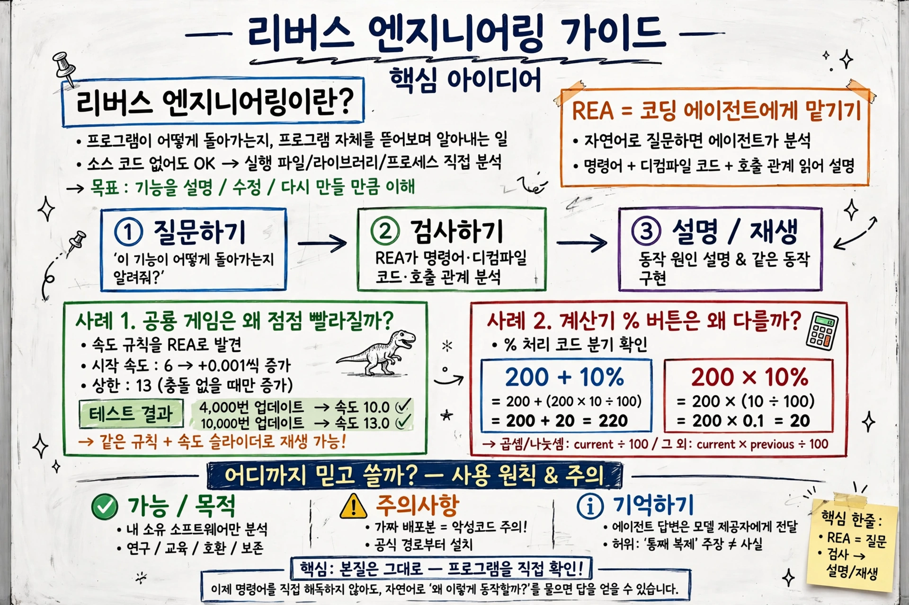
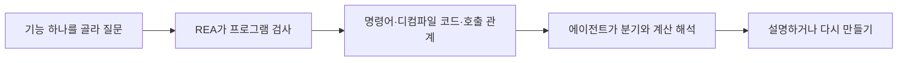
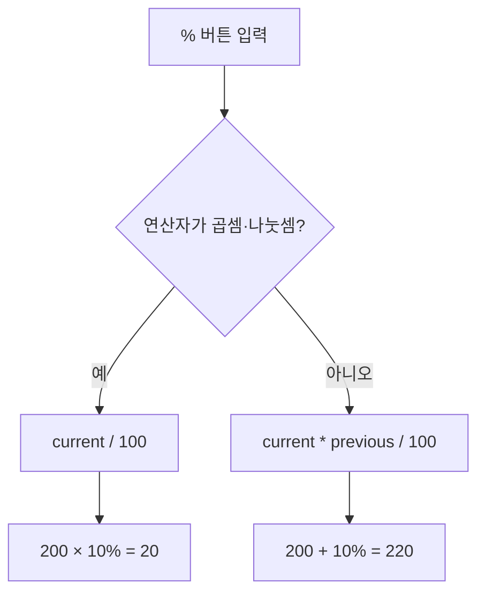

# REA: 프로그램 속을 뜯어보지 않아도 됩니다. 에이전트에게 물으면 답이 옵니다

> **Summary**
> 리버스 엔지니어링은 프로그램이 어떻게 돌아가는지, 프로그램 자체를 뜯어보며 알아내는 일입니다. REA는 이 일을 코딩 에이전트에게 맡기는 도구입니다. 자연어로 물으면 에이전트가 명령어와 디컴파일 코드, 호출 관계를 읽어 분기와 계산 방식을 설명하고, 다시 만드는 방법까지 해석합니다. 공룡 게임의 가속 규칙과 계산기 % 버튼의 분기를 복원한 사례가 그 방식을 증명하며, 분석은 내가 소유했거나 살펴봐도 되는 소프트웨어에만 쓰는 것이 원칙입니다.

---

- 리버스 엔지니어링은 프로그램이 어떻게 돌아가는지, 프로그램 자체를 뜯어보며 알아내는 일입니다.
- REA는 이 일을 코딩 에이전트에게 맡깁니다. 자연어로 물으면 명령어와 디컴파일 코드, 호출 관계를 읽어 설명합니다.
- 공룡 게임의 가속 규칙과 계산기 % 버튼의 분기를 복원한 사례가, 그 방식을 증명합니다.

계산기를 켜고 `200 + 10%`를 눌러본 적 있으시죠? 답은 220이 나옵니다. 그런데 `200 × 10%`를 누르면 20이 나옵니다. 같은 % 버튼인데, 왜 답이 이렇게 다를까요?

🎥 [동영상 보기](https://www.youtube.com/watch?v=tfpaGcR_IpU)

## 리버스 엔지니어링, 도대체 뭘까요?

리버스 엔지니어링은 설명서를 읽는 일이 아닙니다. 프로그램 자체를 검사해, 어떻게 돌아가는지 알아내는 일입니다. 소스 코드가 없어도 됩니다. 실행 파일과 라이브러리, 실행 중인 프로세스를 직접 들여다봅니다. 목표는 분명합니다. 기능을 설명하거나, 바꾸거나, 다시 만들 수 있을 만큼 이해하는 것입니다.

예전에는 이 일이 전문가의 전유물이었습니다. 명령어를 한 줄씩 해독하고, 호출을 따라가고, 계산 과정을 복원해야 했습니다. 시간도 오래 걸렸고, 진입 장벽도 높았습니다. 그런데 이제 질문의 형태가 바뀌었습니다. 이 버튼이 왜 이렇게 동작하는지 물으면, 에이전트가 답을 찾아옵니다!

## 에이전트에게 물으면 뭐가 달라질까요?

REA는 코딩 에이전트에게 리버스 엔지니어링 도구를 건네는 연결 장치입니다. 에이전트가 이미 쓰는 환경에 MCP 서버로 붙고, 터미널에서는 CLI로도 쓸 수 있습니다. 분석은 내 컴퓨터 안에서 일어납니다. 에이전트는 명령어와 디컴파일 코드, 호출 관계를 REA에서 받아오고, 어떤 분기가 적용되는지, 무엇을 계산하는지, 어떻게 다시 만들지 해석합니다.

흐름은 세 단계로 단순합니다. 질문하고, 검사하고, 설명하거나 다시 만드는 것입니다. 질문은 하나만 던지면 됩니다. "이 기능이 어떻게 돌아가는지 알려줘."라고요.

## 공룡은 왜 점점 빨라질까요?

브라우저 공룡 게임, 아시죠? 뛰다 보면 점점 빨라집니다. 이유는 속도 규칙 속에 있었습니다. REA는 실행 중인 게임 스크립트를 로컬 디버깅 연결로 읽어, 속도 규칙을 그대로 찾아냈습니다. 시작 속도는 6, 한 번 업데이트할 때마다 0.001씩 오르고, 상한은 13입니다. 충돌 없이 업데이트할 때만 오릅니다.

숫자로도 확인했습니다. 장애물과 자동 실행을 끈 상태에서 업데이트 함수를 4,000번 부르자 속도는 10.0이 됐고, 10,000번 부르자 13.0에 닿았습니다. 규칙을 알았으니, 이제 다시 만드는 일은 간단해집니다. 같은 가속 규칙에 속도 조절 슬라이더만 붙인 작은 게임을 만들면 됩니다. 원본의 동작은 그대로, 내 손으로 조절하는 재미는 새로 얻는 것입니다.

## 계산기 % 버튼은 왜 덧셈과 곱셈이 다를까요?

계산기 이야기로 돌아가 보겠습니다. REA는 설치된 계산기 앱의 라이브러리에서 % 버튼 처리 코드를 찾아냈습니다. 핸들러는 연산자를 먼저 검사합니다. 곱셈이나 나눗셈이면 `current / 100`을 쓰고, 그 외에는 `current * previous / 100`을 씁니다. 그래서 `200 + 10%`는 200의 10%인 20을 더해 220이 되고, `200 × 10%`는 0.1을 곱해 20이 됩니다. 실제 명령어는 연산자 값을 두 상수와 비교해 분기하고, 상수 100을 씁니다.

이 복원 결과는 공개된 계산기 소스의 백분율 구현과 대조해 확인했습니다. 검사는 REA 4.1.0과 계산기 11.2508.4.0 버전으로 수행했습니다. 추측이 아니라, 코드와 테스트 사례로 검증한 답입니다!

## 어디까지 믿고 써야 할까요?

사례는 두 개만이 아닙니다. 1996년 벽돌 깨기 게임에서는 소리가 좌우로 갈리는 계산식을 복원했고, 다시 만든 코드는 원본과 3,205개 테스트를 모두 통과했습니다. 컴파일된 함수 63바이트가 원본과 똑같이 나왔습니다. 분석 대상도 넓습니다. 네이티브 실행 파일과 라이브러리, 자바스크립트와 일렉트론 앱, 브라우저와 프로세스 활동까지 아우릅니다.

그런데 화제에는 과장도 섞여 있습니다. 공개 열흘 남짓 만에 별이 25만 개를 넘겼다는 이야기가 돌았고, 유명 앱을 통째로 복제했다는 주장도 있었습니다. 하지만 통째로 복제했다는 주장은 사실이 아닙니다. 별도의 프로젝트였고, 만든 쪽도 원본 앱을 뜯지 않았다고 밝혔습니다. 가짜 배포본이 악성코드를 퍼뜨린 사례도 있었습니다. 공식 경로로 받는 것이 먼저입니다!

그리고 선이 있습니다. 분석은 내가 소유했거나 살펴봐도 되는 소프트웨어에만 씁니다. 연구와 교육, 호환성과 보존이 REA가 밝힌 쓰임새입니다. 분석 자체는 내 컴퓨터 안에서 일어나지만, 에이전트의 답변은 쓰는 모델 제공자에게 전달된다는 점도 기억하면 좋습니다.

리버스 엔지니어링의 본질은 바뀌지 않았습니다. 프로그램이 어떻게 돌아가는지, 직접 확인하는 일입니다. 달라진 것은 질문하는 방법입니다. 이제는 명령어를 해독하지 않아도, 왜 이렇게 동작하는지 물을 수 있습니다. 답은 코드 속에 있고, 확인하는 길도 함께 열려 있습니다!

