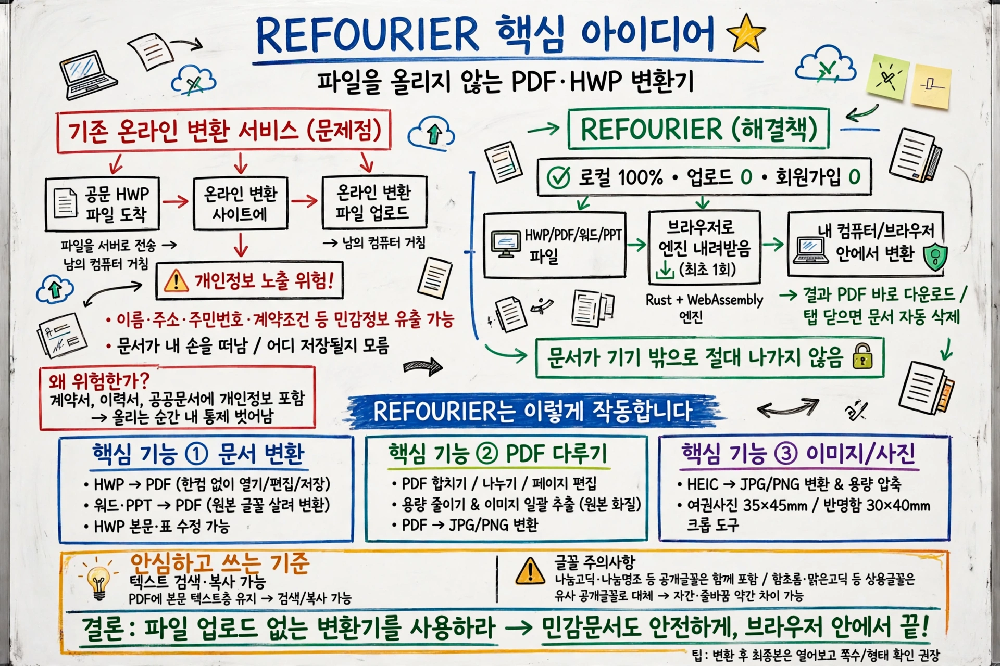
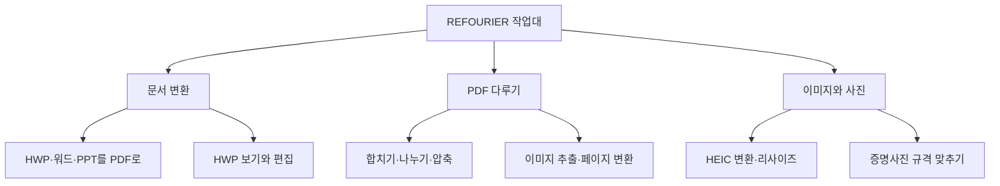

# REFOURIER: 파일을 올리지 않고 PDF·HWP를 바꿉니다. 변환은 내 브라우저 안에서 끝납니다

> **Summary**
> REFOURIER는 파일을 서버에 올리지 않고 브라우저 안에서 PDF·HWP를 변환하는 도구로, 설치도 회원가입도 필요 없습니다. HWP는 한컴 없이 열어 보고 고치고 PDF로 바꾸고, 워드·PPT는 원본 글꼴을 살려 PDF로 만들며, PDF 합치기·나누기·이미지 추출까지 한 자리에서 됩니다. 변환 엔진이 내 컴퓨터 안에서 돌아가기 때문에 계약서나 이력서처럼 남에게 보이기 꺼려지는 문서도 안심하고 쓸 수 있습니다.

---

- REFOURIER는 파일을 서버에 올리지 않고 브라우저 안에서 PDF·HWP를 변환하는 도구입니다. 설치도, 회원가입도 필요 없습니다.
- HWP는 한컴 없이 열어 보고 고치고 PDF로 바꾸고, 워드·PPT는 원본 글꼴을 살려 PDF로 만듭니다. PDF 합치기·나누기·이미지 추출까지 한 자리에서 됩니다.
- 변환 엔진이 내 컴퓨터 안에서 돌아가기 때문에 계약서나 이력서처럼 남에게 보이기 꺼려지는 문서도 안심하고 쓸 수 있습니다.

공문 양식이 HWP 파일로 도착했습니다. 제출처는 PDF를 달라고 합니다. 한컴오피스는 이 컴퓨터에 없습니다. 이런 적 있으시죠?

보통은 온라인 변환 사이트를 찾게 됩니다. 파일을 올리고, 변환이 끝나기를 기다리고, 결과를 내려받습니다. 그런데 그 파일, 어디를 거쳤을까요? 대부분의 변환 사이트는 파일을 서버로 올립니다. 서버에서 변환한 뒤 결과를 돌려줍니다. 문서 내용이 남의 컴퓨터를 한 번 거치는 셈입니다!

🎥 [동영상 보기](https://www.youtube.com/watch?v=6s9mk_AnA0k)

## 왜 파일을 올리면 안 될까요?

HWP 파일은 한국에서 유독 자주 오갑니다. 공공기관 양식, 회사 보고서, 이력서가 HWP로 도착하는데 제출처는 PDF를 요구합니다. 문제는 그 문서 안에 무엇이 들어 있느냐입니다. 이름, 주소, 주민등록번호, 계약 조건이 들어간 문서를 변환 사이트에 올리는 일, 괜찮을까요?

파일을 올리는 순간, 그 문서는 내 손을 떠납니다. 변환이 끝나고 삭제해 준다고 해도, 그 약속을 확인할 방법은 없습니다. 그래서 이 글의 결론은 단순합니다. **파일을 올리지 않는 변환기를 쓰면 됩니다!**

## 변환은 어떻게 내 컴퓨터 안에서 끝날까요?

REFOURIER의 숫자는 세 가지입니다. 로컬 처리 100%, 업로드 0, 회원가입 0입니다. 설치도 없습니다. 브라우저만 있으면 됩니다.

원리는 방향을 뒤집는 것입니다. 파일을 엔진이 있는 서버로 보내는 대신, 엔진을 내 브라우저로 내려받습니다. Rust로 만든 변환 엔진이 WebAssembly로 브라우저 안에서 직접 PDF를 그립니다. 파싱도, 변환도, 글꼴 임베드도 전부 내 기기 안에서 일어납니다. 문서가 기기를 떠나지 않습니다!

이 구조라서 처음 한 번만 엔진을 내려받으면 됩니다. 그 뒤로는 변환이 오프라인에 가깝게 돌아갑니다. 탭을 닫으면 문서는 사라집니다. 서버에 남길 복사본 자체가 없습니다.

## HWP만 바꾸는 게 아닙니다. 뭐가 더 될까요?

REFOURIER는 변환만 하는 도구가 아닙니다. 16가지 포맷을 다루는 작업대입니다. 크게 세 갈래로 나뉩니다.

**첫째, 문서 변환입니다.** HWP를 PDF로 바꾸고, 워드와 파워포인트도 원본 글꼴을 살려 PDF로 만듭니다. HWP는 한컴 없이 열어 보고, 본문과 표를 고쳐서 저장할 수도 있습니다. 뷰어와 편집기가 함께 있습니다.

**둘째, PDF 다루기입니다.** PDF를 합치고, 나누고, 페이지를 편집합니다. 용량을 줄이고, 문서 속 이미지를 원본 화질로 일괄 추출합니다. PDF를 JPG나 PNG 이미지로 바꾸는 일도 됩니다.

**셋째, 이미지와 사진입니다.** 아이폰 사진 HEIC를 JPG나 PNG로 바꾸고, 사진 용량을 줄이고, 크기를 맞춥니다. 여권사진 35×45mm와 반명함 30×40mm 규격에 맞추는 크롭 도구까지 있습니다. 제출용 사진을 만들 때 따로 프로그램을 켤 필요가 없습니다.

## 어디까지 믿고 쓰면 될까요?

좋은 도구도 한계는 알아야 합니다. 변환한 PDF에서 글자가 검색되고 복사되는 점은 확인됐습니다. 본문 텍스트층이 유지되기 때문입니다. 다만 글꼴에는 주의할 점이 있습니다.

변환기는 나눔고딕·나눔명조 같은 공개 글꼴을 PDF에 함께 담습니다. 그래서 어디서 열어도 글자가 유지됩니다. 그런데 함초롬이나 맑은고딕 같은 상용 글꼴은 비슷한 공개 글꼴로 대체됩니다. 자간과 줄바꿈이 미세하게 다를 수 있습니다. 제출용 최종본이라면, 변환한 PDF를 한 번 열어보고 쪽수와 모양을 확인하는 것이 순서입니다!

그리고 이 글의 범위를 분명히 해두겠습니다. 이 글은 **업로드 없는 PDF·HWP 변환**에 집중합니다. 브라우저 PDF 편집기나 파일 도구 모음을 넓게 다루는 글과는 각도가 다릅니다. 변환이 목적이면 변환에 집중하는 도구가 맞습니다. 편집이 목적이면 편집 도구를 고르면 됩니다. 무엇을 하려는지에 따라 도구를 고르는 것이 순서입니다!

파일을 올리지 않는다는 원칙 하나가, 변환 도구를 고르는 기준을 바꿉니다. 다음에 HWP 파일이 도착하면, 올리기 전에 한 번 물어보세요. 이 파일, 내 컴퓨터 안에서 끝낼 수 있을까요?

